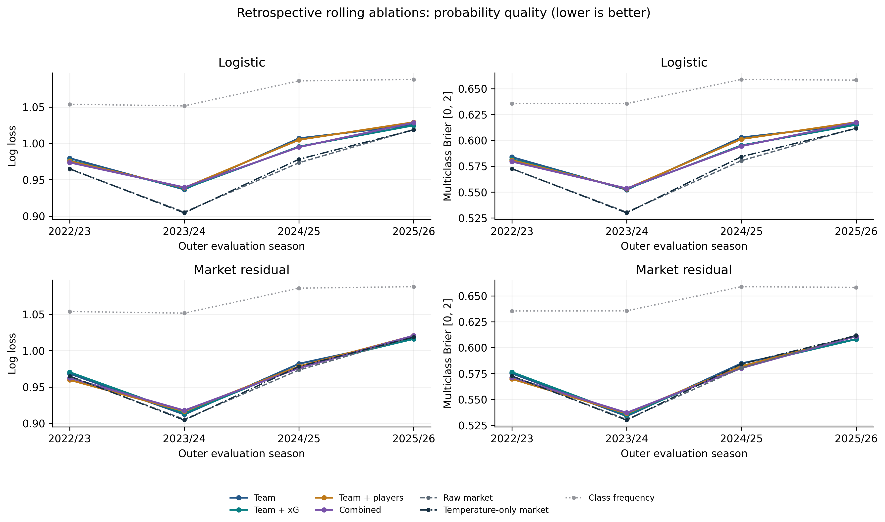
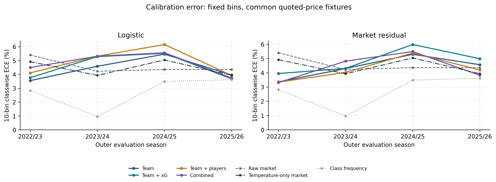
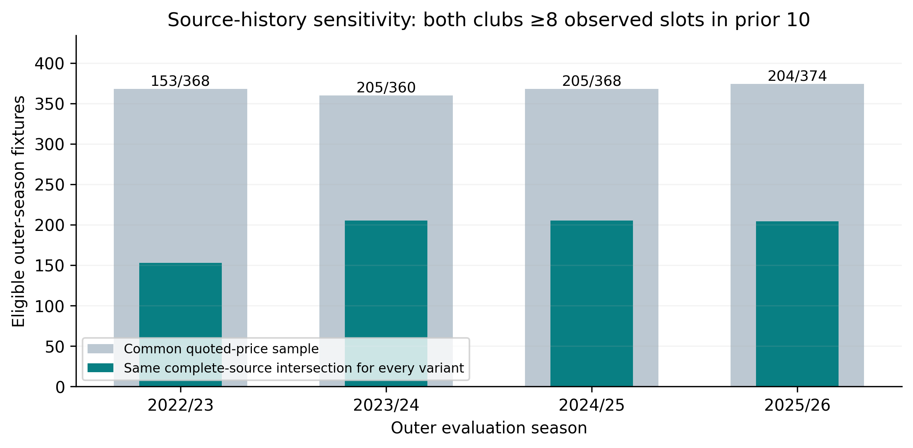
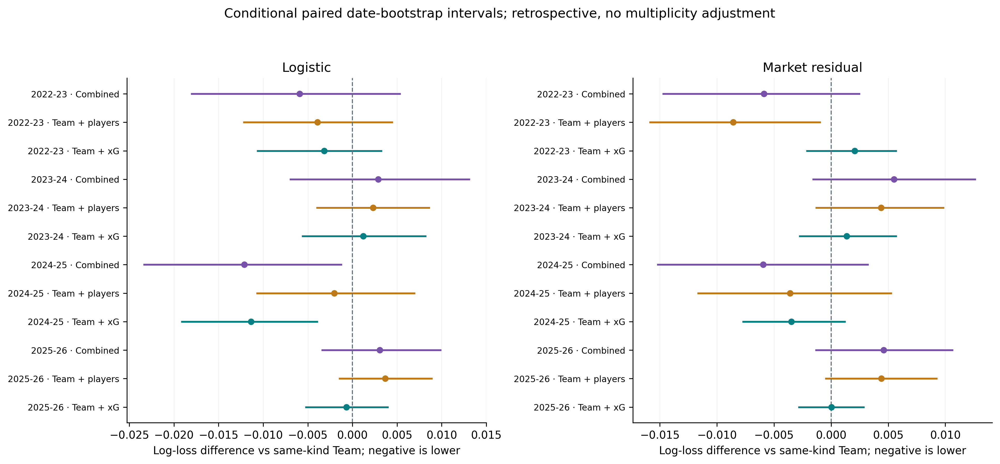
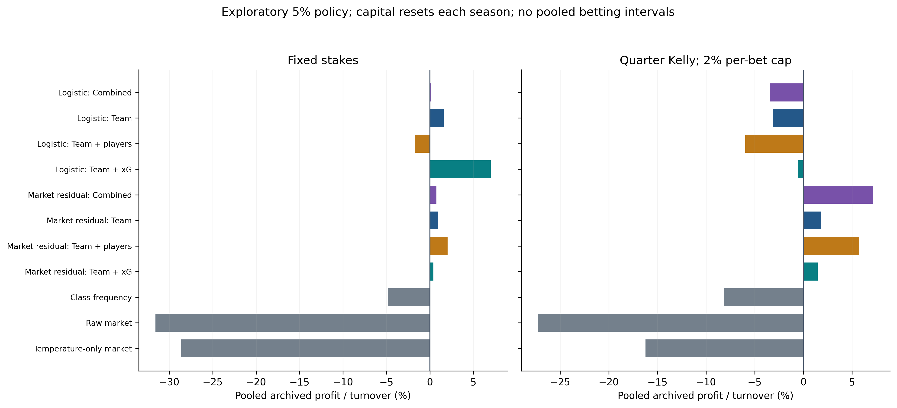

# EPL rolling source-feature ablations

Run date: 2026-10-13. Saved data snapshot: 2026-10-06.

**Exploratory retrospective study. The first experiment already inspected 2025/26 outcomes; there is no new untouched confirmatory holdout here.** No prospective predictions, live profitability or executable arbitrage are claimed.

## Numerical findings

- The retrospective evaluation covers 4 outer seasons (2022-23, 2023-24, 2024-25, 2025-26). All variants use the same eligible quoted-price fixtures in each season.
- The lowest observed pooled log loss is **0.9662** for **Raw market** over 1,470 matches. This is a descriptive ranking of already inspected history, not a newly selected production model or a fresh holdout result.
- Within Logistic, pooled log-loss changes versus Team are Team + xG **-0.0035**; Team + players **+0.0000**; Combined **-0.0030**. Negative means lower loss. All groups also share source-coverage controls.
- Within Market residual, pooled log-loss changes versus Team are Team + xG **-0.0000**; Team + players **-0.0009**; Combined **-0.0004**. Negative means lower loss. All groups also share source-coverage controls.
- The lowest-loss residual variant changes pooled log loss by **+0.0022** versus the temperature-only market baseline. This comparison helps separate added historical features from improvement attributable solely to recalibrating bookmaker probabilities.
- Of 2 pooled player-versus-team conditional log-loss intervals, 2 include zero and 0 lie entirely below zero. These exploratory intervals are not adjusted for multiple comparisons and omit fitting/selection uncertainty.
- Across fixed-stake variants, pooled archived profit/turnover ranges from **-31.59% to +7.01%**. Capital resets in each outer season; these are descriptive combinations of separate replays, not a continuous investment track record.
- **Betting ROI uncertainty was not estimated in this run.** Empty interval columns do not mean precise returns or zero uncertainty. Positive historical point estimates cannot establish a reliable betting edge.

## Pooled probability quality on common fixtures

| variant | n_matches | accuracy | classwise_ece_10 | log_loss | brier_score |
| --- | --- | --- | --- | --- | --- |
| Raw market | 1470 | 0.5442 | 0.0177 | 0.9662 | 0.5743 |
| Temperature-only market | 1470 | 0.5442 | 0.0197 | 0.9671 | 0.5750 |
| Market residual: Team + players | 1470 | 0.5415 | 0.0216 | 0.9693 | 0.5751 |
| Market residual: Combined | 1470 | 0.5422 | 0.0203 | 0.9697 | 0.5752 |
| Market residual: Team + xG | 1470 | 0.5422 | 0.0309 | 0.9701 | 0.5758 |
| Market residual: Team | 1470 | 0.5408 | 0.0226 | 0.9701 | 0.5758 |
| Logistic: Team + xG | 1470 | 0.5333 | 0.0255 | 0.9841 | 0.5866 |
| Logistic: Combined | 1470 | 0.5313 | 0.0301 | 0.9845 | 0.5865 |
| Logistic: Team | 1470 | 0.5293 | 0.0217 | 0.9876 | 0.5889 |
| Logistic: Team + players | 1470 | 0.5252 | 0.0275 | 0.9876 | 0.5885 |
| Class frequency | 1470 | 0.4429 | 0.0153 | 1.0700 | 0.6471 |

Pooled log loss, Brier, accuracy and ECE are computed on all saved outer-season predictions. ECE is not averaged across seasonal ECE estimates. Lower proper losses are better; constant forecasts can have low ECE with little resolution. Raw-market, held-out-temperature-only market, and fixed training-frequency baselines are retained.





## Same-history sensitivity

Every variant shares the same complete-history intersection: both clubs have at least eight observed xG slots and eight FPL slots in their ten strictly earlier E0 games, with nonmissing fixed numeric performance inputs. Coverage flags/counts themselves need not equal ten. The all-common-fixture analysis retains missing histories with training-fitted preprocessing. This sensitivity restricts evaluation of the same fitted predictions; it does not refit.

| variant | n_matches | accuracy | classwise_ece_10 | log_loss | brier_score |
| --- | --- | --- | --- | --- | --- |
| Market residual: Combined | 767 | 0.4980 | 0.0265 | 1.0118 | 0.6042 |
| Market residual: Team + xG | 767 | 0.5059 | 0.0305 | 1.0121 | 0.6047 |
| Market residual: Team + players | 767 | 0.5020 | 0.0284 | 1.0126 | 0.6045 |
| Raw market | 767 | 0.5072 | 0.0356 | 1.0127 | 0.6056 |
| Market residual: Team | 767 | 0.5059 | 0.0284 | 1.0137 | 0.6055 |
| Temperature-only market | 767 | 0.5072 | 0.0324 | 1.0169 | 0.6083 |
| Logistic: Team + xG | 767 | 0.4928 | 0.0394 | 1.0285 | 0.6178 |
| Logistic: Combined | 767 | 0.4902 | 0.0408 | 1.0289 | 0.6177 |
| Logistic: Team + players | 767 | 0.4824 | 0.0413 | 1.0326 | 0.6199 |
| Logistic: Team | 767 | 0.4915 | 0.0436 | 1.0329 | 0.6204 |
| Class frequency | 767 | 0.4589 | 0.0209 | 1.0658 | 0.6436 |



## Paired comparisons

| model_type | feature_group | reference_group | reference_model_type | metric | difference | ci_lower | ci_upper | n_matches |
| --- | --- | --- | --- | --- | --- | --- | --- | --- |
| logistic | team | market_only | baseline | log_loss | 0.0214 | 0.0107 | 0.0333 | 1470 |
| logistic | team | market_only | baseline | brier_score | 0.0146 | 0.0073 | 0.0219 | 1470 |
| logistic | team | market_only | baseline | accuracy | -0.0150 | -0.0294 | -0.0006 | 1470 |
| market_residual | team | market_only | baseline | log_loss | 0.0040 | -0.0031 | 0.0114 | 1470 |
| market_residual | team | market_only | baseline | brier_score | 0.0016 | -0.0030 | 0.0058 | 1470 |
| market_residual | team | market_only | baseline | accuracy | -0.0034 | -0.0155 | 0.0094 | 1470 |
| market_residual | team | market_only | market_temperature | log_loss | 0.0031 | -0.0040 | 0.0103 | 1470 |
| market_residual | team | market_only | market_temperature | brier_score | 0.0008 | -0.0033 | 0.0050 | 1470 |
| market_residual | team | market_only | market_temperature | accuracy | -0.0034 | -0.0155 | 0.0094 | 1470 |
| logistic | team_xg | market_only | baseline | log_loss | 0.0179 | 0.0077 | 0.0290 | 1470 |
| logistic | team_xg | market_only | baseline | brier_score | 0.0123 | 0.0055 | 0.0191 | 1470 |
| logistic | team_xg | market_only | baseline | accuracy | -0.0109 | -0.0255 | 0.0043 | 1470 |
| logistic | team_xg | team | logistic | log_loss | -0.0035 | -0.0066 | -0.0003 | 1470 |
| logistic | team_xg | team | logistic | brier_score | -0.0023 | -0.0043 | -0.0002 | 1470 |
| logistic | team_xg | team | logistic | accuracy | 0.0041 | -0.0041 | 0.0127 | 1470 |
| market_residual | team_xg | market_only | baseline | log_loss | 0.0040 | -0.0033 | 0.0114 | 1470 |
| market_residual | team_xg | market_only | baseline | brier_score | 0.0015 | -0.0028 | 0.0058 | 1470 |
| market_residual | team_xg | market_only | baseline | accuracy | -0.0020 | -0.0137 | 0.0098 | 1470 |
| market_residual | team_xg | team | market_residual | log_loss | -0.0000 | -0.0019 | 0.0018 | 1470 |
| market_residual | team_xg | team | market_residual | brier_score | -0.0001 | -0.0013 | 0.0012 | 1470 |
| market_residual | team_xg | team | market_residual | accuracy | 0.0014 | -0.0043 | 0.0075 | 1470 |
| market_residual | team_xg | market_only | market_temperature | log_loss | 0.0031 | -0.0041 | 0.0103 | 1470 |
| market_residual | team_xg | market_only | market_temperature | brier_score | 0.0008 | -0.0034 | 0.0049 | 1470 |
| market_residual | team_xg | market_only | market_temperature | accuracy | -0.0020 | -0.0137 | 0.0098 | 1470 |
| logistic | team_player | market_only | baseline | log_loss | 0.0214 | 0.0109 | 0.0323 | 1470 |
| logistic | team_player | market_only | baseline | brier_score | 0.0143 | 0.0072 | 0.0214 | 1470 |
| logistic | team_player | market_only | baseline | accuracy | -0.0190 | -0.0350 | -0.0029 | 1470 |
| logistic | team_player | team | logistic | log_loss | 0.0000 | -0.0039 | 0.0036 | 1470 |
| logistic | team_player | team | logistic | brier_score | -0.0003 | -0.0028 | 0.0020 | 1470 |
| logistic | team_player | team | logistic | accuracy | -0.0041 | -0.0132 | 0.0049 | 1470 |
| market_residual | team_player | market_only | baseline | log_loss | 0.0031 | -0.0043 | 0.0110 | 1470 |
| market_residual | team_player | market_only | baseline | brier_score | 0.0008 | -0.0038 | 0.0057 | 1470 |
| market_residual | team_player | market_only | baseline | accuracy | -0.0027 | -0.0153 | 0.0098 | 1470 |
| market_residual | team_player | team | market_residual | log_loss | -0.0009 | -0.0044 | 0.0027 | 1470 |
| market_residual | team_player | team | market_residual | brier_score | -0.0007 | -0.0030 | 0.0016 | 1470 |
| market_residual | team_player | team | market_residual | accuracy | 0.0007 | -0.0063 | 0.0080 | 1470 |
| market_residual | team_player | market_only | market_temperature | log_loss | 0.0022 | -0.0050 | 0.0097 | 1470 |
| market_residual | team_player | market_only | market_temperature | brier_score | 0.0001 | -0.0044 | 0.0049 | 1470 |
| market_residual | team_player | market_only | market_temperature | accuracy | -0.0027 | -0.0153 | 0.0098 | 1470 |
| logistic | combined | market_only | baseline | log_loss | 0.0184 | 0.0086 | 0.0289 | 1470 |
| logistic | combined | market_only | baseline | brier_score | 0.0122 | 0.0055 | 0.0192 | 1470 |
| logistic | combined | market_only | baseline | accuracy | -0.0129 | -0.0275 | 0.0034 | 1470 |
| logistic | combined | team | logistic | log_loss | -0.0030 | -0.0081 | 0.0018 | 1470 |
| logistic | combined | team | logistic | brier_score | -0.0024 | -0.0057 | 0.0009 | 1470 |
| logistic | combined | team | logistic | accuracy | 0.0020 | -0.0073 | 0.0121 | 1470 |
| market_residual | combined | market_only | baseline | log_loss | 0.0035 | -0.0040 | 0.0116 | 1470 |
| market_residual | combined | market_only | baseline | brier_score | 0.0010 | -0.0036 | 0.0058 | 1470 |
| market_residual | combined | market_only | baseline | accuracy | -0.0020 | -0.0146 | 0.0111 | 1470 |
| market_residual | combined | team | market_residual | log_loss | -0.0004 | -0.0043 | 0.0035 | 1470 |
| market_residual | combined | team | market_residual | brier_score | -0.0006 | -0.0031 | 0.0020 | 1470 |
| market_residual | combined | team | market_residual | accuracy | 0.0014 | -0.0077 | 0.0105 | 1470 |
| market_residual | combined | market_only | market_temperature | log_loss | 0.0026 | -0.0046 | 0.0107 | 1470 |
| market_residual | combined | market_only | market_temperature | brier_score | 0.0003 | -0.0043 | 0.0052 | 1470 |
| market_residual | combined | market_only | market_temperature | accuracy | -0.0020 | -0.0146 | 0.0111 | 1470 |
| market_temperature | market_only | market_only | baseline | log_loss | 0.0009 | -0.0015 | 0.0034 | 1470 |
| market_temperature | market_only | market_only | baseline | brier_score | 0.0007 | -0.0008 | 0.0023 | 1470 |
| market_temperature | market_only | market_only | baseline | accuracy | 0.0000 | 0.0000 | 0.0000 | 1470 |
| baseline | class_frequency | market_only | baseline | log_loss | 0.1038 | 0.0832 | 0.1234 | 1470 |
| baseline | class_frequency | market_only | baseline | brier_score | 0.0729 | 0.0576 | 0.0865 | 1470 |
| baseline | class_frequency | market_only | baseline | accuracy | -0.1014 | -0.1254 | -0.0742 | 1470 |

Differences are candidate minus reference: negative is lower log loss/Brier, positive is higher accuracy. Conditional intervals resample whole calendar dates within season; pooled comparisons are season-stratified. They omit model-fitting/calibration/tuning uncertainty and broader cross-date dependence, and are not corrected for multiple comparisons. ECE values are point-score comparisons unless an explicitly estimated interval is supplied; blank intervals are not zero uncertainty.

Recorded paired-interval settings: ci_level: 0.95; n_bootstrap: 1000; bootstrap_unit: whole_match_date_stratified_by_outer_season.



## Fixed exploratory betting summaries

All policies use a fixed 5% estimated-return threshold, best individual-book preclosing prices, and at most one outcome per match. Fixed stake is 10 with initial capital 1,000; quarter Kelly is capped at 2% per bet, with same-date commitments allocated before settlement. There is no new tuned-threshold stage in this study. ROI means profit/turnover, not growth on initial capital.

| variant | staking | outer_seasons | bet_count | profit | turnover | roi |
| --- | --- | --- | --- | --- | --- | --- |
| Logistic: Team | fixed | 4 | 1241 | 197.9000 | 12410.0000 | 0.0159 |
| Logistic: Team | kelly | 4 | 1241 | -544.3205 | 17405.1907 | -0.0313 |
| Market residual: Team | fixed | 4 | 1048 | 95.3000 | 10480.0000 | 0.0091 |
| Market residual: Team | kelly | 4 | 1048 | 250.0709 | 13587.5023 | 0.0184 |
| Logistic: Team + xG | fixed | 4 | 1236 | 866.3000 | 12360.0000 | 0.0701 |
| Logistic: Team + xG | kelly | 4 | 1236 | -109.7503 | 18605.8483 | -0.0059 |
| Market residual: Team + xG | fixed | 4 | 1098 | 46.6000 | 10980.0000 | 0.0042 |
| Market residual: Team + xG | kelly | 4 | 1098 | 216.8007 | 14835.1491 | 0.0146 |
| Logistic: Team + players | fixed | 4 | 1274 | -220.6000 | 12740.0000 | -0.0173 |
| Logistic: Team + players | kelly | 4 | 1274 | -1027.8385 | 17212.3096 | -0.0597 |
| Market residual: Team + players | fixed | 4 | 1147 | 233.4000 | 11470.0000 | 0.0203 |
| Market residual: Team + players | kelly | 4 | 1147 | 965.1439 | 16820.9455 | 0.0574 |
| Logistic: Combined | fixed | 4 | 1285 | 17.8000 | 12850.0000 | 0.0014 |
| Logistic: Combined | kelly | 4 | 1285 | -621.5347 | 17911.6557 | -0.0347 |
| Market residual: Combined | fixed | 4 | 1186 | 90.3000 | 11860.0000 | 0.0076 |
| Market residual: Combined | kelly | 4 | 1186 | 1285.6337 | 17870.6169 | 0.0719 |
| Raw market | fixed | 4 | 263 | -830.7000 | 2630.0000 | -0.3159 |
| Raw market | kelly | 4 | 263 | -258.2123 | 946.9745 | -0.2727 |
| Temperature-only market | fixed | 4 | 216 | -618.1000 | 2160.0000 | -0.2862 |
| Temperature-only market | kelly | 4 | 216 | -297.9701 | 1837.1016 | -0.1622 |
| Class frequency | fixed | 4 | 1447 | -702.4000 | 14470.0000 | -0.0485 |
| Class frequency | kelly | 4 | 1447 | -1745.7105 | 21477.8129 | -0.0813 |

The table adds profit and turnover from separate season replays, each with reset capital; it is not a continuous bankroll path. No pooled betting confidence interval is manufactured by averaging fold endpoints. When bootstrap intervals were not computed, those columns remain unavailable and no precision is inferred.



## Chronology, source controls and limits

| outer_season | role | seasons | n_matches | date_min | date_max | complete_history_matches |
| --- | --- | --- | --- | --- | --- | --- |
| 2022-23 | train | 2016-17,2017-18,2018-19,2019-20 | 1264 | 2016-08-13 00:00:00 | 2020-07-26 00:00:00 | 358 |
| 2022-23 | tune | 2020-21 | 338 | 2020-09-12 00:00:00 | 2021-05-23 00:00:00 | 107 |
| 2022-23 | calibration | 2021-22 | 338 | 2021-08-13 00:00:00 | 2022-05-22 00:00:00 | 129 |
| 2022-23 | evaluation | 2022-23 | 368 | 2022-08-05 00:00:00 | 2023-05-28 00:00:00 | 153 |
| 2023-24 | train | 2016-17,2017-18,2018-19,2019-20,2020-21 | 1602 | 2016-08-13 00:00:00 | 2021-05-23 00:00:00 | 465 |
| 2023-24 | tune | 2021-22 | 338 | 2021-08-13 00:00:00 | 2022-05-22 00:00:00 | 129 |
| 2023-24 | calibration | 2022-23 | 368 | 2022-08-05 00:00:00 | 2023-05-28 00:00:00 | 153 |
| 2023-24 | evaluation | 2023-24 | 360 | 2023-08-11 00:00:00 | 2024-05-19 00:00:00 | 205 |
| 2024-25 | train | 2016-17,2017-18,2018-19,2019-20,2020-21,2021-22 | 1940 | 2016-08-13 00:00:00 | 2022-05-22 00:00:00 | 594 |
| 2024-25 | tune | 2022-23 | 368 | 2022-08-05 00:00:00 | 2023-05-28 00:00:00 | 153 |
| 2024-25 | calibration | 2023-24 | 360 | 2023-08-11 00:00:00 | 2024-05-19 00:00:00 | 205 |
| 2024-25 | evaluation | 2024-25 | 368 | 2024-08-16 00:00:00 | 2025-05-25 00:00:00 | 205 |
| 2025-26 | train | 2016-17,2017-18,2018-19,2019-20,2020-21,2021-22,2022-23 | 2308 | 2016-08-13 00:00:00 | 2023-05-28 00:00:00 | 747 |
| 2025-26 | tune | 2023-24 | 360 | 2023-08-11 00:00:00 | 2024-05-19 00:00:00 | 205 |
| 2025-26 | calibration | 2024-25 | 368 | 2024-08-16 00:00:00 | 2025-05-25 00:00:00 | 205 |
| 2025-26 | evaluation | 2025-26 | 374 | 2025-08-15 00:00:00 | 2026-05-24 00:00:00 | 204 |

The rolling roles train/tune/calibrate strictly before each outer season. Already inspected outer history remains retrospective research even with this correct chronological fitting order. All performance groups share source-availability controls, so Team is not independent of xG/FPL coverage metadata. The ablations isolate additional performance inputs conditional on those shared controls, rather than removing all source information.

Full raw E0 histories support both clubs' basic match statistics. Expanded source reconciliation and observed-count controls do not prove a historically available starting XI, injury list or squad. Lagged FPL contributions describe prior player/team performance; source definitions, fantasy scoring and archived xG model versions can change. Original publication times and quote clocks remain unverified. A feature earlier than kickoff is not necessarily earlier than an archived preclosing price.

Targets are fixtures involving at least one of the twenty 2026/27 clubs, so current-club survivor bias remains. The first experiment's artifacts are retained separately. The data snapshot is frozen historical material, not a live feed. Fees, stake limits, price simultaneity and execution are unverified; even positive historical returns or conditional intervals cannot establish a currently tradeable advantage.

First-experiment output preservation recorded by the run: **True**.

See `source_reconciliation_summary.json`, `feature_groups.json`, `run_metadata.json`, the full paired table, and tuning/chronological-role tables for audit detail. Numeric findings above are derived from these saved outputs; report generation never retrains or changes a model.

## Inspect and regenerate displays

Open [EPL_feature_ablation.xlsx](EPL_feature_ablation.xlsx) or [the executed notebook](../03_epl_feature_ablation.ipynb). Figures are supplied as PNG and vector SVG. The workbook has eight review sheets; full source JSON and fixture-level predictions remain separate.

From the project root, rebuild displays without retraining:

```powershell
python -c "from pathlib import Path; from epl_modeling.ablation_reporting import build_ablation_report; build_ablation_report(Path('epl_modeling/ablation_results'))"
```
