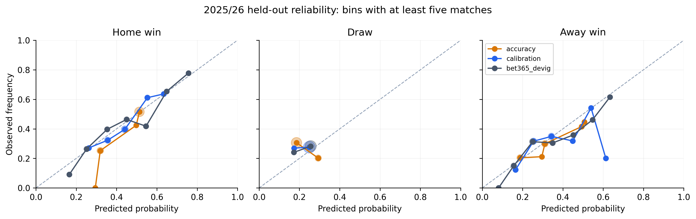
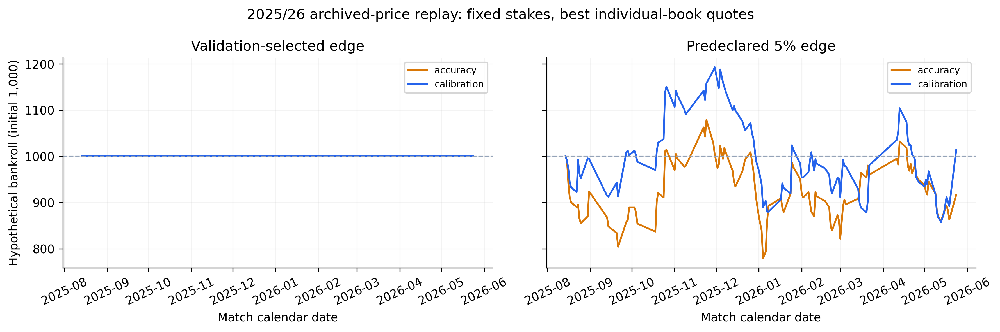

# EPL first experiment: accuracy versus calibration

Run date: October 13, 2026. Data snapshot: October 6, 2026. This is the first completed research run, with a small predefined search budget.

The experiment trains logistic regression, random forest, SVM and MLP models under two separate selection objectives. The accuracy branch selects its final family by 2023/24 accuracy; the calibration branch selects by 2023/24 classwise ECE. Both branches use held-out temperature calibration, and betting thresholds are fixed using 2024/25 only. The 2025/26 test season is scored after those decisions are locked.

**Interpretation:** these are hypothetical archived-price results. Per-quote clocks and historical feature publication times are unavailable, so the run does not establish that every feature and price coexisted at a tradable instant. It does not establish executable arbitrage or live profitability.

## First-run findings

On 374 held-out 2025/26 fixtures, the calibration-selected model's ten-bin classwise ECE is 4.16%, versus 6.20% for the accuracy-selected model. Its accuracy is lower (44.39% versus 48.13%). The bookmaker benchmark has lower log loss (1.0191) than both the calibration branch (1.0564) and accuracy branch (1.0763). The training-frequency baseline has the lowest ECE despite worse proper scores, illustrating why ECE alone cannot establish betting usefulness.

Neither branch found a positive-profit threshold with at least thirty validation bets. Both primary policies therefore hold cash in the test; their zero profit and undefined ROI do not demonstrate a profitable strategy.

Under the separately predeclared 5% edge policy with fixed stakes and best individual-book odds, the calibration branch's ROI is +0.41% (conditional 95% date-bootstrap interval -20.08% to +22.07%), versus -2.25% (-18.83% to +15.45%) for accuracy selection. Both intervals include zero; neither supplies a reliable positive-return finding. The quarter-Kelly versions lose money in this test. These outcomes support further investigation of probability quality and market information, without establishing a tradable advantage.

The selected models use team boxscore features only. Player and xG candidates exist in the feature frame but do not survive this budgeted ranking/selection path. This run does not measure the incremental value of player information; a separate, prospectively specified ablation is still needed. See [feature coverage](../FEATURE_COVERAGE.md) for the early FPL opponent-identity gap.

## Data and chronology

| split | seasons | n_matches | date_min | date_max | H | D | A |
| --- | --- | --- | --- | --- | --- | --- | --- |
| train | 2014-15,2015-16,2016-17,2017-18,2018-19,2019-20,2020-21 | 2250 | 2014-08-16 00:00:00 | 2021-05-23 00:00:00 | 1001 | 524 | 725 |
| tune | 2021-22 | 338 | 2021-08-13 00:00:00 | 2022-05-22 00:00:00 | 146 | 76 | 116 |
| calibration | 2022-23 | 368 | 2022-08-05 00:00:00 | 2023-05-28 00:00:00 | 177 | 86 | 105 |
| model_selection | 2023-24 | 360 | 2023-08-11 00:00:00 | 2024-05-19 00:00:00 | 167 | 77 | 116 |
| strategy_validation | 2024-25 | 368 | 2024-08-16 00:00:00 | 2025-05-25 00:00:00 | 148 | 92 | 128 |
| test | 2025-26 | 374 | 2025-08-15 00:00:00 | 2026-05-24 00:00:00 | 159 | 103 | 112 |
| monitoring | 2026-27 | 50 | 2026-08-21 00:00:00 | 2026-09-20 00:00:00 | 18 | 16 | 16 |

The historical sample includes only fixtures involving at least one of the 20 current 2026/27 clubs. Other opponents are retained, and their historical team features are reconstructed from saved whole-league files. This fixed current-club cohort has survivor bias and is not a full historical-league sample. The partial current season contains only 50 observed completed games through September 20; the October retrieval/run dates do not extend that match coverage.

## Locked model choices

- Accuracy family: `svm`.
- Calibration family: `mlp`.
- TPE budget: 12 seeded trials per family per branch.

Selected features and the full trial/selection audit are saved alongside this report. Candidate feature screening uses training data only: missingness and constant-feature checks, early/late-training KS tests with BH adjustment, a Spearman redundancy filter, and a budgeted greedy forward search using two expanding training-season folds. Those internal scores are optimization diagnostics. No test season is used to choose features, hyperparameters, calibration parameters, families or thresholds.

## Held-out probability quality

| model | n_matches | accuracy | classwise_ece_10 | log_loss | brier_score |
| --- | --- | --- | --- | --- | --- |
| accuracy | 374 | 0.4813 | 0.0620 | 1.0763 | 0.6446 |
| calibration | 374 | 0.4439 | 0.0416 | 1.0564 | 0.6356 |
| bet365_devig | 374 | 0.4866 | 0.0436 | 1.0191 | 0.6120 |
| training_class_frequency | 374 | 0.4251 | 0.0290 | 1.0851 | 0.6566 |

The table uses the same matches covered by complete Bet365 reference triplets for all four predictors. The full-cohort scores are also saved. Lower log loss, Brier and ECE are better; higher accuracy is better. Classwise ECE averages three one-vs-rest ECEs in ten equal-width bins. Five- and fifteen-bin sensitivities are saved. The multiclass Brier score is the mean sum of the three squared probability errors, with range [0,2]. A low ECE can reward nearly constant probabilities, so frequency and market baselines and proper scores must be considered together.



Paired calendar-date bootstrap intervals below describe calibration-minus-accuracy metric differences, conditional on the fitted models. They do not include model-selection or fitting uncertainty, and do not prove performance across other seasons.

| metric | difference_calibration_minus_accuracy | ci_lower | ci_upper | bootstrap_unit | n_bootstrap |
| --- | --- | --- | --- | --- | --- |
| accuracy | -0.0374 | -0.0709 | -0.0027 | match_calendar_date | 1000 |
| classwise_ece_10 | -0.0204 | -0.0437 | 0.0068 | match_calendar_date | 1000 |
| log_loss | -0.0199 | -0.0451 | 0.0058 | match_calendar_date | 1000 |
| brier_score | -0.0090 | -0.0252 | 0.0076 | match_calendar_date | 1000 |

## Validation-selected betting policy

For each branch, thresholds 0%, 2.5%, 5%, 7.5%, 10%, 15% and 20% were examined on 2024/25 only. The selected policy maximizes fixed-stake validation ROI among thresholds with at least 30 bets and positive profit. If none qualifies, the primary policy holds cash. The same locked threshold is then used for both quoted-price modes and both staking rules.

- accuracy: **hold cash** (no_admissible_positive_validation_strategy).
- calibration: **hold cash** (no_admissible_positive_validation_strategy).

| branch | odds_mode | staking | bet_count | profit | roi | roi_ci_low | roi_ci_high | max_drawdown |
| --- | --- | --- | --- | --- | --- | --- | --- | --- |
| accuracy | best_individual_book | fixed | 0 | 0.0000 | — | — | — | 0.0000 |
| accuracy | best_individual_book | kelly | 0 | 0.0000 | — | — | — | 0.0000 |
| accuracy | bet365_reference | fixed | 0 | 0.0000 | — | — | — | 0.0000 |
| accuracy | bet365_reference | kelly | 0 | 0.0000 | — | — | — | 0.0000 |
| calibration | best_individual_book | fixed | 0 | 0.0000 | — | — | — | 0.0000 |
| calibration | best_individual_book | kelly | 0 | 0.0000 | — | — | — | 0.0000 |
| calibration | bet365_reference | fixed | 0 | 0.0000 | — | — | — | 0.0000 |
| calibration | bet365_reference | kelly | 0 | 0.0000 | — | — | — | 0.0000 |

ROI is profit divided by total stakes; it is not return on the initial bankroll. Fixed stake is 10 with initial capital 1,000. Quarter Kelly is capped at 2% of date-start capital per bet. Only one outcome is selected per match. All same-date stakes use the date-start bankroll, and commitments are scaled before any settlement if they exceed available cash. Bootstrap intervals resample whole match dates conditional on the recorded bets; they omit fitting, threshold selection, execution and cross-date dependence uncertainty.

## Predeclared 5% edge comparison

This secondary policy was specified before inspecting the test and is reported even if validation recommends holding cash. It must not be substituted for the primary policy based on which test result looks better.

| branch | odds_mode | staking | bet_count | profit | roi | roi_ci_low | roi_ci_high |
| --- | --- | --- | --- | --- | --- | --- | --- |
| accuracy | best_individual_book | fixed | 371 | -83.3000 | -0.0225 | -0.1883 | 0.1545 |
| accuracy | best_individual_book | kelly | 371 | -377.0496 | -0.0701 | -0.2318 | 0.1192 |
| accuracy | bet365_reference | fixed | 365 | -186.7000 | -0.0512 | -0.2025 | 0.1115 |
| accuracy | bet365_reference | kelly | 365 | -433.1408 | -0.0857 | -0.2364 | 0.0879 |
| calibration | best_individual_book | fixed | 333 | 13.7000 | 0.0041 | -0.2008 | 0.2207 |
| calibration | best_individual_book | kelly | 333 | -153.9145 | -0.0259 | -0.2093 | 0.1772 |
| calibration | bet365_reference | fixed | 314 | -23.5000 | -0.0075 | -0.1946 | 0.1970 |
| calibration | bet365_reference | kelly | 314 | -170.6091 | -0.0309 | -0.2097 | 0.1647 |



## Odds and arbitrage audit

There are 374 test matches with complete individual-book prices and a complete Bet365 reference. The inverse-best-odds sum is below one in 0 archived test matches. All 374 test price rows have missing or incompatible quote clocks. These are mathematical candidate discrepancies, not verified simultaneously available arbitrage. The panel excludes market maxima/averages, exchanges, incomplete or invalid triplets, and unreliable Pinnacle records from July 23, 2025. All outcomes use the same native preclosing snapshot label. Preclosing does not mean a verified opening quote. Line-shopping comparisons can change both the chosen outcome and whether a bet qualifies; they measure entire policy differences, not an isolated causal price effect.

## Corrected literature and practical limits

The proposal cites Walsh and Joshi (2024). Its [2025 corrigendum](https://doi.org/10.1016/j.mlwa.2025.100627) corrects feature-engineering errors and changes the reported average returns to losses for both selection approaches. The original positive-average-profit headline must not motivate a claim that calibration guarantees profit. See [METHODOLOGY.md](../METHODOLOGY.md) for the corrected comparison and this study's explicit adaptations.

Current player values, injuries, squad snapshots and actual target-match lineups do not enter historical predictors. Lagged FPL aggregates describe past team/player contributions; they do not establish the players available before a future match. Historical xG models and archival publication clocks may have changed. The search budget, one held-out season, current-club selection, unsynchronized quotes, unmodeled fees/limits and unverified publication times limit generalization. Any later changes motivated by this test make 2025/26 development data; a new untouched evaluation period would then be needed.

## Reproduce and inspect

```powershell
python -m pip install -r epl_modeling/requirements.txt
python -m unittest discover -s epl_modeling/tests -p 'test_*.py' -v
python -m epl_modeling.experiment --trials 12
```

Open [EPL_modeling_results.xlsx](EPL_modeling_results.xlsx) or the [executed notebook](../02_epl_modeling_results.ipynb). CSV and Parquet tables, fitted model bundles, selected features, trial diagnostics, locked choices and input/code hashes are saved in this directory. Only load joblib models from a trusted source.
