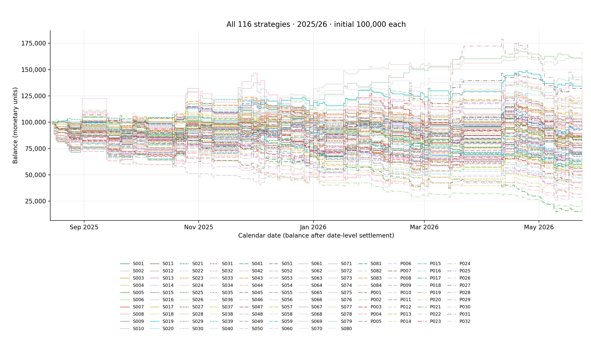
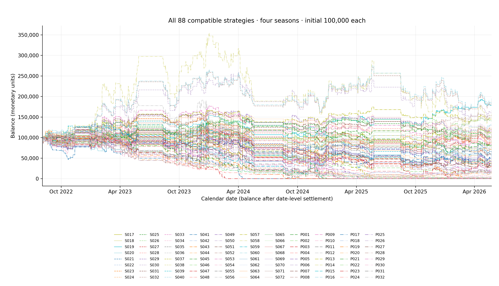
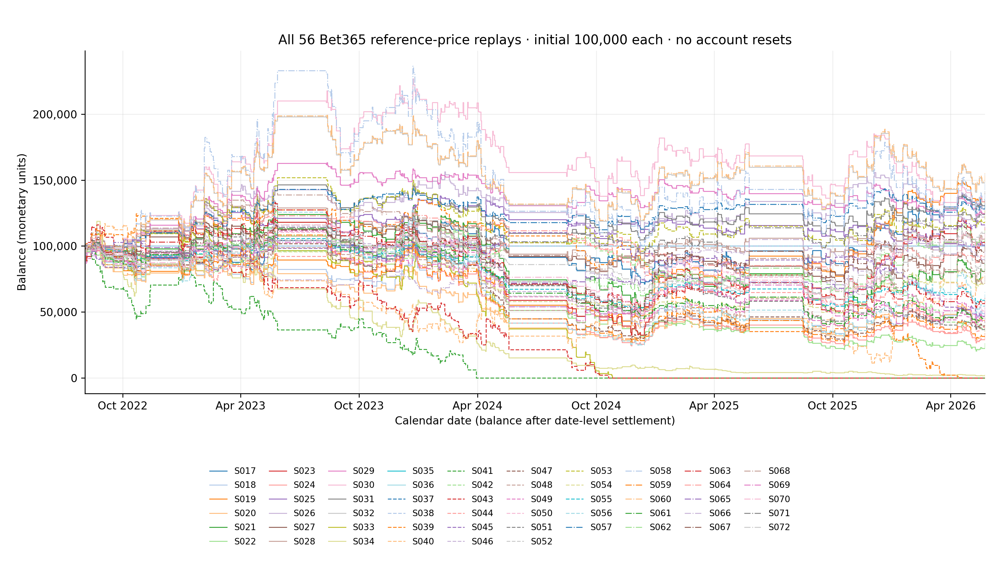

# EPL project: player-focused models and complete strategy comparison

DRAFT FOR REVIEW | 2026-10-20 | EPL component of the statistical-arbitrage final project.

This study tests player-focused predictors directly rather than treating player data only as a small supplement to team statistics. Four declared feature blocks—team control, player form, player squad, and team plus player squad—are each fitted with multinomial logistic regression and histogram gradient boosting. The eight learned alternatives are compared on the same four chronological evaluation seasons, with market and earlier-study benchmarks kept visible.

The new trading comparison adds 32 fully specified rules P001–P032: eight models × two price panels × two sizing rules. All start at 100,000. The full common-2025 graph contains the original 84 plus all 32 new rules on one set of axes; the continuous four-season graph contains all 56 compatible old rules plus the new 32. The final appendix explains every one of the 116 strategies, retaining every original configuration unchanged.

These are new retrospective redesigns of already examined history. Chronological fitting protects each individual fold's information boundary but does not make 2025/26 a fresh holdout or establish a winning strategy. Prediction accuracy is separate from trade hit ratio, and model expected payoffs are conditional claims rather than demonstrated future returns. Newly generated player-model future probabilities are a separate forecast cohort and do not replace the earlier frozen prospective ledger.

Table M1. Exact ordered feature lists and model specifications are in the workbook. Counts precede fitted preprocessing and its missingness indicators.

| Feature block | Declared inputs | Models |
| --- | --- | --- |
| Team control | 19 | Logistic + hist. boosted trees |
| Player form | 96 | Logistic + hist. boosted trees |
| Player squad | 222 | Logistic + hist. boosted trees |
| Team + player squad | 235 | Logistic + hist. boosted trees |

## What the player features observe, and what they cannot know

Player form is computed from past player performance. The richer squad block uses a rule-based projected XI, positional summaries, prior minutes and squad depth derived from strictly earlier observations. The projected XI is a historical selection rule, not the target match's announced lineup or future minutes. Current roster labels, later transfers, target appearances and season-final aggregates cannot supply earlier predictors. Missing or incomplete player history remains visible through the declared coverage fields.

Every fold keeps training, hyperparameter tuning, probability calibration and evaluation chronologically separate. Imputation and scaling are fitted only on the permitted fitting block. Histogram boosting's random internal early stopping is disabled; tuning uses the declared earlier season. The same feature/source identity and calendar rules apply to both model families and every block, so within-family comparisons isolate feature additions more clearly than comparing different algorithms.

The primary test population is the same 1,470 quoted fixtures involving the present-day 2026/27 club cohort: 368 in 2022/23, 360 in 2023/24, 368 in 2024/25 and 374 in 2025/26. This cohort is not the full historical league and retains survivor/selection limitations. Earlier completed matches may update later lagged features; their outcomes cannot update the already frozen model parameters within that evaluation season. No 2026/27 label is used to fit or select these models.

Coverage and role completeness are diagnostics, not performance-based filters. The complete feature frame, per-season coverage, exact fitted parameters and chronology are retained alongside probabilities. Source-specific fantasy definitions and position labels can change across seasons; historical player contributions and projected depth do not verify injuries, availability, transfers or a starting XI known before the target.

When native historical role fields are unavailable, a season-fixed archived element_type supplies a disclosed position proxy. Its original publication clock is unverified. Position-based squad features therefore do not establish a fully timestamp-verified historical lineup feed. The player-form block does not require these role labels.

## Player-history coverage and projected squad completeness

Table M1b. Coverage of the evaluated target-side histories where detailed rows are available. Prior observed fixture slots are not imputed target appearances. Every detailed source record and cutoff remains in the workbook; a complete projected XI is not confirmed player availability.

| season | side | target_sides |
| --- | --- | --- |
| 2016-17 | away | 308 |
| 2016-17 | home | 308 |
| 2017-18 | away | 308 |
| 2017-18 | home | 308 |
| 2018-19 | away | 324 |
| 2018-19 | home | 324 |
| 2019-20 | away | 324 |
| 2019-20 | home | 324 |
| 2020-21 | away | 338 |
| 2020-21 | home | 338 |
| 2021-22 | away | 338 |
| 2021-22 | home | 338 |
| 2022-23 | away | 368 |
| 2022-23 | home | 368 |
| 2023-24 | away | 360 |
| 2023-24 | home | 360 |

The projection uses a fixed 1 goalkeeper, 4 defenders, 4 midfielders and 2 forwards, chosen by strictly prior minutes. It excludes candidates whose known historical transfer evidence contradicts the target club. It does not use the target match's minutes, target lineup or later player membership. Sparse positions remain visibly incomplete rather than acquiring invented players; differences between observed historical roles and future match participation remain a limitation.

## Every model and benchmark on the same quoted fixtures

Table M2. Pooled chronological evaluation. Lower log loss/Brier are better. Accuracy is a classification score, not a betting hit ratio. ECE at 5/10/15 bins is descriptive. Shared fixtures and overlapping predictors make the rows dependent; no model is selected from this table.

| Model | Matches | Accuracy | Log loss | Brier | ECE 5 | ECE 10 | ECE 15 |
| --- | --- | --- | --- | --- | --- | --- | --- |
| Matched team control | Logistic regression | 1,470 | 53.40% | 0.9925 | 0.5922 | 0.0117 | 0.0238 | 0.0343 |
| Matched team control | Histogram gradient boosting | 1,470 | 52.45% | 0.9987 | 0.5950 | 0.0195 | 0.0232 | 0.0316 |
| Player form only | Logistic regression | 1,470 | 50.07% | 1.0218 | 0.6114 | 0.0336 | 0.0345 | 0.0355 |
| Player form only | Histogram gradient boosting | 1,470 | 49.18% | 1.0287 | 0.6151 | 0.0230 | 0.0318 | 0.0386 |
| Player form + projected XI + depth | Logistic regression | 1,470 | 49.52% | 1.0254 | 0.6136 | 0.0312 | 0.0339 | 0.0351 |
| Player form + projected XI + depth | Histogram gradient boosting | 1,470 | 49.93% | 1.0234 | 0.6119 | 0.0249 | 0.0256 | 0.0366 |
| Team + full player block | Logistic regression | 1,470 | 50.95% | 1.0161 | 0.6071 | 0.0377 | 0.0385 | 0.0422 |
| Team + full player block | Histogram gradient boosting | 1,470 | 49.80% | 1.0158 | 0.6061 | 0.0241 | 0.0300 | 0.0382 |
| Raw de-vigged Bet365 market | 1,470 | 54.42% | 0.9662 | 0.5743 | 0.0149 | 0.0177 | 0.0199 |
| Temperature-calibrated market | 1,470 | 54.42% | 0.9671 | 0.5750 | 0.0148 | 0.0197 | 0.0195 |
| Historical fitting-class frequency | 1,470 | 44.29% | 1.0700 | 0.6471 | 0.0153 | 0.0153 | 0.0153 |
| Legacy team logistic with original source controls | 1,470 | 52.93% | 0.9876 | 0.5889 | 0.0113 | 0.0217 | 0.0287 |
| Legacy team + seven FPL aggregates logistic | 1,470 | 52.52% | 0.9876 | 0.5885 | 0.0139 | 0.0275 | 0.0252 |

## Predictive losses through the four evaluation seasons

Table M3. All saved models and benchmarks, in source order. LL=multiclass log loss; Brier is the unscaled three-class squared probability error. Every annual accuracy/calibration score and sample count is in the workbook. A strong pooled score need not persist across years.

| Model | 2022<br>LL | 2023<br>LL | 2024<br>LL | 2025<br>LL | 2022<br>Brier | 2023<br>Brier | 2024<br>Brier | 2025<br>Brier |
| --- | --- | --- | --- | --- | --- | --- | --- | --- |
| Matched team control | Logistic regression | 0.9822 | 0.9341 | 1.0212 | 1.0308 | 0.5848 | 0.5506 | 0.6133 | 0.6189 |
| Matched team control | Histogram gradient boosting | 0.9932 | 0.9406 | 1.0181 | 1.0412 | 0.5895 | 0.5552 | 0.6091 | 0.6248 |
| Player form only | Logistic regression | 0.9984 | 0.9726 | 1.0576 | 1.0571 | 0.5982 | 0.5738 | 0.6352 | 0.6372 |
| Player form only | Histogram gradient boosting | 1.0088 | 0.9923 | 1.0559 | 1.0565 | 0.6030 | 0.5867 | 0.6334 | 0.6364 |
| Player form + projected XI + depth | Logistic regression | 1.0054 | 0.9757 | 1.0609 | 1.0579 | 0.5984 | 0.5775 | 0.6386 | 0.6387 |
| Player form + projected XI + depth | Histogram gradient boosting | 0.9978 | 0.9830 | 1.0558 | 1.0556 | 0.5967 | 0.5812 | 0.6327 | 0.6358 |
| Team + full player block | Logistic regression | 1.0012 | 0.9685 | 1.0441 | 1.0490 | 0.5939 | 0.5747 | 0.6265 | 0.6323 |
| Team + full player block | Histogram gradient boosting | 0.9901 | 0.9678 | 1.0488 | 1.0548 | 0.5899 | 0.5706 | 0.6281 | 0.6347 |
| Raw de-vigged Bet365 market | 0.9646 | 0.9055 | 0.9733 | 1.0191 | 0.5724 | 0.5306 | 0.5804 | 0.6120 |
| Temperature-calibrated market | 0.9650 | 0.9044 | 0.9782 | 1.0185 | 0.5726 | 0.5300 | 0.5842 | 0.6115 |
| Historical fitting-class frequency | 1.0538 | 1.0515 | 1.0859 | 1.0880 | 0.6354 | 0.6355 | 0.6589 | 0.6582 |
| Legacy team logistic with original source controls | 0.9796 | 0.9366 | 1.0069 | 1.0254 | 0.5838 | 0.5523 | 0.6028 | 0.6153 |
| Legacy team + seven FPL aggregates logistic | 0.9757 | 0.9389 | 1.0049 | 1.0291 | 0.5809 | 0.5533 | 0.6013 | 0.6175 |

## Paired log-loss feature comparisons

Table M4. Candidate minus reference on matched fixtures; negative log-loss differences favor the candidate. Whole-date bootstrap intervals are descriptive, condition on the recorded fits and do not adjust for this enlarged search. Every annual and pooled log-loss, Brier and accuracy comparison remains in the workbook.

| Candidate | Reference | Metric | Difference | 95% CI<br>lower | 95% CI<br>upper | Matches |
| --- | --- | --- | --- | --- | --- | --- |
| Player form / Logistic | Team control / Logistic | log_loss | 0.0293 | 0.0151 | 0.0433 | 1,470 |
| Player form / Hist. boosted trees | Team control / Hist. boosted trees | log_loss | 0.0300 | 0.0157 | 0.0458 | 1,470 |
| Player squad / Logistic | Team control / Logistic | log_loss | 0.0328 | 0.0182 | 0.0482 | 1,470 |
| Player squad / Hist. boosted trees | Team control / Hist. boosted trees | log_loss | 0.0247 | 0.0101 | 0.0394 | 1,470 |
| Team + player squad / Logistic | Team control / Logistic | log_loss | 0.0236 | 0.0108 | 0.0360 | 1,470 |
| Team + player squad / Hist. boosted trees | Team control / Hist. boosted trees | log_loss | 0.0171 | 0.0077 | 0.0269 | 1,470 |
| Team control / Logistic | market_only / baseline | log_loss | 0.0264 | 0.0153 | 0.0374 | 1,470 |
| Team control / Hist. boosted trees | market_only / baseline | log_loss | 0.0326 | 0.0209 | 0.0445 | 1,470 |
| Player form / Logistic | market_only / baseline | log_loss | 0.0557 | 0.0406 | 0.0715 | 1,470 |
| Player form / Hist. boosted trees | market_only / baseline | log_loss | 0.0625 | 0.0477 | 0.0758 | 1,470 |
| Player squad / Logistic | market_only / baseline | log_loss | 0.0592 | 0.0434 | 0.0761 | 1,470 |
| Player squad / Hist. boosted trees | market_only / baseline | log_loss | 0.0572 | 0.0429 | 0.0712 | 1,470 |
| Team + player squad / Logistic | market_only / baseline | log_loss | 0.0499 | 0.0339 | 0.0658 | 1,470 |
| Team + player squad / Hist. boosted trees | market_only / baseline | log_loss | 0.0496 | 0.0376 | 0.0611 | 1,470 |

## Every strategy on one common-season money graph

All 116 strategies are visible on the same axes, each as its own 100,000-unit account. Calendar time is horizontal and money is vertical. The one-season comparison shares 374 fixtures; the four-season comparison shares 1,470 fixtures without resets. IDs map to the final complete appendix.



Figure M1. No account balances are added together. Same-date requests are allocated before settlement. The offline HTML embeds all traces and its library, supports hover/legend controls, and initially shows every strategy.

## Every compatible strategy on one continuous money graph

All 88 strategies are visible on the same axes, each as its own 100,000-unit account. Calendar time is horizontal and money is vertical. The one-season comparison shares 374 fixtures; the four-season comparison shares 1,470 fixtures without resets. IDs map to the final complete appendix.



Figure M2. No account balances are added together. Same-date requests are allocated before settlement. The offline HTML embeds all traces and its library, supports hover/legend controls, and initially shows every strategy.

## New strategies: continuous four-season accounts | P001–P032

Table M5. Every new strategy in stable ID order. Frequency=trades/common priced fixtures. Expected gain/loss are model-probability-weighted components at allocated stakes; observed winning/losing means describe realised net payoffs. ROI divides profit by stake turnover; capital return divides by 100,000. All additional payoff, exposure and conditional-interval statistics are in the workbook.

| ID | Trades | Hit<br>% | Trade<br>freq. % | Avg. winning<br>gain | Avg. losing<br>loss | Model expected<br>gain/trade | Model expected<br>loss/trade | ROI on<br>stakes | Return on<br>100,000 | Max.<br>drawdown |
| --- | --- | --- | --- | --- | --- | --- | --- | --- | --- | --- |
| P001 | 1,233 | 28.30% | 83.88% | 2,499.97 | 1,000.00 | 967.19 | 649.99 | −0.93% | −11.51% | 56.59% |
| P002 | 1,233 | 28.30% | 83.88% | 2,038.77 | 897.06 | 887.65 | 562.09 | −7.25% | −81.47% | 87.57% |
| P003 | 1,061 | 27.24% | 72.18% | 2,449.74 | 997.88 | 937.87 | 647.86 | −5.90% | −62.39% | 97.09% |
| P004 | 1,061 | 27.24% | 72.18% | 1,720.84 | 752.36 | 732.54 | 474.29 | −10.24% | −83.50% | 90.92% |
| P005 | 1,306 | 26.88% | 88.84% | 2,584.42 | 1,000.00 | 1,020.18 | 658.72 | −3.67% | −47.87% | 71.89% |
| P006 | 1,306 | 26.88% | 88.84% | 2,147.35 | 873.60 | 923.77 | 560.43 | −6.93% | −80.56% | 86.05% |
| P007 | 1,175 | 26.38% | 79.93% | 2,602.03 | 1,000.00 | 980.06 | 660.68 | −4.97% | −58.37% | 78.13% |
| P008 | 1,175 | 26.38% | 79.93% | 1,937.15 | 788.68 | 803.67 | 504.72 | −8.70% | −81.70% | 85.83% |
| P009 | 944 | 25.00% | 64.22% | 2,509.53 | 977.75 | 1,098.04 | 618.22 | −10.87% | −100.00% | 100.00% |
| P010 | 1,384 | 24.57% | 94.15% | 1,533.07 | 592.18 | 694.24 | 370.03 | −11.72% | −96.99% | 98.07% |
| P011 | 681 | 24.52% | 46.33% | 2,423.78 | 982.05 | 1,087.01 | 621.58 | −14.97% | −100.00% | 100.00% |
| P012 | 1,290 | 24.65% | 87.76% | 1,534.94 | 600.45 | 680.74 | 374.63 | −12.29% | −95.53% | 97.46% |
| P013 | 1,037 | 23.24% | 70.54% | 2,841.03 | 985.79 | 1,187.34 | 642.23 | −9.78% | −100.00% | 100.00% |
| P014 | 1,351 | 23.09% | 91.90% | 2,239.69 | 766.34 | 964.99 | 494.20 | −9.38% | −97.45% | 98.54% |
| P015 | 787 | 23.00% | 53.54% | 2,791.22 | 998.70 | 1,164.21 | 650.00 | −12.72% | −100.00% | 100.00% |
| P016 | 1,276 | 22.49% | 86.80% | 1,761.14 | 610.76 | 731.99 | 391.43 | −12.62% | −98.59% | 99.04% |
| P017 | 1,413 | 25.55% | 96.12% | 2,813.93 | 1,000.00 | 1,185.77 | 639.19 | −2.56% | −36.17% | 79.89% |
| P018 | 1,413 | 25.55% | 96.12% | 2,175.28 | 827.10 | 1,010.85 | 515.19 | −7.21% | −84.83% | 92.40% |
| P019 | 724 | 25.41% | 49.25% | 2,248.53 | 951.35 | 1,079.68 | 591.83 | −14.59% | −100.00% | 100.00% |
| P020 | 1,360 | 25.88% | 92.52% | 1,519.78 | 616.81 | 710.34 | 379.49 | −10.32% | −86.78% | 94.64% |
| P021 | 859 | 23.63% | 58.44% | 2,692.11 | 985.52 | 1,199.16 | 636.22 | −11.82% | −100.00% | 100.00% |
| P022 | 1,370 | 22.19% | 93.20% | 1,763.54 | 596.10 | 769.84 | 384.77 | −12.02% | −99.32% | 99.54% |
| P023 | 543 | 21.92% | 36.94% | 2,707.21 | 995.65 | 1,174.68 | 643.52 | −18.54% | −100.00% | 100.00% |
| P024 | 1,287 | 22.30% | 87.55% | 1,472.17 | 521.70 | 636.21 | 334.41 | −14.67% | −99.19% | 99.44% |
| P025 | 977 | 25.28% | 66.46% | 2,536.69 | 995.29 | 1,115.44 | 631.57 | −10.28% | −100.00% | 100.00% |
| P026 | 1,402 | 26.18% | 95.37% | 1,671.97 | 671.57 | 762.22 | 415.54 | −8.57% | −81.46% | 91.98% |
| P027 | 780 | 25.77% | 53.06% | 2,372.89 | 996.46 | 1,061.25 | 626.04 | −12.86% | −100.00% | 100.00% |
| P028 | 1,328 | 26.58% | 90.34% | 1,368.80 | 581.04 | 628.17 | 356.67 | −10.67% | −83.33% | 95.18% |
| P029 | 888 | 24.10% | 60.41% | 2,662.39 | 993.70 | 1,083.45 | 639.98 | −11.34% | −100.00% | 100.00% |
| P030 | 1,346 | 23.70% | 91.56% | 1,570.82 | 583.86 | 665.10 | 372.88 | −12.32% | −98.53% | 99.04% |
| P031 | 842 | 23.87% | 57.28% | 2,640.02 | 983.84 | 1,026.82 | 633.68 | −12.09% | −100.00% | 100.00% |
| P032 | 1,234 | 24.31% | 83.95% | 1,681.06 | 644.20 | 693.54 | 407.44 | −12.12% | −97.36% | 98.49% |

## New strategies: common 2025/26 accounts | P001–P032

Table M5. Every new strategy in stable ID order. Frequency=trades/common priced fixtures. Expected gain/loss are model-probability-weighted components at allocated stakes; observed winning/losing means describe realised net payoffs. ROI divides profit by stake turnover; capital return divides by 100,000. All additional payoff, exposure and conditional-interval statistics are in the workbook.

| ID | Trades | Hit<br>% | Trade<br>freq. % | Avg. winning<br>gain | Avg. losing<br>loss | Model expected<br>gain/trade | Model expected<br>loss/trade | ROI on<br>stakes | Return on<br>100,000 | Max.<br>drawdown |
| --- | --- | --- | --- | --- | --- | --- | --- | --- | --- | --- |
| P001 | 310 | 24.52% | 82.89% | 2,968.68 | 1,000.00 | 1,059.58 | 702.17 | −2.70% | −8.38% | 32.39% |
| P002 | 310 | 24.52% | 82.89% | 2,928.40 | 1,080.09 | 1,174.18 | 730.93 | −9.21% | −30.18% | 47.39% |
| P003 | 274 | 24.82% | 73.26% | 3,086.76 | 1,000.00 | 1,006.81 | 699.86 | 1.42% | 3.90% | 32.87% |
| P004 | 274 | 24.82% | 73.26% | 3,276.22 | 1,125.35 | 1,175.72 | 767.06 | −2.96% | −9.04% | 42.89% |
| P005 | 318 | 24.21% | 85.03% | 2,878.05 | 1,000.00 | 1,050.63 | 690.45 | −6.10% | −19.39% | 39.47% |
| P006 | 318 | 24.21% | 85.03% | 2,654.61 | 1,059.50 | 1,146.63 | 703.87 | −15.47% | −50.93% | 59.73% |
| P007 | 288 | 25.69% | 77.01% | 2,799.73 | 1,000.00 | 997.49 | 686.05 | −2.37% | −6.82% | 21.97% |
| P008 | 288 | 25.69% | 77.01% | 2,745.73 | 1,140.53 | 1,156.47 | 748.10 | −12.79% | −40.89% | 50.67% |
| P009 | 348 | 24.14% | 93.05% | 2,950.24 | 1,000.00 | 1,122.19 | 678.28 | −4.65% | −16.18% | 39.90% |
| P010 | 348 | 24.14% | 93.05% | 2,645.04 | 1,021.36 | 1,167.70 | 663.00 | −13.78% | −47.46% | 63.88% |
| P011 | 332 | 24.70% | 88.77% | 2,924.51 | 1,000.00 | 1,060.23 | 672.08 | −3.07% | −10.19% | 47.70% |
| P012 | 332 | 24.70% | 88.77% | 2,667.23 | 1,015.18 | 1,101.19 | 655.41 | −10.70% | −35.08% | 59.54% |
| P013 | 323 | 22.29% | 86.36% | 3,048.06 | 1,000.00 | 1,153.99 | 678.16 | −9.76% | −31.54% | 52.37% |
| P014 | 323 | 22.29% | 86.36% | 3,109.09 | 1,128.62 | 1,333.67 | 740.56 | −16.63% | −59.43% | 67.04% |
| P015 | 305 | 22.95% | 81.55% | 2,983.43 | 1,000.00 | 1,077.69 | 675.10 | −8.58% | −26.16% | 42.27% |
| P016 | 305 | 22.95% | 81.55% | 3,188.36 | 1,154.76 | 1,280.96 | 758.63 | −13.86% | −48.18% | 56.67% |
| P017 | 359 | 25.63% | 95.99% | 2,981.74 | 1,000.00 | 1,169.25 | 667.00 | 2.04% | 7.32% | 19.32% |
| P018 | 359 | 25.63% | 95.99% | 4,262.02 | 1,496.15 | 1,780.72 | 980.45 | −1.39% | −7.37% | 35.98% |
| P019 | 349 | 27.79% | 93.32% | 2,923.51 | 1,000.00 | 1,099.10 | 661.60 | 9.05% | 31.58% | 16.10% |
| P020 | 349 | 27.79% | 93.32% | 5,083.37 | 1,790.33 | 2,011.10 | 1,168.39 | 6.77% | 41.92% | 28.29% |
| P021 | 334 | 19.46% | 89.30% | 3,008.00 | 1,000.00 | 1,147.31 | 679.67 | −22.00% | −73.48% | 85.81% |
| P022 | 334 | 19.46% | 89.30% | 2,639.83 | 918.54 | 1,117.92 | 612.44 | −24.87% | −75.50% | 82.21% |
| P023 | 309 | 22.01% | 82.62% | 2,962.35 | 1,000.00 | 1,082.41 | 678.78 | −12.80% | −39.56% | 58.51% |
| P024 | 309 | 22.01% | 82.62% | 2,654.81 | 1,006.31 | 1,126.02 | 659.02 | −20.46% | −61.99% | 73.72% |
| P025 | 358 | 26.82% | 95.72% | 2,947.40 | 1,000.00 | 1,134.64 | 665.45 | 5.85% | 20.95% | 20.85% |
| P026 | 358 | 26.82% | 95.72% | 4,544.86 | 1,577.65 | 1,833.47 | 1,035.36 | 4.09% | 22.96% | 36.97% |
| P027 | 345 | 28.70% | 92.25% | 2,936.87 | 1,000.00 | 1,072.34 | 662.61 | 12.97% | 44.75% | 15.35% |
| P028 | 345 | 28.70% | 92.25% | 5,334.46 | 1,870.68 | 2,057.39 | 1,218.96 | 10.62% | 67.93% | 32.79% |
| P029 | 340 | 22.65% | 90.91% | 2,770.00 | 1,000.00 | 1,064.49 | 676.14 | −14.62% | −49.71% | 67.52% |
| P030 | 340 | 22.65% | 90.91% | 2,280.11 | 918.83 | 1,012.85 | 601.23 | −21.49% | −66.08% | 74.08% |
| P031 | 308 | 25.32% | 82.35% | 2,718.59 | 1,000.00 | 1,012.93 | 673.44 | −5.83% | −17.95% | 36.06% |
| P032 | 308 | 25.32% | 82.35% | 2,659.50 | 1,093.40 | 1,129.58 | 708.34 | −13.35% | −44.04% | 57.43% |

## Annual starts expose the stability of each new rule

Table M6. Each annual diagnostic independently starts at 100,000; these are not deposits or resets in the continuous graph. A zero-profit season is not counted positive. Seasonal consistency does not remove retrospective design or prove future profitability.

| ID | Positive<br>seasons | 2022-23<br>return | 2023-24<br>return | 2024-25<br>return | 2025-26<br>return | Worst annual<br>return | Best annual<br>return |
| --- | --- | --- | --- | --- | --- | --- | --- |
| P001 | 1 / 4 | 19.14% | −1.27% | −21.00% | −8.38% | −21.00% | 19.14% |
| P002 | 0 / 4 | −9.64% | −35.72% | −54.31% | −30.18% | −54.31% | −9.64% |
| P003 | 1 / 4 | −11.48% | −13.23% | −39.15% | 3.90% | −39.15% | 3.90% |
| P004 | 0 / 4 | −21.40% | −42.11% | −60.13% | −9.04% | −60.13% | −9.04% |
| P005 | 0 / 4 | −15.49% | −9.32% | −3.67% | −19.39% | −19.39% | −3.67% |
| P006 | 0 / 4 | −34.15% | −23.76% | −21.10% | −50.93% | −50.93% | −21.10% |
| P007 | 0 / 4 | −8.92% | −20.28% | −22.35% | −6.82% | −22.35% | −6.82% |
| P008 | 0 / 4 | −32.41% | −33.74% | −30.86% | −40.89% | −40.89% | −30.86% |
| P009 | 0 / 4 | −7.25% | −40.49% | −71.55% | −16.18% | −71.55% | −7.25% |
| P010 | 0 / 4 | −46.28% | −58.85% | −74.05% | −47.46% | −74.05% | −46.28% |
| P011 | 0 / 4 | −15.80% | −62.78% | −45.33% | −10.19% | −62.78% | −10.19% |
| P012 | 0 / 4 | −35.77% | −67.80% | −66.70% | −35.08% | −67.80% | −35.08% |
| P013 | 1 / 4 | 8.73% | −41.38% | −63.27% | −31.54% | −63.27% | 8.73% |
| P014 | 0 / 4 | −18.47% | −68.83% | −75.25% | −59.43% | −75.25% | −18.47% |
| P015 | 1 / 4 | 5.44% | −74.98% | −93.85% | −26.16% | −93.85% | 5.44% |
| P016 | 0 / 4 | −30.90% | −80.01% | −80.32% | −48.18% | −80.32% | −30.90% |
| P017 | 1 / 4 | −11.71% | −22.95% | −8.83% | 7.32% | −22.95% | 7.32% |
| P018 | 0 / 4 | −40.94% | −49.95% | −44.60% | −7.37% | −49.95% | −7.37% |
| P019 | 1 / 4 | −42.80% | −46.68% | −19.19% | 31.58% | −46.68% | 31.58% |
| P020 | 1 / 4 | −53.39% | −62.76% | −46.33% | 41.92% | −62.76% | 41.92% |
| P021 | 0 / 4 | −19.85% | −60.72% | −63.02% | −73.48% | −73.48% | −19.85% |
| P022 | 0 / 4 | −34.64% | −77.82% | −80.90% | −75.50% | −80.90% | −34.64% |
| P023 | 0 / 4 | −35.67% | −77.13% | −75.58% | −39.56% | −77.13% | −35.67% |
| P024 | 0 / 4 | −46.84% | −81.22% | −78.66% | −61.99% | −81.22% | −46.84% |
| P025 | 1 / 4 | −40.17% | −16.11% | −19.10% | 20.95% | −40.17% | 20.95% |
| P026 | 1 / 4 | −55.51% | −47.93% | −34.90% | 22.96% | −55.51% | 22.96% |
| P027 | 1 / 4 | −37.66% | −40.86% | −27.46% | 44.75% | −40.86% | 44.75% |
| P028 | 1 / 4 | −55.57% | −61.50% | −41.95% | 67.93% | −61.50% | 67.93% |
| P029 | 0 / 4 | −14.64% | −51.78% | −56.97% | −49.71% | −56.97% | −14.64% |
| P030 | 0 / 4 | −40.23% | −71.82% | −74.22% | −66.08% | −74.22% | −40.23% |
| P031 | 1 / 4 | 1.02% | −65.40% | −48.28% | −17.95% | −65.40% | 1.02% |
| P032 | 0 / 4 | −31.21% | −75.56% | −71.94% | −44.04% | −75.56% | −31.21% |

## New player-model future probabilities are a separate cohort

The new player-model generation contains 80 future probability records for 10 targets. They belong to this model/feature protocol, not the original four-model prospective comparison. Their H/D/A probabilities, target identities, model/feature/source hashes and generation clocks are preserved in future_predictions and its provenance. Existing released forecasts, observed outcomes and their first ten-game scores remain unchanged.

These future player-model probabilities are unscored at this report's cut-off. Later results must be observed under their own immutable cohort and identity checks. Missing pre-kickoff prices or a trade ledger leave prospective trading gain/loss, hit ratio, ROI, drawdown and wealth unavailable. The retrospective P001–P032 account paths are not prospective executed returns, and no real wager is placed.

The remainder preserves the prior research snapshot and all original graphs. player_models_overview.xlsx contains predictions, engineered features, feature lists, model/strategy metrics, coverage, future records and exact configurations. Detailed bet/date ledgers are separate CSV/Parquet files with hashes and workbook links. Reproduce this report with python -m epl_player_models.report --results PATH. The final expanded appendix contains exact S001–S084 and P001–P032 definitions.

## Preserved research snapshot: first prospective evaluation

The following research snapshot is preserved from the October 20 first-outcome report. Its 84-strategy references describe the original catalog. The new player-model study above adds P001–P032; the expanded 116-rule appendix remains the final section of this combined report.

DRAFT FOR REVIEW | October 20, 2026 | EPL component of the statistical-arbitrage final project.

This update follows the forecasts recorded before the October 17–19 fixtures. It joins their frozen probabilities to newly observed finished results, reports the first prospective prediction scores, and documents source freshness and the next release. The complete historical strategy study and its 100,000-unit account graphs remain later in this report. The final appendix still explains every one of the 84 strategy configurations.

Table P1. Evaluation as of 2026-10-20T22:40:45.782141+00:00. Four model forecasts of the same game are correlated records, not four independent matches.

| Coverage item | Recorded count |
| --- | --- |
| Original released probability records | 40 |
| Distinct original fixtures | 10 |
| Resolved original probability records | 40 |
| Resolved distinct original fixtures | 10 |
| Pending original probability records | 0 |
| New probability records released | 40 |
| New target fixtures | 10 |
| Recorded prospective trades | 0 |

The first release had no valid observed pre-match odds for its targets and did not record a betting policy or stakes. Prospective betting hit ratio, expected trading gain/loss, ROI, profit, drawdown and account wealth are unavailable. Zero recorded trades does not establish zero error or zero profit for an unobserved betting strategy. The historical money curves describe their separately labelled retrospective account replays.

## First prospective prediction scores and their limits

Each model is scored only on its earliest valid pre-kickoff forecast and an identity-matched finished source result. Accuracy is the share whose maximum-probability H/D/A class was correct, with H/D/A tie order inherited from the frozen scorer. Lower log loss and Brier score are better. These are prediction scores, not a trading hit ratio or a betting return.

Table P2. One row per released model. Wilson intervals summarize binomial accuracy uncertainty; their sampling assumptions are approximate for this small, dependent football sample. Ten fixtures cannot establish model superiority or stable calibration.

| Model | Resolved<br>fixtures | Accuracy | 95% Wilson<br>accuracy interval | Log<br>loss | 95% log-loss<br>interval | Brier<br>score | 95% Brier<br>interval | Classwise<br>ECE 5 | Classwise<br>ECE 10 | Classwise<br>ECE 15 |
| --- | --- | --- | --- | --- | --- | --- | --- | --- | --- | --- |
| Combined | 10 | 60.00% | 31.27% to 83.18% | 0.8872 | 0.6805 to 1.0905 | 0.5147 | 0.3691 to 0.6561 | 0.2472 | 0.2472 | 0.2827 |
| Team | 10 | 60.00% | 31.27% to 83.18% | 0.8659 | 0.6774 to 1.0542 | 0.5012 | 0.3671 to 0.6346 | 0.2059 | 0.2059 | 0.2643 |
| Team + player | 10 | 60.00% | 31.27% to 83.18% | 0.8593 | 0.6583 to 1.0577 | 0.4958 | 0.3533 to 0.6346 | 0.2272 | 0.2272 | 0.2555 |
| Team + xG | 10 | 60.00% | 31.27% to 83.18% | 0.8922 | 0.6963 to 1.0885 | 0.5188 | 0.3795 to 0.6564 | 0.2238 | 0.2238 | 0.2424 |

Table P3. Every difference is model A minus model B on the same observed fixtures; negative loss differences favor A. Paired bootstrap intervals condition on this recorded batch and do not adjust for all comparisons or the wider research search. Full accuracy intervals and bootstrap settings are in pairwise_scores.

| Model A | Model B | Common<br>fixtures | Log loss<br>A minus B | 95% paired<br>log-loss interval | Brier<br>A minus B | 95% paired<br>Brier interval | Accuracy<br>A minus B |
| --- | --- | --- | --- | --- | --- | --- | --- |
| Combined | Team | 10 | 0.0213 | −0.0122 to 0.0555 | 0.0135 | −0.0102 to 0.0378 | 0.00% |
| Combined | Team + player | 10 | 0.0279 | 0.0100 to 0.0501 | 0.0189 | 0.0061 to 0.0353 | 0.00% |
| Combined | Team + xG | 10 | −0.0050 | −0.0310 to 0.0189 | −0.0041 | −0.0226 to 0.0125 | 0.00% |
| Team | Team + player | 10 | 0.0067 | −0.0205 to 0.0366 | 0.0054 | −0.0132 to 0.0262 | 0.00% |
| Team | Team + xG | 10 | −0.0263 | −0.0481 to −0.0081 | −0.0176 | −0.0328 to −0.0051 | 0.00% |
| Team + player | Team + xG | 10 | −0.0329 | −0.0658 to −0.0001 | −0.0230 | −0.0461 to 0.0000 | 0.00% |

The four alternatives share training history, fixture outcomes and much of their feature information. A larger point estimate is not independent confirmation. Classwise ECE depends strongly on bin choices when the sample is small; all declared 5-, 10- and 15-bin versions are retained. No candidate is selected, refitted or tuned using these results, and this first batch is not a validation of the retrospectively designed 84-rule trading catalog.

## Every original target and observed result

Table P4. The ten original target identities remain in view, including pending records if any. Goals/result come from an observed finished fixture; elapsed kickoff alone never settles a prediction. H=home win, D=draw, A=away win. Kickoff is UTC.

| kickoff UTC | home team | away team | home goals | away goals | result | status |
| --- | --- | --- | --- | --- | --- | --- |
| Oct 17 11:30 | Everton | Chelsea | 0 | 2 | A | settled |
| Oct 17 14:00 | Brentford | Liverpool | 1 | 2 | A | settled |
| Oct 17 14:00 | Fulham | Hull City | 1 | 0 | H | settled |
| Oct 17 14:00 | Manchester City | Ipswich Town | 3 | 2 | H | settled |
| Oct 17 16:30 | Newcastle United | Aston Villa | 0 | 1 | A | settled |
| Oct 18 13:00 | Bournemouth | Sunderland | 2 | 0 | H | settled |
| Oct 18 13:00 | Brighton & Hove Albion | Crystal Palace | 5 | 0 | H | settled |
| Oct 18 13:00 | Leeds United | Manchester United | 1 | 1 | D | settled |
| Oct 18 15:30 | Nottingham Forest | Arsenal | 0 | 1 | A | settled |
| Oct 19 19:00 | Tottenham Hotspur | Coventry City | 3 | 1 | H | settled |

The prospective workbook preserves all 40 released H/D/A probability triplets, exact creation and kickoff clocks, predicted classes, per-forecast correctness, log loss and Brier score. Its fixture table provides the ten-match denominator. Settlement observation clocks describe when finished results were captured, rather than an inferred final-whistle time. Forecast and outcome ledgers remain separate append-only records.

Ledger-chain checks detect internal edits, gaps and reordering relative to saved heads, while preserved repository versions provide additional release provenance. A locally recomputed chain is not independent proof of publication time. The integrity table and source manifest retain the exact paths, hashes and checks used by this update; no earlier forecast probability or settlement is replaced.

## Source freshness and the next prospective release

Table P5. Recent retrieval and fresh underlying results are separate facts. A capture's observation time is not the provider's publication clock; unresolved scheduled fixtures stay pending until a consistent finished result is observed.

| source | snapshot role | observed at UTC | latest completed match date | source capture valid | core source status |
| --- | --- | --- | --- | --- | --- |
| FPL | results | 2026-10-20T22:30:28.822854+00:00 | 2026-10-19 | True | downloaded |
| Football-Data | results | 2026-10-20T22:30:30.391521+00:00 | 2026-10-19 | True | downloaded |
| Understat | results | 2026-10-20T22:30:29.435417+00:00 | 2026-10-19 | True | downloaded |
| FPL | player_refresh | 2026-10-20T22:30:54.851544+00:00 | 2026-10-19 | True | downloaded |
| Football-Data | player_refresh | 2026-10-20T22:30:56.145000+00:00 | 2026-10-19 | True | downloaded |
| Understat | player_refresh | 2026-10-20T22:30:55.286893+00:00 | 2026-10-19 | True | downloaded |

Results snapshot: epl_live/snapshots/20261020T223027.384077Z_34ff62be24. Player-complete capture: epl_live/snapshots/20261020T223053.930369Z_299021e7c7. Evaluation: epl_live/evaluations/20261020T223809.255369Z. Next-release run: epl_live/runs/20261020T223825.164001Z. Exact local paths and capture metadata are in the workbook and source_provenance.json.

The next release contains 40 probability records for 10 future targets. It uses the same frozen model bundles and the existing source/feature/quote gates. New forecasts are listed separately in next_forecasts and are not inserted into this completed batch's score denominator. Missing or stale quote inputs remain exclusions, without invented market forecasts or betting returns.

The player-complete refresh captured 668 of 668 requested player summaries. Original and next-release coverage tables retain every released or withheld model/fixture variant and its stated exclusion reason in the workbook.

The remainder preserves the full historical study: all 84 common-season configurations, all 56 compatible continuous four-season accounts, annual stability, selection diagnostics, quote sensitivity and complete trading metrics. These are retrospective results and retain their original dates and limitations. The 100,000 starts are hypothetical historical account starts; they do not describe prospective executed funds.

Reproduce this combined report with python -m epl_prospective.report --results PATH. prospective_overview.xlsx contains the complete new record-level audit, fixture/model/pairwise scores, source freshness, next release and integrity records, plus a link to the frozen execution_overview.xlsx. The exact original 84-strategy appendix is the final section.

## Historical research: frozen strategy and quote-sensitivity study

Historical view frozen on October 15, 2026. The following study retains its original dates, wording and observations; any prospective pending-status statement below describes that earlier date. Current settled coverage and subsequent forecasts are reported in the opening October 20 update.

DRAFT FOR REVIEW | October 15, 2026 | EPL component of the statistical-arbitrage final project.

The project now checks how much recorded strategy performance depends on the archived prices used to trade. The exact 84-strategy catalog, its all-84 graph, the continuous four-season graph for 56 compatible rules, annual diagnostics and the earlier conditional selection audit are retained. This report adds complete Bet365 reference-price replays, fixed-exposure quote attribution and bookmaker concentration. The final appendix still explains every strategy.

There are 364 original account scopes: 84 common-season accounts, 56 uninterrupted four-season accounts and 224 separate annual accounts. Each is compared in three modes, producing 1,092 metric rows. An original account keeps its exact saved prices; a reference replay recomputes price-dependent choices and sizing using Bet365; fixed-exposure repricing retains the original selections and allocated stakes to isolate the recorded quote effect.

Table E1. Profitable means strictly positive final profit. Annual accounts are separate 100,000-unit diagnostic starts. Unfunded fixed-exposure shadows are not feasible investment accounts.

| Population | Accounts | Original<br>profitable | Reference replay<br>profitable | Reference replay<br>unfunded | Fixed-exposure<br>unfunded shadows |
| --- | --- | --- | --- | --- | --- |
| 2025/26 | 84 | 25 | 25 | 0 | 0 |
| Four-season continuous | 56 | 24 | 21 | 0 | 15 |
| Separate annual accounts | 224 | 96 | 97 | 0 | 0 |

Reference replay profits are realised historical outcomes under a different archived quote assumption. All learned probabilities and market inputs remain frozen. No model is refitted, no unseen outcome is introduced and no strategy is chosen from this comparison. The original 84-rule selection adjustment has not been rerun for reference prices and does not establish significance for the new replay paths.

## Price replay and pure quote attribution answer different questions

Every reference-price strategy starts with 100,000 over its available original history. Odds bands, maximum-edge outcome choice, strict thresholds, consensus votes and fractional-Kelly requests are recomputed at the reference quote. Fixed 1,000 requests and date-start capital rules are retained. All same-date requests are jointly allocated before any settlement, so same-date winnings cannot finance another trade. The continuous four-season account has no season reset, deposits, borrowing, interest or transaction fee assumption.

A reference replay can trade different matches, select different outcomes and follow a different capital path. Its difference from the original is therefore not pure price uplift. The separate fixed-exposure diagnostic retains each original bet and allocated stake and replaces only its payoff odds. Quote uplift equals the sum over original winners of stake multiplied by original odds minus reference odds. Original profit equals fixed-exposure reference profit plus that realised quote uplift.

Keeping old stake requests can exhaust the lower-payout shadow account. Funding is checked against cash at the start of every date, before that date's settlement. If original stakes cannot be funded, the diagnostic remains an arithmetic shadow: its raw cumulative profit and negative balances support attribution, while feasible terminal wealth, capital return and conventional maximum drawdown are unavailable. No negative shadow is plotted as a funded 100,000-unit strategy. Full reference replays resize requests to cash and remain feasible.

All original probability inputs stay unchanged, including residual-model inputs and the raw de-vigged Bet365 probabilities used for market controls. The comparison isolates the quote panel used by the betting rule; it is not a new retail information set. Archived quote timestamps and simultaneous availability are unverified in both modes, and neither represents confirmed fills, account limits, liquidity or executable closing-line value.

## Every reference-price account through four seasons

All 56 compatible rules appear on this one money-versus-time graph. Each starts at exactly 100,000 on August 4, 2022, settles the same 1,470 archived fixtures through May 24, 2026 and carries its own capital without resets. These are recomputed reference-price accounts, not fixed-exposure shadows.



Figure E1. Every S017–S072 reference replay on linear monetary and calendar-date axes; balances are separate accounts. The offline interactive version initially shows every trace and retains both original graphs and all strategy explanations.

## All-strategy 2025/26 price comparison: S001–S028

Original and reference each begin at 100,000; 374 common fixtures. Reference gain/loss expectations are probability-weighted model claims at allocated reference stakes; winning/losing means are observed net payoffs. Frequency uses the common priced universe. Undefined cash-strategy ratios appear as dashes.

Table E2. Complete original-versus-reference comparison in stable ID order. ROI is profit divided by stake turnover. Ending balance is initial 100,000 plus realised profit; drawdown includes the initial cash point. Full capital returns, intervals and all 1,092 metric rows are in execution_overview.xlsx.

| ID | Trades<br>orig / ref | Ref hit<br>% | Ref trade<br>freq. % | Ref model<br>gain/trade | Ref model<br>loss/trade | Ref avg.<br>win gain | Ref avg.<br>losing loss | Orig<br>ROI % | Ref<br>ROI % | Orig end<br>balance | Ref end<br>balance | Ref max.<br>drawdown |
| --- | --- | --- | --- | --- | --- | --- | --- | --- | --- | --- | --- | --- |
| S001 | 0 / 0 | — | 0.00% | — | — | — | — | — | — | 100,000 | 100,000 | 0.00% |
| S002 | 0 / 0 | — | 0.00% | — | — | — | — | — | — | 100,000 | 100,000 | 0.00% |
| S003 | 0 / 0 | — | 0.00% | — | — | — | — | — | — | 100,000 | 100,000 | 0.00% |
| S004 | 0 / 0 | — | 0.00% | — | — | — | — | — | — | 100,000 | 100,000 | 0.00% |
| S005 | 371 / 365 | 26.85% | 97.59% | 1,087.19 | 625.18 | 2,533.98 | 1,000.00 | −2.25% | −5.12% | 91,670 | 81,330 | 28.60% |
| S006 | 371 / 365 | 26.85% | 97.59% | 1,545.18 | 854.83 | 3,368.62 | 1,398.65 | −7.01% | −8.57% | 62,295 | 56,686 | 51.21% |
| S007 | 365 / 365 | 26.85% | 97.59% | 1,087.19 | 625.18 | 2,533.98 | 1,000.00 | −5.12% | −5.12% | 81,330 | 81,330 | 28.60% |
| S008 | 365 / 365 | 26.85% | 97.59% | 1,545.18 | 854.83 | 3,368.62 | 1,398.65 | −8.57% | −8.57% | 56,686 | 56,686 | 51.21% |
| S009 | 0 / 0 | — | 0.00% | — | — | — | — | — | — | 100,000 | 100,000 | 0.00% |
| S010 | 0 / 0 | — | 0.00% | — | — | — | — | — | — | 100,000 | 100,000 | 0.00% |
| S011 | 0 / 0 | — | 0.00% | — | — | — | — | — | — | 100,000 | 100,000 | 0.00% |
| S012 | 0 / 0 | — | 0.00% | — | — | — | — | — | — | 100,000 | 100,000 | 0.00% |
| S013 | 333 / 314 | 27.71% | 83.96% | 1,160.52 | 628.63 | 2,582.18 | 1,000.00 | 0.41% | −0.75% | 101,370 | 97,650 | 29.38% |
| S014 | 333 / 314 | 27.71% | 83.96% | 2,101.94 | 1,084.41 | 4,410.79 | 1,765.64 | −2.59% | −3.09% | 84,609 | 82,939 | 51.98% |
| S015 | 314 / 314 | 27.71% | 83.96% | 1,160.52 | 628.63 | 2,582.18 | 1,000.00 | −0.75% | −0.75% | 97,650 | 97,650 | 29.38% |
| S016 | 314 / 314 | 27.71% | 83.96% | 2,101.94 | 1,084.41 | 4,410.79 | 1,765.64 | −3.09% | −3.09% | 82,939 | 82,939 | 51.98% |
| S017 | 306 / 279 | 30.47% | 74.60% | 973.05 | 685.51 | 2,810.00 | 1,000.00 | 4.86% | 16.08% | 114,870 | 144,850 | 11.58% |
| S018 | 306 / 279 | 30.47% | 74.60% | 1,485.43 | 992.73 | 3,767.93 | 1,506.59 | −0.67% | 6.83% | 97,279 | 127,996 | 25.36% |
| S019 | 304 / 274 | 30.29% | 73.26% | 970.81 | 688.45 | 2,887.83 | 1,000.00 | 13.90% | 17.77% | 142,270 | 148,690 | 16.17% |
| S020 | 304 / 274 | 30.29% | 73.26% | 1,486.33 | 1,002.67 | 3,690.63 | 1,541.44 | 4.04% | 2.94% | 118,763 | 111,907 | 30.89% |
| S021 | 314 / 289 | 27.34% | 77.27% | 974.70 | 690.83 | 2,828.61 | 1,000.00 | 1.71% | 4.66% | 105,380 | 113,460 | 32.17% |
| S022 | 314 / 289 | 27.34% | 77.27% | 1,091.92 | 733.71 | 2,601.67 | 1,127.35 | −9.94% | −9.97% | 64,151 | 68,789 | 46.48% |
| S023 | 321 / 289 | 29.41% | 77.27% | 962.02 | 686.68 | 2,827.88 | 1,000.00 | 3.97% | 12.58% | 112,730 | 136,370 | 21.82% |
| S024 | 321 / 289 | 29.41% | 77.27% | 1,278.41 | 869.08 | 3,046.21 | 1,349.66 | −7.33% | −4.42% | 70,889 | 83,597 | 39.68% |
| S025 | 250 / 164 | 26.83% | 43.85% | 840.49 | 700.71 | 2,405.91 | 1,000.00 | −9.74% | −8.62% | 75,660 | 85,860 | 22.13% |
| S026 | 250 / 164 | 26.83% | 43.85% | 902.44 | 722.34 | 2,708.16 | 1,031.94 | −6.63% | −2.63% | 83,812 | 95,326 | 24.53% |
| S027 | 259 / 188 | 27.66% | 50.27% | 851.48 | 707.96 | 2,705.19 | 1,000.00 | 4.15% | 2.48% | 110,760 | 104,670 | 13.73% |
| S028 | 259 / 188 | 27.66% | 50.27% | 914.56 | 731.01 | 2,782.74 | 1,057.96 | 0.32% | 0.40% | 100,888 | 100,820 | 20.38% |

## All-strategy 2025/26 price comparison: S029–S056

Original and reference each begin at 100,000; 374 common fixtures. Reference gain/loss expectations are probability-weighted model claims at allocated reference stakes; winning/losing means are observed net payoffs. Frequency uses the common priced universe. Undefined cash-strategy ratios appear as dashes.

Table E2. Complete original-versus-reference comparison in stable ID order. ROI is profit divided by stake turnover. Ending balance is initial 100,000 plus realised profit; drawdown includes the initial cash point. Full capital returns, intervals and all 1,092 metric rows are in execution_overview.xlsx.

| ID | Trades<br>orig / ref | Ref hit<br>% | Ref trade<br>freq. % | Ref model<br>gain/trade | Ref model<br>loss/trade | Ref avg.<br>win gain | Ref avg.<br>losing loss | Orig<br>ROI % | Ref<br>ROI % | Orig end<br>balance | Ref end<br>balance | Ref max.<br>drawdown |
| --- | --- | --- | --- | --- | --- | --- | --- | --- | --- | --- | --- | --- |
| S029 | 277 / 201 | 26.37% | 53.74% | 854.82 | 700.09 | 2,657.74 | 1,000.00 | −8.47% | −3.55% | 76,550 | 92,860 | 23.81% |
| S030 | 277 / 201 | 26.37% | 53.74% | 916.31 | 723.65 | 2,637.24 | 1,065.67 | −8.89% | −8.24% | 74,739 | 82,054 | 32.49% |
| S031 | 289 / 216 | 28.24% | 57.75% | 861.52 | 703.94 | 2,798.69 | 1,000.00 | −10.46% | 7.28% | 69,770 | 115,720 | 15.00% |
| S032 | 289 / 216 | 28.24% | 57.75% | 988.29 | 776.83 | 2,883.21 | 1,153.84 | −8.32% | −1.19% | 75,980 | 97,031 | 24.88% |
| S033 | 368 / 360 | 24.44% | 96.26% | 1,388.77 | 613.89 | 2,819.20 | 1,000.00 | −1.84% | −6.64% | 93,220 | 76,090 | 42.38% |
| S034 | 368 / 360 | 24.44% | 96.26% | 2,031.05 | 873.43 | 3,903.54 | 1,446.04 | −5.46% | −9.68% | 67,519 | 50,188 | 66.15% |
| S035 | 62 / 0 | — | 0.00% | — | — | — | — | −60.48% | — | 62,500 | 100,000 | 0.00% |
| S036 | 62 / 0 | — | 0.00% | — | — | — | — | −49.40% | — | 88,935 | 100,000 | 0.00% |
| S037 | 91 / 0 | — | 0.00% | — | — | — | — | −62.64% | — | 43,000 | 100,000 | 0.00% |
| S038 | 91 / 0 | — | 0.00% | — | — | — | — | −53.73% | — | 80,837 | 100,000 | 0.00% |
| S039 | 374 / 374 | 42.51% | 100.00% | 510.49 | 562.74 | 1,129.94 | 1,000.00 | −7.44% | −9.45% | 72,180 | 64,660 | 48.90% |
| S040 | 374 / 374 | 27.54% | 100.00% | 703.83 | 756.07 | 2,939.22 | 1,000.00 | 11.20% | 8.49% | 141,880 | 131,740 | 33.97% |
| S041 | 374 / 374 | 29.95% | 100.00% | 628.94 | 681.19 | 2,009.73 | 1,000.00 | −6.59% | −9.87% | 75,360 | 63,090 | 47.35% |
| S042 | 374 / 374 | 48.66% | 100.00% | 425.98 | 478.23 | 812.97 | 1,000.00 | −10.20% | −11.78% | 61,840 | 55,960 | 45.03% |
| S043 | 374 / 374 | 22.19% | 100.00% | 728.53 | 780.78 | 3,150.24 | 1,000.00 | −4.46% | −7.90% | 83,310 | 70,470 | 46.49% |
| S044 | 374 / 374 | 48.93% | 100.00% | 450.49 | 514.06 | 884.81 | 1,000.00 | −6.07% | −7.78% | 77,300 | 70,920 | 34.56% |
| S045 | 374 / 374 | 48.40% | 100.00% | 433.36 | 489.01 | 827.46 | 1,000.00 | −9.94% | −11.56% | 62,820 | 56,770 | 45.89% |
| S046 | 304 / 277 | 29.60% | 74.06% | 971.54 | 690.50 | 2,863.66 | 1,000.00 | 9.34% | 14.38% | 128,390 | 139,820 | 22.52% |
| S047 | 304 / 277 | 29.60% | 74.06% | 1,338.26 | 902.43 | 3,273.45 | 1,384.99 | 0.34% | −0.45% | 101,520 | 98,350 | 38.87% |
| S048 | 289 / 240 | 27.92% | 64.17% | 916.32 | 711.69 | 3,013.13 | 1,000.00 | 11.04% | 12.03% | 131,910 | 128,880 | 24.25% |
| S049 | 289 / 240 | 27.92% | 64.17% | 958.35 | 708.72 | 2,455.57 | 1,070.66 | −1.10% | −8.45% | 96,317 | 79,299 | 36.06% |
| S050 | 239 / 176 | 19.89% | 47.06% | 916.92 | 748.62 | 3,468.29 | 1,000.00 | −3.55% | −11.14% | 91,520 | 80,390 | 25.79% |
| S051 | 239 / 176 | 19.89% | 47.06% | 730.89 | 570.06 | 2,221.16 | 796.26 | −21.19% | −25.15% | 59,111 | 65,468 | 36.92% |
| S052 | 321 / 289 | 29.41% | 77.27% | 1,061.24 | 759.78 | 3,079.82 | 1,111.41 | 1.90% | 10.98% | 105,965 | 135,057 | 22.48% |
| S053 | 289 / 216 | 28.24% | 57.75% | 858.49 | 701.68 | 2,744.89 | 1,001.82 | −13.25% | 5.65% | 70,724 | 112,157 | 14.24% |
| S054 | 289 / 240 | 27.92% | 64.17% | 986.04 | 767.01 | 3,189.29 | 1,082.74 | 9.63% | 10.21% | 129,698 | 126,369 | 22.04% |
| S055 | 321 / 289 | 29.41% | 77.27% | 703.44 | 478.23 | 1,706.52 | 739.02 | −5.46% | −2.79% | 87,620 | 94,294 | 21.71% |
| S056 | 321 / 289 | 29.41% | 77.27% | 1,887.74 | 1,333.50 | 5,093.76 | 1,992.51 | −1.29% | 4.70% | 93,018 | 126,497 | 39.66% |

## All-strategy 2025/26 price comparison: S057–S084

Original and reference each begin at 100,000; 374 common fixtures. Reference gain/loss expectations are probability-weighted model claims at allocated reference stakes; winning/losing means are observed net payoffs. Frequency uses the common priced universe. Undefined cash-strategy ratios appear as dashes.

Table E2. Complete original-versus-reference comparison in stable ID order. ROI is profit divided by stake turnover. Ending balance is initial 100,000 plus realised profit; drawdown includes the initial cash point. Full capital returns, intervals and all 1,092 metric rows are in execution_overview.xlsx.

| ID | Trades<br>orig / ref | Ref hit<br>% | Ref trade<br>freq. % | Ref model<br>gain/trade | Ref model<br>loss/trade | Ref avg.<br>win gain | Ref avg.<br>losing loss | Orig<br>ROI % | Ref<br>ROI % | Orig end<br>balance | Ref end<br>balance | Ref max.<br>drawdown |
| --- | --- | --- | --- | --- | --- | --- | --- | --- | --- | --- | --- | --- |
| S057 | 289 / 216 | 28.24% | 57.75% | 503.62 | 395.68 | 1,482.63 | 585.80 | −6.99% | −0.28% | 88,674 | 99,641 | 12.94% |
| S058 | 289 / 216 | 28.24% | 57.75% | 1,403.46 | 1,128.30 | 4,247.29 | 1,647.53 | −10.66% | 1.05% | 63,021 | 103,718 | 31.27% |
| S059 | 321 / 289 | 29.41% | 77.27% | 1,265.80 | 860.38 | 2,985.77 | 1,337.47 | −7.78% | −5.18% | 69,281 | 80,948 | 39.68% |
| S060 | 289 / 216 | 28.24% | 57.75% | 988.29 | 776.83 | 2,883.21 | 1,153.84 | −8.32% | −1.19% | 75,980 | 97,031 | 24.88% |
| S061 | 289 / 240 | 27.92% | 64.17% | 956.88 | 707.58 | 2,447.16 | 1,069.17 | −1.27% | −8.59% | 95,751 | 78,993 | 36.06% |
| S062 | 270 / 217 | 28.57% | 58.02% | 922.85 | 709.10 | 2,961.77 | 1,000.00 | 9.52% | 13.19% | 125,710 | 128,630 | 21.65% |
| S063 | 270 / 217 | 28.57% | 58.02% | 1,033.90 | 758.68 | 2,629.49 | 1,153.12 | −1.89% | −6.61% | 93,984 | 84,294 | 33.58% |
| S064 | 116 / 102 | 32.35% | 27.27% | 889.47 | 675.57 | 2,364.85 | 1,000.00 | 6.81% | 8.86% | 107,900 | 109,040 | 12.78% |
| S065 | 135 / 108 | 31.48% | 28.88% | 889.08 | 742.30 | 3,366.76 | 1,000.00 | 42.97% | 37.47% | 158,010 | 140,470 | 9.80% |
| S066 | 130 / 97 | 18.56% | 25.94% | 969.49 | 757.54 | 3,925.56 | 1,000.00 | −11.03% | −8.60% | 85,660 | 91,660 | 18.53% |
| S067 | 264 / 232 | 25.00% | 62.03% | 1,020.37 | 694.81 | 3,132.24 | 1,000.00 | 4.34% | 3.31% | 111,450 | 107,670 | 24.55% |
| S068 | 200 / 138 | 23.91% | 36.90% | 915.84 | 710.87 | 2,842.12 | 1,000.00 | −14.25% | −8.12% | 71,500 | 88,790 | 28.75% |
| S069 | 222 / 173 | 20.81% | 46.26% | 983.34 | 727.97 | 3,367.78 | 1,000.00 | 5.71% | −9.11% | 112,670 | 84,240 | 29.09% |
| S070 | 256 / 234 | 33.33% | 62.57% | 850.47 | 657.62 | 2,451.28 | 1,000.00 | 16.72% | 15.04% | 142,810 | 135,200 | 14.00% |
| S071 | 222 / 174 | 31.03% | 46.52% | 812.24 | 668.38 | 2,436.11 | 1,000.00 | 6.82% | 6.64% | 115,150 | 111,550 | 15.25% |
| S072 | 217 / 186 | 32.80% | 49.73% | 826.93 | 675.69 | 2,589.51 | 1,000.00 | 28.22% | 17.72% | 161,240 | 132,960 | 17.25% |
| S073 | 374 / 374 | 27.01% | 100.00% | 1,078.16 | 626.52 | 2,519.11 | 1,000.00 | −2.08% | −4.97% | 92,220 | 81,430 | 25.47% |
| S074 | 374 / 368 | 26.90% | 98.40% | 1,083.84 | 625.20 | 2,519.49 | 1,000.00 | −2.08% | −5.32% | 92,220 | 80,430 | 27.68% |
| S075 | 365 / 356 | 26.40% | 95.19% | 1,097.74 | 625.64 | 2,549.26 | 1,000.00 | −2.23% | −6.28% | 91,870 | 77,630 | 29.86% |
| S076 | 349 / 335 | 26.57% | 89.57% | 1,122.71 | 626.57 | 2,574.49 | 1,000.00 | −1.96% | −5.04% | 93,170 | 83,130 | 27.53% |
| S077 | 312 / 286 | 26.22% | 76.47% | 1,189.89 | 629.79 | 2,735.73 | 1,000.00 | −3.54% | −2.03% | 88,950 | 94,180 | 24.23% |
| S078 | 276 / 255 | 25.88% | 68.18% | 1,236.30 | 629.30 | 2,755.00 | 1,000.00 | 1.59% | −2.81% | 104,400 | 92,830 | 26.05% |
| S079 | 364 / 347 | 27.67% | 92.78% | 1,112.97 | 629.48 | 2,548.54 | 1,000.00 | −2.77% | −1.83% | 89,910 | 93,660 | 34.24% |
| S080 | 354 / 328 | 28.05% | 87.70% | 1,139.00 | 628.28 | 2,563.70 | 1,000.00 | −0.90% | −0.04% | 96,810 | 99,860 | 29.76% |
| S081 | 318 / 300 | 27.33% | 80.21% | 1,180.77 | 626.99 | 2,629.27 | 1,000.00 | 1.06% | −0.80% | 103,370 | 97,600 | 27.28% |
| S082 | 302 / 283 | 27.21% | 75.67% | 1,207.88 | 626.10 | 2,685.84 | 1,000.00 | 2.39% | 0.29% | 107,220 | 100,810 | 23.09% |
| S083 | 275 / 256 | 25.39% | 68.45% | 1,254.62 | 624.79 | 2,779.23 | 1,000.00 | −1.26% | −4.04% | 96,530 | 89,650 | 32.88% |
| S084 | 255 / 238 | 24.79% | 63.64% | 1,287.36 | 623.46 | 2,847.46 | 1,000.00 | −4.84% | −4.62% | 87,650 | 89,000 | 31.75% |

## Four-season price comparison: S017–S044

Original and reference each begin at 100,000; 1,470 common fixtures, one uninterrupted account. Reference gain/loss expectations are probability-weighted model claims at allocated reference stakes; winning/losing means are observed net payoffs. Frequency uses the common priced universe. Undefined cash-strategy ratios appear as dashes.

Table E2. Complete original-versus-reference comparison in stable ID order. ROI is profit divided by stake turnover. Ending balance is initial 100,000 plus realised profit; drawdown includes the initial cash point. Full capital returns, intervals and all 1,092 metric rows are in execution_overview.xlsx.

| ID | Trades<br>orig / ref | Ref hit<br>% | Ref trade<br>freq. % | Ref model<br>gain/trade | Ref model<br>loss/trade | Ref avg.<br>win gain | Ref avg.<br>losing loss | Orig<br>ROI % | Ref<br>ROI % | Orig end<br>balance | Ref end<br>balance | Ref max.<br>drawdown |
| --- | --- | --- | --- | --- | --- | --- | --- | --- | --- | --- | --- | --- |
| S017 | 1,241 / 1,097 | 29.54% | 74.63% | 927.37 | 646.16 | 2,513.36 | 1,000.00 | 1.59% | 3.77% | 119,790 | 141,330 | 39.85% |
| S018 | 1,241 / 1,097 | 29.54% | 74.63% | 902.80 | 588.20 | 2,135.10 | 951.20 | −3.77% | −4.15% | 51,238 | 56,498 | 69.17% |
| S019 | 1,236 / 1,089 | 30.30% | 74.08% | 917.09 | 642.17 | 2,424.67 | 1,000.00 | 7.01% | 3.78% | 186,630 | 141,140 | 60.53% |
| S020 | 1,236 / 1,089 | 30.30% | 74.08% | 818.67 | 538.14 | 1,869.77 | 878.07 | −2.60% | −5.18% | 69,705 | 50,571 | 74.43% |
| S021 | 1,274 / 1,144 | 28.93% | 77.82% | 927.32 | 646.54 | 2,433.84 | 1,000.00 | −1.73% | −0.65% | 77,940 | 92,600 | 64.12% |
| S022 | 1,274 / 1,144 | 28.93% | 77.82% | 951.63 | 618.63 | 2,232.77 | 999.83 | −5.38% | −6.40% | 24,993 | 26,185 | 84.06% |
| S023 | 1,285 / 1,148 | 29.53% | 78.10% | 917.27 | 644.77 | 2,429.03 | 1,000.00 | 0.14% | 1.26% | 101,780 | 114,440 | 73.18% |
| S024 | 1,285 / 1,148 | 29.53% | 78.10% | 868.83 | 571.14 | 2,022.82 | 929.67 | −4.31% | −6.20% | 35,197 | 33,633 | 78.88% |
| S025 | 1,048 / 773 | 30.92% | 52.59% | 812.23 | 663.08 | 2,240.08 | 1,000.00 | 0.91% | 0.18% | 109,530 | 101,380 | 30.28% |
| S026 | 1,048 / 773 | 30.92% | 52.59% | 1,198.61 | 935.41 | 3,297.27 | 1,423.93 | 1.28% | 2.34% | 121,356 | 127,671 | 35.10% |
| S027 | 1,098 / 816 | 30.27% | 55.51% | 821.07 | 662.18 | 2,261.21 | 1,000.00 | 0.42% | −1.28% | 104,660 | 89,520 | 39.56% |
| S028 | 1,098 / 816 | 30.27% | 55.51% | 1,069.21 | 822.51 | 2,923.38 | 1,256.76 | 1.43% | 0.64% | 123,176 | 106,977 | 40.72% |
| S029 | 1,147 / 899 | 31.37% | 61.16% | 815.86 | 656.87 | 2,303.48 | 1,000.00 | 2.03% | 3.62% | 123,340 | 132,580 | 25.45% |
| S030 | 1,147 / 899 | 31.37% | 61.16% | 1,647.22 | 1,269.16 | 4,457.26 | 1,975.34 | 2.29% | 2.02% | 166,479 | 138,163 | 44.90% |
| S031 | 1,186 / 937 | 31.80% | 63.74% | 822.93 | 656.88 | 2,279.13 | 1,000.00 | 0.76% | 4.29% | 109,030 | 140,180 | 28.63% |
| S032 | 1,186 / 937 | 31.80% | 63.74% | 1,583.88 | 1,210.18 | 4,230.24 | 1,886.69 | 2.86% | 2.96% | 190,546 | 155,019 | 40.11% |
| S033 | 1,447 / 781 | 21.25% | 53.13% | 1,706.75 | 604.92 | 3,063.39 | 989.47 | −4.85% | −12.93% | 29,760 | 0 | 100.00% |
| S034 | 1,447 / 1,409 | 22.36% | 95.85% | 1,157.39 | 406.33 | 2,020.55 | 671.30 | −7.26% | −10.45% | 6,866 | 2,076 | 98.57% |
| S035 | 263 / 0 | — | 0.00% | — | — | — | — | −31.59% | — | 16,930 | 100,000 | 0.00% |
| S036 | 263 / 0 | — | 0.00% | — | — | — | — | −26.89% | — | 76,285 | 100,000 | 0.00% |
| S037 | 216 / 0 | — | 0.00% | — | — | — | — | −28.62% | — | 38,190 | 100,000 | 0.00% |
| S038 | 216 / 0 | — | 0.00% | — | — | — | — | −15.53% | — | 72,339 | 100,000 | 0.00% |
| S039 | 1,470 / 1,420 | 44.08% | 96.60% | 500.08 | 551.10 | 1,093.71 | 988.24 | −4.18% | −7.13% | 38,510 | 0 | 100.00% |
| S040 | 1,470 / 1,470 | 24.35% | 100.00% | 713.48 | 765.16 | 3,037.37 | 1,000.00 | 2.02% | −1.67% | 129,720 | 75,380 | 90.37% |
| S041 | 670 / 644 | 30.12% | 43.81% | 623.91 | 674.90 | 1,794.28 | 995.76 | −14.95% | −15.57% | 0 | 0 | 100.00% |
| S042 | 1,470 / 1,470 | 54.42% | 100.00% | 406.97 | 458.65 | 755.00 | 1,000.00 | −2.26% | −4.49% | 66,810 | 34,000 | 68.02% |
| S043 | 1,363 / 806 | 19.35% | 54.83% | 736.07 | 786.39 | 3,469.50 | 986.53 | −7.34% | −12.58% | 0 | 0 | 100.00% |
| S044 | 1,470 / 1,470 | 53.13% | 100.00% | 462.59 | 463.75 | 800.06 | 1,000.00 | −2.13% | −4.36% | 68,640 | 35,850 | 67.89% |

## Four-season price comparison: S045–S072

Original and reference each begin at 100,000; 1,470 common fixtures, one uninterrupted account. Reference gain/loss expectations are probability-weighted model claims at allocated reference stakes; winning/losing means are observed net payoffs. Frequency uses the common priced universe. Undefined cash-strategy ratios appear as dashes.

Table E2. Complete original-versus-reference comparison in stable ID order. ROI is profit divided by stake turnover. Ending balance is initial 100,000 plus realised profit; drawdown includes the initial cash point. Full capital returns, intervals and all 1,092 metric rows are in execution_overview.xlsx.

| ID | Trades<br>orig / ref | Ref hit<br>% | Ref trade<br>freq. % | Ref model<br>gain/trade | Ref model<br>loss/trade | Ref avg.<br>win gain | Ref avg.<br>losing loss | Orig<br>ROI % | Ref<br>ROI % | Orig end<br>balance | Ref end<br>balance | Ref max.<br>drawdown |
| --- | --- | --- | --- | --- | --- | --- | --- | --- | --- | --- | --- | --- |
| S045 | 1,470 / 1,470 | 54.22% | 100.00% | 429.82 | 453.70 | 776.96 | 1,000.00 | −1.41% | −3.66% | 79,210 | 46,240 | 60.55% |
| S046 | 1,239 / 1,106 | 29.93% | 75.24% | 920.49 | 647.53 | 2,430.42 | 1,000.00 | 1.57% | 2.66% | 119,410 | 129,470 | 61.62% |
| S047 | 1,239 / 1,106 | 29.93% | 75.24% | 920.40 | 605.81 | 2,129.11 | 979.55 | −4.52% | −5.02% | 42,466 | 45,585 | 74.34% |
| S048 | 1,186 / 977 | 28.45% | 66.46% | 871.50 | 670.91 | 2,475.04 | 1,000.00 | 1.51% | −1.12% | 117,950 | 89,060 | 64.87% |
| S049 | 1,186 / 977 | 28.45% | 66.46% | 843.34 | 609.57 | 2,170.52 | 939.56 | −4.12% | −5.66% | 52,998 | 46,654 | 67.86% |
| S050 | 990 / 706 | 24.08% | 48.03% | 877.15 | 711.96 | 2,899.18 | 1,000.00 | −5.73% | −6.11% | 43,270 | 56,860 | 55.80% |
| S051 | 990 / 706 | 24.08% | 48.03% | 704.56 | 538.30 | 2,092.39 | 779.18 | −9.26% | −10.84% | 28,085 | 38,065 | 66.91% |
| S052 | 1,285 / 1,148 | 29.53% | 78.10% | 764.15 | 534.76 | 1,978.01 | 832.72 | −1.35% | −0.33% | 83,032 | 96,871 | 60.73% |
| S053 | 1,186 / 937 | 31.80% | 63.74% | 968.93 | 773.03 | 2,633.92 | 1,182.74 | −0.55% | 2.65% | 91,792 | 129,136 | 36.88% |
| S054 | 1,186 / 977 | 28.45% | 66.46% | 648.43 | 497.87 | 1,790.91 | 744.95 | −0.08% | −3.17% | 99,097 | 77,151 | 52.41% |
| S055 | 1,285 / 1,148 | 29.53% | 78.10% | 565.57 | 374.86 | 1,340.42 | 606.65 | −3.71% | −5.20% | 66,722 | 63,625 | 52.77% |
| S056 | 1,285 / 1,148 | 29.53% | 78.10% | 1,207.51 | 825.90 | 3,011.02 | 1,304.67 | −2.22% | −2.33% | 52,935 | 65,257 | 81.67% |
| S057 | 1,186 / 937 | 31.80% | 63.74% | 660.98 | 505.09 | 1,786.02 | 784.11 | 4.17% | 4.02% | 148,982 | 131,187 | 21.99% |
| S058 | 1,186 / 937 | 31.80% | 63.74% | 2,131.94 | 1,670.03 | 5,694.42 | 2,580.14 | 1.42% | 1.97% | 161,663 | 148,226 | 57.31% |
| S059 | 1,285 / 1,148 | 29.53% | 78.10% | 874.88 | 578.19 | 2,051.82 | 939.67 | −4.28% | −5.97% | 36,210 | 35,370 | 76.61% |
| S060 | 1,186 / 937 | 31.80% | 63.74% | 1,587.93 | 1,214.13 | 4,245.71 | 1,892.44 | 2.99% | 3.00% | 195,190 | 155,952 | 39.97% |
| S061 | 1,186 / 977 | 28.45% | 66.46% | 852.81 | 618.87 | 2,210.02 | 952.71 | −3.96% | −5.39% | 54,492 | 48,442 | 67.00% |
| S062 | 1,085 / 858 | 29.72% | 58.37% | 874.27 | 662.26 | 2,411.57 | 1,000.00 | 1.61% | 1.39% | 117,520 | 111,950 | 43.84% |
| S063 | 1,085 / 858 | 29.72% | 58.37% | 1,020.73 | 730.22 | 2,547.64 | 1,141.94 | −2.78% | −3.90% | 64,453 | 61,059 | 63.89% |
| S064 | 466 / 385 | 31.95% | 26.19% | 834.25 | 642.19 | 2,084.15 | 1,000.00 | 5.54% | −1.47% | 125,830 | 94,350 | 34.12% |
| S065 | 478 / 365 | 23.29% | 24.83% | 902.66 | 744.74 | 3,449.88 | 1,000.00 | 8.03% | 3.63% | 138,360 | 113,240 | 40.09% |
| S066 | 501 / 386 | 28.24% | 26.26% | 885.25 | 664.50 | 2,510.28 | 1,000.00 | −0.36% | −0.88% | 98,210 | 96,620 | 38.86% |
| S067 | 1,075 / 918 | 27.34% | 62.45% | 977.08 | 654.47 | 2,672.63 | 1,000.00 | −0.38% | 0.42% | 95,880 | 103,830 | 60.42% |
| S068 | 862 / 614 | 27.20% | 41.77% | 886.93 | 672.73 | 2,554.55 | 1,000.00 | 2.45% | −3.32% | 121,110 | 79,610 | 50.04% |
| S069 | 884 / 680 | 24.71% | 46.26% | 940.72 | 684.54 | 2,778.15 | 1,000.00 | −3.74% | −6.66% | 66,930 | 54,730 | 61.57% |
| S070 | 970 / 891 | 32.88% | 60.61% | 817.89 | 608.73 | 2,072.59 | 1,000.00 | 3.62% | 1.04% | 135,140 | 109,270 | 58.61% |
| S071 | 882 / 735 | 34.97% | 50.00% | 773.37 | 623.22 | 1,959.46 | 1,000.00 | 6.21% | 3.48% | 154,810 | 125,580 | 23.75% |
| S072 | 870 / 737 | 32.56% | 50.14% | 790.06 | 628.88 | 2,113.75 | 1,000.00 | 5.64% | 1.40% | 149,040 | 110,300 | 45.45% |

## Quote dependence, probability claims and bookmaker concentration

The quote inventory covers 1,470 fixtures and 4,410 outcome-price comparisons. Best archived outcome prices are at least the Bet365 reference in every checked comparison: True. Provider quote timestamps do not verify an executable contemporaneous opportunity. The complete inventory, uplift distribution and missing-clock counts are retained in the workbook and quote_summary.json.

Across all outcome-price cells, the median best/reference uplift is 2.86% and its mean is 4.05%. This is a quote-cell distribution, not a strategy return or a selected-bet average. Winning-payoff uplift depends on which quoted outcomes were actually selected and staked.

For each original selected outcome, let q be its frozen de-vigged reference-market probability. The market-implied component is stake × (q × odds − 1); the model probability premium is stake × odds × (p − q). Their sum equals the model expected profit. Replacing p with the realised win indicator gives actual profit as the same market component plus an outcome residual. These exact accounting identities distinguish quote effects from a model's probability claim and realised variation. They do not treat q as truth or demonstrate a predictive edge.

Table E3. Illustrative fixed original-account decompositions, in monetary units; all 364 are available. S013 is the earlier calibration-selected flat-stake rule. S019 and S065 were previously discussed in seasonal stability checks. These examples do not select future winners.

| Scope | ID | Actual<br>profit | Model expected<br>profit | Market-implied<br>component | Model probability<br>premium | Realised quote<br>uplift |
| --- | --- | --- | --- | --- | --- | --- |
| single | S013 | 1,370.00 | 202,659.43 | 1,921.49 | 200,737.95 | 12,660.00 |
| continuous | S019 | 86,630.00 | 375,860.61 | −5,619.27 | 381,479.88 | 49,380.00 |
| continuous | S065 | 38,360.00 | 83,625.94 | −3,857.22 | 87,483.16 | 20,270.00 |

The bookmaker inventory retains 2,417 account/book rows. Bet and stake shares measure how strongly an original rule depends on individual providers; the reported Herfindahl indices sum squared shares. Signed profit shares can be negative or exceed 100% when providers' gains and losses offset, so they are not portfolio weights. Book concentration is distinct from quote availability, funding feasibility and provider execution capacity.

Detailed reference and fixed-exposure bet/date ledgers are exported as CSV and Parquet beside the report. To keep the review workbook compact, it contains complete metrics, comparisons, funding indicators, payoff decomposition, book/quote diagnostics, previous selection tables, catalog and graph values; it links the external ledgers instead of duplicating every trade. Neither historical price sensitivity nor the retained conditional bootstrap constitutes an independent future test.

## Preserved study: chronological coverage and account design

DRAFT FOR REVIEW | October 15, 2026 | EPL component of the statistical-arbitrage final project.

This continuation checks whether the strategy results persist through time and how much apparent success survives comparison with the whole strategy catalog. It adds a continuous four-season account replay for all 56 rules with compatible saved predictions, annual reset diagnostics, and conditional multiple-strategy uncertainty for the original full 84-rule common season. No model is retrained and no earlier strategy result is overwritten.

The four-season universe is the same 1,470 common quoted cohort fixtures for every compatible rule: 368 in 2022/23, 360 in 2023/24, 368 in 2024/25 and 374 in 2025/26. There are 453 settlement dates from August 5, 2022 through May 24, 2026. Each continuous account begins at exactly 100,000 on August 4, 2022. Its cash carries across summers and seasons without a reset, deposit, borrowing or interest.

The full 84-rule catalog remains intact. S017–S072 use rolling-study probability series and can be evaluated across all four seasons. S001–S016 and S073–S084 depend on the first study, whose matching saved test predictions cover 2025/26 only. Those 28 strategies retain their original one-season graph and complete metrics; no earlier probability or return is invented. The final appendix explains all 84 strategies and states each one's available coverage.

These are retrospective exploratory results. Although each rolling prediction comes from a chronologically earlier fitted model, strategy recipes and this enlarged catalog were created after outcomes had been examined. Extending the calendar and adjusting a conditional comparison does not produce a fresh holdout, a deployable betting system or a validated winning strategy. Historical match selection uses the current 2026/27 club cohort and therefore has survivor/selection limitations.

## Findings from the completed replay

Of the 56 continuous four-season accounts, 24 finish above their 100,000 starting balance. Endpoints range from 0.00 to 195,189.75 monetary units. The largest historical endpoint belongs to S060, with a capital return of 95.19%, wager-turnover ROI of 2.99% and date-close maximum drawdown of 38.35%. These identify recorded outcomes; they do not select a recommended future strategy.

With annual accounts restarted separately at 100,000, 2 of 56 rules show positive profit in all four seasons, while 19 are profitable in at most one. The annual-return and drop-one-year tables expose which recorded results are consistent across these periods and which rely on a narrower interval. Neither consistency nor a larger four-year endpoint corrects the retrospective design of the catalog.

In the separate complete 84-rule 2025/26 comparison, 0 of the eight benchmark/block maximum-statistic families reject their conditional null at 5%. The smallest global one-sided p-value is 0.1457, and the smallest rule-level family-adjusted p-value is 0.1457. All eight block/benchmark sensitivities and all 672 individual rows are retained. These diagnostics assess fixed recorded cash paths and have the limitations described below.

The tables distinguish model expected gain and loss from realised average winning and losing payoffs. A favorable model expectation alone does not demonstrate an edge: probability errors are amplified by high decimal odds, and a realised bankroll-dependent sizing path is already conditioned on past outcomes. Frequency, drawdown, exposure and payoff uncertainty matter alongside an ending balance.

## One continuous 100,000-unit account per compatible strategy

All 56 compatible rules appear on this single chart. Every account starts at 100,000; account balances are not added together. Curves continue through four seasons and off-season gaps without resetting. IDs map to the complete final appendix.


Figure 1. All S017–S072 balances on linear monetary and calendar-date axes. Step lines record end-of-date cash after allocating every same-date request before settlement. The offline HTML version retains every visible trace and provides hover/legend controls.

## Four-season trading metrics: S017–S044

One uninterrupted account; 1,470 priced opportunities per strategy. Expected gain/loss are model-implied components conditional on recorded stakes. Winning and losing means are realised net payoffs per trade; losing loss is a positive magnitude.

Table 1. Every compatible rule, in catalog order. Frequency=trades/1,470 fixtures; ROI=profit/turnover; capital return=profit/100,000. Undefined values appear as dashes. Full metrics and confidence intervals are in the workbook.

| ID | Trades | Hit<br>% | Trade<br>freq. % | Avg. winning<br>gain | Avg. losing<br>loss | Model expected<br>gain/trade | Model expected<br>loss/trade | ROI on<br>stakes | Return on<br>100,000 | Max.<br>drawdown |
| --- | --- | --- | --- | --- | --- | --- | --- | --- | --- | --- |
| S017 | 1,241 | 29.57% | 84.42% | 2,435.40 | 1,000.00 | 962.54 | 648.43 | 1.59% | 19.79% | 40.35% |
| S018 | 1,241 | 29.57% | 84.42% | 2,322.00 | 1,030.82 | 1,017.97 | 643.69 | −3.77% | −48.76% | 65.74% |
| S019 | 1,236 | 30.42% | 84.08% | 2,517.63 | 1,000.00 | 950.59 | 646.50 | 7.01% | 86.63% | 23.03% |
| S020 | 1,236 | 30.42% | 84.08% | 2,078.29 | 943.88 | 906.19 | 582.49 | −2.60% | −30.30% | 69.45% |
| S021 | 1,274 | 28.81% | 86.67% | 2,411.28 | 1,000.00 | 965.05 | 647.65 | −1.73% | −22.06% | 59.36% |
| S022 | 1,274 | 28.81% | 86.67% | 2,452.26 | 1,074.96 | 1,065.89 | 673.54 | −5.38% | −75.01% | 84.72% |
| S023 | 1,285 | 29.49% | 87.41% | 2,395.20 | 1,000.00 | 952.49 | 646.63 | 0.14% | 1.78% | 65.95% |
| S024 | 1,285 | 29.49% | 87.41% | 2,576.06 | 1,149.15 | 1,122.81 | 717.94 | −4.31% | −64.80% | 80.66% |
| S025 | 1,048 | 30.34% | 71.29% | 2,325.57 | 1,000.00 | 848.51 | 670.37 | 0.91% | 9.53% | 32.78% |
| S026 | 1,048 | 30.34% | 71.29% | 3,472.78 | 1,483.55 | 1,296.87 | 984.38 | 1.28% | 21.36% | 35.30% |
| S027 | 1,098 | 30.33% | 74.69% | 2,311.29 | 1,000.00 | 850.72 | 666.28 | 0.42% | 4.66% | 37.59% |
| S028 | 1,098 | 30.33% | 74.69% | 3,264.77 | 1,390.84 | 1,212.32 | 911.31 | 1.43% | 23.18% | 33.29% |
| S029 | 1,147 | 31.04% | 78.03% | 2,287.47 | 1,000.00 | 852.95 | 663.70 | 2.03% | 23.34% | 31.88% |
| S030 | 1,147 | 31.04% | 78.03% | 5,500.79 | 2,391.66 | 2,081.53 | 1,557.27 | 2.29% | 66.48% | 42.02% |
| S031 | 1,186 | 30.69% | 80.68% | 2,283.05 | 1,000.00 | 857.50 | 662.99 | 0.76% | 9.03% | 42.73% |
| S032 | 1,186 | 30.69% | 80.68% | 5,930.31 | 2,515.92 | 2,215.39 | 1,642.73 | 2.86% | 90.55% | 39.14% |
| S033 | 1,447 | 23.01% | 98.44% | 3,134.41 | 1,000.00 | 1,739.52 | 611.96 | −4.85% | −70.24% | 89.49% |
| S034 | 1,447 | 23.01% | 98.44% | 2,728.19 | 899.12 | 1,649.27 | 541.60 | −7.26% | −93.13% | 95.97% |
| S035 | 263 | 9.51% | 17.89% | 6,197.20 | 1,000.00 | 991.12 | 864.14 | −31.59% | −83.07% | 85.57% |
| S036 | 263 | 9.51% | 17.89% | 2,158.53 | 326.38 | 330.50 | 284.69 | −26.89% | −23.72% | 26.17% |
| S037 | 216 | 25.46% | 14.69% | 1,803.45 | 1,000.00 | 780.85 | 681.50 | −28.62% | −61.81% | 64.12% |
| S038 | 216 | 25.46% | 14.69% | 1,279.71 | 608.98 | 454.22 | 389.66 | −15.53% | −27.66% | 31.16% |
| S039 | 1,470 | 44.29% | 100.00% | 1,163.61 | 1,000.00 | 535.36 | 557.87 | −4.18% | −61.49% | 77.89% |
| S040 | 1,470 | 24.35% | 100.00% | 3,189.16 | 1,000.00 | 751.35 | 765.16 | 2.02% | 29.72% | 60.04% |
| S041 | 670 | 29.40% | 45.58% | 1,888.48 | 997.95 | 670.66 | 676.21 | −14.95% | −100.00% | 100.00% |
| S042 | 1,470 | 54.42% | 100.00% | 796.01 | 1,000.00 | 428.40 | 458.65 | −2.26% | −33.19% | 46.50% |
| S043 | 1,363 | 19.96% | 92.72% | 3,641.51 | 999.53 | 798.64 | 793.33 | −7.34% | −100.00% | 100.00% |
| S044 | 1,470 | 53.13% | 100.00% | 842.05 | 1,000.00 | 486.61 | 463.75 | −2.13% | −31.36% | 46.78% |

## Four-season trading metrics: S045–S072

One uninterrupted account; 1,470 priced opportunities per strategy. Expected gain/loss are model-implied components conditional on recorded stakes. Winning and losing means are realised net payoffs per trade; losing loss is a positive magnitude.

Table 1. Every compatible rule, in catalog order. Frequency=trades/1,470 fixtures; ROI=profit/turnover; capital return=profit/100,000. Undefined values appear as dashes. Full metrics and confidence intervals are in the workbook.

| ID | Trades | Hit<br>% | Trade<br>freq. % | Avg. winning<br>gain | Avg. losing<br>loss | Model expected<br>gain/trade | Model expected<br>loss/trade | ROI on<br>stakes | Return on<br>100,000 | Max.<br>drawdown |
| --- | --- | --- | --- | --- | --- | --- | --- | --- | --- | --- |
| S045 | 1,470 | 54.22% | 100.00% | 818.33 | 1,000.00 | 452.24 | 453.70 | −1.41% | −20.79% | 41.50% |
| S046 | 1,239 | 29.62% | 84.29% | 2,428.91 | 1,000.00 | 958.28 | 651.00 | 1.57% | 19.41% | 48.96% |
| S047 | 1,239 | 29.62% | 84.29% | 2,269.24 | 1,021.04 | 1,001.70 | 639.38 | −4.52% | −57.53% | 76.89% |
| S048 | 1,186 | 29.01% | 80.68% | 2,499.85 | 1,000.00 | 902.42 | 672.78 | 1.51% | 17.95% | 51.31% |
| S049 | 1,186 | 29.01% | 80.68% | 2,166.75 | 941.05 | 866.05 | 610.49 | −4.12% | −47.00% | 66.41% |
| S050 | 990 | 25.35% | 67.35% | 2,718.21 | 1,000.00 | 895.15 | 707.39 | −5.73% | −56.73% | 79.77% |
| S051 | 990 | 25.35% | 67.35% | 1,932.75 | 753.77 | 690.12 | 518.34 | −9.26% | −71.92% | 75.24% |
| S052 | 1,285 | 29.49% | 87.41% | 2,291.32 | 977.24 | 932.35 | 630.07 | −1.35% | −16.97% | 64.71% |
| S053 | 1,186 | 30.69% | 80.68% | 2,801.58 | 1,250.59 | 1,068.91 | 824.30 | −0.55% | −8.21% | 54.59% |
| S054 | 1,186 | 29.01% | 80.68% | 2,300.81 | 941.07 | 846.86 | 630.57 | −0.08% | −0.90% | 53.56% |
| S055 | 1,285 | 29.49% | 87.41% | 1,555.99 | 687.64 | 669.76 | 430.80 | −3.71% | −33.28% | 52.04% |
| S056 | 1,285 | 29.49% | 87.41% | 3,789.80 | 1,637.30 | 1,583.37 | 1,046.22 | −2.22% | −47.06% | 84.17% |
| S057 | 1,186 | 30.69% | 80.68% | 2,235.68 | 930.42 | 823.30 | 610.74 | 4.17% | 48.98% | 20.86% |
| S058 | 1,186 | 30.69% | 80.68% | 8,277.31 | 3,590.36 | 3,107.45 | 2,353.82 | 1.42% | 61.66% | 63.35% |
| S059 | 1,285 | 29.49% | 87.41% | 2,552.95 | 1,138.36 | 1,107.80 | 712.05 | −4.28% | −63.79% | 78.76% |
| S060 | 1,186 | 30.69% | 80.68% | 5,973.63 | 2,529.45 | 2,226.45 | 1,652.54 | 2.99% | 95.19% | 38.35% |
| S061 | 1,186 | 29.01% | 80.68% | 2,186.42 | 947.31 | 869.56 | 615.40 | −3.96% | −45.51% | 65.67% |
| S062 | 1,085 | 29.59% | 73.81% | 2,434.64 | 1,000.00 | 908.46 | 668.43 | 1.61% | 17.52% | 45.15% |
| S063 | 1,085 | 29.59% | 73.81% | 2,629.56 | 1,151.35 | 1,066.12 | 745.62 | −2.78% | −35.55% | 63.10% |
| S064 | 466 | 33.91% | 31.70% | 2,112.85 | 1,000.00 | 850.98 | 633.00 | 5.54% | 25.83% | 27.14% |
| S065 | 478 | 24.06% | 32.52% | 3,490.09 | 1,000.00 | 920.73 | 745.78 | 8.03% | 38.36% | 37.35% |
| S066 | 501 | 27.74% | 34.08% | 2,591.44 | 1,000.00 | 929.49 | 680.50 | −0.36% | −1.79% | 34.39% |
| S067 | 1,075 | 27.72% | 73.13% | 2,593.56 | 1,000.00 | 1,005.97 | 654.87 | −0.38% | −4.12% | 57.70% |
| S068 | 862 | 28.07% | 58.64% | 2,649.21 | 1,000.00 | 922.71 | 683.07 | 2.45% | 21.11% | 28.53% |
| S069 | 884 | 25.45% | 60.14% | 2,781.91 | 1,000.00 | 970.38 | 687.90 | −3.74% | −33.07% | 66.89% |
| S070 | 970 | 34.23% | 65.99% | 2,027.53 | 1,000.00 | 821.91 | 603.58 | 3.62% | 35.14% | 56.67% |
| S071 | 882 | 35.71% | 60.00% | 1,974.00 | 1,000.00 | 781.56 | 620.54 | 6.21% | 54.81% | 26.13% |
| S072 | 870 | 34.37% | 59.18% | 2,073.71 | 1,000.00 | 791.09 | 622.68 | 5.64% | 49.04% | 46.98% |

## Separate annual starts test stability across seasons

The continuous chart is the account history requested by the project. To separate season conditions from inherited capital, a second calculation gives each rule a fresh 100,000 at the beginning of each season. These are four independent diagnostic accounts, not four deposits into the continuous account. Annual performance is therefore not spliced into the main graph.

Annual capital returns divide each season's realised profit by its own 100,000 start. The positive-season count uses strictly positive profit, with a zero-profit year not counted as positive. Worst and best annual returns show the range. Pooled reset ROI sums the four annual profits and divides by their combined turnover; it is neither a compounded return nor the continuous account's ROI.

Drop-one-year minimum and maximum ROI recompute that pooled reset ROI after removing each season in turn. This checks how strongly the recorded pooled result depends on one year. It does not select a rule, exclude an inconvenient season or create independent validation. Returns from fixed and Kelly rules can differ between the continuous account and annual accounts because each Kelly path depends on its own realised starting cash.

## Annual stability for every rule: S017–S044

Table 2. Each annual column uses a separate 100,000-unit start. Pooled and drop-one-year columns use wager-turnover ROI from reset accounts. All 224 annual strategy rows, full payoffs and activity metrics are in the workbook.

| ID | +ve<br>years | 2022/23<br>return | 2023/24<br>return | 2024/25<br>return | 2025/26<br>return | Worst year<br>return | Best year<br>return | Pooled reset<br>ROI | Drop-one-year<br>min ROI | Drop-one-year<br>max ROI |
| --- | --- | --- | --- | --- | --- | --- | --- | --- | --- | --- |
| S017 | 3 | 18.82% | −20.13% | 6.23% | 14.87% | −20.13% | 18.82% | 1.59% | 0.10% | 4.33% |
| S018 | 0 | −6.88% | −41.47% | −3.36% | −2.72% | −41.47% | −2.72% | −3.13% | −4.09% | −1.00% |
| S019 | 4 | 1.24% | 6.06% | 37.06% | 42.27% | 1.24% | 42.27% | 7.01% | 4.76% | 9.05% |
| S020 | 2 | −34.24% | −36.86% | 41.37% | 18.76% | −36.86% | 41.37% | −0.59% | −4.12% | 1.85% |
| S021 | 2 | 17.54% | −31.78% | −13.20% | 5.38% | −31.78% | 17.54% | −1.73% | −4.09% | 1.02% |
| S022 | 1 | 15.88% | −49.83% | −32.99% | −35.85% | −49.83% | 15.88% | −5.97% | −9.44% | −4.22% |
| S023 | 3 | 46.32% | −62.83% | 5.56% | 12.73% | −62.83% | 46.32% | 0.14% | −4.55% | 6.77% |
| S024 | 1 | 32.67% | −60.53% | −5.18% | −29.11% | −60.53% | 32.67% | −3.47% | −7.36% | −0.12% |
| S025 | 2 | 25.63% | 11.05% | −2.81% | −24.34% | −24.34% | 25.63% | 0.91% | −2.07% | 4.24% |
| S026 | 2 | 28.59% | −0.02% | 12.63% | −16.19% | −16.19% | 28.59% | 1.84% | −0.37% | 3.70% |
| S027 | 2 | −7.98% | 9.38% | −7.50% | 10.76% | −7.98% | 10.76% | 0.42% | −0.73% | 1.55% |
| S028 | 4 | 8.68% | 2.33% | 9.78% | 0.89% | 0.89% | 9.78% | 1.46% | 1.10% | 1.80% |
| S029 | 2 | 54.69% | −17.98% | 10.08% | −23.45% | −23.45% | 54.69% | 2.03% | −3.64% | 5.38% |
| S030 | 2 | 116.24% | −13.36% | 18.89% | −25.26% | −25.26% | 116.24% | 5.74% | −1.71% | 8.71% |
| S031 | 2 | 56.40% | −31.31% | 14.17% | −30.23% | −31.31% | 56.40% | 0.76% | −5.36% | 4.56% |
| S032 | 2 | 135.81% | −24.97% | 41.74% | −24.02% | −24.97% | 135.81% | 7.19% | −0.60% | 11.06% |
| S033 | 1 | 13.04% | −40.37% | −36.13% | −6.78% | −40.37% | 13.04% | −4.85% | −7.71% | −2.73% |
| S034 | 0 | −9.77% | −70.41% | −61.91% | −32.48% | −70.41% | −9.77% | −8.13% | −11.46% | −6.15% |
| S035 | 0 | −14.68% | −4.60% | −26.29% | −37.50% | −37.50% | −4.60% | −31.59% | −39.83% | −22.67% |
| S036 | 0 | −6.26% | −0.00% | −8.49% | −11.07% | −11.07% | −0.00% | −27.27% | −36.31% | −20.41% |
| S037 | 1 | −4.15% | 1.59% | −2.25% | −57.00% | −57.00% | 1.59% | −28.62% | −41.94% | −3.85% |
| S038 | 0 | −1.11% | −0.17% | −9.35% | −19.16% | −19.16% | −0.17% | −16.22% | −38.39% | −7.18% |
| S039 | 1 | 40.13% | −9.96% | −63.84% | −27.82% | −63.84% | 40.13% | −4.18% | −9.22% | 0.21% |
| S040 | 2 | −14.20% | −29.28% | 31.32% | 41.88% | −29.28% | 41.88% | 2.02% | −1.11% | 5.32% |
| S041 | 1 | −50.30% | −39.66% | 18.55% | −24.64% | −50.30% | 18.55% | −6.53% | −10.40% | −4.15% |
| S042 | 2 | 5.86% | 14.02% | −14.91% | −38.16% | −38.16% | 14.02% | −2.26% | −4.25% | 0.45% |
| S043 | 0 | −16.49% | −30.50% | −16.45% | −16.69% | −30.50% | −16.45% | −5.45% | −5.79% | −4.47% |
| S044 | 2 | 2.07% | 17.80% | −28.53% | −22.70% | −28.53% | 17.80% | −2.13% | −4.43% | −0.26% |

## Annual stability for every rule: S045–S072

Table 2. Each annual column uses a separate 100,000-unit start. Pooled and drop-one-year columns use wager-turnover ROI from reset accounts. All 224 annual strategy rows, full payoffs and activity metrics are in the workbook.

| ID | +ve<br>years | 2022/23<br>return | 2023/24<br>return | 2024/25<br>return | 2025/26<br>return | Worst year<br>return | Best year<br>return | Pooled reset<br>ROI | Drop-one-year<br>min ROI | Drop-one-year<br>max ROI |
| --- | --- | --- | --- | --- | --- | --- | --- | --- | --- | --- |
| S045 | 2 | 7.91% | 19.54% | −11.06% | −37.18% | −37.18% | 19.54% | −1.41% | −3.63% | 1.50% |
| S046 | 2 | 22.48% | −23.38% | −8.08% | 28.39% | −23.38% | 28.39% | 1.57% | −0.96% | 4.64% |
| S047 | 2 | 2.56% | −49.83% | −18.71% | 1.52% | −49.83% | 2.56% | −3.71% | −5.11% | −1.13% |
| S048 | 2 | 16.66% | −24.31% | −6.31% | 31.91% | −24.31% | 31.91% | 1.51% | −1.56% | 4.80% |
| S049 | 0 | −3.54% | −37.62% | −8.56% | −3.68% | −37.62% | −3.54% | −3.63% | −4.38% | −1.47% |
| S050 | 1 | 10.42% | −43.13% | −15.54% | −8.48% | −43.13% | 10.42% | −5.73% | −8.87% | −1.84% |
| S051 | 1 | 0.81% | −37.85% | −24.17% | −40.89% | −40.89% | 0.81% | −10.43% | −14.08% | −7.78% |
| S052 | 3 | 51.98% | −48.68% | 0.46% | 5.96% | −48.68% | 51.98% | 0.78% | −4.73% | 6.02% |
| S053 | 2 | 66.79% | −29.79% | 10.84% | −29.28% | −29.79% | 66.79% | 1.58% | −5.99% | 5.39% |
| S054 | 2 | 13.18% | −24.94% | −10.06% | 29.70% | −24.94% | 29.70% | 0.66% | −2.48% | 3.71% |
| S055 | 2 | 17.97% | −35.55% | 0.15% | −12.38% | −35.55% | 17.97% | −3.07% | −6.63% | 0.78% |
| S056 | 2 | 77.87% | −68.45% | 1.40% | −6.98% | −68.45% | 77.87% | 0.17% | −4.72% | 4.13% |
| S057 | 2 | 57.16% | −11.84% | 21.27% | −11.33% | −11.84% | 57.16% | 6.47% | −0.31% | 10.36% |
| S058 | 2 | 197.43% | −36.51% | 35.83% | −36.98% | −36.98% | 197.43% | 6.96% | −2.62% | 10.90% |
| S059 | 1 | 31.25% | −57.25% | −6.84% | −30.72% | −57.25% | 31.25% | −3.63% | −7.49% | −0.47% |
| S060 | 2 | 137.57% | −24.41% | 43.05% | −24.02% | −24.41% | 137.57% | 7.44% | −0.45% | 11.34% |
| S061 | 0 | −2.44% | −34.93% | −10.36% | −4.25% | −34.93% | −2.44% | −3.58% | −4.40% | −1.60% |
| S062 | 2 | 23.12% | −24.44% | −6.87% | 25.71% | −24.44% | 25.71% | 1.61% | −1.00% | 5.23% |
| S063 | 1 | 13.99% | −33.80% | −9.12% | −6.02% | −33.80% | 13.99% | −2.46% | −4.54% | −0.11% |
| S064 | 3 | 41.56% | 3.95% | −27.58% | 7.90% | −27.58% | 41.56% | 5.54% | −4.51% | 16.54% |
| S065 | 2 | 12.23% | −29.85% | −2.03% | 58.01% | −29.85% | 58.01% | 8.03% | −5.73% | 20.92% |
| S066 | 1 | −16.43% | −4.88% | 33.86% | −14.34% | −16.43% | 33.86% | −0.36% | −9.24% | 3.90% |
| S067 | 3 | 21.50% | −45.46% | 8.39% | 11.45% | −45.46% | 21.50% | −0.38% | −3.11% | 5.15% |
| S068 | 2 | 45.31% | −14.64% | 18.94% | −28.50% | −28.50% | 45.31% | 2.45% | −3.75% | 7.49% |
| S069 | 2 | −13.26% | −44.68% | 12.20% | 12.67% | −44.68% | 12.67% | −3.74% | −6.91% | 1.79% |
| S070 | 3 | 22.51% | −36.57% | 6.39% | 42.81% | −36.57% | 42.81% | 3.62% | −1.07% | 9.80% |
| S071 | 3 | 36.17% | −21.79% | 25.28% | 15.15% | −21.79% | 36.17% | 6.21% | 2.82% | 11.36% |
| S072 | 2 | 12.03% | −16.13% | −8.10% | 61.24% | −16.13% | 61.24% | 5.64% | −1.87% | 9.89% |

## Selection uncertainty across the entire original catalog

The conditional selection diagnostic compares all 84 strategies over their shared 2025/26 history: 374 fixtures and 113 settlement dates. This is deliberately a separate population from the 56-rule four-season replay. It asks whether observed mean date-level excess profit remains unusual when the maximum across all 84 recorded rules is considered, rather than reading one attractive unadjusted curve in isolation.

There are two benchmarks: cash, with zero date-level P&L, and S042, the original market-favorite flat-1,000 rule. Each comparison uses paired same-date strategy-minus-benchmark cashflows. The S042 account is itself stochastic and is not a no-risk cash proxy. Conditional on the saved paths, circular blocks of 1, 3, 5 and 10 consecutive settlement dates preserve different amounts of local date dependence. The block unit is a recorded settlement date, not a calendar day.

For each benchmark and block length separately, 19,999 joint resamples center each rule's observed excess cashflow under its null, apply the same date indices to every rule, and retain the largest one-sided mean statistic across all 84 rules. The comparison table gives raw and family-adjusted one-sided p-values, pointwise intervals and a common simultaneous interval critical value. The global table below tests the maximum of that one declared family. Duplicate and cash paths remain in the catalog.

These are conditional resampling diagnostics inspired by maximum-statistic data-snooping adjustments, not a full White Reality Check or guaranteed family-wise error control. Strategies, fitted probabilities and the realised bankroll-dependent stake path are held fixed; a counterfactual bootstrap Kelly path is not regenerated. Changing bankroll scale and one-season nonstationarity weaken stationarity assumptions. The earlier wider research search is uncounted. The eight benchmark/block families are separate sensitivity analyses, with no joint eight-family guarantee or chosen block length.

## Global conditional selection comparisons

Table 3. Eight separate one-sided 84-rule maximum-mean diagnostics on the original 2025/26 date cashflows. Units are excess monetary P&L per settlement date. Statistical rejection, if present, remains conditional on recorded paths and the assumptions stated above.

| Benchmark | Block<br>dates | Rules | Date<br>count | Highest mean<br>ID | Highest excess<br>mean/date | Global<br>one-sided p | Simultaneous<br>critical units | Replicates | Distinct<br>paths | Reject at<br>5%? |
| --- | --- | --- | --- | --- | --- | --- | --- | --- | --- | --- |
| cash | 1 | 84 | 113 | S072 | 541.95 | 0.4154 | 1,286.73 | 19,999 | 75 | No |
| S042 | 1 | 84 | 113 | S072 | 879.65 | 0.1951 | 1,434.60 | 19,999 | 75 | No |
| cash | 3 | 84 | 113 | S072 | 541.95 | 0.4136 | 1,216.94 | 19,999 | 75 | No |
| S042 | 3 | 84 | 113 | S072 | 879.65 | 0.1746 | 1,321.92 | 19,999 | 75 | No |
| cash | 5 | 84 | 113 | S072 | 541.95 | 0.4187 | 1,241.67 | 19,999 | 75 | No |
| S042 | 5 | 84 | 113 | S072 | 879.65 | 0.1813 | 1,349.73 | 19,999 | 75 | No |
| cash | 10 | 84 | 113 | S072 | 541.95 | 0.3887 | 1,138.73 | 19,999 | 75 | No |
| S042 | 10 | 84 | 113 | S072 | 879.65 | 0.1457 | 1,259.65 | 19,999 | 75 | No |

The complete 672 rule/benchmark/block comparison rows are in the workbook and selection_comparison.csv. Raw, adjusted and simultaneous quantities are retained for every rule; the report does not suppress unsuccessful comparisons or select the most favorable block sensitivity.

## Full catalog coverage: all 84 original account curves

This preserved comparison uses all 374 common 2025/26 fixtures, August 15, 2025 through May 24, 2026, with an August 14 initial 100,000 point for every rule. It includes the 28 first-study recipes unavailable for the earlier rolling seasons and all eight original cash-policy traces.


Figure 2. The complete original 84-strategy graph, copied byte for byte from the frozen strategy-laboratory artifact. This separate one-season replay is the population used by the conditional selection diagnostic.

## Original 2025/26 metrics: S001–S028

Table 4. Complete original common-season metrics for all 84 catalog IDs. These remain frozen, with frequency based on 374 fixtures and each account beginning at 100,000. These rows do not describe the four-season account.

| ID | Trades | Hit<br>% | Trade<br>freq. % | Avg. winning<br>gain | Avg. losing<br>loss | Model expected<br>gain/trade | Model expected<br>loss/trade | ROI on<br>stakes | Return on<br>100,000 | Max.<br>drawdown |
| --- | --- | --- | --- | --- | --- | --- | --- | --- | --- | --- |
| S001 | 0 | — | 0.00% | — | — | — | — | — | 0.00% | 0.00% |
| S002 | 0 | — | 0.00% | — | — | — | — | — | 0.00% | 0.00% |
| S003 | 0 | — | 0.00% | — | — | — | — | — | 0.00% | 0.00% |
| S004 | 0 | — | 0.00% | — | — | — | — | — | 0.00% | 0.00% |
| S005 | 371 | 26.68% | 99.20% | 2,663.33 | 1,000.00 | 1,173.68 | 631.47 | −2.25% | −8.33% | 27.74% |
| S006 | 371 | 26.68% | 99.20% | 3,653.27 | 1,468.30 | 1,748.01 | 905.17 | −7.01% | −37.70% | 49.95% |
| S007 | 365 | 26.85% | 97.59% | 2,533.98 | 1,000.00 | 1,087.19 | 625.18 | −5.12% | −18.67% | 28.60% |
| S008 | 365 | 26.85% | 97.59% | 3,368.62 | 1,398.65 | 1,545.18 | 854.83 | −8.57% | −43.31% | 51.21% |
| S009 | 0 | — | 0.00% | — | — | — | — | — | 0.00% | 0.00% |
| S010 | 0 | — | 0.00% | — | — | — | — | — | 0.00% | 0.00% |
| S011 | 0 | — | 0.00% | — | — | — | — | — | 0.00% | 0.00% |
| S012 | 0 | — | 0.00% | — | — | — | — | — | 0.00% | 0.00% |
| S013 | 333 | 27.03% | 89.04% | 2,715.22 | 1,000.00 | 1,240.24 | 631.66 | 0.41% | 1.37% | 28.11% |
| S014 | 333 | 27.03% | 89.04% | 4,673.27 | 1,794.18 | 2,295.30 | 1,107.73 | −2.59% | −15.39% | 54.44% |
| S015 | 314 | 27.71% | 83.96% | 2,582.18 | 1,000.00 | 1,160.52 | 628.63 | −0.75% | −2.35% | 29.38% |
| S016 | 314 | 27.71% | 83.96% | 4,410.79 | 1,765.64 | 2,101.94 | 1,084.41 | −3.09% | −17.06% | 51.98% |
| S017 | 306 | 27.78% | 81.82% | 2,774.94 | 1,000.00 | 1,034.32 | 690.01 | 4.86% | 14.87% | 18.00% |
| S018 | 306 | 27.78% | 81.82% | 3,471.59 | 1,347.54 | 1,430.25 | 903.46 | −0.67% | −2.72% | 35.79% |
| S019 | 304 | 29.28% | 81.28% | 2,890.67 | 1,000.00 | 1,019.10 | 689.70 | 13.90% | 42.27% | 15.10% |
| S020 | 304 | 29.28% | 81.28% | 3,997.61 | 1,567.55 | 1,603.27 | 1,036.33 | 4.04% | 18.76% | 31.36% |
| S021 | 314 | 26.11% | 83.96% | 2,894.88 | 1,000.00 | 1,035.00 | 692.84 | 1.71% | 5.38% | 21.25% |
| S022 | 314 | 26.11% | 83.96% | 2,909.99 | 1,183.05 | 1,231.39 | 782.29 | −9.94% | −35.85% | 48.86% |
| S023 | 321 | 27.10% | 85.83% | 2,835.98 | 1,000.00 | 1,010.98 | 689.58 | 3.97% | 12.73% | 22.14% |
| S024 | 321 | 27.10% | 85.83% | 3,089.88 | 1,273.21 | 1,293.70 | 838.41 | −7.33% | −29.11% | 47.23% |
| S025 | 250 | 24.40% | 66.84% | 2,699.34 | 1,000.00 | 893.26 | 720.60 | −9.74% | −24.34% | 34.22% |
| S026 | 250 | 24.40% | 66.84% | 2,632.00 | 935.13 | 867.71 | 669.15 | −6.63% | −16.19% | 25.64% |
| S027 | 259 | 27.03% | 69.25% | 2,853.71 | 1,000.00 | 896.62 | 717.47 | 4.15% | 10.76% | 19.50% |
| S028 | 259 | 27.03% | 69.25% | 2,856.25 | 1,053.17 | 957.16 | 735.52 | 0.32% | 0.89% | 19.13% |

## Original 2025/26 metrics: S029–S056

Table 4. Complete original common-season metrics for all 84 catalog IDs. These remain frozen, with frequency based on 374 fixtures and each account beginning at 100,000. These rows do not describe the four-season account.

| ID | Trades | Hit<br>% | Trade<br>freq. % | Avg. winning<br>gain | Avg. losing<br>loss | Model expected<br>gain/trade | Model expected<br>loss/trade | ROI on<br>stakes | Return on<br>100,000 | Max.<br>drawdown |
| --- | --- | --- | --- | --- | --- | --- | --- | --- | --- | --- |
| S029 | 277 | 25.27% | 74.06% | 2,622.14 | 1,000.00 | 897.20 | 709.19 | −8.47% | −23.45% | 34.33% |
| S030 | 277 | 25.27% | 74.06% | 2,618.42 | 1,007.49 | 915.50 | 696.55 | −8.89% | −25.26% | 32.58% |
| S031 | 289 | 24.22% | 77.27% | 2,696.71 | 1,000.00 | 900.22 | 710.69 | −10.46% | −30.23% | 44.57% |
| S032 | 289 | 24.22% | 77.27% | 2,700.53 | 972.86 | 898.72 | 680.11 | −8.32% | −24.02% | 33.95% |
| S033 | 368 | 25.00% | 98.40% | 2,926.30 | 1,000.00 | 1,511.12 | 613.81 | −1.84% | −6.78% | 32.78% |
| S034 | 368 | 25.00% | 98.40% | 4,563.62 | 1,638.89 | 2,505.09 | 987.80 | −5.46% | −32.48% | 57.66% |
| S035 | 62 | 6.45% | 16.58% | 5,125.00 | 1,000.00 | 982.31 | 861.00 | −60.48% | −37.50% | 40.00% |
| S036 | 62 | 6.45% | 16.58% | 2,378.66 | 354.83 | 357.20 | 308.84 | −49.40% | −11.07% | 13.93% |
| S037 | 91 | 6.59% | 24.33% | 4,666.67 | 1,000.00 | 970.99 | 844.61 | −62.64% | −57.00% | 57.00% |
| S038 | 91 | 6.59% | 24.33% | 2,279.54 | 386.36 | 385.79 | 329.87 | −53.73% | −19.16% | 21.26% |
| S039 | 374 | 42.51% | 100.00% | 1,177.23 | 1,000.00 | 537.20 | 562.74 | −7.44% | −27.82% | 44.37% |
| S040 | 374 | 27.54% | 100.00% | 3,037.67 | 1,000.00 | 729.43 | 756.07 | 11.20% | 41.88% | 32.74% |
| S041 | 374 | 29.95% | 100.00% | 2,119.29 | 1,000.00 | 676.98 | 681.19 | −6.59% | −24.64% | 40.75% |
| S042 | 374 | 48.66% | 100.00% | 845.27 | 1,000.00 | 443.06 | 478.23 | −10.20% | −38.16% | 41.23% |
| S043 | 374 | 22.19% | 100.00% | 3,304.94 | 1,000.00 | 784.06 | 780.78 | −4.46% | −16.69% | 38.25% |
| S044 | 374 | 48.93% | 100.00% | 919.67 | 1,000.00 | 468.52 | 514.06 | −6.07% | −22.70% | 31.07% |
| S045 | 374 | 48.40% | 100.00% | 860.88 | 1,000.00 | 451.15 | 489.01 | −9.94% | −37.18% | 41.77% |
| S046 | 304 | 28.62% | 81.28% | 2,820.57 | 1,000.00 | 1,027.68 | 693.72 | 9.34% | 28.39% | 17.78% |
| S047 | 304 | 28.62% | 81.28% | 3,798.85 | 1,516.04 | 1,569.05 | 1,010.16 | 0.34% | 1.52% | 36.06% |
| S048 | 289 | 28.37% | 77.27% | 2,913.54 | 1,000.00 | 963.99 | 716.17 | 11.04% | 31.91% | 20.55% |
| S049 | 289 | 28.37% | 77.27% | 2,966.31 | 1,192.85 | 1,147.59 | 812.53 | −1.10% | −3.68% | 34.23% |
| S050 | 239 | 22.59% | 63.90% | 3,268.89 | 1,000.00 | 956.46 | 746.18 | −3.55% | −8.48% | 28.95% |
| S051 | 239 | 22.59% | 63.90% | 2,126.73 | 841.80 | 793.30 | 589.60 | −21.19% | −40.89% | 43.87% |
| S052 | 321 | 27.10% | 85.83% | 2,720.03 | 985.80 | 990.69 | 676.42 | 1.90% | 5.96% | 23.80% |
| S053 | 289 | 24.22% | 77.27% | 1,994.18 | 771.09 | 688.46 | 542.44 | −13.25% | −29.28% | 37.65% |
| S054 | 289 | 28.37% | 77.27% | 3,070.35 | 1,072.81 | 1,028.92 | 765.50 | 9.63% | 29.70% | 19.30% |
| S055 | 321 | 27.10% | 85.83% | 1,804.62 | 723.85 | 738.16 | 479.10 | −5.46% | −12.38% | 26.12% |
| S056 | 321 | 27.10% | 85.83% | 4,506.91 | 1,705.49 | 1,718.96 | 1,155.98 | −1.29% | −6.98% | 41.49% |

## Original 2025/26 metrics: S057–S084

Table 4. Complete original common-season metrics for all 84 catalog IDs. These remain frozen, with frequency based on 374 fixtures and each account beginning at 100,000. These rows do not describe the four-season account.

| ID | Trades | Hit<br>% | Trade<br>freq. % | Avg. winning<br>gain | Avg. losing<br>loss | Model expected<br>gain/trade | Model expected<br>loss/trade | ROI on<br>stakes | Return on<br>100,000 | Max.<br>drawdown |
| --- | --- | --- | --- | --- | --- | --- | --- | --- | --- | --- |
| S057 | 289 | 24.22% | 77.27% | 1,536.98 | 542.99 | 503.50 | 381.48 | −6.99% | −11.33% | 17.61% |
| S058 | 289 | 24.22% | 77.27% | 3,197.66 | 1,190.93 | 1,079.15 | 834.37 | −10.66% | −36.98% | 49.37% |
| S059 | 321 | 27.10% | 85.83% | 3,056.02 | 1,267.49 | 1,287.68 | 834.50 | −7.78% | −30.72% | 47.04% |
| S060 | 289 | 24.22% | 77.27% | 2,700.53 | 972.86 | 898.72 | 680.11 | −8.32% | −24.02% | 33.95% |
| S061 | 289 | 28.37% | 77.27% | 2,954.63 | 1,190.96 | 1,145.65 | 811.06 | −1.27% | −4.25% | 34.23% |
| S062 | 270 | 28.15% | 72.19% | 2,890.92 | 1,000.00 | 975.01 | 716.27 | 9.52% | 25.71% | 20.05% |
| S063 | 270 | 28.15% | 72.19% | 3,009.39 | 1,209.95 | 1,172.38 | 823.53 | −1.89% | −6.02% | 33.60% |
| S064 | 116 | 31.90% | 31.02% | 2,348.65 | 1,000.00 | 929.65 | 674.71 | 6.81% | 7.90% | 13.37% |
| S065 | 135 | 32.59% | 36.10% | 3,386.59 | 1,000.00 | 896.42 | 740.92 | 42.97% | 58.01% | 9.83% |
| S066 | 130 | 19.23% | 34.76% | 3,626.40 | 1,000.00 | 1,032.62 | 759.43 | −11.03% | −14.34% | 23.49% |
| S067 | 264 | 25.38% | 70.59% | 3,111.19 | 1,000.00 | 1,075.87 | 700.54 | 4.34% | 11.45% | 20.45% |
| S068 | 200 | 21.50% | 53.48% | 2,988.37 | 1,000.00 | 962.06 | 721.36 | −14.25% | −28.50% | 37.18% |
| S069 | 222 | 24.77% | 59.36% | 3,266.73 | 1,000.00 | 1,028.87 | 728.19 | 5.71% | 12.67% | 21.00% |
| S070 | 256 | 33.20% | 68.45% | 2,515.41 | 1,000.00 | 857.56 | 655.54 | 16.72% | 42.81% | 13.00% |
| S071 | 222 | 31.08% | 59.36% | 2,436.96 | 1,000.00 | 816.10 | 667.18 | 6.82% | 15.15% | 16.30% |
| S072 | 217 | 35.94% | 58.02% | 2,567.18 | 1,000.00 | 833.94 | 674.32 | 28.22% | 61.24% | 12.00% |
| S073 | 374 | 26.74% | 100.00% | 2,662.20 | 1,000.00 | 1,170.29 | 632.09 | −2.08% | −7.78% | 28.00% |
| S074 | 374 | 26.74% | 100.00% | 2,662.20 | 1,000.00 | 1,170.29 | 632.09 | −2.08% | −7.78% | 28.00% |
| S075 | 365 | 26.58% | 97.59% | 2,679.07 | 1,000.00 | 1,181.53 | 631.43 | −2.23% | −8.13% | 28.54% |
| S076 | 349 | 26.65% | 93.32% | 2,679.25 | 1,000.00 | 1,201.85 | 630.70 | −1.96% | −6.83% | 27.81% |
| S077 | 312 | 25.32% | 83.42% | 2,809.49 | 1,000.00 | 1,258.99 | 635.05 | −3.54% | −11.05% | 27.72% |
| S078 | 276 | 26.09% | 73.80% | 2,894.44 | 1,000.00 | 1,317.97 | 634.90 | 1.59% | 4.40% | 18.87% |
| S079 | 364 | 26.37% | 97.33% | 2,686.56 | 1,000.00 | 1,194.85 | 635.56 | −2.77% | −10.09% | 36.93% |
| S080 | 354 | 26.84% | 94.65% | 2,692.74 | 1,000.00 | 1,208.70 | 633.98 | −0.90% | −3.19% | 31.65% |
| S081 | 318 | 27.36% | 85.03% | 2,693.91 | 1,000.00 | 1,263.27 | 628.83 | 1.06% | 3.37% | 24.76% |
| S082 | 302 | 27.15% | 80.75% | 2,770.98 | 1,000.00 | 1,294.95 | 631.49 | 2.39% | 7.22% | 23.33% |
| S083 | 275 | 25.82% | 73.53% | 2,824.37 | 1,000.00 | 1,346.59 | 630.29 | −1.26% | −3.47% | 32.13% |
| S084 | 255 | 23.92% | 68.18% | 2,977.87 | 1,000.00 | 1,388.55 | 629.78 | −4.84% | −12.35% | 35.93% |

## Payoff definitions and cash accounting

For selected win probability p, stake s and decimal odds O, expected gain is p·s·(O−1), expected loss magnitude is (1−p)·s, and their difference is model expected net profit. These components use allocated realised stakes. They are model-implied claims conditional on the observed account path, not unbiased future investment expectations or unconditional forecasts of terminal capital.

A win returns stake×odds including principal; a loss returns zero. Realised net profit is gross return minus stake. Hit ratio is wins/trades, distinct from full-match classification accuracy. Average winning gain excludes returned principal; average losing loss is positive. Frequency is trades divided by valid priced opportunities. ROI divides profit by turnover; capital return divides by the stated starting capital. Drawdown includes the initial 100,000 and subsequent date-close peaks.

Fixed stakes request 1,000; dynamic and fractional-Kelly rules use the balance at the start of that settlement date. All same-date requests are allocated together and uniformly scaled to available cash and any declared date budget. Same-date winnings cannot fund another request. Outcome and inclusive odds filters apply before choice; edge thresholds are strict, ties follow H, D, A, and at most one outcome is selected per match. The final appendix records every model, threshold, eligibility condition, sizing fraction and cap.

Whole-date bootstrap intervals in the ordinary metric tables condition on the recorded model, choices and realised stake path and do not adjust for the enlarged search. They differ from the separately labelled 84-rule selection diagnostics. Neither interval mechanism resizes a counterfactual Kelly account. No-trade totals/activity are zero; undefined per-trade means, hit ratios and ROI remain unavailable.

## Limitations, references and reproducibility

Archived best-individual-book prices and reference prices do not verify provider publication clocks, simultaneous executable availability, accepted fills, liquidity, account limits or actual transaction fees. The new account comparison adds no interest or fee assumption. The separate frozen robustness study contains explicit hypothetical payout/fee shocks. These results do not establish current bookmaker arbitrage or live profitability.

Chronological fitting comes from the frozen rolling-origin ablation protocol. Each outer-season prediction uses a prior training/tuning/calibration history, while the expanded rule catalog remains retrospective. No future prospective fixture is treated as settled. The append-only forecast ledger and its later outcome evaluations remain separate from this historical study.

Method/source references: epl_modeling/ABLATION_PROTOCOL.md; epl_strategy/METHODOLOGY.md; epl_strategy_lab/PROTOCOL.md; epl_strategy_validation/PROTOCOL.md. The circular-block construction follows the fixed-block resampling approach described by Politis and Romano, Stanford technical report, https://statistics.stanford.edu/technical-reports/circular-block-resampling-procedure-stationary-data. The maximum-statistic data-snooping concept is associated with White (2000), https://doi.org/10.1111/1468-0262.00152. The implementation here has the narrower conditional scope stated above.

Reproduce this report from finished tables with python -m epl_strategy_validation.report --results PATH. validation_overview.xlsx contains continuous/annual metrics, every cashflow, season stability, all selection comparisons, exact catalog configurations and input hashes. The report manifest verifies consumed sources were unchanged during reporting. The final builder envelope is written after reporting; the independent audit is intentionally not a report input. This avoids a circular envelope dependency.

The appendix follows and is the final report section. Each of the 84 stable strategy IDs has its own explanation, exact original configuration and explicit coverage note. A missing earlier first-study curve denotes unavailable saved predictions, never an assumed zero return.

This combined continuation is reproduced with python -m epl_execution.report --results PATH. Its execution_overview.xlsx contains all three price modes and all account scopes. The prior validation_overview.xlsx and original study remain frozen. epl_execution/PROTOCOL.md specifies quote replay, shadow funding and attribution. New reference replays do not inherit the original-path selection adjustment. The exact 84-strategy appendix remains the final section.

## Appendix — every strategy explained (final section)

### S001 — First-study accuracy-selected SVM | locked primary cash | best individual-book quotes | flat 1,000

Origin: legacy.

Original 2025/26 comparison only. No matching earlier frozen predictions exist for this first-study recipe, so no earlier curve is fabricated. Frozen first-study accuracy-selected SVM. Hold the entire balance in cash; place no wager. The saved no-bet threshold is 1,000,000. Reference replay overrides only odds_mode to reference (Bet365); probabilities and other original parameters stay unchanged, while eligibility, selection, consensus and stakes are recomputed. Fixed-exposure repricing keeps original bets/stakes; an unfunded diagnostic is a shadow cashflow.

Exact original configuration:

```json
{"allocation_basis": "All requests use date-start capital and are uniformly scaled to available cash and any declared date cap before outcomes settle","allowed_outcomes": ["H","D","A"],"bankroll_fraction": 0.01,"cash_only": true,"consensus_min": null,"consensus_model_keys": [],"date_cap_fraction": null,"description": "First-study accuracy-selected SVM: validation selected no admissible positive-return rule; the frozen threshold is 1,000,000 and this configuration remains entirely in cash.","diagnostic": false,"fixed_stake": 1000.0,"kelly_fraction": 0.25,"max_bet_fraction": 0.02,"max_odds": null,"min_edge": 1000000.0,"min_odds": null,"model_key": "first_accuracy","model_label": "First-study accuracy-selected SVM","name": "First-study accuracy-selected SVM | locked primary cash | best individual-book quotes | flat 1,000","odds_mode": "best","origin": "legacy","policy_family": "locked primary cash","selection_rule": "max_edge","staking": "fixed","strategy_id": "S001","study_status": "exploratory_replay_of_already_examined_2025_26_no_new_holdout"}
```

### S002 — First-study accuracy-selected SVM | locked primary cash | best individual-book quotes | 0.25 Kelly, per-bet cap 2%

Origin: legacy.

Original 2025/26 comparison only. No matching earlier frozen predictions exist for this first-study recipe, so no earlier curve is fabricated. Frozen first-study accuracy-selected SVM. Hold the entire balance in cash; place no wager. The saved no-bet threshold is 1,000,000. Reference replay overrides only odds_mode to reference (Bet365); probabilities and other original parameters stay unchanged, while eligibility, selection, consensus and stakes are recomputed. Fixed-exposure repricing keeps original bets/stakes; an unfunded diagnostic is a shadow cashflow.

Exact original configuration:

```json
{"allocation_basis": "All requests use date-start capital and are uniformly scaled to available cash and any declared date cap before outcomes settle","allowed_outcomes": ["H","D","A"],"bankroll_fraction": 0.01,"cash_only": true,"consensus_min": null,"consensus_model_keys": [],"date_cap_fraction": null,"description": "First-study accuracy-selected SVM: validation selected no admissible positive-return rule; the frozen threshold is 1,000,000 and this configuration remains entirely in cash.","diagnostic": false,"fixed_stake": 1000.0,"kelly_fraction": 0.25,"max_bet_fraction": 0.02,"max_odds": null,"min_edge": 1000000.0,"min_odds": null,"model_key": "first_accuracy","model_label": "First-study accuracy-selected SVM","name": "First-study accuracy-selected SVM | locked primary cash | best individual-book quotes | 0.25 Kelly, per-bet cap 2%","odds_mode": "best","origin": "legacy","policy_family": "locked primary cash","selection_rule": "max_edge","staking": "kelly","strategy_id": "S002","study_status": "exploratory_replay_of_already_examined_2025_26_no_new_holdout"}
```

### S003 — First-study accuracy-selected SVM | locked primary cash | Bet365 reference quotes | flat 1,000

Origin: legacy.

Original 2025/26 comparison only. No matching earlier frozen predictions exist for this first-study recipe, so no earlier curve is fabricated. Frozen first-study accuracy-selected SVM. Hold the entire balance in cash; place no wager. The saved no-bet threshold is 1,000,000. Reference replay overrides only odds_mode to reference (Bet365); probabilities and other original parameters stay unchanged, while eligibility, selection, consensus and stakes are recomputed. Fixed-exposure repricing keeps original bets/stakes; an unfunded diagnostic is a shadow cashflow.

Exact original configuration:

```json
{"allocation_basis": "All requests use date-start capital and are uniformly scaled to available cash and any declared date cap before outcomes settle","allowed_outcomes": ["H","D","A"],"bankroll_fraction": 0.01,"cash_only": true,"consensus_min": null,"consensus_model_keys": [],"date_cap_fraction": null,"description": "First-study accuracy-selected SVM: validation selected no admissible positive-return rule; the frozen threshold is 1,000,000 and this configuration remains entirely in cash.","diagnostic": false,"fixed_stake": 1000.0,"kelly_fraction": 0.25,"max_bet_fraction": 0.02,"max_odds": null,"min_edge": 1000000.0,"min_odds": null,"model_key": "first_accuracy","model_label": "First-study accuracy-selected SVM","name": "First-study accuracy-selected SVM | locked primary cash | Bet365 reference quotes | flat 1,000","odds_mode": "reference","origin": "legacy","policy_family": "locked primary cash","selection_rule": "max_edge","staking": "fixed","strategy_id": "S003","study_status": "exploratory_replay_of_already_examined_2025_26_no_new_holdout"}
```

### S004 — First-study accuracy-selected SVM | locked primary cash | Bet365 reference quotes | 0.25 Kelly, per-bet cap 2%

Origin: legacy.

Original 2025/26 comparison only. No matching earlier frozen predictions exist for this first-study recipe, so no earlier curve is fabricated. Frozen first-study accuracy-selected SVM. Hold the entire balance in cash; place no wager. The saved no-bet threshold is 1,000,000. Reference replay overrides only odds_mode to reference (Bet365); probabilities and other original parameters stay unchanged, while eligibility, selection, consensus and stakes are recomputed. Fixed-exposure repricing keeps original bets/stakes; an unfunded diagnostic is a shadow cashflow.

Exact original configuration:

```json
{"allocation_basis": "All requests use date-start capital and are uniformly scaled to available cash and any declared date cap before outcomes settle","allowed_outcomes": ["H","D","A"],"bankroll_fraction": 0.01,"cash_only": true,"consensus_min": null,"consensus_model_keys": [],"date_cap_fraction": null,"description": "First-study accuracy-selected SVM: validation selected no admissible positive-return rule; the frozen threshold is 1,000,000 and this configuration remains entirely in cash.","diagnostic": false,"fixed_stake": 1000.0,"kelly_fraction": 0.25,"max_bet_fraction": 0.02,"max_odds": null,"min_edge": 1000000.0,"min_odds": null,"model_key": "first_accuracy","model_label": "First-study accuracy-selected SVM","name": "First-study accuracy-selected SVM | locked primary cash | Bet365 reference quotes | 0.25 Kelly, per-bet cap 2%","odds_mode": "reference","origin": "legacy","policy_family": "locked primary cash","selection_rule": "max_edge","staking": "kelly","strategy_id": "S004","study_status": "exploratory_replay_of_already_examined_2025_26_no_new_holdout"}
```

### S005 — First-study accuracy-selected SVM | predeclared 5% edge | best individual-book quotes | flat 1,000

Origin: legacy.

Original 2025/26 comparison only. No matching earlier frozen predictions exist for this first-study recipe, so no earlier curve is fabricated. Frozen first-study accuracy-selected SVM. Choose the eligible H/D/A outcome with largest p×odds−1. Use best eligible individual-book prices. Apply outcomes H, D, A and no decimal-odds bounds before outcome choice. Require selected p×odds−1 strictly above 5.00%. Request a fixed stake of 1,000 monetary units. Scale same-date requests proportionally to available cash; no extra date cap. Reference replay overrides only odds_mode to reference (Bet365); probabilities and other original parameters stay unchanged, while eligibility, selection, consensus and stakes are recomputed. Fixed-exposure repricing keeps original bets/stakes; an unfunded diagnostic is a shadow cashflow.

Exact original configuration:

```json
{"allocation_basis": "All requests use date-start capital and are uniformly scaled to available cash and any declared date cap before outcomes settle","allowed_outcomes": ["H","D","A"],"bankroll_fraction": 0.01,"cash_only": false,"consensus_min": null,"consensus_model_keys": [],"date_cap_fraction": null,"description": "First-study accuracy-selected SVM; max_edge selection among the allowed outcomes at best individual-book quotes. Require selected model expected return strictly above 5%; stake flat 1,000.","diagnostic": false,"fixed_stake": 1000.0,"kelly_fraction": 0.25,"max_bet_fraction": 0.02,"max_odds": null,"min_edge": 0.05,"min_odds": null,"model_key": "first_accuracy","model_label": "First-study accuracy-selected SVM","name": "First-study accuracy-selected SVM | predeclared 5% edge | best individual-book quotes | flat 1,000","odds_mode": "best","origin": "legacy","policy_family": "predeclared 5% edge","selection_rule": "max_edge","staking": "fixed","strategy_id": "S005","study_status": "exploratory_replay_of_already_examined_2025_26_no_new_holdout"}
```

### S006 — First-study accuracy-selected SVM | predeclared 5% edge | best individual-book quotes | 0.25 Kelly, per-bet cap 2%

Origin: legacy.

Original 2025/26 comparison only. No matching earlier frozen predictions exist for this first-study recipe, so no earlier curve is fabricated. Frozen first-study accuracy-selected SVM. Choose the eligible H/D/A outcome with largest p×odds−1. Use best eligible individual-book prices. Apply outcomes H, D, A and no decimal-odds bounds before outcome choice. Require selected p×odds−1 strictly above 5.00%. Request B×min(cap, f×max((p×odds−1)/(odds−1),0)), where B is date-start balance, f=0.2500 and cap=2.00%. Scale same-date requests proportionally to available cash; no extra date cap. Reference replay overrides only odds_mode to reference (Bet365); probabilities and other original parameters stay unchanged, while eligibility, selection, consensus and stakes are recomputed. Fixed-exposure repricing keeps original bets/stakes; an unfunded diagnostic is a shadow cashflow.

Exact original configuration:

```json
{"allocation_basis": "All requests use date-start capital and are uniformly scaled to available cash and any declared date cap before outcomes settle","allowed_outcomes": ["H","D","A"],"bankroll_fraction": 0.01,"cash_only": false,"consensus_min": null,"consensus_model_keys": [],"date_cap_fraction": null,"description": "First-study accuracy-selected SVM; max_edge selection among the allowed outcomes at best individual-book quotes. Require selected model expected return strictly above 5%; stake 0.25 Kelly, per-bet cap 2%.","diagnostic": false,"fixed_stake": 1000.0,"kelly_fraction": 0.25,"max_bet_fraction": 0.02,"max_odds": null,"min_edge": 0.05,"min_odds": null,"model_key": "first_accuracy","model_label": "First-study accuracy-selected SVM","name": "First-study accuracy-selected SVM | predeclared 5% edge | best individual-book quotes | 0.25 Kelly, per-bet cap 2%","odds_mode": "best","origin": "legacy","policy_family": "predeclared 5% edge","selection_rule": "max_edge","staking": "kelly","strategy_id": "S006","study_status": "exploratory_replay_of_already_examined_2025_26_no_new_holdout"}
```

### S007 — First-study accuracy-selected SVM | predeclared 5% edge | Bet365 reference quotes | flat 1,000

Origin: legacy.

Original 2025/26 comparison only. No matching earlier frozen predictions exist for this first-study recipe, so no earlier curve is fabricated. Frozen first-study accuracy-selected SVM. Choose the eligible H/D/A outcome with largest p×odds−1. Use Bet365 reference prices. Apply outcomes H, D, A and no decimal-odds bounds before outcome choice. Require selected p×odds−1 strictly above 5.00%. Request a fixed stake of 1,000 monetary units. Scale same-date requests proportionally to available cash; no extra date cap. Reference replay overrides only odds_mode to reference (Bet365); probabilities and other original parameters stay unchanged, while eligibility, selection, consensus and stakes are recomputed. Fixed-exposure repricing keeps original bets/stakes; an unfunded diagnostic is a shadow cashflow.

Exact original configuration:

```json
{"allocation_basis": "All requests use date-start capital and are uniformly scaled to available cash and any declared date cap before outcomes settle","allowed_outcomes": ["H","D","A"],"bankroll_fraction": 0.01,"cash_only": false,"consensus_min": null,"consensus_model_keys": [],"date_cap_fraction": null,"description": "First-study accuracy-selected SVM; max_edge selection among the allowed outcomes at Bet365 reference quotes. Require selected model expected return strictly above 5%; stake flat 1,000.","diagnostic": false,"fixed_stake": 1000.0,"kelly_fraction": 0.25,"max_bet_fraction": 0.02,"max_odds": null,"min_edge": 0.05,"min_odds": null,"model_key": "first_accuracy","model_label": "First-study accuracy-selected SVM","name": "First-study accuracy-selected SVM | predeclared 5% edge | Bet365 reference quotes | flat 1,000","odds_mode": "reference","origin": "legacy","policy_family": "predeclared 5% edge","selection_rule": "max_edge","staking": "fixed","strategy_id": "S007","study_status": "exploratory_replay_of_already_examined_2025_26_no_new_holdout"}
```

### S008 — First-study accuracy-selected SVM | predeclared 5% edge | Bet365 reference quotes | 0.25 Kelly, per-bet cap 2%

Origin: legacy.

Original 2025/26 comparison only. No matching earlier frozen predictions exist for this first-study recipe, so no earlier curve is fabricated. Frozen first-study accuracy-selected SVM. Choose the eligible H/D/A outcome with largest p×odds−1. Use Bet365 reference prices. Apply outcomes H, D, A and no decimal-odds bounds before outcome choice. Require selected p×odds−1 strictly above 5.00%. Request B×min(cap, f×max((p×odds−1)/(odds−1),0)), where B is date-start balance, f=0.2500 and cap=2.00%. Scale same-date requests proportionally to available cash; no extra date cap. Reference replay overrides only odds_mode to reference (Bet365); probabilities and other original parameters stay unchanged, while eligibility, selection, consensus and stakes are recomputed. Fixed-exposure repricing keeps original bets/stakes; an unfunded diagnostic is a shadow cashflow.

Exact original configuration:

```json
{"allocation_basis": "All requests use date-start capital and are uniformly scaled to available cash and any declared date cap before outcomes settle","allowed_outcomes": ["H","D","A"],"bankroll_fraction": 0.01,"cash_only": false,"consensus_min": null,"consensus_model_keys": [],"date_cap_fraction": null,"description": "First-study accuracy-selected SVM; max_edge selection among the allowed outcomes at Bet365 reference quotes. Require selected model expected return strictly above 5%; stake 0.25 Kelly, per-bet cap 2%.","diagnostic": false,"fixed_stake": 1000.0,"kelly_fraction": 0.25,"max_bet_fraction": 0.02,"max_odds": null,"min_edge": 0.05,"min_odds": null,"model_key": "first_accuracy","model_label": "First-study accuracy-selected SVM","name": "First-study accuracy-selected SVM | predeclared 5% edge | Bet365 reference quotes | 0.25 Kelly, per-bet cap 2%","odds_mode": "reference","origin": "legacy","policy_family": "predeclared 5% edge","selection_rule": "max_edge","staking": "kelly","strategy_id": "S008","study_status": "exploratory_replay_of_already_examined_2025_26_no_new_holdout"}
```

### S009 — First-study calibration-selected MLP | locked primary cash | best individual-book quotes | flat 1,000

Origin: legacy.

Original 2025/26 comparison only. No matching earlier frozen predictions exist for this first-study recipe, so no earlier curve is fabricated. Frozen first-study ECE-selected MLP. Hold the entire balance in cash; place no wager. The saved no-bet threshold is 1,000,000. Reference replay overrides only odds_mode to reference (Bet365); probabilities and other original parameters stay unchanged, while eligibility, selection, consensus and stakes are recomputed. Fixed-exposure repricing keeps original bets/stakes; an unfunded diagnostic is a shadow cashflow.

Exact original configuration:

```json
{"allocation_basis": "All requests use date-start capital and are uniformly scaled to available cash and any declared date cap before outcomes settle","allowed_outcomes": ["H","D","A"],"bankroll_fraction": 0.01,"cash_only": true,"consensus_min": null,"consensus_model_keys": [],"date_cap_fraction": null,"description": "First-study calibration-selected MLP: validation selected no admissible positive-return rule; the frozen threshold is 1,000,000 and this configuration remains entirely in cash.","diagnostic": false,"fixed_stake": 1000.0,"kelly_fraction": 0.25,"max_bet_fraction": 0.02,"max_odds": null,"min_edge": 1000000.0,"min_odds": null,"model_key": "first_calibration","model_label": "First-study calibration-selected MLP","name": "First-study calibration-selected MLP | locked primary cash | best individual-book quotes | flat 1,000","odds_mode": "best","origin": "legacy","policy_family": "locked primary cash","selection_rule": "max_edge","staking": "fixed","strategy_id": "S009","study_status": "exploratory_replay_of_already_examined_2025_26_no_new_holdout"}
```

### S010 — First-study calibration-selected MLP | locked primary cash | best individual-book quotes | 0.25 Kelly, per-bet cap 2%

Origin: legacy.

Original 2025/26 comparison only. No matching earlier frozen predictions exist for this first-study recipe, so no earlier curve is fabricated. Frozen first-study ECE-selected MLP. Hold the entire balance in cash; place no wager. The saved no-bet threshold is 1,000,000. Reference replay overrides only odds_mode to reference (Bet365); probabilities and other original parameters stay unchanged, while eligibility, selection, consensus and stakes are recomputed. Fixed-exposure repricing keeps original bets/stakes; an unfunded diagnostic is a shadow cashflow.

Exact original configuration:

```json
{"allocation_basis": "All requests use date-start capital and are uniformly scaled to available cash and any declared date cap before outcomes settle","allowed_outcomes": ["H","D","A"],"bankroll_fraction": 0.01,"cash_only": true,"consensus_min": null,"consensus_model_keys": [],"date_cap_fraction": null,"description": "First-study calibration-selected MLP: validation selected no admissible positive-return rule; the frozen threshold is 1,000,000 and this configuration remains entirely in cash.","diagnostic": false,"fixed_stake": 1000.0,"kelly_fraction": 0.25,"max_bet_fraction": 0.02,"max_odds": null,"min_edge": 1000000.0,"min_odds": null,"model_key": "first_calibration","model_label": "First-study calibration-selected MLP","name": "First-study calibration-selected MLP | locked primary cash | best individual-book quotes | 0.25 Kelly, per-bet cap 2%","odds_mode": "best","origin": "legacy","policy_family": "locked primary cash","selection_rule": "max_edge","staking": "kelly","strategy_id": "S010","study_status": "exploratory_replay_of_already_examined_2025_26_no_new_holdout"}
```

### S011 — First-study calibration-selected MLP | locked primary cash | Bet365 reference quotes | flat 1,000

Origin: legacy.

Original 2025/26 comparison only. No matching earlier frozen predictions exist for this first-study recipe, so no earlier curve is fabricated. Frozen first-study ECE-selected MLP. Hold the entire balance in cash; place no wager. The saved no-bet threshold is 1,000,000. Reference replay overrides only odds_mode to reference (Bet365); probabilities and other original parameters stay unchanged, while eligibility, selection, consensus and stakes are recomputed. Fixed-exposure repricing keeps original bets/stakes; an unfunded diagnostic is a shadow cashflow.

Exact original configuration:

```json
{"allocation_basis": "All requests use date-start capital and are uniformly scaled to available cash and any declared date cap before outcomes settle","allowed_outcomes": ["H","D","A"],"bankroll_fraction": 0.01,"cash_only": true,"consensus_min": null,"consensus_model_keys": [],"date_cap_fraction": null,"description": "First-study calibration-selected MLP: validation selected no admissible positive-return rule; the frozen threshold is 1,000,000 and this configuration remains entirely in cash.","diagnostic": false,"fixed_stake": 1000.0,"kelly_fraction": 0.25,"max_bet_fraction": 0.02,"max_odds": null,"min_edge": 1000000.0,"min_odds": null,"model_key": "first_calibration","model_label": "First-study calibration-selected MLP","name": "First-study calibration-selected MLP | locked primary cash | Bet365 reference quotes | flat 1,000","odds_mode": "reference","origin": "legacy","policy_family": "locked primary cash","selection_rule": "max_edge","staking": "fixed","strategy_id": "S011","study_status": "exploratory_replay_of_already_examined_2025_26_no_new_holdout"}
```

### S012 — First-study calibration-selected MLP | locked primary cash | Bet365 reference quotes | 0.25 Kelly, per-bet cap 2%

Origin: legacy.

Original 2025/26 comparison only. No matching earlier frozen predictions exist for this first-study recipe, so no earlier curve is fabricated. Frozen first-study ECE-selected MLP. Hold the entire balance in cash; place no wager. The saved no-bet threshold is 1,000,000. Reference replay overrides only odds_mode to reference (Bet365); probabilities and other original parameters stay unchanged, while eligibility, selection, consensus and stakes are recomputed. Fixed-exposure repricing keeps original bets/stakes; an unfunded diagnostic is a shadow cashflow.

Exact original configuration:

```json
{"allocation_basis": "All requests use date-start capital and are uniformly scaled to available cash and any declared date cap before outcomes settle","allowed_outcomes": ["H","D","A"],"bankroll_fraction": 0.01,"cash_only": true,"consensus_min": null,"consensus_model_keys": [],"date_cap_fraction": null,"description": "First-study calibration-selected MLP: validation selected no admissible positive-return rule; the frozen threshold is 1,000,000 and this configuration remains entirely in cash.","diagnostic": false,"fixed_stake": 1000.0,"kelly_fraction": 0.25,"max_bet_fraction": 0.02,"max_odds": null,"min_edge": 1000000.0,"min_odds": null,"model_key": "first_calibration","model_label": "First-study calibration-selected MLP","name": "First-study calibration-selected MLP | locked primary cash | Bet365 reference quotes | 0.25 Kelly, per-bet cap 2%","odds_mode": "reference","origin": "legacy","policy_family": "locked primary cash","selection_rule": "max_edge","staking": "kelly","strategy_id": "S012","study_status": "exploratory_replay_of_already_examined_2025_26_no_new_holdout"}
```

### S013 — First-study calibration-selected MLP | predeclared 5% edge | best individual-book quotes | flat 1,000

Origin: legacy.

Original 2025/26 comparison only. No matching earlier frozen predictions exist for this first-study recipe, so no earlier curve is fabricated. Frozen first-study ECE-selected MLP. Choose the eligible H/D/A outcome with largest p×odds−1. Use best eligible individual-book prices. Apply outcomes H, D, A and no decimal-odds bounds before outcome choice. Require selected p×odds−1 strictly above 5.00%. Request a fixed stake of 1,000 monetary units. Scale same-date requests proportionally to available cash; no extra date cap. Reference replay overrides only odds_mode to reference (Bet365); probabilities and other original parameters stay unchanged, while eligibility, selection, consensus and stakes are recomputed. Fixed-exposure repricing keeps original bets/stakes; an unfunded diagnostic is a shadow cashflow.

Exact original configuration:

```json
{"allocation_basis": "All requests use date-start capital and are uniformly scaled to available cash and any declared date cap before outcomes settle","allowed_outcomes": ["H","D","A"],"bankroll_fraction": 0.01,"cash_only": false,"consensus_min": null,"consensus_model_keys": [],"date_cap_fraction": null,"description": "First-study calibration-selected MLP; max_edge selection among the allowed outcomes at best individual-book quotes. Require selected model expected return strictly above 5%; stake flat 1,000.","diagnostic": false,"fixed_stake": 1000.0,"kelly_fraction": 0.25,"max_bet_fraction": 0.02,"max_odds": null,"min_edge": 0.05,"min_odds": null,"model_key": "first_calibration","model_label": "First-study calibration-selected MLP","name": "First-study calibration-selected MLP | predeclared 5% edge | best individual-book quotes | flat 1,000","odds_mode": "best","origin": "legacy","policy_family": "predeclared 5% edge","selection_rule": "max_edge","staking": "fixed","strategy_id": "S013","study_status": "exploratory_replay_of_already_examined_2025_26_no_new_holdout"}
```

### S014 — First-study calibration-selected MLP | predeclared 5% edge | best individual-book quotes | 0.25 Kelly, per-bet cap 2%

Origin: legacy.

Original 2025/26 comparison only. No matching earlier frozen predictions exist for this first-study recipe, so no earlier curve is fabricated. Frozen first-study ECE-selected MLP. Choose the eligible H/D/A outcome with largest p×odds−1. Use best eligible individual-book prices. Apply outcomes H, D, A and no decimal-odds bounds before outcome choice. Require selected p×odds−1 strictly above 5.00%. Request B×min(cap, f×max((p×odds−1)/(odds−1),0)), where B is date-start balance, f=0.2500 and cap=2.00%. Scale same-date requests proportionally to available cash; no extra date cap. Reference replay overrides only odds_mode to reference (Bet365); probabilities and other original parameters stay unchanged, while eligibility, selection, consensus and stakes are recomputed. Fixed-exposure repricing keeps original bets/stakes; an unfunded diagnostic is a shadow cashflow.

Exact original configuration:

```json
{"allocation_basis": "All requests use date-start capital and are uniformly scaled to available cash and any declared date cap before outcomes settle","allowed_outcomes": ["H","D","A"],"bankroll_fraction": 0.01,"cash_only": false,"consensus_min": null,"consensus_model_keys": [],"date_cap_fraction": null,"description": "First-study calibration-selected MLP; max_edge selection among the allowed outcomes at best individual-book quotes. Require selected model expected return strictly above 5%; stake 0.25 Kelly, per-bet cap 2%.","diagnostic": false,"fixed_stake": 1000.0,"kelly_fraction": 0.25,"max_bet_fraction": 0.02,"max_odds": null,"min_edge": 0.05,"min_odds": null,"model_key": "first_calibration","model_label": "First-study calibration-selected MLP","name": "First-study calibration-selected MLP | predeclared 5% edge | best individual-book quotes | 0.25 Kelly, per-bet cap 2%","odds_mode": "best","origin": "legacy","policy_family": "predeclared 5% edge","selection_rule": "max_edge","staking": "kelly","strategy_id": "S014","study_status": "exploratory_replay_of_already_examined_2025_26_no_new_holdout"}
```

### S015 — First-study calibration-selected MLP | predeclared 5% edge | Bet365 reference quotes | flat 1,000

Origin: legacy.

Original 2025/26 comparison only. No matching earlier frozen predictions exist for this first-study recipe, so no earlier curve is fabricated. Frozen first-study ECE-selected MLP. Choose the eligible H/D/A outcome with largest p×odds−1. Use Bet365 reference prices. Apply outcomes H, D, A and no decimal-odds bounds before outcome choice. Require selected p×odds−1 strictly above 5.00%. Request a fixed stake of 1,000 monetary units. Scale same-date requests proportionally to available cash; no extra date cap. Reference replay overrides only odds_mode to reference (Bet365); probabilities and other original parameters stay unchanged, while eligibility, selection, consensus and stakes are recomputed. Fixed-exposure repricing keeps original bets/stakes; an unfunded diagnostic is a shadow cashflow.

Exact original configuration:

```json
{"allocation_basis": "All requests use date-start capital and are uniformly scaled to available cash and any declared date cap before outcomes settle","allowed_outcomes": ["H","D","A"],"bankroll_fraction": 0.01,"cash_only": false,"consensus_min": null,"consensus_model_keys": [],"date_cap_fraction": null,"description": "First-study calibration-selected MLP; max_edge selection among the allowed outcomes at Bet365 reference quotes. Require selected model expected return strictly above 5%; stake flat 1,000.","diagnostic": false,"fixed_stake": 1000.0,"kelly_fraction": 0.25,"max_bet_fraction": 0.02,"max_odds": null,"min_edge": 0.05,"min_odds": null,"model_key": "first_calibration","model_label": "First-study calibration-selected MLP","name": "First-study calibration-selected MLP | predeclared 5% edge | Bet365 reference quotes | flat 1,000","odds_mode": "reference","origin": "legacy","policy_family": "predeclared 5% edge","selection_rule": "max_edge","staking": "fixed","strategy_id": "S015","study_status": "exploratory_replay_of_already_examined_2025_26_no_new_holdout"}
```

### S016 — First-study calibration-selected MLP | predeclared 5% edge | Bet365 reference quotes | 0.25 Kelly, per-bet cap 2%

Origin: legacy.

Original 2025/26 comparison only. No matching earlier frozen predictions exist for this first-study recipe, so no earlier curve is fabricated. Frozen first-study ECE-selected MLP. Choose the eligible H/D/A outcome with largest p×odds−1. Use Bet365 reference prices. Apply outcomes H, D, A and no decimal-odds bounds before outcome choice. Require selected p×odds−1 strictly above 5.00%. Request B×min(cap, f×max((p×odds−1)/(odds−1),0)), where B is date-start balance, f=0.2500 and cap=2.00%. Scale same-date requests proportionally to available cash; no extra date cap. Reference replay overrides only odds_mode to reference (Bet365); probabilities and other original parameters stay unchanged, while eligibility, selection, consensus and stakes are recomputed. Fixed-exposure repricing keeps original bets/stakes; an unfunded diagnostic is a shadow cashflow.

Exact original configuration:

```json
{"allocation_basis": "All requests use date-start capital and are uniformly scaled to available cash and any declared date cap before outcomes settle","allowed_outcomes": ["H","D","A"],"bankroll_fraction": 0.01,"cash_only": false,"consensus_min": null,"consensus_model_keys": [],"date_cap_fraction": null,"description": "First-study calibration-selected MLP; max_edge selection among the allowed outcomes at Bet365 reference quotes. Require selected model expected return strictly above 5%; stake 0.25 Kelly, per-bet cap 2%.","diagnostic": false,"fixed_stake": 1000.0,"kelly_fraction": 0.25,"max_bet_fraction": 0.02,"max_odds": null,"min_edge": 0.05,"min_odds": null,"model_key": "first_calibration","model_label": "First-study calibration-selected MLP","name": "First-study calibration-selected MLP | predeclared 5% edge | Bet365 reference quotes | 0.25 Kelly, per-bet cap 2%","odds_mode": "reference","origin": "legacy","policy_family": "predeclared 5% edge","selection_rule": "max_edge","staking": "kelly","strategy_id": "S016","study_status": "exploratory_replay_of_already_examined_2025_26_no_new_holdout"}
```

### S017 — Rolling logistic: team | predeclared 5% edge | best individual-book quotes | flat 1,000

Origin: legacy.

Four-season rolling replay: 2022/23–2025/26; also included in the original 84-strategy 2025/26 comparison. Frozen rolling-study logistic probabilities; feature group team_only. Choose the eligible H/D/A outcome with largest p×odds−1. Use best eligible individual-book prices. Apply outcomes H, D, A and no decimal-odds bounds before outcome choice. Require selected p×odds−1 strictly above 5.00%. Request a fixed stake of 1,000 monetary units. Scale same-date requests proportionally to available cash; no extra date cap. Reference replay overrides only odds_mode to reference (Bet365); probabilities and other original parameters stay unchanged, while eligibility, selection, consensus and stakes are recomputed. Fixed-exposure repricing keeps original bets/stakes; an unfunded diagnostic is a shadow cashflow.

Exact original configuration:

```json
{"allocation_basis": "All requests use date-start capital and are uniformly scaled to available cash and any declared date cap before outcomes settle","allowed_outcomes": ["H","D","A"],"bankroll_fraction": 0.01,"cash_only": false,"consensus_min": null,"consensus_model_keys": [],"date_cap_fraction": null,"description": "Rolling logistic: team; max_edge selection among the allowed outcomes at best individual-book quotes. Require selected model expected return strictly above 5%; stake flat 1,000.","diagnostic": false,"fixed_stake": 1000.0,"kelly_fraction": 0.25,"max_bet_fraction": 0.02,"max_odds": null,"min_edge": 0.05,"min_odds": null,"model_key": "logit_team_only","model_label": "Rolling logistic: team","name": "Rolling logistic: team | predeclared 5% edge | best individual-book quotes | flat 1,000","odds_mode": "best","origin": "legacy","policy_family": "predeclared 5% edge","selection_rule": "max_edge","staking": "fixed","strategy_id": "S017","study_status": "exploratory_replay_of_already_examined_2025_26_no_new_holdout"}
```

### S018 — Rolling logistic: team | predeclared 5% edge | best individual-book quotes | 0.25 Kelly, per-bet cap 2%

Origin: legacy.

Four-season rolling replay: 2022/23–2025/26; also included in the original 84-strategy 2025/26 comparison. Frozen rolling-study logistic probabilities; feature group team_only. Choose the eligible H/D/A outcome with largest p×odds−1. Use best eligible individual-book prices. Apply outcomes H, D, A and no decimal-odds bounds before outcome choice. Require selected p×odds−1 strictly above 5.00%. Request B×min(cap, f×max((p×odds−1)/(odds−1),0)), where B is date-start balance, f=0.2500 and cap=2.00%. Scale same-date requests proportionally to available cash; no extra date cap. Reference replay overrides only odds_mode to reference (Bet365); probabilities and other original parameters stay unchanged, while eligibility, selection, consensus and stakes are recomputed. Fixed-exposure repricing keeps original bets/stakes; an unfunded diagnostic is a shadow cashflow.

Exact original configuration:

```json
{"allocation_basis": "All requests use date-start capital and are uniformly scaled to available cash and any declared date cap before outcomes settle","allowed_outcomes": ["H","D","A"],"bankroll_fraction": 0.01,"cash_only": false,"consensus_min": null,"consensus_model_keys": [],"date_cap_fraction": null,"description": "Rolling logistic: team; max_edge selection among the allowed outcomes at best individual-book quotes. Require selected model expected return strictly above 5%; stake 0.25 Kelly, per-bet cap 2%.","diagnostic": false,"fixed_stake": 1000.0,"kelly_fraction": 0.25,"max_bet_fraction": 0.02,"max_odds": null,"min_edge": 0.05,"min_odds": null,"model_key": "logit_team_only","model_label": "Rolling logistic: team","name": "Rolling logistic: team | predeclared 5% edge | best individual-book quotes | 0.25 Kelly, per-bet cap 2%","odds_mode": "best","origin": "legacy","policy_family": "predeclared 5% edge","selection_rule": "max_edge","staking": "kelly","strategy_id": "S018","study_status": "exploratory_replay_of_already_examined_2025_26_no_new_holdout"}
```

### S019 — Rolling logistic: team + xG | predeclared 5% edge | best individual-book quotes | flat 1,000

Origin: legacy.

Four-season rolling replay: 2022/23–2025/26; also included in the original 84-strategy 2025/26 comparison. Frozen rolling-study logistic probabilities; feature group team_xg. Choose the eligible H/D/A outcome with largest p×odds−1. Use best eligible individual-book prices. Apply outcomes H, D, A and no decimal-odds bounds before outcome choice. Require selected p×odds−1 strictly above 5.00%. Request a fixed stake of 1,000 monetary units. Scale same-date requests proportionally to available cash; no extra date cap. Reference replay overrides only odds_mode to reference (Bet365); probabilities and other original parameters stay unchanged, while eligibility, selection, consensus and stakes are recomputed. Fixed-exposure repricing keeps original bets/stakes; an unfunded diagnostic is a shadow cashflow.

Exact original configuration:

```json
{"allocation_basis": "All requests use date-start capital and are uniformly scaled to available cash and any declared date cap before outcomes settle","allowed_outcomes": ["H","D","A"],"bankroll_fraction": 0.01,"cash_only": false,"consensus_min": null,"consensus_model_keys": [],"date_cap_fraction": null,"description": "Rolling logistic: team + xG; max_edge selection among the allowed outcomes at best individual-book quotes. Require selected model expected return strictly above 5%; stake flat 1,000.","diagnostic": false,"fixed_stake": 1000.0,"kelly_fraction": 0.25,"max_bet_fraction": 0.02,"max_odds": null,"min_edge": 0.05,"min_odds": null,"model_key": "logit_team_xg","model_label": "Rolling logistic: team + xG","name": "Rolling logistic: team + xG | predeclared 5% edge | best individual-book quotes | flat 1,000","odds_mode": "best","origin": "legacy","policy_family": "predeclared 5% edge","selection_rule": "max_edge","staking": "fixed","strategy_id": "S019","study_status": "exploratory_replay_of_already_examined_2025_26_no_new_holdout"}
```

### S020 — Rolling logistic: team + xG | predeclared 5% edge | best individual-book quotes | 0.25 Kelly, per-bet cap 2%

Origin: legacy.

Four-season rolling replay: 2022/23–2025/26; also included in the original 84-strategy 2025/26 comparison. Frozen rolling-study logistic probabilities; feature group team_xg. Choose the eligible H/D/A outcome with largest p×odds−1. Use best eligible individual-book prices. Apply outcomes H, D, A and no decimal-odds bounds before outcome choice. Require selected p×odds−1 strictly above 5.00%. Request B×min(cap, f×max((p×odds−1)/(odds−1),0)), where B is date-start balance, f=0.2500 and cap=2.00%. Scale same-date requests proportionally to available cash; no extra date cap. Reference replay overrides only odds_mode to reference (Bet365); probabilities and other original parameters stay unchanged, while eligibility, selection, consensus and stakes are recomputed. Fixed-exposure repricing keeps original bets/stakes; an unfunded diagnostic is a shadow cashflow.

Exact original configuration:

```json
{"allocation_basis": "All requests use date-start capital and are uniformly scaled to available cash and any declared date cap before outcomes settle","allowed_outcomes": ["H","D","A"],"bankroll_fraction": 0.01,"cash_only": false,"consensus_min": null,"consensus_model_keys": [],"date_cap_fraction": null,"description": "Rolling logistic: team + xG; max_edge selection among the allowed outcomes at best individual-book quotes. Require selected model expected return strictly above 5%; stake 0.25 Kelly, per-bet cap 2%.","diagnostic": false,"fixed_stake": 1000.0,"kelly_fraction": 0.25,"max_bet_fraction": 0.02,"max_odds": null,"min_edge": 0.05,"min_odds": null,"model_key": "logit_team_xg","model_label": "Rolling logistic: team + xG","name": "Rolling logistic: team + xG | predeclared 5% edge | best individual-book quotes | 0.25 Kelly, per-bet cap 2%","odds_mode": "best","origin": "legacy","policy_family": "predeclared 5% edge","selection_rule": "max_edge","staking": "kelly","strategy_id": "S020","study_status": "exploratory_replay_of_already_examined_2025_26_no_new_holdout"}
```

### S021 — Rolling logistic: team + player | predeclared 5% edge | best individual-book quotes | flat 1,000

Origin: legacy.

Four-season rolling replay: 2022/23–2025/26; also included in the original 84-strategy 2025/26 comparison. Frozen rolling-study logistic probabilities; feature group team_players. Choose the eligible H/D/A outcome with largest p×odds−1. Use best eligible individual-book prices. Apply outcomes H, D, A and no decimal-odds bounds before outcome choice. Require selected p×odds−1 strictly above 5.00%. Request a fixed stake of 1,000 monetary units. Scale same-date requests proportionally to available cash; no extra date cap. Reference replay overrides only odds_mode to reference (Bet365); probabilities and other original parameters stay unchanged, while eligibility, selection, consensus and stakes are recomputed. Fixed-exposure repricing keeps original bets/stakes; an unfunded diagnostic is a shadow cashflow.

Exact original configuration:

```json
{"allocation_basis": "All requests use date-start capital and are uniformly scaled to available cash and any declared date cap before outcomes settle","allowed_outcomes": ["H","D","A"],"bankroll_fraction": 0.01,"cash_only": false,"consensus_min": null,"consensus_model_keys": [],"date_cap_fraction": null,"description": "Rolling logistic: team + player; max_edge selection among the allowed outcomes at best individual-book quotes. Require selected model expected return strictly above 5%; stake flat 1,000.","diagnostic": false,"fixed_stake": 1000.0,"kelly_fraction": 0.25,"max_bet_fraction": 0.02,"max_odds": null,"min_edge": 0.05,"min_odds": null,"model_key": "logit_team_players","model_label": "Rolling logistic: team + player","name": "Rolling logistic: team + player | predeclared 5% edge | best individual-book quotes | flat 1,000","odds_mode": "best","origin": "legacy","policy_family": "predeclared 5% edge","selection_rule": "max_edge","staking": "fixed","strategy_id": "S021","study_status": "exploratory_replay_of_already_examined_2025_26_no_new_holdout"}
```

### S022 — Rolling logistic: team + player | predeclared 5% edge | best individual-book quotes | 0.25 Kelly, per-bet cap 2%

Origin: legacy.

Four-season rolling replay: 2022/23–2025/26; also included in the original 84-strategy 2025/26 comparison. Frozen rolling-study logistic probabilities; feature group team_players. Choose the eligible H/D/A outcome with largest p×odds−1. Use best eligible individual-book prices. Apply outcomes H, D, A and no decimal-odds bounds before outcome choice. Require selected p×odds−1 strictly above 5.00%. Request B×min(cap, f×max((p×odds−1)/(odds−1),0)), where B is date-start balance, f=0.2500 and cap=2.00%. Scale same-date requests proportionally to available cash; no extra date cap. Reference replay overrides only odds_mode to reference (Bet365); probabilities and other original parameters stay unchanged, while eligibility, selection, consensus and stakes are recomputed. Fixed-exposure repricing keeps original bets/stakes; an unfunded diagnostic is a shadow cashflow.

Exact original configuration:

```json
{"allocation_basis": "All requests use date-start capital and are uniformly scaled to available cash and any declared date cap before outcomes settle","allowed_outcomes": ["H","D","A"],"bankroll_fraction": 0.01,"cash_only": false,"consensus_min": null,"consensus_model_keys": [],"date_cap_fraction": null,"description": "Rolling logistic: team + player; max_edge selection among the allowed outcomes at best individual-book quotes. Require selected model expected return strictly above 5%; stake 0.25 Kelly, per-bet cap 2%.","diagnostic": false,"fixed_stake": 1000.0,"kelly_fraction": 0.25,"max_bet_fraction": 0.02,"max_odds": null,"min_edge": 0.05,"min_odds": null,"model_key": "logit_team_players","model_label": "Rolling logistic: team + player","name": "Rolling logistic: team + player | predeclared 5% edge | best individual-book quotes | 0.25 Kelly, per-bet cap 2%","odds_mode": "best","origin": "legacy","policy_family": "predeclared 5% edge","selection_rule": "max_edge","staking": "kelly","strategy_id": "S022","study_status": "exploratory_replay_of_already_examined_2025_26_no_new_holdout"}
```

### S023 — Rolling logistic: combined | predeclared 5% edge | best individual-book quotes | flat 1,000

Origin: legacy.

Four-season rolling replay: 2022/23–2025/26; also included in the original 84-strategy 2025/26 comparison. Frozen rolling-study logistic probabilities; feature group combined. Choose the eligible H/D/A outcome with largest p×odds−1. Use best eligible individual-book prices. Apply outcomes H, D, A and no decimal-odds bounds before outcome choice. Require selected p×odds−1 strictly above 5.00%. Request a fixed stake of 1,000 monetary units. Scale same-date requests proportionally to available cash; no extra date cap. Reference replay overrides only odds_mode to reference (Bet365); probabilities and other original parameters stay unchanged, while eligibility, selection, consensus and stakes are recomputed. Fixed-exposure repricing keeps original bets/stakes; an unfunded diagnostic is a shadow cashflow.

Exact original configuration:

```json
{"allocation_basis": "All requests use date-start capital and are uniformly scaled to available cash and any declared date cap before outcomes settle","allowed_outcomes": ["H","D","A"],"bankroll_fraction": 0.01,"cash_only": false,"consensus_min": null,"consensus_model_keys": [],"date_cap_fraction": null,"description": "Rolling logistic: combined; max_edge selection among the allowed outcomes at best individual-book quotes. Require selected model expected return strictly above 5%; stake flat 1,000.","diagnostic": false,"fixed_stake": 1000.0,"kelly_fraction": 0.25,"max_bet_fraction": 0.02,"max_odds": null,"min_edge": 0.05,"min_odds": null,"model_key": "logit_combined","model_label": "Rolling logistic: combined","name": "Rolling logistic: combined | predeclared 5% edge | best individual-book quotes | flat 1,000","odds_mode": "best","origin": "legacy","policy_family": "predeclared 5% edge","selection_rule": "max_edge","staking": "fixed","strategy_id": "S023","study_status": "exploratory_replay_of_already_examined_2025_26_no_new_holdout"}
```

### S024 — Rolling logistic: combined | predeclared 5% edge | best individual-book quotes | 0.25 Kelly, per-bet cap 2%

Origin: legacy.

Four-season rolling replay: 2022/23–2025/26; also included in the original 84-strategy 2025/26 comparison. Frozen rolling-study logistic probabilities; feature group combined. Choose the eligible H/D/A outcome with largest p×odds−1. Use best eligible individual-book prices. Apply outcomes H, D, A and no decimal-odds bounds before outcome choice. Require selected p×odds−1 strictly above 5.00%. Request B×min(cap, f×max((p×odds−1)/(odds−1),0)), where B is date-start balance, f=0.2500 and cap=2.00%. Scale same-date requests proportionally to available cash; no extra date cap. Reference replay overrides only odds_mode to reference (Bet365); probabilities and other original parameters stay unchanged, while eligibility, selection, consensus and stakes are recomputed. Fixed-exposure repricing keeps original bets/stakes; an unfunded diagnostic is a shadow cashflow.

Exact original configuration:

```json
{"allocation_basis": "All requests use date-start capital and are uniformly scaled to available cash and any declared date cap before outcomes settle","allowed_outcomes": ["H","D","A"],"bankroll_fraction": 0.01,"cash_only": false,"consensus_min": null,"consensus_model_keys": [],"date_cap_fraction": null,"description": "Rolling logistic: combined; max_edge selection among the allowed outcomes at best individual-book quotes. Require selected model expected return strictly above 5%; stake 0.25 Kelly, per-bet cap 2%.","diagnostic": false,"fixed_stake": 1000.0,"kelly_fraction": 0.25,"max_bet_fraction": 0.02,"max_odds": null,"min_edge": 0.05,"min_odds": null,"model_key": "logit_combined","model_label": "Rolling logistic: combined","name": "Rolling logistic: combined | predeclared 5% edge | best individual-book quotes | 0.25 Kelly, per-bet cap 2%","odds_mode": "best","origin": "legacy","policy_family": "predeclared 5% edge","selection_rule": "max_edge","staking": "kelly","strategy_id": "S024","study_status": "exploratory_replay_of_already_examined_2025_26_no_new_holdout"}
```

### S025 — Rolling market residual: team | predeclared 5% edge | best individual-book quotes | flat 1,000

Origin: legacy.

Four-season rolling replay: 2022/23–2025/26; also included in the original 84-strategy 2025/26 comparison. Frozen rolling-study market-residual probabilities; feature group team_only. Choose the eligible H/D/A outcome with largest p×odds−1. Use best eligible individual-book prices. Apply outcomes H, D, A and no decimal-odds bounds before outcome choice. Require selected p×odds−1 strictly above 5.00%. Request a fixed stake of 1,000 monetary units. Scale same-date requests proportionally to available cash; no extra date cap. Reference replay overrides only odds_mode to reference (Bet365); probabilities and other original parameters stay unchanged, while eligibility, selection, consensus and stakes are recomputed. Fixed-exposure repricing keeps original bets/stakes; an unfunded diagnostic is a shadow cashflow.

Exact original configuration:

```json
{"allocation_basis": "All requests use date-start capital and are uniformly scaled to available cash and any declared date cap before outcomes settle","allowed_outcomes": ["H","D","A"],"bankroll_fraction": 0.01,"cash_only": false,"consensus_min": null,"consensus_model_keys": [],"date_cap_fraction": null,"description": "Rolling market residual: team; max_edge selection among the allowed outcomes at best individual-book quotes. Require selected model expected return strictly above 5%; stake flat 1,000.","diagnostic": false,"fixed_stake": 1000.0,"kelly_fraction": 0.25,"max_bet_fraction": 0.02,"max_odds": null,"min_edge": 0.05,"min_odds": null,"model_key": "residual_team_only","model_label": "Rolling market residual: team","name": "Rolling market residual: team | predeclared 5% edge | best individual-book quotes | flat 1,000","odds_mode": "best","origin": "legacy","policy_family": "predeclared 5% edge","selection_rule": "max_edge","staking": "fixed","strategy_id": "S025","study_status": "exploratory_replay_of_already_examined_2025_26_no_new_holdout"}
```

### S026 — Rolling market residual: team | predeclared 5% edge | best individual-book quotes | 0.25 Kelly, per-bet cap 2%

Origin: legacy.

Four-season rolling replay: 2022/23–2025/26; also included in the original 84-strategy 2025/26 comparison. Frozen rolling-study market-residual probabilities; feature group team_only. Choose the eligible H/D/A outcome with largest p×odds−1. Use best eligible individual-book prices. Apply outcomes H, D, A and no decimal-odds bounds before outcome choice. Require selected p×odds−1 strictly above 5.00%. Request B×min(cap, f×max((p×odds−1)/(odds−1),0)), where B is date-start balance, f=0.2500 and cap=2.00%. Scale same-date requests proportionally to available cash; no extra date cap. Reference replay overrides only odds_mode to reference (Bet365); probabilities and other original parameters stay unchanged, while eligibility, selection, consensus and stakes are recomputed. Fixed-exposure repricing keeps original bets/stakes; an unfunded diagnostic is a shadow cashflow.

Exact original configuration:

```json
{"allocation_basis": "All requests use date-start capital and are uniformly scaled to available cash and any declared date cap before outcomes settle","allowed_outcomes": ["H","D","A"],"bankroll_fraction": 0.01,"cash_only": false,"consensus_min": null,"consensus_model_keys": [],"date_cap_fraction": null,"description": "Rolling market residual: team; max_edge selection among the allowed outcomes at best individual-book quotes. Require selected model expected return strictly above 5%; stake 0.25 Kelly, per-bet cap 2%.","diagnostic": false,"fixed_stake": 1000.0,"kelly_fraction": 0.25,"max_bet_fraction": 0.02,"max_odds": null,"min_edge": 0.05,"min_odds": null,"model_key": "residual_team_only","model_label": "Rolling market residual: team","name": "Rolling market residual: team | predeclared 5% edge | best individual-book quotes | 0.25 Kelly, per-bet cap 2%","odds_mode": "best","origin": "legacy","policy_family": "predeclared 5% edge","selection_rule": "max_edge","staking": "kelly","strategy_id": "S026","study_status": "exploratory_replay_of_already_examined_2025_26_no_new_holdout"}
```

### S027 — Rolling market residual: team + xG | predeclared 5% edge | best individual-book quotes | flat 1,000

Origin: legacy.

Four-season rolling replay: 2022/23–2025/26; also included in the original 84-strategy 2025/26 comparison. Frozen rolling-study market-residual probabilities; feature group team_xg. Choose the eligible H/D/A outcome with largest p×odds−1. Use best eligible individual-book prices. Apply outcomes H, D, A and no decimal-odds bounds before outcome choice. Require selected p×odds−1 strictly above 5.00%. Request a fixed stake of 1,000 monetary units. Scale same-date requests proportionally to available cash; no extra date cap. Reference replay overrides only odds_mode to reference (Bet365); probabilities and other original parameters stay unchanged, while eligibility, selection, consensus and stakes are recomputed. Fixed-exposure repricing keeps original bets/stakes; an unfunded diagnostic is a shadow cashflow.

Exact original configuration:

```json
{"allocation_basis": "All requests use date-start capital and are uniformly scaled to available cash and any declared date cap before outcomes settle","allowed_outcomes": ["H","D","A"],"bankroll_fraction": 0.01,"cash_only": false,"consensus_min": null,"consensus_model_keys": [],"date_cap_fraction": null,"description": "Rolling market residual: team + xG; max_edge selection among the allowed outcomes at best individual-book quotes. Require selected model expected return strictly above 5%; stake flat 1,000.","diagnostic": false,"fixed_stake": 1000.0,"kelly_fraction": 0.25,"max_bet_fraction": 0.02,"max_odds": null,"min_edge": 0.05,"min_odds": null,"model_key": "residual_team_xg","model_label": "Rolling market residual: team + xG","name": "Rolling market residual: team + xG | predeclared 5% edge | best individual-book quotes | flat 1,000","odds_mode": "best","origin": "legacy","policy_family": "predeclared 5% edge","selection_rule": "max_edge","staking": "fixed","strategy_id": "S027","study_status": "exploratory_replay_of_already_examined_2025_26_no_new_holdout"}
```

### S028 — Rolling market residual: team + xG | predeclared 5% edge | best individual-book quotes | 0.25 Kelly, per-bet cap 2%

Origin: legacy.

Four-season rolling replay: 2022/23–2025/26; also included in the original 84-strategy 2025/26 comparison. Frozen rolling-study market-residual probabilities; feature group team_xg. Choose the eligible H/D/A outcome with largest p×odds−1. Use best eligible individual-book prices. Apply outcomes H, D, A and no decimal-odds bounds before outcome choice. Require selected p×odds−1 strictly above 5.00%. Request B×min(cap, f×max((p×odds−1)/(odds−1),0)), where B is date-start balance, f=0.2500 and cap=2.00%. Scale same-date requests proportionally to available cash; no extra date cap. Reference replay overrides only odds_mode to reference (Bet365); probabilities and other original parameters stay unchanged, while eligibility, selection, consensus and stakes are recomputed. Fixed-exposure repricing keeps original bets/stakes; an unfunded diagnostic is a shadow cashflow.

Exact original configuration:

```json
{"allocation_basis": "All requests use date-start capital and are uniformly scaled to available cash and any declared date cap before outcomes settle","allowed_outcomes": ["H","D","A"],"bankroll_fraction": 0.01,"cash_only": false,"consensus_min": null,"consensus_model_keys": [],"date_cap_fraction": null,"description": "Rolling market residual: team + xG; max_edge selection among the allowed outcomes at best individual-book quotes. Require selected model expected return strictly above 5%; stake 0.25 Kelly, per-bet cap 2%.","diagnostic": false,"fixed_stake": 1000.0,"kelly_fraction": 0.25,"max_bet_fraction": 0.02,"max_odds": null,"min_edge": 0.05,"min_odds": null,"model_key": "residual_team_xg","model_label": "Rolling market residual: team + xG","name": "Rolling market residual: team + xG | predeclared 5% edge | best individual-book quotes | 0.25 Kelly, per-bet cap 2%","odds_mode": "best","origin": "legacy","policy_family": "predeclared 5% edge","selection_rule": "max_edge","staking": "kelly","strategy_id": "S028","study_status": "exploratory_replay_of_already_examined_2025_26_no_new_holdout"}
```

### S029 — Rolling market residual: team + player | predeclared 5% edge | best individual-book quotes | flat 1,000

Origin: legacy.

Four-season rolling replay: 2022/23–2025/26; also included in the original 84-strategy 2025/26 comparison. Frozen rolling-study market-residual probabilities; feature group team_players. Choose the eligible H/D/A outcome with largest p×odds−1. Use best eligible individual-book prices. Apply outcomes H, D, A and no decimal-odds bounds before outcome choice. Require selected p×odds−1 strictly above 5.00%. Request a fixed stake of 1,000 monetary units. Scale same-date requests proportionally to available cash; no extra date cap. Reference replay overrides only odds_mode to reference (Bet365); probabilities and other original parameters stay unchanged, while eligibility, selection, consensus and stakes are recomputed. Fixed-exposure repricing keeps original bets/stakes; an unfunded diagnostic is a shadow cashflow.

Exact original configuration:

```json
{"allocation_basis": "All requests use date-start capital and are uniformly scaled to available cash and any declared date cap before outcomes settle","allowed_outcomes": ["H","D","A"],"bankroll_fraction": 0.01,"cash_only": false,"consensus_min": null,"consensus_model_keys": [],"date_cap_fraction": null,"description": "Rolling market residual: team + player; max_edge selection among the allowed outcomes at best individual-book quotes. Require selected model expected return strictly above 5%; stake flat 1,000.","diagnostic": false,"fixed_stake": 1000.0,"kelly_fraction": 0.25,"max_bet_fraction": 0.02,"max_odds": null,"min_edge": 0.05,"min_odds": null,"model_key": "residual_team_players","model_label": "Rolling market residual: team + player","name": "Rolling market residual: team + player | predeclared 5% edge | best individual-book quotes | flat 1,000","odds_mode": "best","origin": "legacy","policy_family": "predeclared 5% edge","selection_rule": "max_edge","staking": "fixed","strategy_id": "S029","study_status": "exploratory_replay_of_already_examined_2025_26_no_new_holdout"}
```

### S030 — Rolling market residual: team + player | predeclared 5% edge | best individual-book quotes | 0.25 Kelly, per-bet cap 2%

Origin: legacy.

Four-season rolling replay: 2022/23–2025/26; also included in the original 84-strategy 2025/26 comparison. Frozen rolling-study market-residual probabilities; feature group team_players. Choose the eligible H/D/A outcome with largest p×odds−1. Use best eligible individual-book prices. Apply outcomes H, D, A and no decimal-odds bounds before outcome choice. Require selected p×odds−1 strictly above 5.00%. Request B×min(cap, f×max((p×odds−1)/(odds−1),0)), where B is date-start balance, f=0.2500 and cap=2.00%. Scale same-date requests proportionally to available cash; no extra date cap. Reference replay overrides only odds_mode to reference (Bet365); probabilities and other original parameters stay unchanged, while eligibility, selection, consensus and stakes are recomputed. Fixed-exposure repricing keeps original bets/stakes; an unfunded diagnostic is a shadow cashflow.

Exact original configuration:

```json
{"allocation_basis": "All requests use date-start capital and are uniformly scaled to available cash and any declared date cap before outcomes settle","allowed_outcomes": ["H","D","A"],"bankroll_fraction": 0.01,"cash_only": false,"consensus_min": null,"consensus_model_keys": [],"date_cap_fraction": null,"description": "Rolling market residual: team + player; max_edge selection among the allowed outcomes at best individual-book quotes. Require selected model expected return strictly above 5%; stake 0.25 Kelly, per-bet cap 2%.","diagnostic": false,"fixed_stake": 1000.0,"kelly_fraction": 0.25,"max_bet_fraction": 0.02,"max_odds": null,"min_edge": 0.05,"min_odds": null,"model_key": "residual_team_players","model_label": "Rolling market residual: team + player","name": "Rolling market residual: team + player | predeclared 5% edge | best individual-book quotes | 0.25 Kelly, per-bet cap 2%","odds_mode": "best","origin": "legacy","policy_family": "predeclared 5% edge","selection_rule": "max_edge","staking": "kelly","strategy_id": "S030","study_status": "exploratory_replay_of_already_examined_2025_26_no_new_holdout"}
```

### S031 — Rolling market residual: combined | predeclared 5% edge | best individual-book quotes | flat 1,000

Origin: legacy.

Four-season rolling replay: 2022/23–2025/26; also included in the original 84-strategy 2025/26 comparison. Frozen rolling-study market-residual probabilities; feature group combined. Choose the eligible H/D/A outcome with largest p×odds−1. Use best eligible individual-book prices. Apply outcomes H, D, A and no decimal-odds bounds before outcome choice. Require selected p×odds−1 strictly above 5.00%. Request a fixed stake of 1,000 monetary units. Scale same-date requests proportionally to available cash; no extra date cap. Reference replay overrides only odds_mode to reference (Bet365); probabilities and other original parameters stay unchanged, while eligibility, selection, consensus and stakes are recomputed. Fixed-exposure repricing keeps original bets/stakes; an unfunded diagnostic is a shadow cashflow.

Exact original configuration:

```json
{"allocation_basis": "All requests use date-start capital and are uniformly scaled to available cash and any declared date cap before outcomes settle","allowed_outcomes": ["H","D","A"],"bankroll_fraction": 0.01,"cash_only": false,"consensus_min": null,"consensus_model_keys": [],"date_cap_fraction": null,"description": "Rolling market residual: combined; max_edge selection among the allowed outcomes at best individual-book quotes. Require selected model expected return strictly above 5%; stake flat 1,000.","diagnostic": false,"fixed_stake": 1000.0,"kelly_fraction": 0.25,"max_bet_fraction": 0.02,"max_odds": null,"min_edge": 0.05,"min_odds": null,"model_key": "residual_combined","model_label": "Rolling market residual: combined","name": "Rolling market residual: combined | predeclared 5% edge | best individual-book quotes | flat 1,000","odds_mode": "best","origin": "legacy","policy_family": "predeclared 5% edge","selection_rule": "max_edge","staking": "fixed","strategy_id": "S031","study_status": "exploratory_replay_of_already_examined_2025_26_no_new_holdout"}
```

### S032 — Rolling market residual: combined | predeclared 5% edge | best individual-book quotes | 0.25 Kelly, per-bet cap 2%

Origin: legacy.

Four-season rolling replay: 2022/23–2025/26; also included in the original 84-strategy 2025/26 comparison. Frozen rolling-study market-residual probabilities; feature group combined. Choose the eligible H/D/A outcome with largest p×odds−1. Use best eligible individual-book prices. Apply outcomes H, D, A and no decimal-odds bounds before outcome choice. Require selected p×odds−1 strictly above 5.00%. Request B×min(cap, f×max((p×odds−1)/(odds−1),0)), where B is date-start balance, f=0.2500 and cap=2.00%. Scale same-date requests proportionally to available cash; no extra date cap. Reference replay overrides only odds_mode to reference (Bet365); probabilities and other original parameters stay unchanged, while eligibility, selection, consensus and stakes are recomputed. Fixed-exposure repricing keeps original bets/stakes; an unfunded diagnostic is a shadow cashflow.

Exact original configuration:

```json
{"allocation_basis": "All requests use date-start capital and are uniformly scaled to available cash and any declared date cap before outcomes settle","allowed_outcomes": ["H","D","A"],"bankroll_fraction": 0.01,"cash_only": false,"consensus_min": null,"consensus_model_keys": [],"date_cap_fraction": null,"description": "Rolling market residual: combined; max_edge selection among the allowed outcomes at best individual-book quotes. Require selected model expected return strictly above 5%; stake 0.25 Kelly, per-bet cap 2%.","diagnostic": false,"fixed_stake": 1000.0,"kelly_fraction": 0.25,"max_bet_fraction": 0.02,"max_odds": null,"min_edge": 0.05,"min_odds": null,"model_key": "residual_combined","model_label": "Rolling market residual: combined","name": "Rolling market residual: combined | predeclared 5% edge | best individual-book quotes | 0.25 Kelly, per-bet cap 2%","odds_mode": "best","origin": "legacy","policy_family": "predeclared 5% edge","selection_rule": "max_edge","staking": "kelly","strategy_id": "S032","study_status": "exploratory_replay_of_already_examined_2025_26_no_new_holdout"}
```

### S033 — Rolling training-class frequency | predeclared 5% edge | best individual-book quotes | flat 1,000

Origin: legacy.

Four-season rolling replay: 2022/23–2025/26; also included in the original 84-strategy 2025/26 comparison. Rolling-study training-class-frequency probabilities. Choose the eligible H/D/A outcome with largest p×odds−1. Use best eligible individual-book prices. Apply outcomes H, D, A and no decimal-odds bounds before outcome choice. Require selected p×odds−1 strictly above 5.00%. Request a fixed stake of 1,000 monetary units. Scale same-date requests proportionally to available cash; no extra date cap. Reference replay overrides only odds_mode to reference (Bet365); probabilities and other original parameters stay unchanged, while eligibility, selection, consensus and stakes are recomputed. Fixed-exposure repricing keeps original bets/stakes; an unfunded diagnostic is a shadow cashflow.

Exact original configuration:

```json
{"allocation_basis": "All requests use date-start capital and are uniformly scaled to available cash and any declared date cap before outcomes settle","allowed_outcomes": ["H","D","A"],"bankroll_fraction": 0.01,"cash_only": false,"consensus_min": null,"consensus_model_keys": [],"date_cap_fraction": null,"description": "Rolling training-class frequency; max_edge selection among the allowed outcomes at best individual-book quotes. Require selected model expected return strictly above 5%; stake flat 1,000.","diagnostic": false,"fixed_stake": 1000.0,"kelly_fraction": 0.25,"max_bet_fraction": 0.02,"max_odds": null,"min_edge": 0.05,"min_odds": null,"model_key": "baseline_class_frequency","model_label": "Rolling training-class frequency","name": "Rolling training-class frequency | predeclared 5% edge | best individual-book quotes | flat 1,000","odds_mode": "best","origin": "legacy","policy_family": "predeclared 5% edge","selection_rule": "max_edge","staking": "fixed","strategy_id": "S033","study_status": "exploratory_replay_of_already_examined_2025_26_no_new_holdout"}
```

### S034 — Rolling training-class frequency | predeclared 5% edge | best individual-book quotes | 0.25 Kelly, per-bet cap 2%

Origin: legacy.

Four-season rolling replay: 2022/23–2025/26; also included in the original 84-strategy 2025/26 comparison. Rolling-study training-class-frequency probabilities. Choose the eligible H/D/A outcome with largest p×odds−1. Use best eligible individual-book prices. Apply outcomes H, D, A and no decimal-odds bounds before outcome choice. Require selected p×odds−1 strictly above 5.00%. Request B×min(cap, f×max((p×odds−1)/(odds−1),0)), where B is date-start balance, f=0.2500 and cap=2.00%. Scale same-date requests proportionally to available cash; no extra date cap. Reference replay overrides only odds_mode to reference (Bet365); probabilities and other original parameters stay unchanged, while eligibility, selection, consensus and stakes are recomputed. Fixed-exposure repricing keeps original bets/stakes; an unfunded diagnostic is a shadow cashflow.

Exact original configuration:

```json
{"allocation_basis": "All requests use date-start capital and are uniformly scaled to available cash and any declared date cap before outcomes settle","allowed_outcomes": ["H","D","A"],"bankroll_fraction": 0.01,"cash_only": false,"consensus_min": null,"consensus_model_keys": [],"date_cap_fraction": null,"description": "Rolling training-class frequency; max_edge selection among the allowed outcomes at best individual-book quotes. Require selected model expected return strictly above 5%; stake 0.25 Kelly, per-bet cap 2%.","diagnostic": false,"fixed_stake": 1000.0,"kelly_fraction": 0.25,"max_bet_fraction": 0.02,"max_odds": null,"min_edge": 0.05,"min_odds": null,"model_key": "baseline_class_frequency","model_label": "Rolling training-class frequency","name": "Rolling training-class frequency | predeclared 5% edge | best individual-book quotes | 0.25 Kelly, per-bet cap 2%","odds_mode": "best","origin": "legacy","policy_family": "predeclared 5% edge","selection_rule": "max_edge","staking": "kelly","strategy_id": "S034","study_status": "exploratory_replay_of_already_examined_2025_26_no_new_holdout"}
```

### S035 — Raw de-vigged Bet365 market | predeclared 5% edge | best individual-book quotes | flat 1,000

Origin: legacy.

Four-season rolling replay: 2022/23–2025/26; also included in the original 84-strategy 2025/26 comparison. Raw normalized inverse Bet365 reference-price probabilities. Choose the eligible H/D/A outcome with largest p×odds−1. Use best eligible individual-book prices. Apply outcomes H, D, A and no decimal-odds bounds before outcome choice. Require selected p×odds−1 strictly above 5.00%. Request a fixed stake of 1,000 monetary units. Scale same-date requests proportionally to available cash; no extra date cap. Reference replay overrides only odds_mode to reference (Bet365); probabilities and other original parameters stay unchanged, while eligibility, selection, consensus and stakes are recomputed. Fixed-exposure repricing keeps original bets/stakes; an unfunded diagnostic is a shadow cashflow.

Exact original configuration:

```json
{"allocation_basis": "All requests use date-start capital and are uniformly scaled to available cash and any declared date cap before outcomes settle","allowed_outcomes": ["H","D","A"],"bankroll_fraction": 0.01,"cash_only": false,"consensus_min": null,"consensus_model_keys": [],"date_cap_fraction": null,"description": "Raw de-vigged Bet365 market; max_edge selection among the allowed outcomes at best individual-book quotes. Require selected model expected return strictly above 5%; stake flat 1,000.","diagnostic": false,"fixed_stake": 1000.0,"kelly_fraction": 0.25,"max_bet_fraction": 0.02,"max_odds": null,"min_edge": 0.05,"min_odds": null,"model_key": "baseline_market_only","model_label": "Raw de-vigged Bet365 market","name": "Raw de-vigged Bet365 market | predeclared 5% edge | best individual-book quotes | flat 1,000","odds_mode": "best","origin": "legacy","policy_family": "predeclared 5% edge","selection_rule": "max_edge","staking": "fixed","strategy_id": "S035","study_status": "exploratory_replay_of_already_examined_2025_26_no_new_holdout"}
```

### S036 — Raw de-vigged Bet365 market | predeclared 5% edge | best individual-book quotes | 0.25 Kelly, per-bet cap 2%

Origin: legacy.

Four-season rolling replay: 2022/23–2025/26; also included in the original 84-strategy 2025/26 comparison. Raw normalized inverse Bet365 reference-price probabilities. Choose the eligible H/D/A outcome with largest p×odds−1. Use best eligible individual-book prices. Apply outcomes H, D, A and no decimal-odds bounds before outcome choice. Require selected p×odds−1 strictly above 5.00%. Request B×min(cap, f×max((p×odds−1)/(odds−1),0)), where B is date-start balance, f=0.2500 and cap=2.00%. Scale same-date requests proportionally to available cash; no extra date cap. Reference replay overrides only odds_mode to reference (Bet365); probabilities and other original parameters stay unchanged, while eligibility, selection, consensus and stakes are recomputed. Fixed-exposure repricing keeps original bets/stakes; an unfunded diagnostic is a shadow cashflow.

Exact original configuration:

```json
{"allocation_basis": "All requests use date-start capital and are uniformly scaled to available cash and any declared date cap before outcomes settle","allowed_outcomes": ["H","D","A"],"bankroll_fraction": 0.01,"cash_only": false,"consensus_min": null,"consensus_model_keys": [],"date_cap_fraction": null,"description": "Raw de-vigged Bet365 market; max_edge selection among the allowed outcomes at best individual-book quotes. Require selected model expected return strictly above 5%; stake 0.25 Kelly, per-bet cap 2%.","diagnostic": false,"fixed_stake": 1000.0,"kelly_fraction": 0.25,"max_bet_fraction": 0.02,"max_odds": null,"min_edge": 0.05,"min_odds": null,"model_key": "baseline_market_only","model_label": "Raw de-vigged Bet365 market","name": "Raw de-vigged Bet365 market | predeclared 5% edge | best individual-book quotes | 0.25 Kelly, per-bet cap 2%","odds_mode": "best","origin": "legacy","policy_family": "predeclared 5% edge","selection_rule": "max_edge","staking": "kelly","strategy_id": "S036","study_status": "exploratory_replay_of_already_examined_2025_26_no_new_holdout"}
```

### S037 — Temperature-calibrated Bet365 market | predeclared 5% edge | best individual-book quotes | flat 1,000

Origin: legacy.

Four-season rolling replay: 2022/23–2025/26; also included in the original 84-strategy 2025/26 comparison. Rolling-study held-out-temperature-adjusted reference-market probabilities. Choose the eligible H/D/A outcome with largest p×odds−1. Use best eligible individual-book prices. Apply outcomes H, D, A and no decimal-odds bounds before outcome choice. Require selected p×odds−1 strictly above 5.00%. Request a fixed stake of 1,000 monetary units. Scale same-date requests proportionally to available cash; no extra date cap. Reference replay overrides only odds_mode to reference (Bet365); probabilities and other original parameters stay unchanged, while eligibility, selection, consensus and stakes are recomputed. Fixed-exposure repricing keeps original bets/stakes; an unfunded diagnostic is a shadow cashflow.

Exact original configuration:

```json
{"allocation_basis": "All requests use date-start capital and are uniformly scaled to available cash and any declared date cap before outcomes settle","allowed_outcomes": ["H","D","A"],"bankroll_fraction": 0.01,"cash_only": false,"consensus_min": null,"consensus_model_keys": [],"date_cap_fraction": null,"description": "Temperature-calibrated Bet365 market; max_edge selection among the allowed outcomes at best individual-book quotes. Require selected model expected return strictly above 5%; stake flat 1,000.","diagnostic": false,"fixed_stake": 1000.0,"kelly_fraction": 0.25,"max_bet_fraction": 0.02,"max_odds": null,"min_edge": 0.05,"min_odds": null,"model_key": "market_temperature","model_label": "Temperature-calibrated Bet365 market","name": "Temperature-calibrated Bet365 market | predeclared 5% edge | best individual-book quotes | flat 1,000","odds_mode": "best","origin": "legacy","policy_family": "predeclared 5% edge","selection_rule": "max_edge","staking": "fixed","strategy_id": "S037","study_status": "exploratory_replay_of_already_examined_2025_26_no_new_holdout"}
```

### S038 — Temperature-calibrated Bet365 market | predeclared 5% edge | best individual-book quotes | 0.25 Kelly, per-bet cap 2%

Origin: legacy.

Four-season rolling replay: 2022/23–2025/26; also included in the original 84-strategy 2025/26 comparison. Rolling-study held-out-temperature-adjusted reference-market probabilities. Choose the eligible H/D/A outcome with largest p×odds−1. Use best eligible individual-book prices. Apply outcomes H, D, A and no decimal-odds bounds before outcome choice. Require selected p×odds−1 strictly above 5.00%. Request B×min(cap, f×max((p×odds−1)/(odds−1),0)), where B is date-start balance, f=0.2500 and cap=2.00%. Scale same-date requests proportionally to available cash; no extra date cap. Reference replay overrides only odds_mode to reference (Bet365); probabilities and other original parameters stay unchanged, while eligibility, selection, consensus and stakes are recomputed. Fixed-exposure repricing keeps original bets/stakes; an unfunded diagnostic is a shadow cashflow.

Exact original configuration:

```json
{"allocation_basis": "All requests use date-start capital and are uniformly scaled to available cash and any declared date cap before outcomes settle","allowed_outcomes": ["H","D","A"],"bankroll_fraction": 0.01,"cash_only": false,"consensus_min": null,"consensus_model_keys": [],"date_cap_fraction": null,"description": "Temperature-calibrated Bet365 market; max_edge selection among the allowed outcomes at best individual-book quotes. Require selected model expected return strictly above 5%; stake 0.25 Kelly, per-bet cap 2%.","diagnostic": false,"fixed_stake": 1000.0,"kelly_fraction": 0.25,"max_bet_fraction": 0.02,"max_odds": null,"min_edge": 0.05,"min_odds": null,"model_key": "market_temperature","model_label": "Temperature-calibrated Bet365 market","name": "Temperature-calibrated Bet365 market | predeclared 5% edge | best individual-book quotes | 0.25 Kelly, per-bet cap 2%","odds_mode": "best","origin": "legacy","policy_family": "predeclared 5% edge","selection_rule": "max_edge","staking": "kelly","strategy_id": "S038","study_status": "exploratory_replay_of_already_examined_2025_26_no_new_holdout"}
```

### S039 — Always H | best quotes | flat 1,000

Origin: new.

Four-season rolling replay: 2022/23–2025/26; also included in the original 84-strategy 2025/26 comparison. Raw normalized inverse Bet365 reference-price probabilities. Choose the configured eligible outcome class. Use best eligible individual-book prices. Apply outcomes H and no decimal-odds bounds before outcome choice. No edge qualification is required. Request a fixed stake of 1,000 monetary units. Scale same-date requests proportionally to available cash; no extra date cap. Reference replay overrides only odds_mode to reference (Bet365); probabilities and other original parameters stay unchanged, while eligibility, selection, consensus and stakes are recomputed. Fixed-exposure repricing keeps original bets/stakes; an unfunded diagnostic is a shadow cashflow.

Exact original configuration:

```json
{"allocation_basis": "All requests use date-start capital and are uniformly scaled to available cash and any declared date cap before outcomes settle","allowed_outcomes": ["H"],"bankroll_fraction": 0.01,"cash_only": false,"consensus_min": null,"consensus_model_keys": [],"date_cap_fraction": null,"description": "Back H on every priced fixture at its best archived individual-book quote, with flat stake 1,000 and no edge filter; market probability is descriptive only.","diagnostic": false,"fixed_stake": 1000.0,"kelly_fraction": 0.25,"max_bet_fraction": 0.02,"max_odds": null,"min_edge": null,"min_odds": null,"model_key": "baseline_market_only","model_label": "Raw de-vigged Bet365 market","name": "Always H | best quotes | flat 1,000","odds_mode": "best","origin": "new","policy_family": "unconditional class benchmark","selection_rule": "fixed_outcome","staking": "fixed","strategy_id": "S039","study_status": "exploratory_replay_of_already_examined_2025_26_no_new_holdout"}
```

### S040 — Always D | best quotes | flat 1,000

Origin: new.

Four-season rolling replay: 2022/23–2025/26; also included in the original 84-strategy 2025/26 comparison. Raw normalized inverse Bet365 reference-price probabilities. Choose the configured eligible outcome class. Use best eligible individual-book prices. Apply outcomes D and no decimal-odds bounds before outcome choice. No edge qualification is required. Request a fixed stake of 1,000 monetary units. Scale same-date requests proportionally to available cash; no extra date cap. Reference replay overrides only odds_mode to reference (Bet365); probabilities and other original parameters stay unchanged, while eligibility, selection, consensus and stakes are recomputed. Fixed-exposure repricing keeps original bets/stakes; an unfunded diagnostic is a shadow cashflow.

Exact original configuration:

```json
{"allocation_basis": "All requests use date-start capital and are uniformly scaled to available cash and any declared date cap before outcomes settle","allowed_outcomes": ["D"],"bankroll_fraction": 0.01,"cash_only": false,"consensus_min": null,"consensus_model_keys": [],"date_cap_fraction": null,"description": "Back D on every priced fixture at its best archived individual-book quote, with flat stake 1,000 and no edge filter; market probability is descriptive only.","diagnostic": false,"fixed_stake": 1000.0,"kelly_fraction": 0.25,"max_bet_fraction": 0.02,"max_odds": null,"min_edge": null,"min_odds": null,"model_key": "baseline_market_only","model_label": "Raw de-vigged Bet365 market","name": "Always D | best quotes | flat 1,000","odds_mode": "best","origin": "new","policy_family": "unconditional class benchmark","selection_rule": "fixed_outcome","staking": "fixed","strategy_id": "S040","study_status": "exploratory_replay_of_already_examined_2025_26_no_new_holdout"}
```

### S041 — Always A | best quotes | flat 1,000

Origin: new.

Four-season rolling replay: 2022/23–2025/26; also included in the original 84-strategy 2025/26 comparison. Raw normalized inverse Bet365 reference-price probabilities. Choose the configured eligible outcome class. Use best eligible individual-book prices. Apply outcomes A and no decimal-odds bounds before outcome choice. No edge qualification is required. Request a fixed stake of 1,000 monetary units. Scale same-date requests proportionally to available cash; no extra date cap. Reference replay overrides only odds_mode to reference (Bet365); probabilities and other original parameters stay unchanged, while eligibility, selection, consensus and stakes are recomputed. Fixed-exposure repricing keeps original bets/stakes; an unfunded diagnostic is a shadow cashflow.

Exact original configuration:

```json
{"allocation_basis": "All requests use date-start capital and are uniformly scaled to available cash and any declared date cap before outcomes settle","allowed_outcomes": ["A"],"bankroll_fraction": 0.01,"cash_only": false,"consensus_min": null,"consensus_model_keys": [],"date_cap_fraction": null,"description": "Back A on every priced fixture at its best archived individual-book quote, with flat stake 1,000 and no edge filter; market probability is descriptive only.","diagnostic": false,"fixed_stake": 1000.0,"kelly_fraction": 0.25,"max_bet_fraction": 0.02,"max_odds": null,"min_edge": null,"min_odds": null,"model_key": "baseline_market_only","model_label": "Raw de-vigged Bet365 market","name": "Always A | best quotes | flat 1,000","odds_mode": "best","origin": "new","policy_family": "unconditional class benchmark","selection_rule": "fixed_outcome","staking": "fixed","strategy_id": "S041","study_status": "exploratory_replay_of_already_examined_2025_26_no_new_holdout"}
```

### S042 — Market favorite | best quotes | flat 1,000

Origin: new.

Four-season rolling replay: 2022/23–2025/26; also included in the original 84-strategy 2025/26 comparison. Raw normalized inverse Bet365 reference-price probabilities. Choose the eligible outcome with greatest raw reference-market probability. Use best eligible individual-book prices. Apply outcomes H, D, A and no decimal-odds bounds before outcome choice. No edge qualification is required. Request a fixed stake of 1,000 monetary units. Scale same-date requests proportionally to available cash; no extra date cap. Reference replay overrides only odds_mode to reference (Bet365); probabilities and other original parameters stay unchanged, while eligibility, selection, consensus and stakes are recomputed. Fixed-exposure repricing keeps original bets/stakes; an unfunded diagnostic is a shadow cashflow.

Exact original configuration:

```json
{"allocation_basis": "All requests use date-start capital and are uniformly scaled to available cash and any declared date cap before outcomes settle","allowed_outcomes": ["H","D","A"],"bankroll_fraction": 0.01,"cash_only": false,"consensus_min": null,"consensus_model_keys": [],"date_cap_fraction": null,"description": "Choose the highest raw de-vigged Bet365 probability, then use that outcome's best archived quote and flat stake 1,000; no edge filter.","diagnostic": false,"fixed_stake": 1000.0,"kelly_fraction": 0.25,"max_bet_fraction": 0.02,"max_odds": null,"min_edge": null,"min_odds": null,"model_key": "baseline_market_only","model_label": "Raw de-vigged Bet365 market","name": "Market favorite | best quotes | flat 1,000","odds_mode": "best","origin": "new","policy_family": "unconditional market benchmark","selection_rule": "market_favorite","staking": "fixed","strategy_id": "S042","study_status": "exploratory_replay_of_already_examined_2025_26_no_new_holdout"}
```

### S043 — Market underdog | best quotes | flat 1,000

Origin: new.

Four-season rolling replay: 2022/23–2025/26; also included in the original 84-strategy 2025/26 comparison. Raw normalized inverse Bet365 reference-price probabilities. Choose the eligible outcome with smallest raw reference-market probability. Use best eligible individual-book prices. Apply outcomes H, D, A and no decimal-odds bounds before outcome choice. No edge qualification is required. Request a fixed stake of 1,000 monetary units. Scale same-date requests proportionally to available cash; no extra date cap. Reference replay overrides only odds_mode to reference (Bet365); probabilities and other original parameters stay unchanged, while eligibility, selection, consensus and stakes are recomputed. Fixed-exposure repricing keeps original bets/stakes; an unfunded diagnostic is a shadow cashflow.

Exact original configuration:

```json
{"allocation_basis": "All requests use date-start capital and are uniformly scaled to available cash and any declared date cap before outcomes settle","allowed_outcomes": ["H","D","A"],"bankroll_fraction": 0.01,"cash_only": false,"consensus_min": null,"consensus_model_keys": [],"date_cap_fraction": null,"description": "Choose the lowest raw de-vigged Bet365 probability, then use that outcome's best archived quote and flat stake 1,000; no edge filter.","diagnostic": false,"fixed_stake": 1000.0,"kelly_fraction": 0.25,"max_bet_fraction": 0.02,"max_odds": null,"min_edge": null,"min_odds": null,"model_key": "baseline_market_only","model_label": "Raw de-vigged Bet365 market","name": "Market underdog | best quotes | flat 1,000","odds_mode": "best","origin": "new","policy_family": "unconditional market benchmark","selection_rule": "market_underdog","staking": "fixed","strategy_id": "S043","study_status": "exploratory_replay_of_already_examined_2025_26_no_new_holdout"}
```

### S044 — Rolling logistic: combined | unconditional model favorite | best individual-book quotes | flat 1,000

Origin: new.

Four-season rolling replay: 2022/23–2025/26; also included in the original 84-strategy 2025/26 comparison. Frozen rolling-study logistic probabilities; feature group combined. Choose the eligible outcome with greatest model probability. Use best eligible individual-book prices. Apply outcomes H, D, A and no decimal-odds bounds before outcome choice. No edge qualification is required. Request a fixed stake of 1,000 monetary units. Scale same-date requests proportionally to available cash; no extra date cap. Reference replay overrides only odds_mode to reference (Bet365); probabilities and other original parameters stay unchanged, while eligibility, selection, consensus and stakes are recomputed. Fixed-exposure repricing keeps original bets/stakes; an unfunded diagnostic is a shadow cashflow.

Exact original configuration:

```json
{"allocation_basis": "All requests use date-start capital and are uniformly scaled to available cash and any declared date cap before outcomes settle","allowed_outcomes": ["H","D","A"],"bankroll_fraction": 0.01,"cash_only": false,"consensus_min": null,"consensus_model_keys": [],"date_cap_fraction": null,"description": "Choose Rolling logistic: combined's highest-probability outcome at its best archived quote; flat stake 1,000 with no edge filter.","diagnostic": false,"fixed_stake": 1000.0,"kelly_fraction": 0.25,"max_bet_fraction": 0.02,"max_odds": null,"min_edge": null,"min_odds": null,"model_key": "logit_combined","model_label": "Rolling logistic: combined","name": "Rolling logistic: combined | unconditional model favorite | best individual-book quotes | flat 1,000","odds_mode": "best","origin": "new","policy_family": "unconditional model favorite","selection_rule": "model_favorite","staking": "fixed","strategy_id": "S044","study_status": "exploratory_replay_of_already_examined_2025_26_no_new_holdout"}
```

### S045 — Rolling market residual: combined | unconditional model favorite | best individual-book quotes | flat 1,000

Origin: new.

Four-season rolling replay: 2022/23–2025/26; also included in the original 84-strategy 2025/26 comparison. Frozen rolling-study market-residual probabilities; feature group combined. Choose the eligible outcome with greatest model probability. Use best eligible individual-book prices. Apply outcomes H, D, A and no decimal-odds bounds before outcome choice. No edge qualification is required. Request a fixed stake of 1,000 monetary units. Scale same-date requests proportionally to available cash; no extra date cap. Reference replay overrides only odds_mode to reference (Bet365); probabilities and other original parameters stay unchanged, while eligibility, selection, consensus and stakes are recomputed. Fixed-exposure repricing keeps original bets/stakes; an unfunded diagnostic is a shadow cashflow.

Exact original configuration:

```json
{"allocation_basis": "All requests use date-start capital and are uniformly scaled to available cash and any declared date cap before outcomes settle","allowed_outcomes": ["H","D","A"],"bankroll_fraction": 0.01,"cash_only": false,"consensus_min": null,"consensus_model_keys": [],"date_cap_fraction": null,"description": "Choose Rolling market residual: combined's highest-probability outcome at its best archived quote; flat stake 1,000 with no edge filter.","diagnostic": false,"fixed_stake": 1000.0,"kelly_fraction": 0.25,"max_bet_fraction": 0.02,"max_odds": null,"min_edge": null,"min_odds": null,"model_key": "residual_combined","model_label": "Rolling market residual: combined","name": "Rolling market residual: combined | unconditional model favorite | best individual-book quotes | flat 1,000","odds_mode": "best","origin": "new","policy_family": "unconditional model favorite","selection_rule": "model_favorite","staking": "fixed","strategy_id": "S045","study_status": "exploratory_replay_of_already_examined_2025_26_no_new_holdout"}
```

### S046 — Equal-weight mean of four rolling logistic probabilities | ensemble 5% edge | best individual-book quotes | flat 1,000

Origin: new.

Four-season rolling replay: 2022/23–2025/26; also included in the original 84-strategy 2025/26 comparison. Equal-weight probability mean of logit_team_only, logit_team_xg, logit_team_players, logit_combined; each weight is 1/4. Choose the eligible H/D/A outcome with largest p×odds−1. Use best eligible individual-book prices. Apply outcomes H, D, A and no decimal-odds bounds before outcome choice. Require selected p×odds−1 strictly above 5.00%. Request a fixed stake of 1,000 monetary units. Scale same-date requests proportionally to available cash; no extra date cap. Reference replay overrides only odds_mode to reference (Bet365); probabilities and other original parameters stay unchanged, while eligibility, selection, consensus and stakes are recomputed. Fixed-exposure repricing keeps original bets/stakes; an unfunded diagnostic is a shadow cashflow.

Exact original configuration:

```json
{"allocation_basis": "All requests use date-start capital and are uniformly scaled to available cash and any declared date cap before outcomes settle","allowed_outcomes": ["H","D","A"],"bankroll_fraction": 0.01,"cash_only": false,"consensus_min": null,"consensus_model_keys": [],"date_cap_fraction": null,"description": "Equal-weight mean of four rolling logistic probabilities; max_edge selection among the allowed outcomes at best individual-book quotes. Require selected model expected return strictly above 5%; stake flat 1,000.","diagnostic": false,"fixed_stake": 1000.0,"kelly_fraction": 0.25,"max_bet_fraction": 0.02,"max_odds": null,"min_edge": 0.05,"min_odds": null,"model_key": "ensemble_logit4","model_label": "Equal-weight mean of four rolling logistic probabilities","name": "Equal-weight mean of four rolling logistic probabilities | ensemble 5% edge | best individual-book quotes | flat 1,000","odds_mode": "best","origin": "new","policy_family": "ensemble 5% edge","selection_rule": "max_edge","staking": "fixed","strategy_id": "S046","study_status": "exploratory_replay_of_already_examined_2025_26_no_new_holdout"}
```

### S047 — Equal-weight mean of four rolling logistic probabilities | ensemble 5% edge | best individual-book quotes | 0.25 Kelly, per-bet cap 2%

Origin: new.

Four-season rolling replay: 2022/23–2025/26; also included in the original 84-strategy 2025/26 comparison. Equal-weight probability mean of logit_team_only, logit_team_xg, logit_team_players, logit_combined; each weight is 1/4. Choose the eligible H/D/A outcome with largest p×odds−1. Use best eligible individual-book prices. Apply outcomes H, D, A and no decimal-odds bounds before outcome choice. Require selected p×odds−1 strictly above 5.00%. Request B×min(cap, f×max((p×odds−1)/(odds−1),0)), where B is date-start balance, f=0.2500 and cap=2.00%. Scale same-date requests proportionally to available cash; no extra date cap. Reference replay overrides only odds_mode to reference (Bet365); probabilities and other original parameters stay unchanged, while eligibility, selection, consensus and stakes are recomputed. Fixed-exposure repricing keeps original bets/stakes; an unfunded diagnostic is a shadow cashflow.

Exact original configuration:

```json
{"allocation_basis": "All requests use date-start capital and are uniformly scaled to available cash and any declared date cap before outcomes settle","allowed_outcomes": ["H","D","A"],"bankroll_fraction": 0.01,"cash_only": false,"consensus_min": null,"consensus_model_keys": [],"date_cap_fraction": null,"description": "Equal-weight mean of four rolling logistic probabilities; max_edge selection among the allowed outcomes at best individual-book quotes. Require selected model expected return strictly above 5%; stake 0.25 Kelly, per-bet cap 2%.","diagnostic": false,"fixed_stake": 1000.0,"kelly_fraction": 0.25,"max_bet_fraction": 0.02,"max_odds": null,"min_edge": 0.05,"min_odds": null,"model_key": "ensemble_logit4","model_label": "Equal-weight mean of four rolling logistic probabilities","name": "Equal-weight mean of four rolling logistic probabilities | ensemble 5% edge | best individual-book quotes | 0.25 Kelly, per-bet cap 2%","odds_mode": "best","origin": "new","policy_family": "ensemble 5% edge","selection_rule": "max_edge","staking": "kelly","strategy_id": "S047","study_status": "exploratory_replay_of_already_examined_2025_26_no_new_holdout"}
```

### S048 — Equal-weight mean of all eight rolling learned probabilities | ensemble 5% edge | best individual-book quotes | flat 1,000

Origin: new.

Four-season rolling replay: 2022/23–2025/26; also included in the original 84-strategy 2025/26 comparison. Equal-weight probability mean of logit_team_only, logit_team_xg, logit_team_players, logit_combined, residual_team_only, residual_team_xg, residual_team_players, residual_combined; each weight is 1/8. Choose the eligible H/D/A outcome with largest p×odds−1. Use best eligible individual-book prices. Apply outcomes H, D, A and no decimal-odds bounds before outcome choice. Require selected p×odds−1 strictly above 5.00%. Request a fixed stake of 1,000 monetary units. Scale same-date requests proportionally to available cash; no extra date cap. Reference replay overrides only odds_mode to reference (Bet365); probabilities and other original parameters stay unchanged, while eligibility, selection, consensus and stakes are recomputed. Fixed-exposure repricing keeps original bets/stakes; an unfunded diagnostic is a shadow cashflow.

Exact original configuration:

```json
{"allocation_basis": "All requests use date-start capital and are uniformly scaled to available cash and any declared date cap before outcomes settle","allowed_outcomes": ["H","D","A"],"bankroll_fraction": 0.01,"cash_only": false,"consensus_min": null,"consensus_model_keys": [],"date_cap_fraction": null,"description": "Equal-weight mean of all eight rolling learned probabilities; max_edge selection among the allowed outcomes at best individual-book quotes. Require selected model expected return strictly above 5%; stake flat 1,000.","diagnostic": false,"fixed_stake": 1000.0,"kelly_fraction": 0.25,"max_bet_fraction": 0.02,"max_odds": null,"min_edge": 0.05,"min_odds": null,"model_key": "ensemble_learned8","model_label": "Equal-weight mean of all eight rolling learned probabilities","name": "Equal-weight mean of all eight rolling learned probabilities | ensemble 5% edge | best individual-book quotes | flat 1,000","odds_mode": "best","origin": "new","policy_family": "ensemble 5% edge","selection_rule": "max_edge","staking": "fixed","strategy_id": "S048","study_status": "exploratory_replay_of_already_examined_2025_26_no_new_holdout"}
```

### S049 — Equal-weight mean of all eight rolling learned probabilities | ensemble 5% edge | best individual-book quotes | 0.25 Kelly, per-bet cap 2%

Origin: new.

Four-season rolling replay: 2022/23–2025/26; also included in the original 84-strategy 2025/26 comparison. Equal-weight probability mean of logit_team_only, logit_team_xg, logit_team_players, logit_combined, residual_team_only, residual_team_xg, residual_team_players, residual_combined; each weight is 1/8. Choose the eligible H/D/A outcome with largest p×odds−1. Use best eligible individual-book prices. Apply outcomes H, D, A and no decimal-odds bounds before outcome choice. Require selected p×odds−1 strictly above 5.00%. Request B×min(cap, f×max((p×odds−1)/(odds−1),0)), where B is date-start balance, f=0.2500 and cap=2.00%. Scale same-date requests proportionally to available cash; no extra date cap. Reference replay overrides only odds_mode to reference (Bet365); probabilities and other original parameters stay unchanged, while eligibility, selection, consensus and stakes are recomputed. Fixed-exposure repricing keeps original bets/stakes; an unfunded diagnostic is a shadow cashflow.

Exact original configuration:

```json
{"allocation_basis": "All requests use date-start capital and are uniformly scaled to available cash and any declared date cap before outcomes settle","allowed_outcomes": ["H","D","A"],"bankroll_fraction": 0.01,"cash_only": false,"consensus_min": null,"consensus_model_keys": [],"date_cap_fraction": null,"description": "Equal-weight mean of all eight rolling learned probabilities; max_edge selection among the allowed outcomes at best individual-book quotes. Require selected model expected return strictly above 5%; stake 0.25 Kelly, per-bet cap 2%.","diagnostic": false,"fixed_stake": 1000.0,"kelly_fraction": 0.25,"max_bet_fraction": 0.02,"max_odds": null,"min_edge": 0.05,"min_odds": null,"model_key": "ensemble_learned8","model_label": "Equal-weight mean of all eight rolling learned probabilities","name": "Equal-weight mean of all eight rolling learned probabilities | ensemble 5% edge | best individual-book quotes | 0.25 Kelly, per-bet cap 2%","odds_mode": "best","origin": "new","policy_family": "ensemble 5% edge","selection_rule": "max_edge","staking": "kelly","strategy_id": "S049","study_status": "exploratory_replay_of_already_examined_2025_26_no_new_holdout"}
```

### S050 — 50/50 combined logistic and raw de-vigged market probabilities | ensemble 5% edge | best individual-book quotes | flat 1,000

Origin: new.

Four-season rolling replay: 2022/23–2025/26; also included in the original 84-strategy 2025/26 comparison. Equal-weight probability mean of logit_combined, baseline_market_only; each weight is 1/2. Choose the eligible H/D/A outcome with largest p×odds−1. Use best eligible individual-book prices. Apply outcomes H, D, A and no decimal-odds bounds before outcome choice. Require selected p×odds−1 strictly above 5.00%. Request a fixed stake of 1,000 monetary units. Scale same-date requests proportionally to available cash; no extra date cap. Reference replay overrides only odds_mode to reference (Bet365); probabilities and other original parameters stay unchanged, while eligibility, selection, consensus and stakes are recomputed. Fixed-exposure repricing keeps original bets/stakes; an unfunded diagnostic is a shadow cashflow.

Exact original configuration:

```json
{"allocation_basis": "All requests use date-start capital and are uniformly scaled to available cash and any declared date cap before outcomes settle","allowed_outcomes": ["H","D","A"],"bankroll_fraction": 0.01,"cash_only": false,"consensus_min": null,"consensus_model_keys": [],"date_cap_fraction": null,"description": "50/50 combined logistic and raw de-vigged market probabilities; max_edge selection among the allowed outcomes at best individual-book quotes. Require selected model expected return strictly above 5%; stake flat 1,000.","diagnostic": false,"fixed_stake": 1000.0,"kelly_fraction": 0.25,"max_bet_fraction": 0.02,"max_odds": null,"min_edge": 0.05,"min_odds": null,"model_key": "ensemble_market_blend","model_label": "50/50 combined logistic and raw de-vigged market probabilities","name": "50/50 combined logistic and raw de-vigged market probabilities | ensemble 5% edge | best individual-book quotes | flat 1,000","odds_mode": "best","origin": "new","policy_family": "ensemble 5% edge","selection_rule": "max_edge","staking": "fixed","strategy_id": "S050","study_status": "exploratory_replay_of_already_examined_2025_26_no_new_holdout"}
```

### S051 — 50/50 combined logistic and raw de-vigged market probabilities | ensemble 5% edge | best individual-book quotes | 0.25 Kelly, per-bet cap 2%

Origin: new.

Four-season rolling replay: 2022/23–2025/26; also included in the original 84-strategy 2025/26 comparison. Equal-weight probability mean of logit_combined, baseline_market_only; each weight is 1/2. Choose the eligible H/D/A outcome with largest p×odds−1. Use best eligible individual-book prices. Apply outcomes H, D, A and no decimal-odds bounds before outcome choice. Require selected p×odds−1 strictly above 5.00%. Request B×min(cap, f×max((p×odds−1)/(odds−1),0)), where B is date-start balance, f=0.2500 and cap=2.00%. Scale same-date requests proportionally to available cash; no extra date cap. Reference replay overrides only odds_mode to reference (Bet365); probabilities and other original parameters stay unchanged, while eligibility, selection, consensus and stakes are recomputed. Fixed-exposure repricing keeps original bets/stakes; an unfunded diagnostic is a shadow cashflow.

Exact original configuration:

```json
{"allocation_basis": "All requests use date-start capital and are uniformly scaled to available cash and any declared date cap before outcomes settle","allowed_outcomes": ["H","D","A"],"bankroll_fraction": 0.01,"cash_only": false,"consensus_min": null,"consensus_model_keys": [],"date_cap_fraction": null,"description": "50/50 combined logistic and raw de-vigged market probabilities; max_edge selection among the allowed outcomes at best individual-book quotes. Require selected model expected return strictly above 5%; stake 0.25 Kelly, per-bet cap 2%.","diagnostic": false,"fixed_stake": 1000.0,"kelly_fraction": 0.25,"max_bet_fraction": 0.02,"max_odds": null,"min_edge": 0.05,"min_odds": null,"model_key": "ensemble_market_blend","model_label": "50/50 combined logistic and raw de-vigged market probabilities","name": "50/50 combined logistic and raw de-vigged market probabilities | ensemble 5% edge | best individual-book quotes | 0.25 Kelly, per-bet cap 2%","odds_mode": "best","origin": "new","policy_family": "ensemble 5% edge","selection_rule": "max_edge","staking": "kelly","strategy_id": "S051","study_status": "exploratory_replay_of_already_examined_2025_26_no_new_holdout"}
```

### S052 — Rolling logistic: combined | dynamic 1% stake | best individual-book quotes | dynamic 1% of date-start capital

Origin: new.

Four-season rolling replay: 2022/23–2025/26; also included in the original 84-strategy 2025/26 comparison. Frozen rolling-study logistic probabilities; feature group combined. Choose the eligible H/D/A outcome with largest p×odds−1. Use best eligible individual-book prices. Apply outcomes H, D, A and no decimal-odds bounds before outcome choice. Require selected p×odds−1 strictly above 5.00%. Request 1.00% of the date-start balance B. Scale same-date requests proportionally to available cash; no extra date cap. Reference replay overrides only odds_mode to reference (Bet365); probabilities and other original parameters stay unchanged, while eligibility, selection, consensus and stakes are recomputed. Fixed-exposure repricing keeps original bets/stakes; an unfunded diagnostic is a shadow cashflow.

Exact original configuration:

```json
{"allocation_basis": "All requests use date-start capital and are uniformly scaled to available cash and any declared date cap before outcomes settle","allowed_outcomes": ["H","D","A"],"bankroll_fraction": 0.01,"cash_only": false,"consensus_min": null,"consensus_model_keys": [],"date_cap_fraction": null,"description": "Rolling logistic: combined; max_edge selection among the allowed outcomes at best individual-book quotes. Require selected model expected return strictly above 5%; stake dynamic 1% of date-start capital.","diagnostic": false,"fixed_stake": 1000.0,"kelly_fraction": 0.25,"max_bet_fraction": 0.02,"max_odds": null,"min_edge": 0.05,"min_odds": null,"model_key": "logit_combined","model_label": "Rolling logistic: combined","name": "Rolling logistic: combined | dynamic 1% stake | best individual-book quotes | dynamic 1% of date-start capital","odds_mode": "best","origin": "new","policy_family": "dynamic 1% stake","selection_rule": "max_edge","staking": "dynamic_fraction","strategy_id": "S052","study_status": "exploratory_replay_of_already_examined_2025_26_no_new_holdout"}
```

### S053 — Rolling market residual: combined | dynamic 1% stake | best individual-book quotes | dynamic 1% of date-start capital

Origin: new.

Four-season rolling replay: 2022/23–2025/26; also included in the original 84-strategy 2025/26 comparison. Frozen rolling-study market-residual probabilities; feature group combined. Choose the eligible H/D/A outcome with largest p×odds−1. Use best eligible individual-book prices. Apply outcomes H, D, A and no decimal-odds bounds before outcome choice. Require selected p×odds−1 strictly above 5.00%. Request 1.00% of the date-start balance B. Scale same-date requests proportionally to available cash; no extra date cap. Reference replay overrides only odds_mode to reference (Bet365); probabilities and other original parameters stay unchanged, while eligibility, selection, consensus and stakes are recomputed. Fixed-exposure repricing keeps original bets/stakes; an unfunded diagnostic is a shadow cashflow.

Exact original configuration:

```json
{"allocation_basis": "All requests use date-start capital and are uniformly scaled to available cash and any declared date cap before outcomes settle","allowed_outcomes": ["H","D","A"],"bankroll_fraction": 0.01,"cash_only": false,"consensus_min": null,"consensus_model_keys": [],"date_cap_fraction": null,"description": "Rolling market residual: combined; max_edge selection among the allowed outcomes at best individual-book quotes. Require selected model expected return strictly above 5%; stake dynamic 1% of date-start capital.","diagnostic": false,"fixed_stake": 1000.0,"kelly_fraction": 0.25,"max_bet_fraction": 0.02,"max_odds": null,"min_edge": 0.05,"min_odds": null,"model_key": "residual_combined","model_label": "Rolling market residual: combined","name": "Rolling market residual: combined | dynamic 1% stake | best individual-book quotes | dynamic 1% of date-start capital","odds_mode": "best","origin": "new","policy_family": "dynamic 1% stake","selection_rule": "max_edge","staking": "dynamic_fraction","strategy_id": "S053","study_status": "exploratory_replay_of_already_examined_2025_26_no_new_holdout"}
```

### S054 — Equal-weight mean of all eight rolling learned probabilities | dynamic 1% stake | best individual-book quotes | dynamic 1% of date-start capital

Origin: new.

Four-season rolling replay: 2022/23–2025/26; also included in the original 84-strategy 2025/26 comparison. Equal-weight probability mean of logit_team_only, logit_team_xg, logit_team_players, logit_combined, residual_team_only, residual_team_xg, residual_team_players, residual_combined; each weight is 1/8. Choose the eligible H/D/A outcome with largest p×odds−1. Use best eligible individual-book prices. Apply outcomes H, D, A and no decimal-odds bounds before outcome choice. Require selected p×odds−1 strictly above 5.00%. Request 1.00% of the date-start balance B. Scale same-date requests proportionally to available cash; no extra date cap. Reference replay overrides only odds_mode to reference (Bet365); probabilities and other original parameters stay unchanged, while eligibility, selection, consensus and stakes are recomputed. Fixed-exposure repricing keeps original bets/stakes; an unfunded diagnostic is a shadow cashflow.

Exact original configuration:

```json
{"allocation_basis": "All requests use date-start capital and are uniformly scaled to available cash and any declared date cap before outcomes settle","allowed_outcomes": ["H","D","A"],"bankroll_fraction": 0.01,"cash_only": false,"consensus_min": null,"consensus_model_keys": [],"date_cap_fraction": null,"description": "Equal-weight mean of all eight rolling learned probabilities; max_edge selection among the allowed outcomes at best individual-book quotes. Require selected model expected return strictly above 5%; stake dynamic 1% of date-start capital.","diagnostic": false,"fixed_stake": 1000.0,"kelly_fraction": 0.25,"max_bet_fraction": 0.02,"max_odds": null,"min_edge": 0.05,"min_odds": null,"model_key": "ensemble_learned8","model_label": "Equal-weight mean of all eight rolling learned probabilities","name": "Equal-weight mean of all eight rolling learned probabilities | dynamic 1% stake | best individual-book quotes | dynamic 1% of date-start capital","odds_mode": "best","origin": "new","policy_family": "dynamic 1% stake","selection_rule": "max_edge","staking": "dynamic_fraction","strategy_id": "S054","study_status": "exploratory_replay_of_already_examined_2025_26_no_new_holdout"}
```

### S055 — Rolling logistic: combined | eighth Kelly, cap 1% | best individual-book quotes | 0.125 Kelly, per-bet cap 1%

Origin: new.

Four-season rolling replay: 2022/23–2025/26; also included in the original 84-strategy 2025/26 comparison. Frozen rolling-study logistic probabilities; feature group combined. Choose the eligible H/D/A outcome with largest p×odds−1. Use best eligible individual-book prices. Apply outcomes H, D, A and no decimal-odds bounds before outcome choice. Require selected p×odds−1 strictly above 5.00%. Request B×min(cap, f×max((p×odds−1)/(odds−1),0)), where B is date-start balance, f=0.1250 and cap=1.00%. Scale same-date requests proportionally to available cash; no extra date cap. Reference replay overrides only odds_mode to reference (Bet365); probabilities and other original parameters stay unchanged, while eligibility, selection, consensus and stakes are recomputed. Fixed-exposure repricing keeps original bets/stakes; an unfunded diagnostic is a shadow cashflow.

Exact original configuration:

```json
{"allocation_basis": "All requests use date-start capital and are uniformly scaled to available cash and any declared date cap before outcomes settle","allowed_outcomes": ["H","D","A"],"bankroll_fraction": 0.01,"cash_only": false,"consensus_min": null,"consensus_model_keys": [],"date_cap_fraction": null,"description": "Rolling logistic: combined; max_edge selection among the allowed outcomes at best individual-book quotes. Require selected model expected return strictly above 5%; stake 0.125 Kelly, per-bet cap 1%.","diagnostic": false,"fixed_stake": 1000.0,"kelly_fraction": 0.125,"max_bet_fraction": 0.01,"max_odds": null,"min_edge": 0.05,"min_odds": null,"model_key": "logit_combined","model_label": "Rolling logistic: combined","name": "Rolling logistic: combined | eighth Kelly, cap 1% | best individual-book quotes | 0.125 Kelly, per-bet cap 1%","odds_mode": "best","origin": "new","policy_family": "eighth Kelly, cap 1%","selection_rule": "max_edge","staking": "kelly","strategy_id": "S055","study_status": "exploratory_replay_of_already_examined_2025_26_no_new_holdout"}
```

### S056 — Rolling logistic: combined | half Kelly, cap 2% | best individual-book quotes | 0.5 Kelly, per-bet cap 2%

Origin: new.

Four-season rolling replay: 2022/23–2025/26; also included in the original 84-strategy 2025/26 comparison. Frozen rolling-study logistic probabilities; feature group combined. Choose the eligible H/D/A outcome with largest p×odds−1. Use best eligible individual-book prices. Apply outcomes H, D, A and no decimal-odds bounds before outcome choice. Require selected p×odds−1 strictly above 5.00%. Request B×min(cap, f×max((p×odds−1)/(odds−1),0)), where B is date-start balance, f=0.5000 and cap=2.00%. Scale same-date requests proportionally to available cash; no extra date cap. Reference replay overrides only odds_mode to reference (Bet365); probabilities and other original parameters stay unchanged, while eligibility, selection, consensus and stakes are recomputed. Fixed-exposure repricing keeps original bets/stakes; an unfunded diagnostic is a shadow cashflow.

Exact original configuration:

```json
{"allocation_basis": "All requests use date-start capital and are uniformly scaled to available cash and any declared date cap before outcomes settle","allowed_outcomes": ["H","D","A"],"bankroll_fraction": 0.01,"cash_only": false,"consensus_min": null,"consensus_model_keys": [],"date_cap_fraction": null,"description": "Rolling logistic: combined; max_edge selection among the allowed outcomes at best individual-book quotes. Require selected model expected return strictly above 5%; stake 0.5 Kelly, per-bet cap 2%.","diagnostic": false,"fixed_stake": 1000.0,"kelly_fraction": 0.5,"max_bet_fraction": 0.02,"max_odds": null,"min_edge": 0.05,"min_odds": null,"model_key": "logit_combined","model_label": "Rolling logistic: combined","name": "Rolling logistic: combined | half Kelly, cap 2% | best individual-book quotes | 0.5 Kelly, per-bet cap 2%","odds_mode": "best","origin": "new","policy_family": "half Kelly, cap 2%","selection_rule": "max_edge","staking": "kelly","strategy_id": "S056","study_status": "exploratory_replay_of_already_examined_2025_26_no_new_holdout"}
```

### S057 — Rolling market residual: combined | eighth Kelly, cap 1% | best individual-book quotes | 0.125 Kelly, per-bet cap 1%

Origin: new.

Four-season rolling replay: 2022/23–2025/26; also included in the original 84-strategy 2025/26 comparison. Frozen rolling-study market-residual probabilities; feature group combined. Choose the eligible H/D/A outcome with largest p×odds−1. Use best eligible individual-book prices. Apply outcomes H, D, A and no decimal-odds bounds before outcome choice. Require selected p×odds−1 strictly above 5.00%. Request B×min(cap, f×max((p×odds−1)/(odds−1),0)), where B is date-start balance, f=0.1250 and cap=1.00%. Scale same-date requests proportionally to available cash; no extra date cap. Reference replay overrides only odds_mode to reference (Bet365); probabilities and other original parameters stay unchanged, while eligibility, selection, consensus and stakes are recomputed. Fixed-exposure repricing keeps original bets/stakes; an unfunded diagnostic is a shadow cashflow.

Exact original configuration:

```json
{"allocation_basis": "All requests use date-start capital and are uniformly scaled to available cash and any declared date cap before outcomes settle","allowed_outcomes": ["H","D","A"],"bankroll_fraction": 0.01,"cash_only": false,"consensus_min": null,"consensus_model_keys": [],"date_cap_fraction": null,"description": "Rolling market residual: combined; max_edge selection among the allowed outcomes at best individual-book quotes. Require selected model expected return strictly above 5%; stake 0.125 Kelly, per-bet cap 1%.","diagnostic": false,"fixed_stake": 1000.0,"kelly_fraction": 0.125,"max_bet_fraction": 0.01,"max_odds": null,"min_edge": 0.05,"min_odds": null,"model_key": "residual_combined","model_label": "Rolling market residual: combined","name": "Rolling market residual: combined | eighth Kelly, cap 1% | best individual-book quotes | 0.125 Kelly, per-bet cap 1%","odds_mode": "best","origin": "new","policy_family": "eighth Kelly, cap 1%","selection_rule": "max_edge","staking": "kelly","strategy_id": "S057","study_status": "exploratory_replay_of_already_examined_2025_26_no_new_holdout"}
```

### S058 — Rolling market residual: combined | half Kelly, cap 2% | best individual-book quotes | 0.5 Kelly, per-bet cap 2%

Origin: new.

Four-season rolling replay: 2022/23–2025/26; also included in the original 84-strategy 2025/26 comparison. Frozen rolling-study market-residual probabilities; feature group combined. Choose the eligible H/D/A outcome with largest p×odds−1. Use best eligible individual-book prices. Apply outcomes H, D, A and no decimal-odds bounds before outcome choice. Require selected p×odds−1 strictly above 5.00%. Request B×min(cap, f×max((p×odds−1)/(odds−1),0)), where B is date-start balance, f=0.5000 and cap=2.00%. Scale same-date requests proportionally to available cash; no extra date cap. Reference replay overrides only odds_mode to reference (Bet365); probabilities and other original parameters stay unchanged, while eligibility, selection, consensus and stakes are recomputed. Fixed-exposure repricing keeps original bets/stakes; an unfunded diagnostic is a shadow cashflow.

Exact original configuration:

```json
{"allocation_basis": "All requests use date-start capital and are uniformly scaled to available cash and any declared date cap before outcomes settle","allowed_outcomes": ["H","D","A"],"bankroll_fraction": 0.01,"cash_only": false,"consensus_min": null,"consensus_model_keys": [],"date_cap_fraction": null,"description": "Rolling market residual: combined; max_edge selection among the allowed outcomes at best individual-book quotes. Require selected model expected return strictly above 5%; stake 0.5 Kelly, per-bet cap 2%.","diagnostic": false,"fixed_stake": 1000.0,"kelly_fraction": 0.5,"max_bet_fraction": 0.02,"max_odds": null,"min_edge": 0.05,"min_odds": null,"model_key": "residual_combined","model_label": "Rolling market residual: combined","name": "Rolling market residual: combined | half Kelly, cap 2% | best individual-book quotes | 0.5 Kelly, per-bet cap 2%","odds_mode": "best","origin": "new","policy_family": "half Kelly, cap 2%","selection_rule": "max_edge","staking": "kelly","strategy_id": "S058","study_status": "exploratory_replay_of_already_examined_2025_26_no_new_holdout"}
```

### S059 — Rolling logistic: combined | quarter Kelly, 10% date budget | best individual-book quotes | 0.25 Kelly, per-bet cap 2%

Origin: new.

Four-season rolling replay: 2022/23–2025/26; also included in the original 84-strategy 2025/26 comparison. Frozen rolling-study logistic probabilities; feature group combined. Choose the eligible H/D/A outcome with largest p×odds−1. Use best eligible individual-book prices. Apply outcomes H, D, A and no decimal-odds bounds before outcome choice. Require selected p×odds−1 strictly above 5.00%. Request B×min(cap, f×max((p×odds−1)/(odds−1),0)), where B is date-start balance, f=0.2500 and cap=2.00%. Scale all same-date requests proportionally to at most 10.00% of date-start cash. Reference replay overrides only odds_mode to reference (Bet365); probabilities and other original parameters stay unchanged, while eligibility, selection, consensus and stakes are recomputed. Fixed-exposure repricing keeps original bets/stakes; an unfunded diagnostic is a shadow cashflow.

Exact original configuration:

```json
{"allocation_basis": "All requests use date-start capital and are uniformly scaled to available cash and any declared date cap before outcomes settle","allowed_outcomes": ["H","D","A"],"bankroll_fraction": 0.01,"cash_only": false,"consensus_min": null,"consensus_model_keys": [],"date_cap_fraction": 0.1,"description": "Select Rolling logistic: combined's maximum edge strictly above 5%. Use quarter Kelly capped at 2% per bet, then uniformly scale all same-date requests to at most 10% of date-start capital.","diagnostic": false,"fixed_stake": 1000.0,"kelly_fraction": 0.25,"max_bet_fraction": 0.02,"max_odds": null,"min_edge": 0.05,"min_odds": null,"model_key": "logit_combined","model_label": "Rolling logistic: combined","name": "Rolling logistic: combined | quarter Kelly, 10% date budget | best individual-book quotes | 0.25 Kelly, per-bet cap 2%","odds_mode": "best","origin": "new","policy_family": "quarter Kelly, 10% date budget","selection_rule": "max_edge","staking": "kelly","strategy_id": "S059","study_status": "exploratory_replay_of_already_examined_2025_26_no_new_holdout"}
```

### S060 — Rolling market residual: combined | quarter Kelly, 10% date budget | best individual-book quotes | 0.25 Kelly, per-bet cap 2%

Origin: new.

Four-season rolling replay: 2022/23–2025/26; also included in the original 84-strategy 2025/26 comparison. Frozen rolling-study market-residual probabilities; feature group combined. Choose the eligible H/D/A outcome with largest p×odds−1. Use best eligible individual-book prices. Apply outcomes H, D, A and no decimal-odds bounds before outcome choice. Require selected p×odds−1 strictly above 5.00%. Request B×min(cap, f×max((p×odds−1)/(odds−1),0)), where B is date-start balance, f=0.2500 and cap=2.00%. Scale all same-date requests proportionally to at most 10.00% of date-start cash. Reference replay overrides only odds_mode to reference (Bet365); probabilities and other original parameters stay unchanged, while eligibility, selection, consensus and stakes are recomputed. Fixed-exposure repricing keeps original bets/stakes; an unfunded diagnostic is a shadow cashflow.

Exact original configuration:

```json
{"allocation_basis": "All requests use date-start capital and are uniformly scaled to available cash and any declared date cap before outcomes settle","allowed_outcomes": ["H","D","A"],"bankroll_fraction": 0.01,"cash_only": false,"consensus_min": null,"consensus_model_keys": [],"date_cap_fraction": 0.1,"description": "Select Rolling market residual: combined's maximum edge strictly above 5%. Use quarter Kelly capped at 2% per bet, then uniformly scale all same-date requests to at most 10% of date-start capital.","diagnostic": false,"fixed_stake": 1000.0,"kelly_fraction": 0.25,"max_bet_fraction": 0.02,"max_odds": null,"min_edge": 0.05,"min_odds": null,"model_key": "residual_combined","model_label": "Rolling market residual: combined","name": "Rolling market residual: combined | quarter Kelly, 10% date budget | best individual-book quotes | 0.25 Kelly, per-bet cap 2%","odds_mode": "best","origin": "new","policy_family": "quarter Kelly, 10% date budget","selection_rule": "max_edge","staking": "kelly","strategy_id": "S060","study_status": "exploratory_replay_of_already_examined_2025_26_no_new_holdout"}
```

### S061 — Equal-weight mean of all eight rolling learned probabilities | quarter Kelly, 10% date budget | best individual-book quotes | 0.25 Kelly, per-bet cap 2%

Origin: new.

Four-season rolling replay: 2022/23–2025/26; also included in the original 84-strategy 2025/26 comparison. Equal-weight probability mean of logit_team_only, logit_team_xg, logit_team_players, logit_combined, residual_team_only, residual_team_xg, residual_team_players, residual_combined; each weight is 1/8. Choose the eligible H/D/A outcome with largest p×odds−1. Use best eligible individual-book prices. Apply outcomes H, D, A and no decimal-odds bounds before outcome choice. Require selected p×odds−1 strictly above 5.00%. Request B×min(cap, f×max((p×odds−1)/(odds−1),0)), where B is date-start balance, f=0.2500 and cap=2.00%. Scale all same-date requests proportionally to at most 10.00% of date-start cash. Reference replay overrides only odds_mode to reference (Bet365); probabilities and other original parameters stay unchanged, while eligibility, selection, consensus and stakes are recomputed. Fixed-exposure repricing keeps original bets/stakes; an unfunded diagnostic is a shadow cashflow.

Exact original configuration:

```json
{"allocation_basis": "All requests use date-start capital and are uniformly scaled to available cash and any declared date cap before outcomes settle","allowed_outcomes": ["H","D","A"],"bankroll_fraction": 0.01,"cash_only": false,"consensus_min": null,"consensus_model_keys": [],"date_cap_fraction": 0.1,"description": "Select Equal-weight mean of all eight rolling learned probabilities's maximum edge strictly above 5%. Use quarter Kelly capped at 2% per bet, then uniformly scale all same-date requests to at most 10% of date-start capital.","diagnostic": false,"fixed_stake": 1000.0,"kelly_fraction": 0.25,"max_bet_fraction": 0.02,"max_odds": null,"min_edge": 0.05,"min_odds": null,"model_key": "ensemble_learned8","model_label": "Equal-weight mean of all eight rolling learned probabilities","name": "Equal-weight mean of all eight rolling learned probabilities | quarter Kelly, 10% date budget | best individual-book quotes | 0.25 Kelly, per-bet cap 2%","odds_mode": "best","origin": "new","policy_family": "quarter Kelly, 10% date budget","selection_rule": "max_edge","staking": "kelly","strategy_id": "S061","study_status": "exploratory_replay_of_already_examined_2025_26_no_new_holdout"}
```

### S062 — Equal-weight mean of all eight rolling learned probabilities | six-of-eight consensus | best individual-book quotes | flat 1,000

Origin: new.

Four-season rolling replay: 2022/23–2025/26; also included in the original 84-strategy 2025/26 comparison. Equal-weight probability mean of logit_team_only, logit_team_xg, logit_team_players, logit_combined, residual_team_only, residual_team_xg, residual_team_players, residual_combined; each weight is 1/8. Choose the eligible H/D/A outcome with largest p×odds−1. Use best eligible individual-book prices. Apply outcomes H, D, A and no decimal-odds bounds before outcome choice. Require selected p×odds−1 strictly above 5.00%. After choosing the mean-eight maximum-edge outcome, require at least 6 of 8 constituent models to have strictly positive edge at that same quote; otherwise abstain without searching another outcome. Request a fixed stake of 1,000 monetary units. Scale same-date requests proportionally to available cash; no extra date cap. Reference replay overrides only odds_mode to reference (Bet365); probabilities and other original parameters stay unchanged, while eligibility, selection, consensus and stakes are recomputed. Fixed-exposure repricing keeps original bets/stakes; an unfunded diagnostic is a shadow cashflow.

Exact original configuration:

```json
{"allocation_basis": "All requests use date-start capital and are uniformly scaled to available cash and any declared date cap before outcomes settle","allowed_outcomes": ["H","D","A"],"bankroll_fraction": 0.01,"cash_only": false,"consensus_min": 6,"consensus_model_keys": ["logit_team_only","logit_team_xg","logit_team_players","logit_combined","residual_team_only","residual_team_xg","residual_team_players","residual_combined"],"date_cap_fraction": null,"description": "Choose the mean-eight maximum-edge outcome strictly above 5%; retain it only if at least six of the eight individual rolling learned models have strictly positive edge at that same selected best quote. A failed vote means no bet, without searching another class.","diagnostic": false,"fixed_stake": 1000.0,"kelly_fraction": 0.25,"max_bet_fraction": 0.02,"max_odds": null,"min_edge": 0.05,"min_odds": null,"model_key": "ensemble_learned8","model_label": "Equal-weight mean of all eight rolling learned probabilities","name": "Equal-weight mean of all eight rolling learned probabilities | six-of-eight consensus | best individual-book quotes | flat 1,000","odds_mode": "best","origin": "new","policy_family": "six-of-eight consensus","selection_rule": "max_edge","staking": "fixed","strategy_id": "S062","study_status": "exploratory_replay_of_already_examined_2025_26_no_new_holdout"}
```

### S063 — Equal-weight mean of all eight rolling learned probabilities | six-of-eight consensus | best individual-book quotes | 0.25 Kelly, per-bet cap 2%

Origin: new.

Four-season rolling replay: 2022/23–2025/26; also included in the original 84-strategy 2025/26 comparison. Equal-weight probability mean of logit_team_only, logit_team_xg, logit_team_players, logit_combined, residual_team_only, residual_team_xg, residual_team_players, residual_combined; each weight is 1/8. Choose the eligible H/D/A outcome with largest p×odds−1. Use best eligible individual-book prices. Apply outcomes H, D, A and no decimal-odds bounds before outcome choice. Require selected p×odds−1 strictly above 5.00%. After choosing the mean-eight maximum-edge outcome, require at least 6 of 8 constituent models to have strictly positive edge at that same quote; otherwise abstain without searching another outcome. Request B×min(cap, f×max((p×odds−1)/(odds−1),0)), where B is date-start balance, f=0.2500 and cap=2.00%. Scale same-date requests proportionally to available cash; no extra date cap. Reference replay overrides only odds_mode to reference (Bet365); probabilities and other original parameters stay unchanged, while eligibility, selection, consensus and stakes are recomputed. Fixed-exposure repricing keeps original bets/stakes; an unfunded diagnostic is a shadow cashflow.

Exact original configuration:

```json
{"allocation_basis": "All requests use date-start capital and are uniformly scaled to available cash and any declared date cap before outcomes settle","allowed_outcomes": ["H","D","A"],"bankroll_fraction": 0.01,"cash_only": false,"consensus_min": 6,"consensus_model_keys": ["logit_team_only","logit_team_xg","logit_team_players","logit_combined","residual_team_only","residual_team_xg","residual_team_players","residual_combined"],"date_cap_fraction": null,"description": "Choose the mean-eight maximum-edge outcome strictly above 5%; retain it only if at least six of the eight individual rolling learned models have strictly positive edge at that same selected best quote. A failed vote means no bet, without searching another class.","diagnostic": false,"fixed_stake": 1000.0,"kelly_fraction": 0.25,"max_bet_fraction": 0.02,"max_odds": null,"min_edge": 0.05,"min_odds": null,"model_key": "ensemble_learned8","model_label": "Equal-weight mean of all eight rolling learned probabilities","name": "Equal-weight mean of all eight rolling learned probabilities | six-of-eight consensus | best individual-book quotes | 0.25 Kelly, per-bet cap 2%","odds_mode": "best","origin": "new","policy_family": "six-of-eight consensus","selection_rule": "max_edge","staking": "kelly","strategy_id": "S063","study_status": "exploratory_replay_of_already_examined_2025_26_no_new_holdout"}
```

### S064 — Equal-weight mean of all eight rolling learned probabilities | 5% edge, H only | best individual-book quotes | flat 1,000

Origin: new.

Four-season rolling replay: 2022/23–2025/26; also included in the original 84-strategy 2025/26 comparison. Equal-weight probability mean of logit_team_only, logit_team_xg, logit_team_players, logit_combined, residual_team_only, residual_team_xg, residual_team_players, residual_combined; each weight is 1/8. Choose the eligible H/D/A outcome with largest p×odds−1. Use best eligible individual-book prices. Apply outcomes H and no decimal-odds bounds before outcome choice. Require selected p×odds−1 strictly above 5.00%. Request a fixed stake of 1,000 monetary units. Scale same-date requests proportionally to available cash; no extra date cap. Reference replay overrides only odds_mode to reference (Bet365); probabilities and other original parameters stay unchanged, while eligibility, selection, consensus and stakes are recomputed. Fixed-exposure repricing keeps original bets/stakes; an unfunded diagnostic is a shadow cashflow.

Exact original configuration:

```json
{"allocation_basis": "All requests use date-start capital and are uniformly scaled to available cash and any declared date cap before outcomes settle","allowed_outcomes": ["H"],"bankroll_fraction": 0.01,"cash_only": false,"consensus_min": null,"consensus_model_keys": [],"date_cap_fraction": null,"description": "Restrict candidates to outcome H before maximizing mean-eight edge; require strict edge above 5% and use flat stake 1,000 at its best archived quote.","diagnostic": false,"fixed_stake": 1000.0,"kelly_fraction": 0.25,"max_bet_fraction": 0.02,"max_odds": null,"min_edge": 0.05,"min_odds": null,"model_key": "ensemble_learned8","model_label": "Equal-weight mean of all eight rolling learned probabilities","name": "Equal-weight mean of all eight rolling learned probabilities | 5% edge, H only | best individual-book quotes | flat 1,000","odds_mode": "best","origin": "new","policy_family": "5% edge, H only","selection_rule": "max_edge","staking": "fixed","strategy_id": "S064","study_status": "exploratory_replay_of_already_examined_2025_26_no_new_holdout"}
```

### S065 — Equal-weight mean of all eight rolling learned probabilities | 5% edge, D only | best individual-book quotes | flat 1,000

Origin: new.

Four-season rolling replay: 2022/23–2025/26; also included in the original 84-strategy 2025/26 comparison. Equal-weight probability mean of logit_team_only, logit_team_xg, logit_team_players, logit_combined, residual_team_only, residual_team_xg, residual_team_players, residual_combined; each weight is 1/8. Choose the eligible H/D/A outcome with largest p×odds−1. Use best eligible individual-book prices. Apply outcomes D and no decimal-odds bounds before outcome choice. Require selected p×odds−1 strictly above 5.00%. Request a fixed stake of 1,000 monetary units. Scale same-date requests proportionally to available cash; no extra date cap. Reference replay overrides only odds_mode to reference (Bet365); probabilities and other original parameters stay unchanged, while eligibility, selection, consensus and stakes are recomputed. Fixed-exposure repricing keeps original bets/stakes; an unfunded diagnostic is a shadow cashflow.

Exact original configuration:

```json
{"allocation_basis": "All requests use date-start capital and are uniformly scaled to available cash and any declared date cap before outcomes settle","allowed_outcomes": ["D"],"bankroll_fraction": 0.01,"cash_only": false,"consensus_min": null,"consensus_model_keys": [],"date_cap_fraction": null,"description": "Restrict candidates to outcome D before maximizing mean-eight edge; require strict edge above 5% and use flat stake 1,000 at its best archived quote.","diagnostic": false,"fixed_stake": 1000.0,"kelly_fraction": 0.25,"max_bet_fraction": 0.02,"max_odds": null,"min_edge": 0.05,"min_odds": null,"model_key": "ensemble_learned8","model_label": "Equal-weight mean of all eight rolling learned probabilities","name": "Equal-weight mean of all eight rolling learned probabilities | 5% edge, D only | best individual-book quotes | flat 1,000","odds_mode": "best","origin": "new","policy_family": "5% edge, D only","selection_rule": "max_edge","staking": "fixed","strategy_id": "S065","study_status": "exploratory_replay_of_already_examined_2025_26_no_new_holdout"}
```

### S066 — Equal-weight mean of all eight rolling learned probabilities | 5% edge, A only | best individual-book quotes | flat 1,000

Origin: new.

Four-season rolling replay: 2022/23–2025/26; also included in the original 84-strategy 2025/26 comparison. Equal-weight probability mean of logit_team_only, logit_team_xg, logit_team_players, logit_combined, residual_team_only, residual_team_xg, residual_team_players, residual_combined; each weight is 1/8. Choose the eligible H/D/A outcome with largest p×odds−1. Use best eligible individual-book prices. Apply outcomes A and no decimal-odds bounds before outcome choice. Require selected p×odds−1 strictly above 5.00%. Request a fixed stake of 1,000 monetary units. Scale same-date requests proportionally to available cash; no extra date cap. Reference replay overrides only odds_mode to reference (Bet365); probabilities and other original parameters stay unchanged, while eligibility, selection, consensus and stakes are recomputed. Fixed-exposure repricing keeps original bets/stakes; an unfunded diagnostic is a shadow cashflow.

Exact original configuration:

```json
{"allocation_basis": "All requests use date-start capital and are uniformly scaled to available cash and any declared date cap before outcomes settle","allowed_outcomes": ["A"],"bankroll_fraction": 0.01,"cash_only": false,"consensus_min": null,"consensus_model_keys": [],"date_cap_fraction": null,"description": "Restrict candidates to outcome A before maximizing mean-eight edge; require strict edge above 5% and use flat stake 1,000 at its best archived quote.","diagnostic": false,"fixed_stake": 1000.0,"kelly_fraction": 0.25,"max_bet_fraction": 0.02,"max_odds": null,"min_edge": 0.05,"min_odds": null,"model_key": "ensemble_learned8","model_label": "Equal-weight mean of all eight rolling learned probabilities","name": "Equal-weight mean of all eight rolling learned probabilities | 5% edge, A only | best individual-book quotes | flat 1,000","odds_mode": "best","origin": "new","policy_family": "5% edge, A only","selection_rule": "max_edge","staking": "fixed","strategy_id": "S066","study_status": "exploratory_replay_of_already_examined_2025_26_no_new_holdout"}
```

### S067 — Rolling logistic: combined | 10% edge | best individual-book quotes | flat 1,000

Origin: new.

Four-season rolling replay: 2022/23–2025/26; also included in the original 84-strategy 2025/26 comparison. Frozen rolling-study logistic probabilities; feature group combined. Choose the eligible H/D/A outcome with largest p×odds−1. Use best eligible individual-book prices. Apply outcomes H, D, A and no decimal-odds bounds before outcome choice. Require selected p×odds−1 strictly above 10.00%. Request a fixed stake of 1,000 monetary units. Scale same-date requests proportionally to available cash; no extra date cap. Reference replay overrides only odds_mode to reference (Bet365); probabilities and other original parameters stay unchanged, while eligibility, selection, consensus and stakes are recomputed. Fixed-exposure repricing keeps original bets/stakes; an unfunded diagnostic is a shadow cashflow.

Exact original configuration:

```json
{"allocation_basis": "All requests use date-start capital and are uniformly scaled to available cash and any declared date cap before outcomes settle","allowed_outcomes": ["H","D","A"],"bankroll_fraction": 0.01,"cash_only": false,"consensus_min": null,"consensus_model_keys": [],"date_cap_fraction": null,"description": "Rolling logistic: combined; max_edge selection among the allowed outcomes at best individual-book quotes. Require selected model expected return strictly above 10%; stake flat 1,000.","diagnostic": false,"fixed_stake": 1000.0,"kelly_fraction": 0.25,"max_bet_fraction": 0.02,"max_odds": null,"min_edge": 0.1,"min_odds": null,"model_key": "logit_combined","model_label": "Rolling logistic: combined","name": "Rolling logistic: combined | 10% edge | best individual-book quotes | flat 1,000","odds_mode": "best","origin": "new","policy_family": "10% edge","selection_rule": "max_edge","staking": "fixed","strategy_id": "S067","study_status": "exploratory_replay_of_already_examined_2025_26_no_new_holdout"}
```

### S068 — Rolling market residual: combined | 10% edge | best individual-book quotes | flat 1,000

Origin: new.

Four-season rolling replay: 2022/23–2025/26; also included in the original 84-strategy 2025/26 comparison. Frozen rolling-study market-residual probabilities; feature group combined. Choose the eligible H/D/A outcome with largest p×odds−1. Use best eligible individual-book prices. Apply outcomes H, D, A and no decimal-odds bounds before outcome choice. Require selected p×odds−1 strictly above 10.00%. Request a fixed stake of 1,000 monetary units. Scale same-date requests proportionally to available cash; no extra date cap. Reference replay overrides only odds_mode to reference (Bet365); probabilities and other original parameters stay unchanged, while eligibility, selection, consensus and stakes are recomputed. Fixed-exposure repricing keeps original bets/stakes; an unfunded diagnostic is a shadow cashflow.

Exact original configuration:

```json
{"allocation_basis": "All requests use date-start capital and are uniformly scaled to available cash and any declared date cap before outcomes settle","allowed_outcomes": ["H","D","A"],"bankroll_fraction": 0.01,"cash_only": false,"consensus_min": null,"consensus_model_keys": [],"date_cap_fraction": null,"description": "Rolling market residual: combined; max_edge selection among the allowed outcomes at best individual-book quotes. Require selected model expected return strictly above 10%; stake flat 1,000.","diagnostic": false,"fixed_stake": 1000.0,"kelly_fraction": 0.25,"max_bet_fraction": 0.02,"max_odds": null,"min_edge": 0.1,"min_odds": null,"model_key": "residual_combined","model_label": "Rolling market residual: combined","name": "Rolling market residual: combined | 10% edge | best individual-book quotes | flat 1,000","odds_mode": "best","origin": "new","policy_family": "10% edge","selection_rule": "max_edge","staking": "fixed","strategy_id": "S068","study_status": "exploratory_replay_of_already_examined_2025_26_no_new_holdout"}
```

### S069 — Equal-weight mean of all eight rolling learned probabilities | 10% edge | best individual-book quotes | flat 1,000

Origin: new.

Four-season rolling replay: 2022/23–2025/26; also included in the original 84-strategy 2025/26 comparison. Equal-weight probability mean of logit_team_only, logit_team_xg, logit_team_players, logit_combined, residual_team_only, residual_team_xg, residual_team_players, residual_combined; each weight is 1/8. Choose the eligible H/D/A outcome with largest p×odds−1. Use best eligible individual-book prices. Apply outcomes H, D, A and no decimal-odds bounds before outcome choice. Require selected p×odds−1 strictly above 10.00%. Request a fixed stake of 1,000 monetary units. Scale same-date requests proportionally to available cash; no extra date cap. Reference replay overrides only odds_mode to reference (Bet365); probabilities and other original parameters stay unchanged, while eligibility, selection, consensus and stakes are recomputed. Fixed-exposure repricing keeps original bets/stakes; an unfunded diagnostic is a shadow cashflow.

Exact original configuration:

```json
{"allocation_basis": "All requests use date-start capital and are uniformly scaled to available cash and any declared date cap before outcomes settle","allowed_outcomes": ["H","D","A"],"bankroll_fraction": 0.01,"cash_only": false,"consensus_min": null,"consensus_model_keys": [],"date_cap_fraction": null,"description": "Equal-weight mean of all eight rolling learned probabilities; max_edge selection among the allowed outcomes at best individual-book quotes. Require selected model expected return strictly above 10%; stake flat 1,000.","diagnostic": false,"fixed_stake": 1000.0,"kelly_fraction": 0.25,"max_bet_fraction": 0.02,"max_odds": null,"min_edge": 0.1,"min_odds": null,"model_key": "ensemble_learned8","model_label": "Equal-weight mean of all eight rolling learned probabilities","name": "Equal-weight mean of all eight rolling learned probabilities | 10% edge | best individual-book quotes | flat 1,000","odds_mode": "best","origin": "new","policy_family": "10% edge","selection_rule": "max_edge","staking": "fixed","strategy_id": "S069","study_status": "exploratory_replay_of_already_examined_2025_26_no_new_holdout"}
```

### S070 — Rolling logistic: combined | 5% edge, odds 1.5–5 | best individual-book quotes | flat 1,000

Origin: new.

Four-season rolling replay: 2022/23–2025/26; also included in the original 84-strategy 2025/26 comparison. Frozen rolling-study logistic probabilities; feature group combined. Choose the eligible H/D/A outcome with largest p×odds−1. Use best eligible individual-book prices. Apply outcomes H, D, A and inclusive decimal-odds range 1.50 to 5.00 before outcome choice. Require selected p×odds−1 strictly above 5.00%. Request a fixed stake of 1,000 monetary units. Scale same-date requests proportionally to available cash; no extra date cap. Reference replay overrides only odds_mode to reference (Bet365); probabilities and other original parameters stay unchanged, while eligibility, selection, consensus and stakes are recomputed. Fixed-exposure repricing keeps original bets/stakes; an unfunded diagnostic is a shadow cashflow.

Exact original configuration:

```json
{"allocation_basis": "All requests use date-start capital and are uniformly scaled to available cash and any declared date cap before outcomes settle","allowed_outcomes": ["H","D","A"],"bankroll_fraction": 0.01,"cash_only": false,"consensus_min": null,"consensus_model_keys": [],"date_cap_fraction": null,"description": "Retain only outcomes with inclusive best-quote decimal odds from 1.5 to 5 before maximizing Rolling logistic: combined's edge. Require selected edge strictly above 5%; flat stake 1,000.","diagnostic": false,"fixed_stake": 1000.0,"kelly_fraction": 0.25,"max_bet_fraction": 0.02,"max_odds": 5.0,"min_edge": 0.05,"min_odds": 1.5,"model_key": "logit_combined","model_label": "Rolling logistic: combined","name": "Rolling logistic: combined | 5% edge, odds 1.5–5 | best individual-book quotes | flat 1,000","odds_mode": "best","origin": "new","policy_family": "5% edge, odds 1.5–5","selection_rule": "max_edge","staking": "fixed","strategy_id": "S070","study_status": "exploratory_replay_of_already_examined_2025_26_no_new_holdout"}
```

### S071 — Rolling market residual: combined | 5% edge, odds 1.5–5 | best individual-book quotes | flat 1,000

Origin: new.

Four-season rolling replay: 2022/23–2025/26; also included in the original 84-strategy 2025/26 comparison. Frozen rolling-study market-residual probabilities; feature group combined. Choose the eligible H/D/A outcome with largest p×odds−1. Use best eligible individual-book prices. Apply outcomes H, D, A and inclusive decimal-odds range 1.50 to 5.00 before outcome choice. Require selected p×odds−1 strictly above 5.00%. Request a fixed stake of 1,000 monetary units. Scale same-date requests proportionally to available cash; no extra date cap. Reference replay overrides only odds_mode to reference (Bet365); probabilities and other original parameters stay unchanged, while eligibility, selection, consensus and stakes are recomputed. Fixed-exposure repricing keeps original bets/stakes; an unfunded diagnostic is a shadow cashflow.

Exact original configuration:

```json
{"allocation_basis": "All requests use date-start capital and are uniformly scaled to available cash and any declared date cap before outcomes settle","allowed_outcomes": ["H","D","A"],"bankroll_fraction": 0.01,"cash_only": false,"consensus_min": null,"consensus_model_keys": [],"date_cap_fraction": null,"description": "Retain only outcomes with inclusive best-quote decimal odds from 1.5 to 5 before maximizing Rolling market residual: combined's edge. Require selected edge strictly above 5%; flat stake 1,000.","diagnostic": false,"fixed_stake": 1000.0,"kelly_fraction": 0.25,"max_bet_fraction": 0.02,"max_odds": 5.0,"min_edge": 0.05,"min_odds": 1.5,"model_key": "residual_combined","model_label": "Rolling market residual: combined","name": "Rolling market residual: combined | 5% edge, odds 1.5–5 | best individual-book quotes | flat 1,000","odds_mode": "best","origin": "new","policy_family": "5% edge, odds 1.5–5","selection_rule": "max_edge","staking": "fixed","strategy_id": "S071","study_status": "exploratory_replay_of_already_examined_2025_26_no_new_holdout"}
```

### S072 — Equal-weight mean of all eight rolling learned probabilities | 5% edge, odds 1.5–5 | best individual-book quotes | flat 1,000

Origin: new.

Four-season rolling replay: 2022/23–2025/26; also included in the original 84-strategy 2025/26 comparison. Equal-weight probability mean of logit_team_only, logit_team_xg, logit_team_players, logit_combined, residual_team_only, residual_team_xg, residual_team_players, residual_combined; each weight is 1/8. Choose the eligible H/D/A outcome with largest p×odds−1. Use best eligible individual-book prices. Apply outcomes H, D, A and inclusive decimal-odds range 1.50 to 5.00 before outcome choice. Require selected p×odds−1 strictly above 5.00%. Request a fixed stake of 1,000 monetary units. Scale same-date requests proportionally to available cash; no extra date cap. Reference replay overrides only odds_mode to reference (Bet365); probabilities and other original parameters stay unchanged, while eligibility, selection, consensus and stakes are recomputed. Fixed-exposure repricing keeps original bets/stakes; an unfunded diagnostic is a shadow cashflow.

Exact original configuration:

```json
{"allocation_basis": "All requests use date-start capital and are uniformly scaled to available cash and any declared date cap before outcomes settle","allowed_outcomes": ["H","D","A"],"bankroll_fraction": 0.01,"cash_only": false,"consensus_min": null,"consensus_model_keys": [],"date_cap_fraction": null,"description": "Retain only outcomes with inclusive best-quote decimal odds from 1.5 to 5 before maximizing Equal-weight mean of all eight rolling learned probabilities's edge. Require selected edge strictly above 5%; flat stake 1,000.","diagnostic": false,"fixed_stake": 1000.0,"kelly_fraction": 0.25,"max_bet_fraction": 0.02,"max_odds": 5.0,"min_edge": 0.05,"min_odds": 1.5,"model_key": "ensemble_learned8","model_label": "Equal-weight mean of all eight rolling learned probabilities","name": "Equal-weight mean of all eight rolling learned probabilities | 5% edge, odds 1.5–5 | best individual-book quotes | flat 1,000","odds_mode": "best","origin": "new","policy_family": "5% edge, odds 1.5–5","selection_rule": "max_edge","staking": "fixed","strategy_id": "S072","study_status": "exploratory_replay_of_already_examined_2025_26_no_new_holdout"}
```

### S073 — First-study accuracy-selected SVM | historical threshold diagnostic 0% | best individual-book quotes | flat 1,000

Origin: legacy_diagnostic.

Original 2025/26 comparison only. No matching earlier frozen predictions exist for this first-study recipe, so no earlier curve is fabricated. Frozen first-study accuracy-selected SVM. Choose the eligible H/D/A outcome with largest p×odds−1. Use best eligible individual-book prices. Apply outcomes H, D, A and no decimal-odds bounds before outcome choice. Require selected p×odds−1 strictly above 0.00%. Request a fixed stake of 1,000 monetary units. Scale same-date requests proportionally to available cash; no extra date cap. Historical threshold-diagnostic recipe replayed on this common period; not a newly selected primary rule. Reference replay overrides only odds_mode to reference (Bet365); probabilities and other original parameters stay unchanged, while eligibility, selection, consensus and stakes are recomputed. Fixed-exposure repricing keeps original bets/stakes; an unfunded diagnostic is a shadow cashflow.

Exact original configuration:

```json
{"allocation_basis": "All requests use date-start capital and are uniformly scaled to available cash and any declared date cap before outcomes settle","allowed_outcomes": ["H","D","A"],"bankroll_fraction": 0.01,"cash_only": false,"consensus_min": null,"consensus_model_keys": [],"date_cap_fraction": null,"description": "Replay the saved First-study accuracy-selected SVM validation-candidate rule with edge strictly above 0% (p × odds − 1 > 0), best individual-book quotes and flat stake 1,000. This is an exploratory diagnostic replay on an already examined season, not the selected primary strategy.","diagnostic": true,"fixed_stake": 1000.0,"kelly_fraction": 0.25,"max_bet_fraction": 0.02,"max_odds": null,"min_edge": 0.0,"min_odds": null,"model_key": "first_accuracy","model_label": "First-study accuracy-selected SVM","name": "First-study accuracy-selected SVM | historical threshold diagnostic 0% | best individual-book quotes | flat 1,000","odds_mode": "best","origin": "legacy_diagnostic","policy_family": "historical threshold diagnostic 0%","selection_rule": "max_edge","staking": "fixed","strategy_id": "S073","study_status": "exploratory_replay_of_already_examined_2025_26_no_new_holdout"}
```

### S074 — First-study accuracy-selected SVM | historical threshold diagnostic 2.5% | best individual-book quotes | flat 1,000

Origin: legacy_diagnostic.

Original 2025/26 comparison only. No matching earlier frozen predictions exist for this first-study recipe, so no earlier curve is fabricated. Frozen first-study accuracy-selected SVM. Choose the eligible H/D/A outcome with largest p×odds−1. Use best eligible individual-book prices. Apply outcomes H, D, A and no decimal-odds bounds before outcome choice. Require selected p×odds−1 strictly above 2.50%. Request a fixed stake of 1,000 monetary units. Scale same-date requests proportionally to available cash; no extra date cap. Historical threshold-diagnostic recipe replayed on this common period; not a newly selected primary rule. Reference replay overrides only odds_mode to reference (Bet365); probabilities and other original parameters stay unchanged, while eligibility, selection, consensus and stakes are recomputed. Fixed-exposure repricing keeps original bets/stakes; an unfunded diagnostic is a shadow cashflow.

Exact original configuration:

```json
{"allocation_basis": "All requests use date-start capital and are uniformly scaled to available cash and any declared date cap before outcomes settle","allowed_outcomes": ["H","D","A"],"bankroll_fraction": 0.01,"cash_only": false,"consensus_min": null,"consensus_model_keys": [],"date_cap_fraction": null,"description": "Replay the saved First-study accuracy-selected SVM validation-candidate rule with edge strictly above 2.5% (p × odds − 1 > 0.025), best individual-book quotes and flat stake 1,000. This is an exploratory diagnostic replay on an already examined season, not the selected primary strategy.","diagnostic": true,"fixed_stake": 1000.0,"kelly_fraction": 0.25,"max_bet_fraction": 0.02,"max_odds": null,"min_edge": 0.025,"min_odds": null,"model_key": "first_accuracy","model_label": "First-study accuracy-selected SVM","name": "First-study accuracy-selected SVM | historical threshold diagnostic 2.5% | best individual-book quotes | flat 1,000","odds_mode": "best","origin": "legacy_diagnostic","policy_family": "historical threshold diagnostic 2.5%","selection_rule": "max_edge","staking": "fixed","strategy_id": "S074","study_status": "exploratory_replay_of_already_examined_2025_26_no_new_holdout"}
```

### S075 — First-study accuracy-selected SVM | historical threshold diagnostic 7.5% | best individual-book quotes | flat 1,000

Origin: legacy_diagnostic.

Original 2025/26 comparison only. No matching earlier frozen predictions exist for this first-study recipe, so no earlier curve is fabricated. Frozen first-study accuracy-selected SVM. Choose the eligible H/D/A outcome with largest p×odds−1. Use best eligible individual-book prices. Apply outcomes H, D, A and no decimal-odds bounds before outcome choice. Require selected p×odds−1 strictly above 7.50%. Request a fixed stake of 1,000 monetary units. Scale same-date requests proportionally to available cash; no extra date cap. Historical threshold-diagnostic recipe replayed on this common period; not a newly selected primary rule. Reference replay overrides only odds_mode to reference (Bet365); probabilities and other original parameters stay unchanged, while eligibility, selection, consensus and stakes are recomputed. Fixed-exposure repricing keeps original bets/stakes; an unfunded diagnostic is a shadow cashflow.

Exact original configuration:

```json
{"allocation_basis": "All requests use date-start capital and are uniformly scaled to available cash and any declared date cap before outcomes settle","allowed_outcomes": ["H","D","A"],"bankroll_fraction": 0.01,"cash_only": false,"consensus_min": null,"consensus_model_keys": [],"date_cap_fraction": null,"description": "Replay the saved First-study accuracy-selected SVM validation-candidate rule with edge strictly above 7.5% (p × odds − 1 > 0.075), best individual-book quotes and flat stake 1,000. This is an exploratory diagnostic replay on an already examined season, not the selected primary strategy.","diagnostic": true,"fixed_stake": 1000.0,"kelly_fraction": 0.25,"max_bet_fraction": 0.02,"max_odds": null,"min_edge": 0.075,"min_odds": null,"model_key": "first_accuracy","model_label": "First-study accuracy-selected SVM","name": "First-study accuracy-selected SVM | historical threshold diagnostic 7.5% | best individual-book quotes | flat 1,000","odds_mode": "best","origin": "legacy_diagnostic","policy_family": "historical threshold diagnostic 7.5%","selection_rule": "max_edge","staking": "fixed","strategy_id": "S075","study_status": "exploratory_replay_of_already_examined_2025_26_no_new_holdout"}
```

### S076 — First-study accuracy-selected SVM | historical threshold diagnostic 10% | best individual-book quotes | flat 1,000

Origin: legacy_diagnostic.

Original 2025/26 comparison only. No matching earlier frozen predictions exist for this first-study recipe, so no earlier curve is fabricated. Frozen first-study accuracy-selected SVM. Choose the eligible H/D/A outcome with largest p×odds−1. Use best eligible individual-book prices. Apply outcomes H, D, A and no decimal-odds bounds before outcome choice. Require selected p×odds−1 strictly above 10.00%. Request a fixed stake of 1,000 monetary units. Scale same-date requests proportionally to available cash; no extra date cap. Historical threshold-diagnostic recipe replayed on this common period; not a newly selected primary rule. Reference replay overrides only odds_mode to reference (Bet365); probabilities and other original parameters stay unchanged, while eligibility, selection, consensus and stakes are recomputed. Fixed-exposure repricing keeps original bets/stakes; an unfunded diagnostic is a shadow cashflow.

Exact original configuration:

```json
{"allocation_basis": "All requests use date-start capital and are uniformly scaled to available cash and any declared date cap before outcomes settle","allowed_outcomes": ["H","D","A"],"bankroll_fraction": 0.01,"cash_only": false,"consensus_min": null,"consensus_model_keys": [],"date_cap_fraction": null,"description": "Replay the saved First-study accuracy-selected SVM validation-candidate rule with edge strictly above 10% (p × odds − 1 > 0.1), best individual-book quotes and flat stake 1,000. This is an exploratory diagnostic replay on an already examined season, not the selected primary strategy.","diagnostic": true,"fixed_stake": 1000.0,"kelly_fraction": 0.25,"max_bet_fraction": 0.02,"max_odds": null,"min_edge": 0.1,"min_odds": null,"model_key": "first_accuracy","model_label": "First-study accuracy-selected SVM","name": "First-study accuracy-selected SVM | historical threshold diagnostic 10% | best individual-book quotes | flat 1,000","odds_mode": "best","origin": "legacy_diagnostic","policy_family": "historical threshold diagnostic 10%","selection_rule": "max_edge","staking": "fixed","strategy_id": "S076","study_status": "exploratory_replay_of_already_examined_2025_26_no_new_holdout"}
```

### S077 — First-study accuracy-selected SVM | historical threshold diagnostic 15% | best individual-book quotes | flat 1,000

Origin: legacy_diagnostic.

Original 2025/26 comparison only. No matching earlier frozen predictions exist for this first-study recipe, so no earlier curve is fabricated. Frozen first-study accuracy-selected SVM. Choose the eligible H/D/A outcome with largest p×odds−1. Use best eligible individual-book prices. Apply outcomes H, D, A and no decimal-odds bounds before outcome choice. Require selected p×odds−1 strictly above 15.00%. Request a fixed stake of 1,000 monetary units. Scale same-date requests proportionally to available cash; no extra date cap. Historical threshold-diagnostic recipe replayed on this common period; not a newly selected primary rule. Reference replay overrides only odds_mode to reference (Bet365); probabilities and other original parameters stay unchanged, while eligibility, selection, consensus and stakes are recomputed. Fixed-exposure repricing keeps original bets/stakes; an unfunded diagnostic is a shadow cashflow.

Exact original configuration:

```json
{"allocation_basis": "All requests use date-start capital and are uniformly scaled to available cash and any declared date cap before outcomes settle","allowed_outcomes": ["H","D","A"],"bankroll_fraction": 0.01,"cash_only": false,"consensus_min": null,"consensus_model_keys": [],"date_cap_fraction": null,"description": "Replay the saved First-study accuracy-selected SVM validation-candidate rule with edge strictly above 15% (p × odds − 1 > 0.15), best individual-book quotes and flat stake 1,000. This is an exploratory diagnostic replay on an already examined season, not the selected primary strategy.","diagnostic": true,"fixed_stake": 1000.0,"kelly_fraction": 0.25,"max_bet_fraction": 0.02,"max_odds": null,"min_edge": 0.15,"min_odds": null,"model_key": "first_accuracy","model_label": "First-study accuracy-selected SVM","name": "First-study accuracy-selected SVM | historical threshold diagnostic 15% | best individual-book quotes | flat 1,000","odds_mode": "best","origin": "legacy_diagnostic","policy_family": "historical threshold diagnostic 15%","selection_rule": "max_edge","staking": "fixed","strategy_id": "S077","study_status": "exploratory_replay_of_already_examined_2025_26_no_new_holdout"}
```

### S078 — First-study accuracy-selected SVM | historical threshold diagnostic 20% | best individual-book quotes | flat 1,000

Origin: legacy_diagnostic.

Original 2025/26 comparison only. No matching earlier frozen predictions exist for this first-study recipe, so no earlier curve is fabricated. Frozen first-study accuracy-selected SVM. Choose the eligible H/D/A outcome with largest p×odds−1. Use best eligible individual-book prices. Apply outcomes H, D, A and no decimal-odds bounds before outcome choice. Require selected p×odds−1 strictly above 20.00%. Request a fixed stake of 1,000 monetary units. Scale same-date requests proportionally to available cash; no extra date cap. Historical threshold-diagnostic recipe replayed on this common period; not a newly selected primary rule. Reference replay overrides only odds_mode to reference (Bet365); probabilities and other original parameters stay unchanged, while eligibility, selection, consensus and stakes are recomputed. Fixed-exposure repricing keeps original bets/stakes; an unfunded diagnostic is a shadow cashflow.

Exact original configuration:

```json
{"allocation_basis": "All requests use date-start capital and are uniformly scaled to available cash and any declared date cap before outcomes settle","allowed_outcomes": ["H","D","A"],"bankroll_fraction": 0.01,"cash_only": false,"consensus_min": null,"consensus_model_keys": [],"date_cap_fraction": null,"description": "Replay the saved First-study accuracy-selected SVM validation-candidate rule with edge strictly above 20% (p × odds − 1 > 0.2), best individual-book quotes and flat stake 1,000. This is an exploratory diagnostic replay on an already examined season, not the selected primary strategy.","diagnostic": true,"fixed_stake": 1000.0,"kelly_fraction": 0.25,"max_bet_fraction": 0.02,"max_odds": null,"min_edge": 0.2,"min_odds": null,"model_key": "first_accuracy","model_label": "First-study accuracy-selected SVM","name": "First-study accuracy-selected SVM | historical threshold diagnostic 20% | best individual-book quotes | flat 1,000","odds_mode": "best","origin": "legacy_diagnostic","policy_family": "historical threshold diagnostic 20%","selection_rule": "max_edge","staking": "fixed","strategy_id": "S078","study_status": "exploratory_replay_of_already_examined_2025_26_no_new_holdout"}
```

### S079 — First-study calibration-selected MLP | historical threshold diagnostic 0% | best individual-book quotes | flat 1,000

Origin: legacy_diagnostic.

Original 2025/26 comparison only. No matching earlier frozen predictions exist for this first-study recipe, so no earlier curve is fabricated. Frozen first-study ECE-selected MLP. Choose the eligible H/D/A outcome with largest p×odds−1. Use best eligible individual-book prices. Apply outcomes H, D, A and no decimal-odds bounds before outcome choice. Require selected p×odds−1 strictly above 0.00%. Request a fixed stake of 1,000 monetary units. Scale same-date requests proportionally to available cash; no extra date cap. Historical threshold-diagnostic recipe replayed on this common period; not a newly selected primary rule. Reference replay overrides only odds_mode to reference (Bet365); probabilities and other original parameters stay unchanged, while eligibility, selection, consensus and stakes are recomputed. Fixed-exposure repricing keeps original bets/stakes; an unfunded diagnostic is a shadow cashflow.

Exact original configuration:

```json
{"allocation_basis": "All requests use date-start capital and are uniformly scaled to available cash and any declared date cap before outcomes settle","allowed_outcomes": ["H","D","A"],"bankroll_fraction": 0.01,"cash_only": false,"consensus_min": null,"consensus_model_keys": [],"date_cap_fraction": null,"description": "Replay the saved First-study calibration-selected MLP validation-candidate rule with edge strictly above 0% (p × odds − 1 > 0), best individual-book quotes and flat stake 1,000. This is an exploratory diagnostic replay on an already examined season, not the selected primary strategy.","diagnostic": true,"fixed_stake": 1000.0,"kelly_fraction": 0.25,"max_bet_fraction": 0.02,"max_odds": null,"min_edge": 0.0,"min_odds": null,"model_key": "first_calibration","model_label": "First-study calibration-selected MLP","name": "First-study calibration-selected MLP | historical threshold diagnostic 0% | best individual-book quotes | flat 1,000","odds_mode": "best","origin": "legacy_diagnostic","policy_family": "historical threshold diagnostic 0%","selection_rule": "max_edge","staking": "fixed","strategy_id": "S079","study_status": "exploratory_replay_of_already_examined_2025_26_no_new_holdout"}
```

### S080 — First-study calibration-selected MLP | historical threshold diagnostic 2.5% | best individual-book quotes | flat 1,000

Origin: legacy_diagnostic.

Original 2025/26 comparison only. No matching earlier frozen predictions exist for this first-study recipe, so no earlier curve is fabricated. Frozen first-study ECE-selected MLP. Choose the eligible H/D/A outcome with largest p×odds−1. Use best eligible individual-book prices. Apply outcomes H, D, A and no decimal-odds bounds before outcome choice. Require selected p×odds−1 strictly above 2.50%. Request a fixed stake of 1,000 monetary units. Scale same-date requests proportionally to available cash; no extra date cap. Historical threshold-diagnostic recipe replayed on this common period; not a newly selected primary rule. Reference replay overrides only odds_mode to reference (Bet365); probabilities and other original parameters stay unchanged, while eligibility, selection, consensus and stakes are recomputed. Fixed-exposure repricing keeps original bets/stakes; an unfunded diagnostic is a shadow cashflow.

Exact original configuration:

```json
{"allocation_basis": "All requests use date-start capital and are uniformly scaled to available cash and any declared date cap before outcomes settle","allowed_outcomes": ["H","D","A"],"bankroll_fraction": 0.01,"cash_only": false,"consensus_min": null,"consensus_model_keys": [],"date_cap_fraction": null,"description": "Replay the saved First-study calibration-selected MLP validation-candidate rule with edge strictly above 2.5% (p × odds − 1 > 0.025), best individual-book quotes and flat stake 1,000. This is an exploratory diagnostic replay on an already examined season, not the selected primary strategy.","diagnostic": true,"fixed_stake": 1000.0,"kelly_fraction": 0.25,"max_bet_fraction": 0.02,"max_odds": null,"min_edge": 0.025,"min_odds": null,"model_key": "first_calibration","model_label": "First-study calibration-selected MLP","name": "First-study calibration-selected MLP | historical threshold diagnostic 2.5% | best individual-book quotes | flat 1,000","odds_mode": "best","origin": "legacy_diagnostic","policy_family": "historical threshold diagnostic 2.5%","selection_rule": "max_edge","staking": "fixed","strategy_id": "S080","study_status": "exploratory_replay_of_already_examined_2025_26_no_new_holdout"}
```

### S081 — First-study calibration-selected MLP | historical threshold diagnostic 7.5% | best individual-book quotes | flat 1,000

Origin: legacy_diagnostic.

Original 2025/26 comparison only. No matching earlier frozen predictions exist for this first-study recipe, so no earlier curve is fabricated. Frozen first-study ECE-selected MLP. Choose the eligible H/D/A outcome with largest p×odds−1. Use best eligible individual-book prices. Apply outcomes H, D, A and no decimal-odds bounds before outcome choice. Require selected p×odds−1 strictly above 7.50%. Request a fixed stake of 1,000 monetary units. Scale same-date requests proportionally to available cash; no extra date cap. Historical threshold-diagnostic recipe replayed on this common period; not a newly selected primary rule. Reference replay overrides only odds_mode to reference (Bet365); probabilities and other original parameters stay unchanged, while eligibility, selection, consensus and stakes are recomputed. Fixed-exposure repricing keeps original bets/stakes; an unfunded diagnostic is a shadow cashflow.

Exact original configuration:

```json
{"allocation_basis": "All requests use date-start capital and are uniformly scaled to available cash and any declared date cap before outcomes settle","allowed_outcomes": ["H","D","A"],"bankroll_fraction": 0.01,"cash_only": false,"consensus_min": null,"consensus_model_keys": [],"date_cap_fraction": null,"description": "Replay the saved First-study calibration-selected MLP validation-candidate rule with edge strictly above 7.5% (p × odds − 1 > 0.075), best individual-book quotes and flat stake 1,000. This is an exploratory diagnostic replay on an already examined season, not the selected primary strategy.","diagnostic": true,"fixed_stake": 1000.0,"kelly_fraction": 0.25,"max_bet_fraction": 0.02,"max_odds": null,"min_edge": 0.075,"min_odds": null,"model_key": "first_calibration","model_label": "First-study calibration-selected MLP","name": "First-study calibration-selected MLP | historical threshold diagnostic 7.5% | best individual-book quotes | flat 1,000","odds_mode": "best","origin": "legacy_diagnostic","policy_family": "historical threshold diagnostic 7.5%","selection_rule": "max_edge","staking": "fixed","strategy_id": "S081","study_status": "exploratory_replay_of_already_examined_2025_26_no_new_holdout"}
```

### S082 — First-study calibration-selected MLP | historical threshold diagnostic 10% | best individual-book quotes | flat 1,000

Origin: legacy_diagnostic.

Original 2025/26 comparison only. No matching earlier frozen predictions exist for this first-study recipe, so no earlier curve is fabricated. Frozen first-study ECE-selected MLP. Choose the eligible H/D/A outcome with largest p×odds−1. Use best eligible individual-book prices. Apply outcomes H, D, A and no decimal-odds bounds before outcome choice. Require selected p×odds−1 strictly above 10.00%. Request a fixed stake of 1,000 monetary units. Scale same-date requests proportionally to available cash; no extra date cap. Historical threshold-diagnostic recipe replayed on this common period; not a newly selected primary rule. Reference replay overrides only odds_mode to reference (Bet365); probabilities and other original parameters stay unchanged, while eligibility, selection, consensus and stakes are recomputed. Fixed-exposure repricing keeps original bets/stakes; an unfunded diagnostic is a shadow cashflow.

Exact original configuration:

```json
{"allocation_basis": "All requests use date-start capital and are uniformly scaled to available cash and any declared date cap before outcomes settle","allowed_outcomes": ["H","D","A"],"bankroll_fraction": 0.01,"cash_only": false,"consensus_min": null,"consensus_model_keys": [],"date_cap_fraction": null,"description": "Replay the saved First-study calibration-selected MLP validation-candidate rule with edge strictly above 10% (p × odds − 1 > 0.1), best individual-book quotes and flat stake 1,000. This is an exploratory diagnostic replay on an already examined season, not the selected primary strategy.","diagnostic": true,"fixed_stake": 1000.0,"kelly_fraction": 0.25,"max_bet_fraction": 0.02,"max_odds": null,"min_edge": 0.1,"min_odds": null,"model_key": "first_calibration","model_label": "First-study calibration-selected MLP","name": "First-study calibration-selected MLP | historical threshold diagnostic 10% | best individual-book quotes | flat 1,000","odds_mode": "best","origin": "legacy_diagnostic","policy_family": "historical threshold diagnostic 10%","selection_rule": "max_edge","staking": "fixed","strategy_id": "S082","study_status": "exploratory_replay_of_already_examined_2025_26_no_new_holdout"}
```

### S083 — First-study calibration-selected MLP | historical threshold diagnostic 15% | best individual-book quotes | flat 1,000

Origin: legacy_diagnostic.

Original 2025/26 comparison only. No matching earlier frozen predictions exist for this first-study recipe, so no earlier curve is fabricated. Frozen first-study ECE-selected MLP. Choose the eligible H/D/A outcome with largest p×odds−1. Use best eligible individual-book prices. Apply outcomes H, D, A and no decimal-odds bounds before outcome choice. Require selected p×odds−1 strictly above 15.00%. Request a fixed stake of 1,000 monetary units. Scale same-date requests proportionally to available cash; no extra date cap. Historical threshold-diagnostic recipe replayed on this common period; not a newly selected primary rule. Reference replay overrides only odds_mode to reference (Bet365); probabilities and other original parameters stay unchanged, while eligibility, selection, consensus and stakes are recomputed. Fixed-exposure repricing keeps original bets/stakes; an unfunded diagnostic is a shadow cashflow.

Exact original configuration:

```json
{"allocation_basis": "All requests use date-start capital and are uniformly scaled to available cash and any declared date cap before outcomes settle","allowed_outcomes": ["H","D","A"],"bankroll_fraction": 0.01,"cash_only": false,"consensus_min": null,"consensus_model_keys": [],"date_cap_fraction": null,"description": "Replay the saved First-study calibration-selected MLP validation-candidate rule with edge strictly above 15% (p × odds − 1 > 0.15), best individual-book quotes and flat stake 1,000. This is an exploratory diagnostic replay on an already examined season, not the selected primary strategy.","diagnostic": true,"fixed_stake": 1000.0,"kelly_fraction": 0.25,"max_bet_fraction": 0.02,"max_odds": null,"min_edge": 0.15,"min_odds": null,"model_key": "first_calibration","model_label": "First-study calibration-selected MLP","name": "First-study calibration-selected MLP | historical threshold diagnostic 15% | best individual-book quotes | flat 1,000","odds_mode": "best","origin": "legacy_diagnostic","policy_family": "historical threshold diagnostic 15%","selection_rule": "max_edge","staking": "fixed","strategy_id": "S083","study_status": "exploratory_replay_of_already_examined_2025_26_no_new_holdout"}
```

### S084 — First-study calibration-selected MLP | historical threshold diagnostic 20% | best individual-book quotes | flat 1,000

Origin: legacy_diagnostic.

Original 2025/26 comparison only. No matching earlier frozen predictions exist for this first-study recipe, so no earlier curve is fabricated. Frozen first-study ECE-selected MLP. Choose the eligible H/D/A outcome with largest p×odds−1. Use best eligible individual-book prices. Apply outcomes H, D, A and no decimal-odds bounds before outcome choice. Require selected p×odds−1 strictly above 20.00%. Request a fixed stake of 1,000 monetary units. Scale same-date requests proportionally to available cash; no extra date cap. Historical threshold-diagnostic recipe replayed on this common period; not a newly selected primary rule. Reference replay overrides only odds_mode to reference (Bet365); probabilities and other original parameters stay unchanged, while eligibility, selection, consensus and stakes are recomputed. Fixed-exposure repricing keeps original bets/stakes; an unfunded diagnostic is a shadow cashflow.

Exact original configuration:

```json
{"allocation_basis": "All requests use date-start capital and are uniformly scaled to available cash and any declared date cap before outcomes settle","allowed_outcomes": ["H","D","A"],"bankroll_fraction": 0.01,"cash_only": false,"consensus_min": null,"consensus_model_keys": [],"date_cap_fraction": null,"description": "Replay the saved First-study calibration-selected MLP validation-candidate rule with edge strictly above 20% (p × odds − 1 > 0.2), best individual-book quotes and flat stake 1,000. This is an exploratory diagnostic replay on an already examined season, not the selected primary strategy.","diagnostic": true,"fixed_stake": 1000.0,"kelly_fraction": 0.25,"max_bet_fraction": 0.02,"max_odds": null,"min_edge": 0.2,"min_odds": null,"model_key": "first_calibration","model_label": "First-study calibration-selected MLP","name": "First-study calibration-selected MLP | historical threshold diagnostic 20% | best individual-book quotes | flat 1,000","odds_mode": "best","origin": "legacy_diagnostic","policy_family": "historical threshold diagnostic 20%","selection_rule": "max_edge","staking": "fixed","strategy_id": "S084","study_status": "exploratory_replay_of_already_examined_2025_26_no_new_holdout"}
```

### P001 — Matched team control | Logistic regression | best | flat 1,000

Origin: new_player_model_strategy.

Matched team control | Logistic regression. Use best archived eligible individual-book prices. Choose the H/D/A outcome with the largest p × odds − 1, with H/D/A tie order; trade only when that edge is strictly above 5%. Request a flat stake of 1,000 monetary units. Allocate every same-date request before settlement and scale proportionally to available cash. No same-date winning proceeds fund another request. Each continuous account starts once at 100,000 across 2022/23–2025/26; the common-2025 and annual diagnostic accounts start independently at 100,000. Probabilities use the relevant chronologically fitted and calibrated player-model fold. This retrospective rule is not an executed prospective bet.

Exact original configuration:

```json
{"allocation_basis": "All requests use date-start cash and are uniformly scaled to available cash before any same-date outcome settles","allowed_outcomes": ["H","D","A"],"bankroll_fraction": 0.01,"cash_only": false,"consensus_min": null,"consensus_model_keys": [],"date_cap_fraction": null,"description": "Matched team control | Logistic regression; choose the allowed H/D/A outcome with maximum p × odds − 1 at the best archived individual-book quote. Trade only for edge strictly greater than 5%; request flat 1,000. H/D/A order resolves ties.","diagnostic": true,"feature_group": "team_control","fixed_stake": 1000.0,"kelly_fraction": 0.25,"max_bet_fraction": 0.02,"max_odds": null,"min_edge": 0.05,"min_odds": null,"model_key": "pm_logistic_team_control","model_label": "Matched team control | Logistic regression","model_type": "logistic","name": "Matched team control | Logistic regression | best | flat 1,000","odds_mode": "best","origin": "new_player_model_study","policy_family": "frozen 5% player-study diagnostic","selection_rule": "max_edge","staking": "fixed","strategy_id": "P001","study_status": "exploratory_previously_inspected_history_not_new_holdout_or_selected_live_betting_policy"}
```

### P002 — Matched team control | Logistic regression | best | quarter Kelly capped at 2% of date-start cash per bet

Origin: new_player_model_strategy.

Matched team control | Logistic regression. Use best archived eligible individual-book prices. Choose the H/D/A outcome with the largest p × odds − 1, with H/D/A tie order; trade only when that edge is strictly above 5%. Request B × min(0.02, 0.25 × max((p × odds − 1)/(odds − 1), 0)), where B is the date-start cash balance. Allocate every same-date request before settlement and scale proportionally to available cash. No same-date winning proceeds fund another request. Each continuous account starts once at 100,000 across 2022/23–2025/26; the common-2025 and annual diagnostic accounts start independently at 100,000. Probabilities use the relevant chronologically fitted and calibrated player-model fold. This retrospective rule is not an executed prospective bet.

Exact original configuration:

```json
{"allocation_basis": "All requests use date-start cash and are uniformly scaled to available cash before any same-date outcome settles","allowed_outcomes": ["H","D","A"],"bankroll_fraction": 0.01,"cash_only": false,"consensus_min": null,"consensus_model_keys": [],"date_cap_fraction": null,"description": "Matched team control | Logistic regression; choose the allowed H/D/A outcome with maximum p × odds − 1 at the best archived individual-book quote. Trade only for edge strictly greater than 5%; request quarter Kelly capped at 2% of date-start cash per bet. H/D/A order resolves ties.","diagnostic": true,"feature_group": "team_control","fixed_stake": 1000.0,"kelly_fraction": 0.25,"max_bet_fraction": 0.02,"max_odds": null,"min_edge": 0.05,"min_odds": null,"model_key": "pm_logistic_team_control","model_label": "Matched team control | Logistic regression","model_type": "logistic","name": "Matched team control | Logistic regression | best | quarter Kelly capped at 2% of date-start cash per bet","odds_mode": "best","origin": "new_player_model_study","policy_family": "frozen 5% player-study diagnostic","selection_rule": "max_edge","staking": "kelly","strategy_id": "P002","study_status": "exploratory_previously_inspected_history_not_new_holdout_or_selected_live_betting_policy"}
```

### P003 — Matched team control | Logistic regression | reference | flat 1,000

Origin: new_player_model_strategy.

Matched team control | Logistic regression. Use archived Bet365 reference prices. Choose the H/D/A outcome with the largest p × odds − 1, with H/D/A tie order; trade only when that edge is strictly above 5%. Request a flat stake of 1,000 monetary units. Allocate every same-date request before settlement and scale proportionally to available cash. No same-date winning proceeds fund another request. Each continuous account starts once at 100,000 across 2022/23–2025/26; the common-2025 and annual diagnostic accounts start independently at 100,000. Probabilities use the relevant chronologically fitted and calibrated player-model fold. This retrospective rule is not an executed prospective bet.

Exact original configuration:

```json
{"allocation_basis": "All requests use date-start cash and are uniformly scaled to available cash before any same-date outcome settles","allowed_outcomes": ["H","D","A"],"bankroll_fraction": 0.01,"cash_only": false,"consensus_min": null,"consensus_model_keys": [],"date_cap_fraction": null,"description": "Matched team control | Logistic regression; choose the allowed H/D/A outcome with maximum p × odds − 1 at the archived Bet365 reference quote. Trade only for edge strictly greater than 5%; request flat 1,000. H/D/A order resolves ties.","diagnostic": true,"feature_group": "team_control","fixed_stake": 1000.0,"kelly_fraction": 0.25,"max_bet_fraction": 0.02,"max_odds": null,"min_edge": 0.05,"min_odds": null,"model_key": "pm_logistic_team_control","model_label": "Matched team control | Logistic regression","model_type": "logistic","name": "Matched team control | Logistic regression | reference | flat 1,000","odds_mode": "reference","origin": "new_player_model_study","policy_family": "frozen 5% player-study diagnostic","selection_rule": "max_edge","staking": "fixed","strategy_id": "P003","study_status": "exploratory_previously_inspected_history_not_new_holdout_or_selected_live_betting_policy"}
```

### P004 — Matched team control | Logistic regression | reference | quarter Kelly capped at 2% of date-start cash per bet

Origin: new_player_model_strategy.

Matched team control | Logistic regression. Use archived Bet365 reference prices. Choose the H/D/A outcome with the largest p × odds − 1, with H/D/A tie order; trade only when that edge is strictly above 5%. Request B × min(0.02, 0.25 × max((p × odds − 1)/(odds − 1), 0)), where B is the date-start cash balance. Allocate every same-date request before settlement and scale proportionally to available cash. No same-date winning proceeds fund another request. Each continuous account starts once at 100,000 across 2022/23–2025/26; the common-2025 and annual diagnostic accounts start independently at 100,000. Probabilities use the relevant chronologically fitted and calibrated player-model fold. This retrospective rule is not an executed prospective bet.

Exact original configuration:

```json
{"allocation_basis": "All requests use date-start cash and are uniformly scaled to available cash before any same-date outcome settles","allowed_outcomes": ["H","D","A"],"bankroll_fraction": 0.01,"cash_only": false,"consensus_min": null,"consensus_model_keys": [],"date_cap_fraction": null,"description": "Matched team control | Logistic regression; choose the allowed H/D/A outcome with maximum p × odds − 1 at the archived Bet365 reference quote. Trade only for edge strictly greater than 5%; request quarter Kelly capped at 2% of date-start cash per bet. H/D/A order resolves ties.","diagnostic": true,"feature_group": "team_control","fixed_stake": 1000.0,"kelly_fraction": 0.25,"max_bet_fraction": 0.02,"max_odds": null,"min_edge": 0.05,"min_odds": null,"model_key": "pm_logistic_team_control","model_label": "Matched team control | Logistic regression","model_type": "logistic","name": "Matched team control | Logistic regression | reference | quarter Kelly capped at 2% of date-start cash per bet","odds_mode": "reference","origin": "new_player_model_study","policy_family": "frozen 5% player-study diagnostic","selection_rule": "max_edge","staking": "kelly","strategy_id": "P004","study_status": "exploratory_previously_inspected_history_not_new_holdout_or_selected_live_betting_policy"}
```

### P005 — Matched team control | Histogram gradient boosting | best | flat 1,000

Origin: new_player_model_strategy.

Matched team control | Histogram gradient boosting. Use best archived eligible individual-book prices. Choose the H/D/A outcome with the largest p × odds − 1, with H/D/A tie order; trade only when that edge is strictly above 5%. Request a flat stake of 1,000 monetary units. Allocate every same-date request before settlement and scale proportionally to available cash. No same-date winning proceeds fund another request. Each continuous account starts once at 100,000 across 2022/23–2025/26; the common-2025 and annual diagnostic accounts start independently at 100,000. Probabilities use the relevant chronologically fitted and calibrated player-model fold. This retrospective rule is not an executed prospective bet.

Exact original configuration:

```json
{"allocation_basis": "All requests use date-start cash and are uniformly scaled to available cash before any same-date outcome settles","allowed_outcomes": ["H","D","A"],"bankroll_fraction": 0.01,"cash_only": false,"consensus_min": null,"consensus_model_keys": [],"date_cap_fraction": null,"description": "Matched team control | Histogram gradient boosting; choose the allowed H/D/A outcome with maximum p × odds − 1 at the best archived individual-book quote. Trade only for edge strictly greater than 5%; request flat 1,000. H/D/A order resolves ties.","diagnostic": true,"feature_group": "team_control","fixed_stake": 1000.0,"kelly_fraction": 0.25,"max_bet_fraction": 0.02,"max_odds": null,"min_edge": 0.05,"min_odds": null,"model_key": "pm_hist_boost_team_control","model_label": "Matched team control | Histogram gradient boosting","model_type": "hist_boost","name": "Matched team control | Histogram gradient boosting | best | flat 1,000","odds_mode": "best","origin": "new_player_model_study","policy_family": "frozen 5% player-study diagnostic","selection_rule": "max_edge","staking": "fixed","strategy_id": "P005","study_status": "exploratory_previously_inspected_history_not_new_holdout_or_selected_live_betting_policy"}
```

### P006 — Matched team control | Histogram gradient boosting | best | quarter Kelly capped at 2% of date-start cash per bet

Origin: new_player_model_strategy.

Matched team control | Histogram gradient boosting. Use best archived eligible individual-book prices. Choose the H/D/A outcome with the largest p × odds − 1, with H/D/A tie order; trade only when that edge is strictly above 5%. Request B × min(0.02, 0.25 × max((p × odds − 1)/(odds − 1), 0)), where B is the date-start cash balance. Allocate every same-date request before settlement and scale proportionally to available cash. No same-date winning proceeds fund another request. Each continuous account starts once at 100,000 across 2022/23–2025/26; the common-2025 and annual diagnostic accounts start independently at 100,000. Probabilities use the relevant chronologically fitted and calibrated player-model fold. This retrospective rule is not an executed prospective bet.

Exact original configuration:

```json
{"allocation_basis": "All requests use date-start cash and are uniformly scaled to available cash before any same-date outcome settles","allowed_outcomes": ["H","D","A"],"bankroll_fraction": 0.01,"cash_only": false,"consensus_min": null,"consensus_model_keys": [],"date_cap_fraction": null,"description": "Matched team control | Histogram gradient boosting; choose the allowed H/D/A outcome with maximum p × odds − 1 at the best archived individual-book quote. Trade only for edge strictly greater than 5%; request quarter Kelly capped at 2% of date-start cash per bet. H/D/A order resolves ties.","diagnostic": true,"feature_group": "team_control","fixed_stake": 1000.0,"kelly_fraction": 0.25,"max_bet_fraction": 0.02,"max_odds": null,"min_edge": 0.05,"min_odds": null,"model_key": "pm_hist_boost_team_control","model_label": "Matched team control | Histogram gradient boosting","model_type": "hist_boost","name": "Matched team control | Histogram gradient boosting | best | quarter Kelly capped at 2% of date-start cash per bet","odds_mode": "best","origin": "new_player_model_study","policy_family": "frozen 5% player-study diagnostic","selection_rule": "max_edge","staking": "kelly","strategy_id": "P006","study_status": "exploratory_previously_inspected_history_not_new_holdout_or_selected_live_betting_policy"}
```

### P007 — Matched team control | Histogram gradient boosting | reference | flat 1,000

Origin: new_player_model_strategy.

Matched team control | Histogram gradient boosting. Use archived Bet365 reference prices. Choose the H/D/A outcome with the largest p × odds − 1, with H/D/A tie order; trade only when that edge is strictly above 5%. Request a flat stake of 1,000 monetary units. Allocate every same-date request before settlement and scale proportionally to available cash. No same-date winning proceeds fund another request. Each continuous account starts once at 100,000 across 2022/23–2025/26; the common-2025 and annual diagnostic accounts start independently at 100,000. Probabilities use the relevant chronologically fitted and calibrated player-model fold. This retrospective rule is not an executed prospective bet.

Exact original configuration:

```json
{"allocation_basis": "All requests use date-start cash and are uniformly scaled to available cash before any same-date outcome settles","allowed_outcomes": ["H","D","A"],"bankroll_fraction": 0.01,"cash_only": false,"consensus_min": null,"consensus_model_keys": [],"date_cap_fraction": null,"description": "Matched team control | Histogram gradient boosting; choose the allowed H/D/A outcome with maximum p × odds − 1 at the archived Bet365 reference quote. Trade only for edge strictly greater than 5%; request flat 1,000. H/D/A order resolves ties.","diagnostic": true,"feature_group": "team_control","fixed_stake": 1000.0,"kelly_fraction": 0.25,"max_bet_fraction": 0.02,"max_odds": null,"min_edge": 0.05,"min_odds": null,"model_key": "pm_hist_boost_team_control","model_label": "Matched team control | Histogram gradient boosting","model_type": "hist_boost","name": "Matched team control | Histogram gradient boosting | reference | flat 1,000","odds_mode": "reference","origin": "new_player_model_study","policy_family": "frozen 5% player-study diagnostic","selection_rule": "max_edge","staking": "fixed","strategy_id": "P007","study_status": "exploratory_previously_inspected_history_not_new_holdout_or_selected_live_betting_policy"}
```

### P008 — Matched team control | Histogram gradient boosting | reference | quarter Kelly capped at 2% of date-start cash per bet

Origin: new_player_model_strategy.

Matched team control | Histogram gradient boosting. Use archived Bet365 reference prices. Choose the H/D/A outcome with the largest p × odds − 1, with H/D/A tie order; trade only when that edge is strictly above 5%. Request B × min(0.02, 0.25 × max((p × odds − 1)/(odds − 1), 0)), where B is the date-start cash balance. Allocate every same-date request before settlement and scale proportionally to available cash. No same-date winning proceeds fund another request. Each continuous account starts once at 100,000 across 2022/23–2025/26; the common-2025 and annual diagnostic accounts start independently at 100,000. Probabilities use the relevant chronologically fitted and calibrated player-model fold. This retrospective rule is not an executed prospective bet.

Exact original configuration:

```json
{"allocation_basis": "All requests use date-start cash and are uniformly scaled to available cash before any same-date outcome settles","allowed_outcomes": ["H","D","A"],"bankroll_fraction": 0.01,"cash_only": false,"consensus_min": null,"consensus_model_keys": [],"date_cap_fraction": null,"description": "Matched team control | Histogram gradient boosting; choose the allowed H/D/A outcome with maximum p × odds − 1 at the archived Bet365 reference quote. Trade only for edge strictly greater than 5%; request quarter Kelly capped at 2% of date-start cash per bet. H/D/A order resolves ties.","diagnostic": true,"feature_group": "team_control","fixed_stake": 1000.0,"kelly_fraction": 0.25,"max_bet_fraction": 0.02,"max_odds": null,"min_edge": 0.05,"min_odds": null,"model_key": "pm_hist_boost_team_control","model_label": "Matched team control | Histogram gradient boosting","model_type": "hist_boost","name": "Matched team control | Histogram gradient boosting | reference | quarter Kelly capped at 2% of date-start cash per bet","odds_mode": "reference","origin": "new_player_model_study","policy_family": "frozen 5% player-study diagnostic","selection_rule": "max_edge","staking": "kelly","strategy_id": "P008","study_status": "exploratory_previously_inspected_history_not_new_holdout_or_selected_live_betting_policy"}
```

### P009 — Player form only | Logistic regression | best | flat 1,000

Origin: new_player_model_strategy.

Player form only | Logistic regression. Use best archived eligible individual-book prices. Choose the H/D/A outcome with the largest p × odds − 1, with H/D/A tie order; trade only when that edge is strictly above 5%. Request a flat stake of 1,000 monetary units. Allocate every same-date request before settlement and scale proportionally to available cash. No same-date winning proceeds fund another request. Each continuous account starts once at 100,000 across 2022/23–2025/26; the common-2025 and annual diagnostic accounts start independently at 100,000. Probabilities use the relevant chronologically fitted and calibrated player-model fold. This retrospective rule is not an executed prospective bet.

Exact original configuration:

```json
{"allocation_basis": "All requests use date-start cash and are uniformly scaled to available cash before any same-date outcome settles","allowed_outcomes": ["H","D","A"],"bankroll_fraction": 0.01,"cash_only": false,"consensus_min": null,"consensus_model_keys": [],"date_cap_fraction": null,"description": "Player form only | Logistic regression; choose the allowed H/D/A outcome with maximum p × odds − 1 at the best archived individual-book quote. Trade only for edge strictly greater than 5%; request flat 1,000. H/D/A order resolves ties.","diagnostic": true,"feature_group": "player_form","fixed_stake": 1000.0,"kelly_fraction": 0.25,"max_bet_fraction": 0.02,"max_odds": null,"min_edge": 0.05,"min_odds": null,"model_key": "pm_logistic_player_form","model_label": "Player form only | Logistic regression","model_type": "logistic","name": "Player form only | Logistic regression | best | flat 1,000","odds_mode": "best","origin": "new_player_model_study","policy_family": "frozen 5% player-study diagnostic","selection_rule": "max_edge","staking": "fixed","strategy_id": "P009","study_status": "exploratory_previously_inspected_history_not_new_holdout_or_selected_live_betting_policy"}
```

### P010 — Player form only | Logistic regression | best | quarter Kelly capped at 2% of date-start cash per bet

Origin: new_player_model_strategy.

Player form only | Logistic regression. Use best archived eligible individual-book prices. Choose the H/D/A outcome with the largest p × odds − 1, with H/D/A tie order; trade only when that edge is strictly above 5%. Request B × min(0.02, 0.25 × max((p × odds − 1)/(odds − 1), 0)), where B is the date-start cash balance. Allocate every same-date request before settlement and scale proportionally to available cash. No same-date winning proceeds fund another request. Each continuous account starts once at 100,000 across 2022/23–2025/26; the common-2025 and annual diagnostic accounts start independently at 100,000. Probabilities use the relevant chronologically fitted and calibrated player-model fold. This retrospective rule is not an executed prospective bet.

Exact original configuration:

```json
{"allocation_basis": "All requests use date-start cash and are uniformly scaled to available cash before any same-date outcome settles","allowed_outcomes": ["H","D","A"],"bankroll_fraction": 0.01,"cash_only": false,"consensus_min": null,"consensus_model_keys": [],"date_cap_fraction": null,"description": "Player form only | Logistic regression; choose the allowed H/D/A outcome with maximum p × odds − 1 at the best archived individual-book quote. Trade only for edge strictly greater than 5%; request quarter Kelly capped at 2% of date-start cash per bet. H/D/A order resolves ties.","diagnostic": true,"feature_group": "player_form","fixed_stake": 1000.0,"kelly_fraction": 0.25,"max_bet_fraction": 0.02,"max_odds": null,"min_edge": 0.05,"min_odds": null,"model_key": "pm_logistic_player_form","model_label": "Player form only | Logistic regression","model_type": "logistic","name": "Player form only | Logistic regression | best | quarter Kelly capped at 2% of date-start cash per bet","odds_mode": "best","origin": "new_player_model_study","policy_family": "frozen 5% player-study diagnostic","selection_rule": "max_edge","staking": "kelly","strategy_id": "P010","study_status": "exploratory_previously_inspected_history_not_new_holdout_or_selected_live_betting_policy"}
```

### P011 — Player form only | Logistic regression | reference | flat 1,000

Origin: new_player_model_strategy.

Player form only | Logistic regression. Use archived Bet365 reference prices. Choose the H/D/A outcome with the largest p × odds − 1, with H/D/A tie order; trade only when that edge is strictly above 5%. Request a flat stake of 1,000 monetary units. Allocate every same-date request before settlement and scale proportionally to available cash. No same-date winning proceeds fund another request. Each continuous account starts once at 100,000 across 2022/23–2025/26; the common-2025 and annual diagnostic accounts start independently at 100,000. Probabilities use the relevant chronologically fitted and calibrated player-model fold. This retrospective rule is not an executed prospective bet.

Exact original configuration:

```json
{"allocation_basis": "All requests use date-start cash and are uniformly scaled to available cash before any same-date outcome settles","allowed_outcomes": ["H","D","A"],"bankroll_fraction": 0.01,"cash_only": false,"consensus_min": null,"consensus_model_keys": [],"date_cap_fraction": null,"description": "Player form only | Logistic regression; choose the allowed H/D/A outcome with maximum p × odds − 1 at the archived Bet365 reference quote. Trade only for edge strictly greater than 5%; request flat 1,000. H/D/A order resolves ties.","diagnostic": true,"feature_group": "player_form","fixed_stake": 1000.0,"kelly_fraction": 0.25,"max_bet_fraction": 0.02,"max_odds": null,"min_edge": 0.05,"min_odds": null,"model_key": "pm_logistic_player_form","model_label": "Player form only | Logistic regression","model_type": "logistic","name": "Player form only | Logistic regression | reference | flat 1,000","odds_mode": "reference","origin": "new_player_model_study","policy_family": "frozen 5% player-study diagnostic","selection_rule": "max_edge","staking": "fixed","strategy_id": "P011","study_status": "exploratory_previously_inspected_history_not_new_holdout_or_selected_live_betting_policy"}
```

### P012 — Player form only | Logistic regression | reference | quarter Kelly capped at 2% of date-start cash per bet

Origin: new_player_model_strategy.

Player form only | Logistic regression. Use archived Bet365 reference prices. Choose the H/D/A outcome with the largest p × odds − 1, with H/D/A tie order; trade only when that edge is strictly above 5%. Request B × min(0.02, 0.25 × max((p × odds − 1)/(odds − 1), 0)), where B is the date-start cash balance. Allocate every same-date request before settlement and scale proportionally to available cash. No same-date winning proceeds fund another request. Each continuous account starts once at 100,000 across 2022/23–2025/26; the common-2025 and annual diagnostic accounts start independently at 100,000. Probabilities use the relevant chronologically fitted and calibrated player-model fold. This retrospective rule is not an executed prospective bet.

Exact original configuration:

```json
{"allocation_basis": "All requests use date-start cash and are uniformly scaled to available cash before any same-date outcome settles","allowed_outcomes": ["H","D","A"],"bankroll_fraction": 0.01,"cash_only": false,"consensus_min": null,"consensus_model_keys": [],"date_cap_fraction": null,"description": "Player form only | Logistic regression; choose the allowed H/D/A outcome with maximum p × odds − 1 at the archived Bet365 reference quote. Trade only for edge strictly greater than 5%; request quarter Kelly capped at 2% of date-start cash per bet. H/D/A order resolves ties.","diagnostic": true,"feature_group": "player_form","fixed_stake": 1000.0,"kelly_fraction": 0.25,"max_bet_fraction": 0.02,"max_odds": null,"min_edge": 0.05,"min_odds": null,"model_key": "pm_logistic_player_form","model_label": "Player form only | Logistic regression","model_type": "logistic","name": "Player form only | Logistic regression | reference | quarter Kelly capped at 2% of date-start cash per bet","odds_mode": "reference","origin": "new_player_model_study","policy_family": "frozen 5% player-study diagnostic","selection_rule": "max_edge","staking": "kelly","strategy_id": "P012","study_status": "exploratory_previously_inspected_history_not_new_holdout_or_selected_live_betting_policy"}
```

### P013 — Player form only | Histogram gradient boosting | best | flat 1,000

Origin: new_player_model_strategy.

Player form only | Histogram gradient boosting. Use best archived eligible individual-book prices. Choose the H/D/A outcome with the largest p × odds − 1, with H/D/A tie order; trade only when that edge is strictly above 5%. Request a flat stake of 1,000 monetary units. Allocate every same-date request before settlement and scale proportionally to available cash. No same-date winning proceeds fund another request. Each continuous account starts once at 100,000 across 2022/23–2025/26; the common-2025 and annual diagnostic accounts start independently at 100,000. Probabilities use the relevant chronologically fitted and calibrated player-model fold. This retrospective rule is not an executed prospective bet.

Exact original configuration:

```json
{"allocation_basis": "All requests use date-start cash and are uniformly scaled to available cash before any same-date outcome settles","allowed_outcomes": ["H","D","A"],"bankroll_fraction": 0.01,"cash_only": false,"consensus_min": null,"consensus_model_keys": [],"date_cap_fraction": null,"description": "Player form only | Histogram gradient boosting; choose the allowed H/D/A outcome with maximum p × odds − 1 at the best archived individual-book quote. Trade only for edge strictly greater than 5%; request flat 1,000. H/D/A order resolves ties.","diagnostic": true,"feature_group": "player_form","fixed_stake": 1000.0,"kelly_fraction": 0.25,"max_bet_fraction": 0.02,"max_odds": null,"min_edge": 0.05,"min_odds": null,"model_key": "pm_hist_boost_player_form","model_label": "Player form only | Histogram gradient boosting","model_type": "hist_boost","name": "Player form only | Histogram gradient boosting | best | flat 1,000","odds_mode": "best","origin": "new_player_model_study","policy_family": "frozen 5% player-study diagnostic","selection_rule": "max_edge","staking": "fixed","strategy_id": "P013","study_status": "exploratory_previously_inspected_history_not_new_holdout_or_selected_live_betting_policy"}
```

### P014 — Player form only | Histogram gradient boosting | best | quarter Kelly capped at 2% of date-start cash per bet

Origin: new_player_model_strategy.

Player form only | Histogram gradient boosting. Use best archived eligible individual-book prices. Choose the H/D/A outcome with the largest p × odds − 1, with H/D/A tie order; trade only when that edge is strictly above 5%. Request B × min(0.02, 0.25 × max((p × odds − 1)/(odds − 1), 0)), where B is the date-start cash balance. Allocate every same-date request before settlement and scale proportionally to available cash. No same-date winning proceeds fund another request. Each continuous account starts once at 100,000 across 2022/23–2025/26; the common-2025 and annual diagnostic accounts start independently at 100,000. Probabilities use the relevant chronologically fitted and calibrated player-model fold. This retrospective rule is not an executed prospective bet.

Exact original configuration:

```json
{"allocation_basis": "All requests use date-start cash and are uniformly scaled to available cash before any same-date outcome settles","allowed_outcomes": ["H","D","A"],"bankroll_fraction": 0.01,"cash_only": false,"consensus_min": null,"consensus_model_keys": [],"date_cap_fraction": null,"description": "Player form only | Histogram gradient boosting; choose the allowed H/D/A outcome with maximum p × odds − 1 at the best archived individual-book quote. Trade only for edge strictly greater than 5%; request quarter Kelly capped at 2% of date-start cash per bet. H/D/A order resolves ties.","diagnostic": true,"feature_group": "player_form","fixed_stake": 1000.0,"kelly_fraction": 0.25,"max_bet_fraction": 0.02,"max_odds": null,"min_edge": 0.05,"min_odds": null,"model_key": "pm_hist_boost_player_form","model_label": "Player form only | Histogram gradient boosting","model_type": "hist_boost","name": "Player form only | Histogram gradient boosting | best | quarter Kelly capped at 2% of date-start cash per bet","odds_mode": "best","origin": "new_player_model_study","policy_family": "frozen 5% player-study diagnostic","selection_rule": "max_edge","staking": "kelly","strategy_id": "P014","study_status": "exploratory_previously_inspected_history_not_new_holdout_or_selected_live_betting_policy"}
```

### P015 — Player form only | Histogram gradient boosting | reference | flat 1,000

Origin: new_player_model_strategy.

Player form only | Histogram gradient boosting. Use archived Bet365 reference prices. Choose the H/D/A outcome with the largest p × odds − 1, with H/D/A tie order; trade only when that edge is strictly above 5%. Request a flat stake of 1,000 monetary units. Allocate every same-date request before settlement and scale proportionally to available cash. No same-date winning proceeds fund another request. Each continuous account starts once at 100,000 across 2022/23–2025/26; the common-2025 and annual diagnostic accounts start independently at 100,000. Probabilities use the relevant chronologically fitted and calibrated player-model fold. This retrospective rule is not an executed prospective bet.

Exact original configuration:

```json
{"allocation_basis": "All requests use date-start cash and are uniformly scaled to available cash before any same-date outcome settles","allowed_outcomes": ["H","D","A"],"bankroll_fraction": 0.01,"cash_only": false,"consensus_min": null,"consensus_model_keys": [],"date_cap_fraction": null,"description": "Player form only | Histogram gradient boosting; choose the allowed H/D/A outcome with maximum p × odds − 1 at the archived Bet365 reference quote. Trade only for edge strictly greater than 5%; request flat 1,000. H/D/A order resolves ties.","diagnostic": true,"feature_group": "player_form","fixed_stake": 1000.0,"kelly_fraction": 0.25,"max_bet_fraction": 0.02,"max_odds": null,"min_edge": 0.05,"min_odds": null,"model_key": "pm_hist_boost_player_form","model_label": "Player form only | Histogram gradient boosting","model_type": "hist_boost","name": "Player form only | Histogram gradient boosting | reference | flat 1,000","odds_mode": "reference","origin": "new_player_model_study","policy_family": "frozen 5% player-study diagnostic","selection_rule": "max_edge","staking": "fixed","strategy_id": "P015","study_status": "exploratory_previously_inspected_history_not_new_holdout_or_selected_live_betting_policy"}
```

### P016 — Player form only | Histogram gradient boosting | reference | quarter Kelly capped at 2% of date-start cash per bet

Origin: new_player_model_strategy.

Player form only | Histogram gradient boosting. Use archived Bet365 reference prices. Choose the H/D/A outcome with the largest p × odds − 1, with H/D/A tie order; trade only when that edge is strictly above 5%. Request B × min(0.02, 0.25 × max((p × odds − 1)/(odds − 1), 0)), where B is the date-start cash balance. Allocate every same-date request before settlement and scale proportionally to available cash. No same-date winning proceeds fund another request. Each continuous account starts once at 100,000 across 2022/23–2025/26; the common-2025 and annual diagnostic accounts start independently at 100,000. Probabilities use the relevant chronologically fitted and calibrated player-model fold. This retrospective rule is not an executed prospective bet.

Exact original configuration:

```json
{"allocation_basis": "All requests use date-start cash and are uniformly scaled to available cash before any same-date outcome settles","allowed_outcomes": ["H","D","A"],"bankroll_fraction": 0.01,"cash_only": false,"consensus_min": null,"consensus_model_keys": [],"date_cap_fraction": null,"description": "Player form only | Histogram gradient boosting; choose the allowed H/D/A outcome with maximum p × odds − 1 at the archived Bet365 reference quote. Trade only for edge strictly greater than 5%; request quarter Kelly capped at 2% of date-start cash per bet. H/D/A order resolves ties.","diagnostic": true,"feature_group": "player_form","fixed_stake": 1000.0,"kelly_fraction": 0.25,"max_bet_fraction": 0.02,"max_odds": null,"min_edge": 0.05,"min_odds": null,"model_key": "pm_hist_boost_player_form","model_label": "Player form only | Histogram gradient boosting","model_type": "hist_boost","name": "Player form only | Histogram gradient boosting | reference | quarter Kelly capped at 2% of date-start cash per bet","odds_mode": "reference","origin": "new_player_model_study","policy_family": "frozen 5% player-study diagnostic","selection_rule": "max_edge","staking": "kelly","strategy_id": "P016","study_status": "exploratory_previously_inspected_history_not_new_holdout_or_selected_live_betting_policy"}
```

### P017 — Player form + projected XI + depth | Logistic regression | best | flat 1,000

Origin: new_player_model_strategy.

Player form + projected XI + depth | Logistic regression. Use best archived eligible individual-book prices. Choose the H/D/A outcome with the largest p × odds − 1, with H/D/A tie order; trade only when that edge is strictly above 5%. Request a flat stake of 1,000 monetary units. Allocate every same-date request before settlement and scale proportionally to available cash. No same-date winning proceeds fund another request. Each continuous account starts once at 100,000 across 2022/23–2025/26; the common-2025 and annual diagnostic accounts start independently at 100,000. Probabilities use the relevant chronologically fitted and calibrated player-model fold. This retrospective rule is not an executed prospective bet.

Exact original configuration:

```json
{"allocation_basis": "All requests use date-start cash and are uniformly scaled to available cash before any same-date outcome settles","allowed_outcomes": ["H","D","A"],"bankroll_fraction": 0.01,"cash_only": false,"consensus_min": null,"consensus_model_keys": [],"date_cap_fraction": null,"description": "Player form + projected XI + depth | Logistic regression; choose the allowed H/D/A outcome with maximum p × odds − 1 at the best archived individual-book quote. Trade only for edge strictly greater than 5%; request flat 1,000. H/D/A order resolves ties.","diagnostic": true,"feature_group": "player_squad","fixed_stake": 1000.0,"kelly_fraction": 0.25,"max_bet_fraction": 0.02,"max_odds": null,"min_edge": 0.05,"min_odds": null,"model_key": "pm_logistic_player_squad","model_label": "Player form + projected XI + depth | Logistic regression","model_type": "logistic","name": "Player form + projected XI + depth | Logistic regression | best | flat 1,000","odds_mode": "best","origin": "new_player_model_study","policy_family": "frozen 5% player-study diagnostic","selection_rule": "max_edge","staking": "fixed","strategy_id": "P017","study_status": "exploratory_previously_inspected_history_not_new_holdout_or_selected_live_betting_policy"}
```

### P018 — Player form + projected XI + depth | Logistic regression | best | quarter Kelly capped at 2% of date-start cash per bet

Origin: new_player_model_strategy.

Player form + projected XI + depth | Logistic regression. Use best archived eligible individual-book prices. Choose the H/D/A outcome with the largest p × odds − 1, with H/D/A tie order; trade only when that edge is strictly above 5%. Request B × min(0.02, 0.25 × max((p × odds − 1)/(odds − 1), 0)), where B is the date-start cash balance. Allocate every same-date request before settlement and scale proportionally to available cash. No same-date winning proceeds fund another request. Each continuous account starts once at 100,000 across 2022/23–2025/26; the common-2025 and annual diagnostic accounts start independently at 100,000. Probabilities use the relevant chronologically fitted and calibrated player-model fold. This retrospective rule is not an executed prospective bet.

Exact original configuration:

```json
{"allocation_basis": "All requests use date-start cash and are uniformly scaled to available cash before any same-date outcome settles","allowed_outcomes": ["H","D","A"],"bankroll_fraction": 0.01,"cash_only": false,"consensus_min": null,"consensus_model_keys": [],"date_cap_fraction": null,"description": "Player form + projected XI + depth | Logistic regression; choose the allowed H/D/A outcome with maximum p × odds − 1 at the best archived individual-book quote. Trade only for edge strictly greater than 5%; request quarter Kelly capped at 2% of date-start cash per bet. H/D/A order resolves ties.","diagnostic": true,"feature_group": "player_squad","fixed_stake": 1000.0,"kelly_fraction": 0.25,"max_bet_fraction": 0.02,"max_odds": null,"min_edge": 0.05,"min_odds": null,"model_key": "pm_logistic_player_squad","model_label": "Player form + projected XI + depth | Logistic regression","model_type": "logistic","name": "Player form + projected XI + depth | Logistic regression | best | quarter Kelly capped at 2% of date-start cash per bet","odds_mode": "best","origin": "new_player_model_study","policy_family": "frozen 5% player-study diagnostic","selection_rule": "max_edge","staking": "kelly","strategy_id": "P018","study_status": "exploratory_previously_inspected_history_not_new_holdout_or_selected_live_betting_policy"}
```

### P019 — Player form + projected XI + depth | Logistic regression | reference | flat 1,000

Origin: new_player_model_strategy.

Player form + projected XI + depth | Logistic regression. Use archived Bet365 reference prices. Choose the H/D/A outcome with the largest p × odds − 1, with H/D/A tie order; trade only when that edge is strictly above 5%. Request a flat stake of 1,000 monetary units. Allocate every same-date request before settlement and scale proportionally to available cash. No same-date winning proceeds fund another request. Each continuous account starts once at 100,000 across 2022/23–2025/26; the common-2025 and annual diagnostic accounts start independently at 100,000. Probabilities use the relevant chronologically fitted and calibrated player-model fold. This retrospective rule is not an executed prospective bet.

Exact original configuration:

```json
{"allocation_basis": "All requests use date-start cash and are uniformly scaled to available cash before any same-date outcome settles","allowed_outcomes": ["H","D","A"],"bankroll_fraction": 0.01,"cash_only": false,"consensus_min": null,"consensus_model_keys": [],"date_cap_fraction": null,"description": "Player form + projected XI + depth | Logistic regression; choose the allowed H/D/A outcome with maximum p × odds − 1 at the archived Bet365 reference quote. Trade only for edge strictly greater than 5%; request flat 1,000. H/D/A order resolves ties.","diagnostic": true,"feature_group": "player_squad","fixed_stake": 1000.0,"kelly_fraction": 0.25,"max_bet_fraction": 0.02,"max_odds": null,"min_edge": 0.05,"min_odds": null,"model_key": "pm_logistic_player_squad","model_label": "Player form + projected XI + depth | Logistic regression","model_type": "logistic","name": "Player form + projected XI + depth | Logistic regression | reference | flat 1,000","odds_mode": "reference","origin": "new_player_model_study","policy_family": "frozen 5% player-study diagnostic","selection_rule": "max_edge","staking": "fixed","strategy_id": "P019","study_status": "exploratory_previously_inspected_history_not_new_holdout_or_selected_live_betting_policy"}
```

### P020 — Player form + projected XI + depth | Logistic regression | reference | quarter Kelly capped at 2% of date-start cash per bet

Origin: new_player_model_strategy.

Player form + projected XI + depth | Logistic regression. Use archived Bet365 reference prices. Choose the H/D/A outcome with the largest p × odds − 1, with H/D/A tie order; trade only when that edge is strictly above 5%. Request B × min(0.02, 0.25 × max((p × odds − 1)/(odds − 1), 0)), where B is the date-start cash balance. Allocate every same-date request before settlement and scale proportionally to available cash. No same-date winning proceeds fund another request. Each continuous account starts once at 100,000 across 2022/23–2025/26; the common-2025 and annual diagnostic accounts start independently at 100,000. Probabilities use the relevant chronologically fitted and calibrated player-model fold. This retrospective rule is not an executed prospective bet.

Exact original configuration:

```json
{"allocation_basis": "All requests use date-start cash and are uniformly scaled to available cash before any same-date outcome settles","allowed_outcomes": ["H","D","A"],"bankroll_fraction": 0.01,"cash_only": false,"consensus_min": null,"consensus_model_keys": [],"date_cap_fraction": null,"description": "Player form + projected XI + depth | Logistic regression; choose the allowed H/D/A outcome with maximum p × odds − 1 at the archived Bet365 reference quote. Trade only for edge strictly greater than 5%; request quarter Kelly capped at 2% of date-start cash per bet. H/D/A order resolves ties.","diagnostic": true,"feature_group": "player_squad","fixed_stake": 1000.0,"kelly_fraction": 0.25,"max_bet_fraction": 0.02,"max_odds": null,"min_edge": 0.05,"min_odds": null,"model_key": "pm_logistic_player_squad","model_label": "Player form + projected XI + depth | Logistic regression","model_type": "logistic","name": "Player form + projected XI + depth | Logistic regression | reference | quarter Kelly capped at 2% of date-start cash per bet","odds_mode": "reference","origin": "new_player_model_study","policy_family": "frozen 5% player-study diagnostic","selection_rule": "max_edge","staking": "kelly","strategy_id": "P020","study_status": "exploratory_previously_inspected_history_not_new_holdout_or_selected_live_betting_policy"}
```

### P021 — Player form + projected XI + depth | Histogram gradient boosting | best | flat 1,000

Origin: new_player_model_strategy.

Player form + projected XI + depth | Histogram gradient boosting. Use best archived eligible individual-book prices. Choose the H/D/A outcome with the largest p × odds − 1, with H/D/A tie order; trade only when that edge is strictly above 5%. Request a flat stake of 1,000 monetary units. Allocate every same-date request before settlement and scale proportionally to available cash. No same-date winning proceeds fund another request. Each continuous account starts once at 100,000 across 2022/23–2025/26; the common-2025 and annual diagnostic accounts start independently at 100,000. Probabilities use the relevant chronologically fitted and calibrated player-model fold. This retrospective rule is not an executed prospective bet.

Exact original configuration:

```json
{"allocation_basis": "All requests use date-start cash and are uniformly scaled to available cash before any same-date outcome settles","allowed_outcomes": ["H","D","A"],"bankroll_fraction": 0.01,"cash_only": false,"consensus_min": null,"consensus_model_keys": [],"date_cap_fraction": null,"description": "Player form + projected XI + depth | Histogram gradient boosting; choose the allowed H/D/A outcome with maximum p × odds − 1 at the best archived individual-book quote. Trade only for edge strictly greater than 5%; request flat 1,000. H/D/A order resolves ties.","diagnostic": true,"feature_group": "player_squad","fixed_stake": 1000.0,"kelly_fraction": 0.25,"max_bet_fraction": 0.02,"max_odds": null,"min_edge": 0.05,"min_odds": null,"model_key": "pm_hist_boost_player_squad","model_label": "Player form + projected XI + depth | Histogram gradient boosting","model_type": "hist_boost","name": "Player form + projected XI + depth | Histogram gradient boosting | best | flat 1,000","odds_mode": "best","origin": "new_player_model_study","policy_family": "frozen 5% player-study diagnostic","selection_rule": "max_edge","staking": "fixed","strategy_id": "P021","study_status": "exploratory_previously_inspected_history_not_new_holdout_or_selected_live_betting_policy"}
```

### P022 — Player form + projected XI + depth | Histogram gradient boosting | best | quarter Kelly capped at 2% of date-start cash per bet

Origin: new_player_model_strategy.

Player form + projected XI + depth | Histogram gradient boosting. Use best archived eligible individual-book prices. Choose the H/D/A outcome with the largest p × odds − 1, with H/D/A tie order; trade only when that edge is strictly above 5%. Request B × min(0.02, 0.25 × max((p × odds − 1)/(odds − 1), 0)), where B is the date-start cash balance. Allocate every same-date request before settlement and scale proportionally to available cash. No same-date winning proceeds fund another request. Each continuous account starts once at 100,000 across 2022/23–2025/26; the common-2025 and annual diagnostic accounts start independently at 100,000. Probabilities use the relevant chronologically fitted and calibrated player-model fold. This retrospective rule is not an executed prospective bet.

Exact original configuration:

```json
{"allocation_basis": "All requests use date-start cash and are uniformly scaled to available cash before any same-date outcome settles","allowed_outcomes": ["H","D","A"],"bankroll_fraction": 0.01,"cash_only": false,"consensus_min": null,"consensus_model_keys": [],"date_cap_fraction": null,"description": "Player form + projected XI + depth | Histogram gradient boosting; choose the allowed H/D/A outcome with maximum p × odds − 1 at the best archived individual-book quote. Trade only for edge strictly greater than 5%; request quarter Kelly capped at 2% of date-start cash per bet. H/D/A order resolves ties.","diagnostic": true,"feature_group": "player_squad","fixed_stake": 1000.0,"kelly_fraction": 0.25,"max_bet_fraction": 0.02,"max_odds": null,"min_edge": 0.05,"min_odds": null,"model_key": "pm_hist_boost_player_squad","model_label": "Player form + projected XI + depth | Histogram gradient boosting","model_type": "hist_boost","name": "Player form + projected XI + depth | Histogram gradient boosting | best | quarter Kelly capped at 2% of date-start cash per bet","odds_mode": "best","origin": "new_player_model_study","policy_family": "frozen 5% player-study diagnostic","selection_rule": "max_edge","staking": "kelly","strategy_id": "P022","study_status": "exploratory_previously_inspected_history_not_new_holdout_or_selected_live_betting_policy"}
```

### P023 — Player form + projected XI + depth | Histogram gradient boosting | reference | flat 1,000

Origin: new_player_model_strategy.

Player form + projected XI + depth | Histogram gradient boosting. Use archived Bet365 reference prices. Choose the H/D/A outcome with the largest p × odds − 1, with H/D/A tie order; trade only when that edge is strictly above 5%. Request a flat stake of 1,000 monetary units. Allocate every same-date request before settlement and scale proportionally to available cash. No same-date winning proceeds fund another request. Each continuous account starts once at 100,000 across 2022/23–2025/26; the common-2025 and annual diagnostic accounts start independently at 100,000. Probabilities use the relevant chronologically fitted and calibrated player-model fold. This retrospective rule is not an executed prospective bet.

Exact original configuration:

```json
{"allocation_basis": "All requests use date-start cash and are uniformly scaled to available cash before any same-date outcome settles","allowed_outcomes": ["H","D","A"],"bankroll_fraction": 0.01,"cash_only": false,"consensus_min": null,"consensus_model_keys": [],"date_cap_fraction": null,"description": "Player form + projected XI + depth | Histogram gradient boosting; choose the allowed H/D/A outcome with maximum p × odds − 1 at the archived Bet365 reference quote. Trade only for edge strictly greater than 5%; request flat 1,000. H/D/A order resolves ties.","diagnostic": true,"feature_group": "player_squad","fixed_stake": 1000.0,"kelly_fraction": 0.25,"max_bet_fraction": 0.02,"max_odds": null,"min_edge": 0.05,"min_odds": null,"model_key": "pm_hist_boost_player_squad","model_label": "Player form + projected XI + depth | Histogram gradient boosting","model_type": "hist_boost","name": "Player form + projected XI + depth | Histogram gradient boosting | reference | flat 1,000","odds_mode": "reference","origin": "new_player_model_study","policy_family": "frozen 5% player-study diagnostic","selection_rule": "max_edge","staking": "fixed","strategy_id": "P023","study_status": "exploratory_previously_inspected_history_not_new_holdout_or_selected_live_betting_policy"}
```

### P024 — Player form + projected XI + depth | Histogram gradient boosting | reference | quarter Kelly capped at 2% of date-start cash per bet

Origin: new_player_model_strategy.

Player form + projected XI + depth | Histogram gradient boosting. Use archived Bet365 reference prices. Choose the H/D/A outcome with the largest p × odds − 1, with H/D/A tie order; trade only when that edge is strictly above 5%. Request B × min(0.02, 0.25 × max((p × odds − 1)/(odds − 1), 0)), where B is the date-start cash balance. Allocate every same-date request before settlement and scale proportionally to available cash. No same-date winning proceeds fund another request. Each continuous account starts once at 100,000 across 2022/23–2025/26; the common-2025 and annual diagnostic accounts start independently at 100,000. Probabilities use the relevant chronologically fitted and calibrated player-model fold. This retrospective rule is not an executed prospective bet.

Exact original configuration:

```json
{"allocation_basis": "All requests use date-start cash and are uniformly scaled to available cash before any same-date outcome settles","allowed_outcomes": ["H","D","A"],"bankroll_fraction": 0.01,"cash_only": false,"consensus_min": null,"consensus_model_keys": [],"date_cap_fraction": null,"description": "Player form + projected XI + depth | Histogram gradient boosting; choose the allowed H/D/A outcome with maximum p × odds − 1 at the archived Bet365 reference quote. Trade only for edge strictly greater than 5%; request quarter Kelly capped at 2% of date-start cash per bet. H/D/A order resolves ties.","diagnostic": true,"feature_group": "player_squad","fixed_stake": 1000.0,"kelly_fraction": 0.25,"max_bet_fraction": 0.02,"max_odds": null,"min_edge": 0.05,"min_odds": null,"model_key": "pm_hist_boost_player_squad","model_label": "Player form + projected XI + depth | Histogram gradient boosting","model_type": "hist_boost","name": "Player form + projected XI + depth | Histogram gradient boosting | reference | quarter Kelly capped at 2% of date-start cash per bet","odds_mode": "reference","origin": "new_player_model_study","policy_family": "frozen 5% player-study diagnostic","selection_rule": "max_edge","staking": "kelly","strategy_id": "P024","study_status": "exploratory_previously_inspected_history_not_new_holdout_or_selected_live_betting_policy"}
```

### P025 — Team + full player block | Logistic regression | best | flat 1,000

Origin: new_player_model_strategy.

Team + full player block | Logistic regression. Use best archived eligible individual-book prices. Choose the H/D/A outcome with the largest p × odds − 1, with H/D/A tie order; trade only when that edge is strictly above 5%. Request a flat stake of 1,000 monetary units. Allocate every same-date request before settlement and scale proportionally to available cash. No same-date winning proceeds fund another request. Each continuous account starts once at 100,000 across 2022/23–2025/26; the common-2025 and annual diagnostic accounts start independently at 100,000. Probabilities use the relevant chronologically fitted and calibrated player-model fold. This retrospective rule is not an executed prospective bet.

Exact original configuration:

```json
{"allocation_basis": "All requests use date-start cash and are uniformly scaled to available cash before any same-date outcome settles","allowed_outcomes": ["H","D","A"],"bankroll_fraction": 0.01,"cash_only": false,"consensus_min": null,"consensus_model_keys": [],"date_cap_fraction": null,"description": "Team + full player block | Logistic regression; choose the allowed H/D/A outcome with maximum p × odds − 1 at the best archived individual-book quote. Trade only for edge strictly greater than 5%; request flat 1,000. H/D/A order resolves ties.","diagnostic": true,"feature_group": "team_player_squad","fixed_stake": 1000.0,"kelly_fraction": 0.25,"max_bet_fraction": 0.02,"max_odds": null,"min_edge": 0.05,"min_odds": null,"model_key": "pm_logistic_team_player_squad","model_label": "Team + full player block | Logistic regression","model_type": "logistic","name": "Team + full player block | Logistic regression | best | flat 1,000","odds_mode": "best","origin": "new_player_model_study","policy_family": "frozen 5% player-study diagnostic","selection_rule": "max_edge","staking": "fixed","strategy_id": "P025","study_status": "exploratory_previously_inspected_history_not_new_holdout_or_selected_live_betting_policy"}
```

### P026 — Team + full player block | Logistic regression | best | quarter Kelly capped at 2% of date-start cash per bet

Origin: new_player_model_strategy.

Team + full player block | Logistic regression. Use best archived eligible individual-book prices. Choose the H/D/A outcome with the largest p × odds − 1, with H/D/A tie order; trade only when that edge is strictly above 5%. Request B × min(0.02, 0.25 × max((p × odds − 1)/(odds − 1), 0)), where B is the date-start cash balance. Allocate every same-date request before settlement and scale proportionally to available cash. No same-date winning proceeds fund another request. Each continuous account starts once at 100,000 across 2022/23–2025/26; the common-2025 and annual diagnostic accounts start independently at 100,000. Probabilities use the relevant chronologically fitted and calibrated player-model fold. This retrospective rule is not an executed prospective bet.

Exact original configuration:

```json
{"allocation_basis": "All requests use date-start cash and are uniformly scaled to available cash before any same-date outcome settles","allowed_outcomes": ["H","D","A"],"bankroll_fraction": 0.01,"cash_only": false,"consensus_min": null,"consensus_model_keys": [],"date_cap_fraction": null,"description": "Team + full player block | Logistic regression; choose the allowed H/D/A outcome with maximum p × odds − 1 at the best archived individual-book quote. Trade only for edge strictly greater than 5%; request quarter Kelly capped at 2% of date-start cash per bet. H/D/A order resolves ties.","diagnostic": true,"feature_group": "team_player_squad","fixed_stake": 1000.0,"kelly_fraction": 0.25,"max_bet_fraction": 0.02,"max_odds": null,"min_edge": 0.05,"min_odds": null,"model_key": "pm_logistic_team_player_squad","model_label": "Team + full player block | Logistic regression","model_type": "logistic","name": "Team + full player block | Logistic regression | best | quarter Kelly capped at 2% of date-start cash per bet","odds_mode": "best","origin": "new_player_model_study","policy_family": "frozen 5% player-study diagnostic","selection_rule": "max_edge","staking": "kelly","strategy_id": "P026","study_status": "exploratory_previously_inspected_history_not_new_holdout_or_selected_live_betting_policy"}
```

### P027 — Team + full player block | Logistic regression | reference | flat 1,000

Origin: new_player_model_strategy.

Team + full player block | Logistic regression. Use archived Bet365 reference prices. Choose the H/D/A outcome with the largest p × odds − 1, with H/D/A tie order; trade only when that edge is strictly above 5%. Request a flat stake of 1,000 monetary units. Allocate every same-date request before settlement and scale proportionally to available cash. No same-date winning proceeds fund another request. Each continuous account starts once at 100,000 across 2022/23–2025/26; the common-2025 and annual diagnostic accounts start independently at 100,000. Probabilities use the relevant chronologically fitted and calibrated player-model fold. This retrospective rule is not an executed prospective bet.

Exact original configuration:

```json
{"allocation_basis": "All requests use date-start cash and are uniformly scaled to available cash before any same-date outcome settles","allowed_outcomes": ["H","D","A"],"bankroll_fraction": 0.01,"cash_only": false,"consensus_min": null,"consensus_model_keys": [],"date_cap_fraction": null,"description": "Team + full player block | Logistic regression; choose the allowed H/D/A outcome with maximum p × odds − 1 at the archived Bet365 reference quote. Trade only for edge strictly greater than 5%; request flat 1,000. H/D/A order resolves ties.","diagnostic": true,"feature_group": "team_player_squad","fixed_stake": 1000.0,"kelly_fraction": 0.25,"max_bet_fraction": 0.02,"max_odds": null,"min_edge": 0.05,"min_odds": null,"model_key": "pm_logistic_team_player_squad","model_label": "Team + full player block | Logistic regression","model_type": "logistic","name": "Team + full player block | Logistic regression | reference | flat 1,000","odds_mode": "reference","origin": "new_player_model_study","policy_family": "frozen 5% player-study diagnostic","selection_rule": "max_edge","staking": "fixed","strategy_id": "P027","study_status": "exploratory_previously_inspected_history_not_new_holdout_or_selected_live_betting_policy"}
```

### P028 — Team + full player block | Logistic regression | reference | quarter Kelly capped at 2% of date-start cash per bet

Origin: new_player_model_strategy.

Team + full player block | Logistic regression. Use archived Bet365 reference prices. Choose the H/D/A outcome with the largest p × odds − 1, with H/D/A tie order; trade only when that edge is strictly above 5%. Request B × min(0.02, 0.25 × max((p × odds − 1)/(odds − 1), 0)), where B is the date-start cash balance. Allocate every same-date request before settlement and scale proportionally to available cash. No same-date winning proceeds fund another request. Each continuous account starts once at 100,000 across 2022/23–2025/26; the common-2025 and annual diagnostic accounts start independently at 100,000. Probabilities use the relevant chronologically fitted and calibrated player-model fold. This retrospective rule is not an executed prospective bet.

Exact original configuration:

```json
{"allocation_basis": "All requests use date-start cash and are uniformly scaled to available cash before any same-date outcome settles","allowed_outcomes": ["H","D","A"],"bankroll_fraction": 0.01,"cash_only": false,"consensus_min": null,"consensus_model_keys": [],"date_cap_fraction": null,"description": "Team + full player block | Logistic regression; choose the allowed H/D/A outcome with maximum p × odds − 1 at the archived Bet365 reference quote. Trade only for edge strictly greater than 5%; request quarter Kelly capped at 2% of date-start cash per bet. H/D/A order resolves ties.","diagnostic": true,"feature_group": "team_player_squad","fixed_stake": 1000.0,"kelly_fraction": 0.25,"max_bet_fraction": 0.02,"max_odds": null,"min_edge": 0.05,"min_odds": null,"model_key": "pm_logistic_team_player_squad","model_label": "Team + full player block | Logistic regression","model_type": "logistic","name": "Team + full player block | Logistic regression | reference | quarter Kelly capped at 2% of date-start cash per bet","odds_mode": "reference","origin": "new_player_model_study","policy_family": "frozen 5% player-study diagnostic","selection_rule": "max_edge","staking": "kelly","strategy_id": "P028","study_status": "exploratory_previously_inspected_history_not_new_holdout_or_selected_live_betting_policy"}
```

### P029 — Team + full player block | Histogram gradient boosting | best | flat 1,000

Origin: new_player_model_strategy.

Team + full player block | Histogram gradient boosting. Use best archived eligible individual-book prices. Choose the H/D/A outcome with the largest p × odds − 1, with H/D/A tie order; trade only when that edge is strictly above 5%. Request a flat stake of 1,000 monetary units. Allocate every same-date request before settlement and scale proportionally to available cash. No same-date winning proceeds fund another request. Each continuous account starts once at 100,000 across 2022/23–2025/26; the common-2025 and annual diagnostic accounts start independently at 100,000. Probabilities use the relevant chronologically fitted and calibrated player-model fold. This retrospective rule is not an executed prospective bet.

Exact original configuration:

```json
{"allocation_basis": "All requests use date-start cash and are uniformly scaled to available cash before any same-date outcome settles","allowed_outcomes": ["H","D","A"],"bankroll_fraction": 0.01,"cash_only": false,"consensus_min": null,"consensus_model_keys": [],"date_cap_fraction": null,"description": "Team + full player block | Histogram gradient boosting; choose the allowed H/D/A outcome with maximum p × odds − 1 at the best archived individual-book quote. Trade only for edge strictly greater than 5%; request flat 1,000. H/D/A order resolves ties.","diagnostic": true,"feature_group": "team_player_squad","fixed_stake": 1000.0,"kelly_fraction": 0.25,"max_bet_fraction": 0.02,"max_odds": null,"min_edge": 0.05,"min_odds": null,"model_key": "pm_hist_boost_team_player_squad","model_label": "Team + full player block | Histogram gradient boosting","model_type": "hist_boost","name": "Team + full player block | Histogram gradient boosting | best | flat 1,000","odds_mode": "best","origin": "new_player_model_study","policy_family": "frozen 5% player-study diagnostic","selection_rule": "max_edge","staking": "fixed","strategy_id": "P029","study_status": "exploratory_previously_inspected_history_not_new_holdout_or_selected_live_betting_policy"}
```

### P030 — Team + full player block | Histogram gradient boosting | best | quarter Kelly capped at 2% of date-start cash per bet

Origin: new_player_model_strategy.

Team + full player block | Histogram gradient boosting. Use best archived eligible individual-book prices. Choose the H/D/A outcome with the largest p × odds − 1, with H/D/A tie order; trade only when that edge is strictly above 5%. Request B × min(0.02, 0.25 × max((p × odds − 1)/(odds − 1), 0)), where B is the date-start cash balance. Allocate every same-date request before settlement and scale proportionally to available cash. No same-date winning proceeds fund another request. Each continuous account starts once at 100,000 across 2022/23–2025/26; the common-2025 and annual diagnostic accounts start independently at 100,000. Probabilities use the relevant chronologically fitted and calibrated player-model fold. This retrospective rule is not an executed prospective bet.

Exact original configuration:

```json
{"allocation_basis": "All requests use date-start cash and are uniformly scaled to available cash before any same-date outcome settles","allowed_outcomes": ["H","D","A"],"bankroll_fraction": 0.01,"cash_only": false,"consensus_min": null,"consensus_model_keys": [],"date_cap_fraction": null,"description": "Team + full player block | Histogram gradient boosting; choose the allowed H/D/A outcome with maximum p × odds − 1 at the best archived individual-book quote. Trade only for edge strictly greater than 5%; request quarter Kelly capped at 2% of date-start cash per bet. H/D/A order resolves ties.","diagnostic": true,"feature_group": "team_player_squad","fixed_stake": 1000.0,"kelly_fraction": 0.25,"max_bet_fraction": 0.02,"max_odds": null,"min_edge": 0.05,"min_odds": null,"model_key": "pm_hist_boost_team_player_squad","model_label": "Team + full player block | Histogram gradient boosting","model_type": "hist_boost","name": "Team + full player block | Histogram gradient boosting | best | quarter Kelly capped at 2% of date-start cash per bet","odds_mode": "best","origin": "new_player_model_study","policy_family": "frozen 5% player-study diagnostic","selection_rule": "max_edge","staking": "kelly","strategy_id": "P030","study_status": "exploratory_previously_inspected_history_not_new_holdout_or_selected_live_betting_policy"}
```

### P031 — Team + full player block | Histogram gradient boosting | reference | flat 1,000

Origin: new_player_model_strategy.

Team + full player block | Histogram gradient boosting. Use archived Bet365 reference prices. Choose the H/D/A outcome with the largest p × odds − 1, with H/D/A tie order; trade only when that edge is strictly above 5%. Request a flat stake of 1,000 monetary units. Allocate every same-date request before settlement and scale proportionally to available cash. No same-date winning proceeds fund another request. Each continuous account starts once at 100,000 across 2022/23–2025/26; the common-2025 and annual diagnostic accounts start independently at 100,000. Probabilities use the relevant chronologically fitted and calibrated player-model fold. This retrospective rule is not an executed prospective bet.

Exact original configuration:

```json
{"allocation_basis": "All requests use date-start cash and are uniformly scaled to available cash before any same-date outcome settles","allowed_outcomes": ["H","D","A"],"bankroll_fraction": 0.01,"cash_only": false,"consensus_min": null,"consensus_model_keys": [],"date_cap_fraction": null,"description": "Team + full player block | Histogram gradient boosting; choose the allowed H/D/A outcome with maximum p × odds − 1 at the archived Bet365 reference quote. Trade only for edge strictly greater than 5%; request flat 1,000. H/D/A order resolves ties.","diagnostic": true,"feature_group": "team_player_squad","fixed_stake": 1000.0,"kelly_fraction": 0.25,"max_bet_fraction": 0.02,"max_odds": null,"min_edge": 0.05,"min_odds": null,"model_key": "pm_hist_boost_team_player_squad","model_label": "Team + full player block | Histogram gradient boosting","model_type": "hist_boost","name": "Team + full player block | Histogram gradient boosting | reference | flat 1,000","odds_mode": "reference","origin": "new_player_model_study","policy_family": "frozen 5% player-study diagnostic","selection_rule": "max_edge","staking": "fixed","strategy_id": "P031","study_status": "exploratory_previously_inspected_history_not_new_holdout_or_selected_live_betting_policy"}
```

### P032 — Team + full player block | Histogram gradient boosting | reference | quarter Kelly capped at 2% of date-start cash per bet

Origin: new_player_model_strategy.

Team + full player block | Histogram gradient boosting. Use archived Bet365 reference prices. Choose the H/D/A outcome with the largest p × odds − 1, with H/D/A tie order; trade only when that edge is strictly above 5%. Request B × min(0.02, 0.25 × max((p × odds − 1)/(odds − 1), 0)), where B is the date-start cash balance. Allocate every same-date request before settlement and scale proportionally to available cash. No same-date winning proceeds fund another request. Each continuous account starts once at 100,000 across 2022/23–2025/26; the common-2025 and annual diagnostic accounts start independently at 100,000. Probabilities use the relevant chronologically fitted and calibrated player-model fold. This retrospective rule is not an executed prospective bet.

Exact original configuration:

```json
{"allocation_basis": "All requests use date-start cash and are uniformly scaled to available cash before any same-date outcome settles","allowed_outcomes": ["H","D","A"],"bankroll_fraction": 0.01,"cash_only": false,"consensus_min": null,"consensus_model_keys": [],"date_cap_fraction": null,"description": "Team + full player block | Histogram gradient boosting; choose the allowed H/D/A outcome with maximum p × odds − 1 at the archived Bet365 reference quote. Trade only for edge strictly greater than 5%; request quarter Kelly capped at 2% of date-start cash per bet. H/D/A order resolves ties.","diagnostic": true,"feature_group": "team_player_squad","fixed_stake": 1000.0,"kelly_fraction": 0.25,"max_bet_fraction": 0.02,"max_odds": null,"min_edge": 0.05,"min_odds": null,"model_key": "pm_hist_boost_team_player_squad","model_label": "Team + full player block | Histogram gradient boosting","model_type": "hist_boost","name": "Team + full player block | Histogram gradient boosting | reference | quarter Kelly capped at 2% of date-start cash per bet","odds_mode": "reference","origin": "new_player_model_study","policy_family": "frozen 5% player-study diagnostic","selection_rule": "max_edge","staking": "kelly","strategy_id": "P032","study_status": "exploratory_previously_inspected_history_not_new_holdout_or_selected_live_betting_policy"}
```
