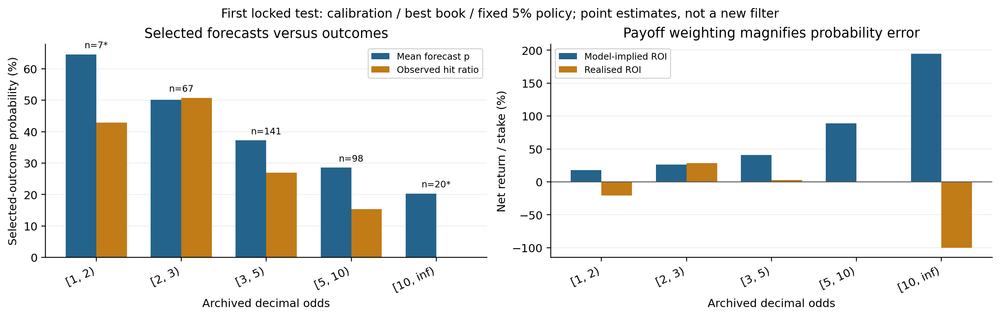

# EPL strategy robustness — exploratory companion draft

October 14, 2026 | Separate extension of the frozen EPL study and the 172-row trading-metrics supplement. All analyses reuse already inspected history; no model, threshold, feature, outcome or selected trade is changed.

Saved analysis run: 2026-10-15T02:46:39.840013+00:00 UTC; October 14, 2026 at 10:46 PM EDT in New York. The source UTC timestamp and local draft date are recorded separately.

The stress table contains 1,422 rows: 158 original strategy/scope records under nine declared assumptions. The original 14 tuning-diagnostic rows are outside this stress extension. All 16 first locked-test policies and 22 pooled ablation variants remain visible, including cash policies. Every scenario retains hit ratio, expected gain/loss, frequency, realised returns and risk in the workbook.

These are hypothetical stress assumptions, not observed bookmaker fees or attainable prices. With original stake s, odds O, fee rate c on every wager and winning-profit haircut h, winning net payoff is s·[(O−1)(1−h)−c], and losing net payoff is −s·(1+c). The haircut applies to winning net payout before fees, excluding returned stake; it is not a haircut of full decimal odds.

Original selections, probabilities and allocated stakes stay fixed. There is no requalification, resizing or newly simulated Kelly sizing path. Fees are 0%, 0.25%, 0.5%, 1% or 2% of original stakes; payout haircuts are 1%, 2.5% or 5%; the combined stress uses a 1% fee plus a 2.5% haircut. Hit ratio and recorded trade frequency therefore remain unchanged by construction. Profitable-trade share remains separately defined from outcome hit ratio.

Model-implied expected gain/loss are probability-weighted positive/negative outcome cashflow components at those recorded stakes. They are not unconditional forecasts of terminal wealth. ROI divides stressed profit by original wager turnover; the separate cash-outlay ROI includes hypothetical fees in its denominator. The same 5% qualification rule already embeds positive model-implied value, so large expected returns are not independent evidence of an edge.

Funding is checked before date settlement: original date stakes plus fees must fit the stressed date-start cash. A failure leaves only an unfundable shadow cashflow calculation, marked †. Conventional max drawdown is then unavailable; shadow drawdown can exceed 100%. Each pooled season resets capital independently. No shadow path is presented as a feasible trading strategy or a fresh Kelly replay.

Reported stress intervals, where available, condition on the recorded positions and use the same whole-date bootstrap draws across scenarios, stratified by reset episode. They omit fitting, selection, market execution and multiplicity uncertainty. Bin, deletion and concentration summaries are descriptive diagnostics; they do not create a new holdout or justify a newly selected tail filter.

## First locked test: all 16 policies under every stress

Cells show net profit / original wager turnover (%). Fee columns charge every original wager; payout columns reduce winning net payouts. A dash is undefined, including cash-policy ROI. † means the recorded exposure cannot be funded under that scenario.

Table R1. Complete 2025/26 locked-test policy grid; unchanged selections/stakes. These are assumptions applied to history, not actual provider fee schedules.

| Strategy | Base | Fee 0.25% | Fee 0.5% | Fee 1% | Fee 2% | Payout −1% | Payout −2.5% | Payout −5% | Fee 1% + payout −2.5% |
| --- | --- | --- | --- | --- | --- | --- | --- | --- | --- |
| Accuracy / Fixed 5% Best book / Fixed | −2.25% | −2.50% | −2.75% | −3.25% | −4.25% | −2.96% | −4.02% | −5.80% | −5.02% |
| Accuracy / Fixed 5% Best book / Quarter Kelly | −7.01% | −7.26% | −7.51% | −8.01% | −9.01% | −7.69% | −8.69% | −10.38% | −9.69% |
| Accuracy / Fixed 5% Bet365 / Fixed | −5.12% | −5.37% | −5.62% | −6.12% | −7.12% | −5.80% | −6.82% | −8.52% | −7.82% |
| Accuracy / Fixed 5% Bet365 / Quarter Kelly | −8.57% | −8.82% | −9.07% | −9.57% | −10.57% | −9.22% | −10.20% | −11.83% | −11.20% |
| Calibration / Fixed 5% Best book / Fixed | 0.41% | 0.16% | −0.09% | −0.59% | −1.59% | −0.32% | −1.42% | −3.26% | −2.42% |
| Calibration / Fixed 5% Best book / Quarter Kelly | −2.59% | −2.84% | −3.09% | −3.59% | −4.59% | −3.29% | −4.35% | −6.12% | −5.35% |
| Calibration / Fixed 5% Bet365 / Fixed | −0.75% | −1.00% | −1.25% | −1.75% | −2.75% | −1.46% | −2.54% | −4.33% | −3.54% |
| Calibration / Fixed 5% Bet365 / Quarter Kelly | −3.09% | −3.34% | −3.59% | −4.09% | −5.09% | −3.78% | −4.82% | −6.56% | −5.82% |
| Accuracy / Primary Best book / Fixed | — | — | — | — | — | — | — | — | — |
| Accuracy / Primary Best book / Quarter Kelly | — | — | — | — | — | — | — | — | — |
| Accuracy / Primary Bet365 / Fixed | — | — | — | — | — | — | — | — | — |
| Accuracy / Primary Bet365 / Quarter Kelly | — | — | — | — | — | — | — | — | — |
| Calibration / Primary Best book / Fixed | — | — | — | — | — | — | — | — | — |
| Calibration / Primary Best book / Quarter Kelly | — | — | — | — | — | — | — | — | — |
| Calibration / Primary Bet365 / Fixed | — | — | — | — | — | — | — | — | — |
| Calibration / Primary Bet365 / Quarter Kelly | — | — | — | — | — | — | — | — | — |

## Pooled ablation: all 22 variants under every stress

Four exploratory outer seasons, 2022/23–2025/26; independently funded resets. Pooled profit and turnover add across seasons. † marks a failure in at least one episode; its value is a shadow cashflow return.

For 11 of 11 positive baseline point returns, the conditional 95% ROI interval includes zero. Full scenario intervals remain in the workbook; these overlapping historical comparisons do not establish a newly selected winning strategy.

Table R2. Complete pooled variant/staking grid. No displayed scenario or strategy is selected for deployment from these results.

| Strategy | Base | Fee 0.25% | Fee 0.5% | Fee 1% | Fee 2% | Payout −1% | Payout −2.5% | Payout −5% | Fee 1% + payout −2.5% |
| --- | --- | --- | --- | --- | --- | --- | --- | --- | --- |
| Class frequency / Fixed | −4.85% | −5.10% | −5.35% | −5.85% | −6.85% | −5.58% | −6.66% | −8.46% | −7.66% |
| Class frequency / Quarter Kelly | −8.13% | −8.38% | −8.63% | −9.13% | −10.13% | −8.83% | −9.87% | −11.62% | −10.87% |
| Raw market / Fixed | −31.59% | −31.84% | −32.09% | −32.59% | −33.59% | −32.17% | −33.06% | −34.53% | −34.06% |
| Raw market / Quarter Kelly | −27.27% | −27.52% | −27.77% | −28.27% | −29.27% | −27.88% | −28.79% | −30.31% | −29.79% |
| Logistic: Combined / Fixed | 0.14% | −0.11% | −0.36% | −0.86% | −1.86% | −0.57% | −1.63% | −3.39% | −2.63% |
| Logistic: Combined / Quarter Kelly | −3.47% | −3.72% | −3.97% | −4.47% | −5.47% | −4.13% | −5.12% | −6.77% | −6.12% |
| Logistic: Team / Fixed | 1.59% | 1.34% | 1.09% | 0.59% | −0.41% | 0.87% | −0.21% | −2.01% | −1.21% |
| Logistic: Team / Quarter Kelly | −3.13% | −3.38% | −3.63% | −4.13% | −5.13% | −3.79% | −4.78% | −6.44% | −5.78% |
| Logistic: Team+players / Fixed | −1.73% | −1.98% | −2.23% | −2.73% | −3.73% | −2.43% | −3.47% | −5.20% | −4.47% |
| Logistic: Team+players / Quarter Kelly | −5.97% | −6.22% | −6.47% | −6.97% | −7.97% | −6.62% | −7.58% | −9.19% | −8.58% |
| Logistic: Team+xG / Fixed | 7.01% | 6.76% | 6.51% | 6.01% | 5.01% | 6.24% | 5.09% | 3.18% | 4.09% |
| Logistic: Team+xG / Quarter Kelly | −0.59% | −0.84% | −1.09% | −1.59% | −2.59% | −1.27% | −2.30% | −4.00% | −3.30% |
| Market residual: Combined / Fixed | 0.76% | 0.51% | 0.26% | −0.24% | −1.24% | 0.06% | −0.99% | −2.74% | −1.99% |
| Market residual: Combined / Quarter Kelly | 7.19% | 6.94% | 6.69% | 6.19% | 5.19% | 6.48% | 5.42% | 3.64% | 4.42% |
| Market residual: Team / Fixed | 0.91% | 0.66% | 0.41% | −0.09% | −1.09% | 0.20% | −0.85% | −2.62% | −1.85% |
| Market residual: Team / Quarter Kelly | 1.84% | 1.59% | 1.34% | 0.84% | −0.16% | 1.18% | 0.18% | −1.48% | −0.82% |
| Market residual: Team+players / Fixed | 2.03% | 1.78% | 1.53% | 1.03% | 0.03% | 1.32% | 0.26% | −1.51% | −0.74% |
| Market residual: Team+players / Quarter Kelly | 5.74% | 5.49% | 5.24% | 4.74% | 3.74% | 5.04% | 3.99% | 2.25% | 2.99% |
| Market residual: Team+xG / Fixed | 0.42% | 0.17% | −0.08% | −0.58% | −1.58% | −0.28% | −1.33% | −3.08% | −2.33% |
| Market residual: Team+xG / Quarter Kelly | 1.46% | 1.21% | 0.96% | 0.46% | −0.54% | 0.79% | −0.21% | −1.88% | −1.21% |
| Temperature market / Fixed | −28.62% | −28.87% | −29.12% | −29.62% | −30.62% | −29.07% | −29.76% | −30.91% | −30.76% |
| Temperature market / Quarter Kelly | −16.22% | −16.47% | −16.72% | −17.22% | −18.22% | −16.61% | −17.21% | −18.19% | −18.21% |

## First locked test: combined-stress trade metrics

Combined assumption: 1% of each original stake plus a 2.5% haircut of winning profit. All money columns are units per trade; average +gain/−loss are realised conditional net-P&L magnitudes. Hit and frequency are percentages.

Table R3. All 16 policies. Funding cell is Yes/conventional drawdown, or No/unavailable with separately labelled shadow drawdown. Totals, probability-weighted net expectancy and all other scenario metrics remain in the workbook.

| Strategy | Trades | Hit % | Trade freq. % | Avg. + gain | Avg. − loss size | Expected gain/trade | Expected loss/trade | Realised net/trade | Fundable / max. DD |
| --- | --- | --- | --- | --- | --- | --- | --- | --- | --- |
| Accuracy / Fixed 5% Best book / Fixed | 371 | 26.68% | 99.20% | 25.87 | 10.10 | 11.41 | 6.38 | −0.50 | Yes / 30.23% |
| Accuracy / Fixed 5% Best book / Quarter Kelly | 371 | 26.68% | 99.20% | 35.48 | 14.83 | 16.99 | 9.14 | −1.40 | Yes / 58.72% |
| Accuracy / Fixed 5% Bet365 / Fixed | 365 | 26.85% | 97.59% | 24.61 | 10.10 | 10.56 | 6.31 | −0.78 | Yes / 33.59% |
| Accuracy / Fixed 5% Bet365 / Quarter Kelly | 365 | 26.85% | 97.59% | 32.71 | 14.13 | 15.01 | 8.63 | −1.55 | Yes / 61.19% |
| Calibration / Fixed 5% Best book / Fixed | 333 | 27.03% | 89.04% | 26.37 | 10.10 | 12.06 | 6.38 | −0.24 | Yes / 33.27% |
| Calibration / Fixed 5% Best book / Quarter Kelly | 333 | 27.03% | 89.04% | 45.39 | 18.12 | 22.31 | 11.19 | −0.96 | Yes / 63.19% |
| Calibration / Fixed 5% Bet365 / Fixed | 314 | 27.71% | 83.96% | 25.08 | 10.10 | 11.28 | 6.35 | −0.35 | Yes / 34.18% |
| Calibration / Fixed 5% Bet365 / Quarter Kelly | 314 | 27.71% | 83.96% | 42.83 | 17.83 | 20.43 | 10.95 | −1.02 | Yes / 60.39% |
| Accuracy / Primary Best book / Fixed | 0 | — | 0.00% | — | — | — | — | — | Yes / 0.00% |
| Accuracy / Primary Best book / Quarter Kelly | 0 | — | 0.00% | — | — | — | — | — | Yes / 0.00% |
| Accuracy / Primary Bet365 / Fixed | 0 | — | 0.00% | — | — | — | — | — | Yes / 0.00% |
| Accuracy / Primary Bet365 / Quarter Kelly | 0 | — | 0.00% | — | — | — | — | — | Yes / 0.00% |
| Calibration / Primary Best book / Fixed | 0 | — | 0.00% | — | — | — | — | — | Yes / 0.00% |
| Calibration / Primary Best book / Quarter Kelly | 0 | — | 0.00% | — | — | — | — | — | Yes / 0.00% |
| Calibration / Primary Bet365 / Fixed | 0 | — | 0.00% | — | — | — | — | — | Yes / 0.00% |
| Calibration / Primary Bet365 / Quarter Kelly | 0 | — | 0.00% | — | — | — | — | — | Yes / 0.00% |

## Pooled ablation: combined-stress trade metrics

Same combined assumption and columns as R3. Pooled drawdown describes the worst separate episode; it is not a continuous bankroll path. Counterfactual recorded activity is not a claim of feasible executed activity.

Table R4. Every pooled variant/staking rule. Missing per-trade means for no-trade policies remain unavailable, never invented zero payoffs.

| Strategy | Trades | Hit % | Trade freq. % | Avg. + gain | Avg. − loss size | Expected gain/trade | Expected loss/trade | Realised net/trade | Fundable / max. DD |
| --- | --- | --- | --- | --- | --- | --- | --- | --- | --- |
| Class frequency / Fixed | 1,447 | 23.01% | 98.44% | 30.46 | 10.10 | 16.92 | 6.18 | −0.77 | Yes / 54.03% |
| Class frequency / Quarter Kelly | 1,447 | 23.01% | 98.44% | 43.73 | 15.17 | 25.58 | 9.16 | −1.61 | Yes / 82.28% |
| Raw market / Fixed | 263 | 9.51% | 17.89% | 60.32 | 10.10 | 9.65 | 8.73 | −3.41 | Yes / 40.77% |
| Raw market / Quarter Kelly | 263 | 9.51% | 17.89% | 22.46 | 3.54 | 3.46 | 3.09 | −1.07 | Yes / 14.23% |
| Logistic: Combined / Fixed | 1,285 | 29.49% | 87.41% | 23.25 | 10.10 | 9.25 | 6.53 | −0.26 | Yes / 70.63% |
| Logistic: Combined / Quarter Kelly | 1,285 | 29.49% | 87.41% | 30.24 | 13.86 | 12.91 | 8.68 | −0.85 | Yes / 70.65% |
| Logistic: Team / Fixed | 1,241 | 29.57% | 84.42% | 23.65 | 10.10 | 9.35 | 6.55 | −0.12 | Yes / 30.68% |
| Logistic: Team / Quarter Kelly | 1,241 | 29.57% | 84.42% | 30.47 | 13.95 | 13.21 | 8.73 | −0.81 | Yes / 54.34% |
| Logistic: Team+players / Fixed | 1,274 | 28.81% | 86.67% | 23.41 | 10.10 | 9.37 | 6.54 | −0.45 | Yes / 42.64% |
| Logistic: Team+players / Quarter Kelly | 1,274 | 28.81% | 86.67% | 29.31 | 13.49 | 12.75 | 8.43 | −1.16 | Yes / 63.92% |
| Logistic: Team+xG / Fixed | 1,236 | 30.42% | 84.08% | 24.45 | 10.10 | 9.23 | 6.53 | 0.41 | Yes / 26.38% |
| Logistic: Team+xG / Quarter Kelly | 1,236 | 30.42% | 84.08% | 32.77 | 15.04 | 13.90 | 9.33 | −0.50 | Yes / 56.44% |
| Market residual: Combined / Fixed | 1,186 | 30.69% | 80.68% | 22.16 | 10.10 | 8.33 | 6.70 | −0.20 | Yes / 49.78% |
| Market residual: Combined / Quarter Kelly | 1,186 | 30.69% | 80.68% | 33.87 | 14.04 | 12.05 | 9.33 | 0.67 | Yes / 39.97% |
| Market residual: Team / Fixed | 1,048 | 30.34% | 71.29% | 22.57 | 10.10 | 8.24 | 6.77 | −0.19 | Yes / 39.87% |
| Market residual: Team / Quarter Kelly | 1,048 | 30.34% | 71.29% | 27.50 | 12.13 | 10.20 | 8.06 | −0.11 | Yes / 29.06% |
| Market residual: Team+players / Fixed | 1,147 | 31.04% | 78.03% | 22.20 | 10.10 | 8.28 | 6.70 | −0.07 | Yes / 41.04% |
| Market residual: Team+players / Quarter Kelly | 1,147 | 31.04% | 78.03% | 31.99 | 13.76 | 11.64 | 9.09 | 0.44 | Yes / 39.54% |
| Market residual: Team+xG / Fixed | 1,098 | 30.33% | 74.69% | 22.44 | 10.10 | 8.26 | 6.73 | −0.23 | Yes / 25.17% |
| Market residual: Team+xG / Quarter Kelly | 1,098 | 30.33% | 74.69% | 28.90 | 12.82 | 10.73 | 8.39 | −0.16 | Yes / 27.67% |
| Temperature market / Fixed | 216 | 25.46% | 14.69% | 17.48 | 10.10 | 7.58 | 6.88 | −3.08 | Yes / 58.61% |
| Temperature market / Quarter Kelly | 216 | 25.46% | 14.69% | 12.71 | 6.42 | 4.59 | 4.12 | −1.55 | Yes / 21.78% |

## Selected-bet tails: expected and realised are different

Descriptive illustration: calibration/best-book/fixed 5% policy, with 333 recorded bets in the first test. In saved bins at odds ≥ 10, 20 bets win 0 times while their mean forecast probability is 20.29%. This is a small retrospective tail, not evidence for a stable exclusion rule.

Across these selected bets, mean forecast p is 36.83% versus hit ratio 27.03%; binary Brier is 0.1988, log loss 0.5837, and ten-bin ECE 0.0981. Model-implied ROI is 60.86% versus realised 0.41%. These conditional binary diagnostics differ from full-match three-outcome scores.

Figure R1. Saved selected-bet bins; point estimates. * denotes fewer than 30 trades, with no implied precision. High-odds payoff weights can enlarge modest probability errors; empty bins remain unobserved.

Table R5. Original baseline positions only. For a binary recorded wager, expected minus realised net P&L equals stake×odds×(p−outcome); summing gives an arithmetic decomposition, not a causal explanation or prospective result.

| Odds bin | Trades | Wins | Mean p | Hit ratio | Expected ROI | Realised ROI |
| --- | --- | --- | --- | --- | --- | --- |
| [1, 2) | 7 | 3 | 64.59% | 42.86% | 17.91% | −20.57% |
| [2, 3) | 67 | 34 | 50.11% | 50.75% | 26.53% | 28.73% |
| [3, 5) | 141 | 38 | 37.24% | 26.95% | 40.81% | 3.02% |
| [5, 10) | 98 | 15 | 28.57% | 15.31% | 88.98% | −0.71% |
| [10, inf) | 20 | 0 | 20.29% | 0.00% | 194.42% | −100.00% |

## Date concentration and season fragility

Top-date shares divide the largest positive date P&L sums by total positive date P&L, not by small overall net profit. Deletion ranges remove each entire episode/date or season while keeping all other recorded bets/stakes fixed; they are not refitted strategies or confidence intervals.

Table R6. All 22 pooled baseline variants. Profitable seasons are observed signs. Overlapping strategies reuse fixtures; rows are not independent replications. Detailed date influence, season deletions and selected-bet scores remain in the workbook.

| Strategy | Base ROI | Top 1 date positive share | Top 5 dates positive share | Delete-one-date ROI range | Profitable seasons | Delete-one-season ROI range |
| --- | --- | --- | --- | --- | --- | --- |
| Class frequency / Fixed | −4.85% | 3.83% | 17.26% | [−6.39%, −4.26%] | 1/4 | [−7.71%, −2.73%] |
| Class frequency / Quarter Kelly | −8.13% | 4.16% | 16.86% | [−9.78%, −7.35%] | 0/4 | [−11.46%, −6.15%] |
| Raw market / Fixed | −31.59% | 13.65% | 43.49% | [−39.05%, −30.53%] | 0/4 | [−39.83%, −22.67%] |
| Raw market / Quarter Kelly | −27.27% | 9.29% | 36.40% | [−32.69%, −26.23%] | 0/4 | [−36.31%, −20.41%] |
| Logistic: Combined / Fixed | 0.14% | 2.89% | 12.05% | [−1.03%, 0.61%] | 3/4 | [−4.55%, 6.77%] |
| Logistic: Combined / Quarter Kelly | −3.47% | 2.29% | 9.76% | [−4.32%, −2.94%] | 1/4 | [−7.36%, −0.12%] |
| Logistic: Team / Fixed | 1.59% | 4.87% | 13.53% | [−0.39%, 2.24%] | 3/4 | [0.10%, 4.33%] |
| Logistic: Team / Quarter Kelly | −3.13% | 3.12% | 12.29% | [−4.26%, −2.58%] | 0/4 | [−4.09%, −1.00%] |
| Logistic: Team+players / Fixed | −1.73% | 2.69% | 11.35% | [−2.75%, −1.13%] | 2/4 | [−4.09%, 1.02%] |
| Logistic: Team+players / Quarter Kelly | −5.97% | 2.37% | 10.85% | [−6.82%, −5.31%] | 1/4 | [−9.44%, −4.22%] |
| Logistic: Team+xG / Fixed | 7.01% | 4.37% | 13.05% | [5.03%, 7.53%] | 4/4 | [4.76%, 9.05%] |
| Logistic: Team+xG / Quarter Kelly | −0.59% | 3.25% | 12.22% | [−1.86%, 0.04%] | 2/4 | [−4.12%, 1.85%] |
| Market residual: Combined / Fixed | 0.76% | 2.86% | 11.96% | [−0.39%, 1.36%] | 2/4 | [−5.36%, 4.56%] |
| Market residual: Combined / Quarter Kelly | 7.19% | 2.89% | 11.71% | [6.02%, 7.91%] | 2/4 | [−0.60%, 11.06%] |
| Market residual: Team / Fixed | 0.91% | 4.90% | 14.89% | [−1.18%, 1.49%] | 2/4 | [−2.07%, 4.24%] |
| Market residual: Team / Quarter Kelly | 1.84% | 2.43% | 10.67% | [0.88%, 2.50%] | 2/4 | [−0.37%, 3.70%] |
| Market residual: Team+players / Fixed | 2.03% | 3.56% | 12.49% | [0.55%, 2.66%] | 2/4 | [−3.64%, 5.38%] |
| Market residual: Team+players / Quarter Kelly | 5.74% | 2.80% | 11.78% | [4.61%, 6.34%] | 2/4 | [−1.71%, 8.71%] |
| Market residual: Team+xG / Fixed | 0.42% | 3.42% | 12.48% | [−0.95%, 0.92%] | 2/4 | [−0.73%, 1.55%] |
| Market residual: Team+xG / Quarter Kelly | 1.46% | 2.41% | 9.90% | [0.54%, 2.11%] | 4/4 | [1.10%, 1.80%] |
| Temperature market / Fixed | −28.62% | 16.13% | 48.99% | [−34.87%, −27.61%] | 1/4 | [−41.94%, −3.85%] |
| Temperature market / Quarter Kelly | −16.22% | 6.42% | 25.51% | [−18.22%, −14.52%] | 0/4 | [−38.39%, −7.18%] |

## Coverage, empirical cost buffers and reproducibility

The complete workbook contains all 1,422 scenario rows and 158 empirical break-even rows; 24 baseline scopes hold no trades. It also retains 2,016 per-scenario/episode funding summaries, diagnostic availability, probability/odds/edge bins, selected-bet scores, date influence and season fragility. Across all scopes/scenarios, 0 rows have unfundable recorded exposure; these are not independent failure observations. All nine mild assumptions passed the funding check in this saved run; this does not verify price execution or future funding.

Historical break-even fee equals baseline net profit / turnover; the winning-profit haircut buffer equals baseline net profit / total winning net gains. These signed arithmetic buffers use observed payoffs and cannot be treated as forecasts of allowable future costs. A negative buffer means the original historical return was already below zero.

For the first-test calibration/best-book/fixed policy, historical ROI is 0.41%. A hypothetical 0.5% charge on every original wager changes it to −0.09% without changing its selected outcomes or recorded frequency. This quantifies sensitivity under one stated assumption; it does not identify an actual fee or an executable advantage.

Selected-outcome calibration is conditional on which bets were chosen. Bin hit ratios differ from full-match H/D/A accuracy and multiclass calibration. Model probability gaps and financial expectation gaps have different weighting; odds and stakes amplify some errors. Sparse tails, repeated clubs, overlapping strategies and already inspected outcomes restrict inference. The present-day club cohort retains its original survivor and source-coverage limits. No new model or betting filter is recommended from this extension.

A dash denotes undefined/unavailable, and genuine infinity remains explicit. A no-trade policy has zero cash totals and activity when opportunities exist, while hit ratio, per-trade means and ROI remain undefined. Failed funding does not erase a recorded outcome, but it prevents interpreting its shadow path as a feasible wager sequence.

This companion is separate from the seven-page draft and the 172-row supplement. Its manifest hashes every new analytic input and the unchanged original study/report sources. Rebuild with python -m epl_robustness.report --results PATH. Rendering does not collect data, fit models, change selection or overwrite prior results. Full-precision source tables remain beside the companion; display CSVs use the published rounding.
