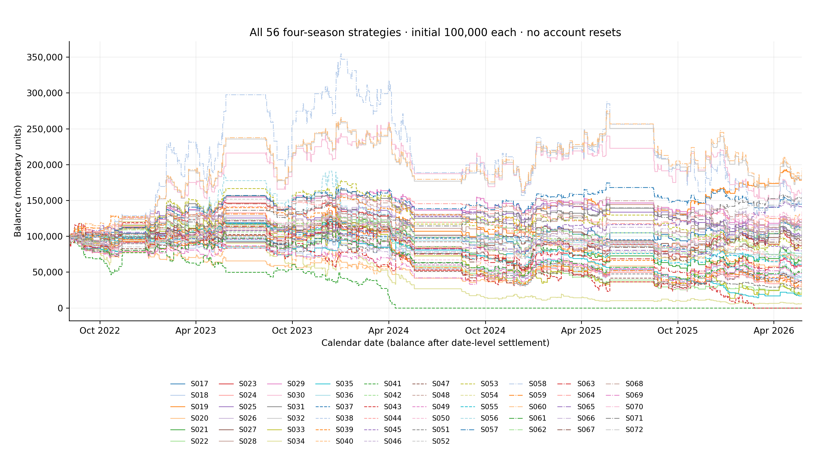
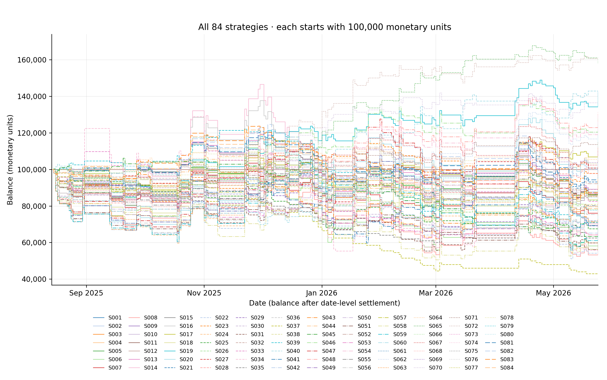

# EPL strategy validation: four seasons and selection uncertainty

DRAFT FOR REVIEW | October 15, 2026 | EPL component of the statistical-arbitrage final project.

This continuation checks whether the strategy results persist through time and how much apparent success survives comparison with the whole strategy catalog. It adds a continuous four-season account replay for all 56 rules with compatible saved predictions, annual reset diagnostics, and conditional multiple-strategy uncertainty for the original full 84-rule common season. No model is retrained and no earlier strategy result is overwritten.

The four-season universe is the same 1,470 common quoted cohort fixtures for every compatible rule: 368 in 2022/23, 360 in 2023/24, 368 in 2024/25 and 374 in 2025/26. There are 453 settlement dates from August 5, 2022 through May 24, 2026. Each continuous account begins at exactly 100,000 on August 4, 2022. Its cash carries across summers and seasons without a reset, deposit, borrowing or interest.

The full 84-rule catalog remains intact. S017–S072 use rolling-study probability series and can be evaluated across all four seasons. S001–S016 and S073–S084 depend on the first study, whose matching saved test predictions cover 2025/26 only. Those 28 strategies retain their original one-season graph and complete metrics; no earlier probability or return is invented. The final appendix explains all 84 strategies and states each one's available coverage.

These are retrospective exploratory results. Although each rolling prediction comes from a chronologically earlier fitted model, strategy recipes and this enlarged catalog were created after outcomes had been examined. Extending the calendar and adjusting a conditional comparison does not produce a fresh holdout, a deployable betting system or a validated winning strategy. Historical match selection uses the current 2026/27 club cohort and therefore has survivor/selection limitations.

## Findings from the completed replay

Of the 56 continuous four-season accounts, 24 finish above their 100,000 starting balance. Endpoints range from 0.00 to 195,189.75 monetary units. The largest historical endpoint belongs to S060, with a capital return of 95.19%, wager-turnover ROI of 2.99% and date-close maximum drawdown of 38.35%. These identify recorded outcomes; they do not select a recommended future strategy.

With annual accounts restarted separately at 100,000, 2 of 56 rules show positive profit in all four seasons, while 19 are profitable in at most one. The annual-return and drop-one-year tables expose which recorded results are consistent across these periods and which rely on a narrower interval. Neither consistency nor a larger four-year endpoint corrects the retrospective design of the catalog.

In the separate complete 84-rule 2025/26 comparison, 0 of the eight benchmark/block maximum-statistic families reject their conditional null at 5%. The smallest global one-sided p-value is 0.1457, and the smallest rule-level family-adjusted p-value is 0.1457. All eight block/benchmark sensitivities and all 672 individual rows are retained. These diagnostics assess fixed recorded cash paths and have the limitations described below.

The tables distinguish model expected gain and loss from realised average winning and losing payoffs. A favorable model expectation alone does not demonstrate an edge: probability errors are amplified by high decimal odds, and a realised bankroll-dependent sizing path is already conditioned on past outcomes. Frequency, drawdown, exposure and payoff uncertainty matter alongside an ending balance.

## One continuous 100,000-unit account per compatible strategy

All 56 compatible rules appear on this single chart. Every account starts at 100,000; account balances are not added together. Curves continue through four seasons and off-season gaps without resetting. IDs map to the complete final appendix.



Figure 1. All S017–S072 balances on linear monetary and calendar-date axes. Step lines record end-of-date cash after allocating every same-date request before settlement. The offline HTML version retains every visible trace and provides hover/legend controls.

## Four-season trading metrics: S017–S044

One uninterrupted account; 1,470 priced opportunities per strategy. Expected gain/loss are model-implied components conditional on recorded stakes. Winning and losing means are realised net payoffs per trade; losing loss is a positive magnitude.

Table 1. Every compatible rule, in catalog order. Frequency=trades/1,470 fixtures; ROI=profit/turnover; capital return=profit/100,000. Undefined values appear as dashes. Full metrics and confidence intervals are in the workbook.

| ID | Trades | Hit<br>% | Trade<br>freq. % | Avg. winning<br>gain | Avg. losing<br>loss | Model expected<br>gain/trade | Model expected<br>loss/trade | ROI on<br>stakes | Return on<br>100,000 | Max.<br>drawdown |
| --- | --- | --- | --- | --- | --- | --- | --- | --- | --- | --- |
| S017 | 1,241 | 29.57% | 84.42% | 2,435.40 | 1,000.00 | 962.54 | 648.43 | 1.59% | 19.79% | 40.35% |
| S018 | 1,241 | 29.57% | 84.42% | 2,322.00 | 1,030.82 | 1,017.97 | 643.69 | −3.77% | −48.76% | 65.74% |
| S019 | 1,236 | 30.42% | 84.08% | 2,517.63 | 1,000.00 | 950.59 | 646.50 | 7.01% | 86.63% | 23.03% |
| S020 | 1,236 | 30.42% | 84.08% | 2,078.29 | 943.88 | 906.19 | 582.49 | −2.60% | −30.30% | 69.45% |
| S021 | 1,274 | 28.81% | 86.67% | 2,411.28 | 1,000.00 | 965.05 | 647.65 | −1.73% | −22.06% | 59.36% |
| S022 | 1,274 | 28.81% | 86.67% | 2,452.26 | 1,074.96 | 1,065.89 | 673.54 | −5.38% | −75.01% | 84.72% |
| S023 | 1,285 | 29.49% | 87.41% | 2,395.20 | 1,000.00 | 952.49 | 646.63 | 0.14% | 1.78% | 65.95% |
| S024 | 1,285 | 29.49% | 87.41% | 2,576.06 | 1,149.15 | 1,122.81 | 717.94 | −4.31% | −64.80% | 80.66% |
| S025 | 1,048 | 30.34% | 71.29% | 2,325.57 | 1,000.00 | 848.51 | 670.37 | 0.91% | 9.53% | 32.78% |
| S026 | 1,048 | 30.34% | 71.29% | 3,472.78 | 1,483.55 | 1,296.87 | 984.38 | 1.28% | 21.36% | 35.30% |
| S027 | 1,098 | 30.33% | 74.69% | 2,311.29 | 1,000.00 | 850.72 | 666.28 | 0.42% | 4.66% | 37.59% |
| S028 | 1,098 | 30.33% | 74.69% | 3,264.77 | 1,390.84 | 1,212.32 | 911.31 | 1.43% | 23.18% | 33.29% |
| S029 | 1,147 | 31.04% | 78.03% | 2,287.47 | 1,000.00 | 852.95 | 663.70 | 2.03% | 23.34% | 31.88% |
| S030 | 1,147 | 31.04% | 78.03% | 5,500.79 | 2,391.66 | 2,081.53 | 1,557.27 | 2.29% | 66.48% | 42.02% |
| S031 | 1,186 | 30.69% | 80.68% | 2,283.05 | 1,000.00 | 857.50 | 662.99 | 0.76% | 9.03% | 42.73% |
| S032 | 1,186 | 30.69% | 80.68% | 5,930.31 | 2,515.92 | 2,215.39 | 1,642.73 | 2.86% | 90.55% | 39.14% |
| S033 | 1,447 | 23.01% | 98.44% | 3,134.41 | 1,000.00 | 1,739.52 | 611.96 | −4.85% | −70.24% | 89.49% |
| S034 | 1,447 | 23.01% | 98.44% | 2,728.19 | 899.12 | 1,649.27 | 541.60 | −7.26% | −93.13% | 95.97% |
| S035 | 263 | 9.51% | 17.89% | 6,197.20 | 1,000.00 | 991.12 | 864.14 | −31.59% | −83.07% | 85.57% |
| S036 | 263 | 9.51% | 17.89% | 2,158.53 | 326.38 | 330.50 | 284.69 | −26.89% | −23.72% | 26.17% |
| S037 | 216 | 25.46% | 14.69% | 1,803.45 | 1,000.00 | 780.85 | 681.50 | −28.62% | −61.81% | 64.12% |
| S038 | 216 | 25.46% | 14.69% | 1,279.71 | 608.98 | 454.22 | 389.66 | −15.53% | −27.66% | 31.16% |
| S039 | 1,470 | 44.29% | 100.00% | 1,163.61 | 1,000.00 | 535.36 | 557.87 | −4.18% | −61.49% | 77.89% |
| S040 | 1,470 | 24.35% | 100.00% | 3,189.16 | 1,000.00 | 751.35 | 765.16 | 2.02% | 29.72% | 60.04% |
| S041 | 670 | 29.40% | 45.58% | 1,888.48 | 997.95 | 670.66 | 676.21 | −14.95% | −100.00% | 100.00% |
| S042 | 1,470 | 54.42% | 100.00% | 796.01 | 1,000.00 | 428.40 | 458.65 | −2.26% | −33.19% | 46.50% |
| S043 | 1,363 | 19.96% | 92.72% | 3,641.51 | 999.53 | 798.64 | 793.33 | −7.34% | −100.00% | 100.00% |
| S044 | 1,470 | 53.13% | 100.00% | 842.05 | 1,000.00 | 486.61 | 463.75 | −2.13% | −31.36% | 46.78% |

## Four-season trading metrics: S045–S072

One uninterrupted account; 1,470 priced opportunities per strategy. Expected gain/loss are model-implied components conditional on recorded stakes. Winning and losing means are realised net payoffs per trade; losing loss is a positive magnitude.

Table 1. Every compatible rule, in catalog order. Frequency=trades/1,470 fixtures; ROI=profit/turnover; capital return=profit/100,000. Undefined values appear as dashes. Full metrics and confidence intervals are in the workbook.

| ID | Trades | Hit<br>% | Trade<br>freq. % | Avg. winning<br>gain | Avg. losing<br>loss | Model expected<br>gain/trade | Model expected<br>loss/trade | ROI on<br>stakes | Return on<br>100,000 | Max.<br>drawdown |
| --- | --- | --- | --- | --- | --- | --- | --- | --- | --- | --- |
| S045 | 1,470 | 54.22% | 100.00% | 818.33 | 1,000.00 | 452.24 | 453.70 | −1.41% | −20.79% | 41.50% |
| S046 | 1,239 | 29.62% | 84.29% | 2,428.91 | 1,000.00 | 958.28 | 651.00 | 1.57% | 19.41% | 48.96% |
| S047 | 1,239 | 29.62% | 84.29% | 2,269.24 | 1,021.04 | 1,001.70 | 639.38 | −4.52% | −57.53% | 76.89% |
| S048 | 1,186 | 29.01% | 80.68% | 2,499.85 | 1,000.00 | 902.42 | 672.78 | 1.51% | 17.95% | 51.31% |
| S049 | 1,186 | 29.01% | 80.68% | 2,166.75 | 941.05 | 866.05 | 610.49 | −4.12% | −47.00% | 66.41% |
| S050 | 990 | 25.35% | 67.35% | 2,718.21 | 1,000.00 | 895.15 | 707.39 | −5.73% | −56.73% | 79.77% |
| S051 | 990 | 25.35% | 67.35% | 1,932.75 | 753.77 | 690.12 | 518.34 | −9.26% | −71.92% | 75.24% |
| S052 | 1,285 | 29.49% | 87.41% | 2,291.32 | 977.24 | 932.35 | 630.07 | −1.35% | −16.97% | 64.71% |
| S053 | 1,186 | 30.69% | 80.68% | 2,801.58 | 1,250.59 | 1,068.91 | 824.30 | −0.55% | −8.21% | 54.59% |
| S054 | 1,186 | 29.01% | 80.68% | 2,300.81 | 941.07 | 846.86 | 630.57 | −0.08% | −0.90% | 53.56% |
| S055 | 1,285 | 29.49% | 87.41% | 1,555.99 | 687.64 | 669.76 | 430.80 | −3.71% | −33.28% | 52.04% |
| S056 | 1,285 | 29.49% | 87.41% | 3,789.80 | 1,637.30 | 1,583.37 | 1,046.22 | −2.22% | −47.06% | 84.17% |
| S057 | 1,186 | 30.69% | 80.68% | 2,235.68 | 930.42 | 823.30 | 610.74 | 4.17% | 48.98% | 20.86% |
| S058 | 1,186 | 30.69% | 80.68% | 8,277.31 | 3,590.36 | 3,107.45 | 2,353.82 | 1.42% | 61.66% | 63.35% |
| S059 | 1,285 | 29.49% | 87.41% | 2,552.95 | 1,138.36 | 1,107.80 | 712.05 | −4.28% | −63.79% | 78.76% |
| S060 | 1,186 | 30.69% | 80.68% | 5,973.63 | 2,529.45 | 2,226.45 | 1,652.54 | 2.99% | 95.19% | 38.35% |
| S061 | 1,186 | 29.01% | 80.68% | 2,186.42 | 947.31 | 869.56 | 615.40 | −3.96% | −45.51% | 65.67% |
| S062 | 1,085 | 29.59% | 73.81% | 2,434.64 | 1,000.00 | 908.46 | 668.43 | 1.61% | 17.52% | 45.15% |
| S063 | 1,085 | 29.59% | 73.81% | 2,629.56 | 1,151.35 | 1,066.12 | 745.62 | −2.78% | −35.55% | 63.10% |
| S064 | 466 | 33.91% | 31.70% | 2,112.85 | 1,000.00 | 850.98 | 633.00 | 5.54% | 25.83% | 27.14% |
| S065 | 478 | 24.06% | 32.52% | 3,490.09 | 1,000.00 | 920.73 | 745.78 | 8.03% | 38.36% | 37.35% |
| S066 | 501 | 27.74% | 34.08% | 2,591.44 | 1,000.00 | 929.49 | 680.50 | −0.36% | −1.79% | 34.39% |
| S067 | 1,075 | 27.72% | 73.13% | 2,593.56 | 1,000.00 | 1,005.97 | 654.87 | −0.38% | −4.12% | 57.70% |
| S068 | 862 | 28.07% | 58.64% | 2,649.21 | 1,000.00 | 922.71 | 683.07 | 2.45% | 21.11% | 28.53% |
| S069 | 884 | 25.45% | 60.14% | 2,781.91 | 1,000.00 | 970.38 | 687.90 | −3.74% | −33.07% | 66.89% |
| S070 | 970 | 34.23% | 65.99% | 2,027.53 | 1,000.00 | 821.91 | 603.58 | 3.62% | 35.14% | 56.67% |
| S071 | 882 | 35.71% | 60.00% | 1,974.00 | 1,000.00 | 781.56 | 620.54 | 6.21% | 54.81% | 26.13% |
| S072 | 870 | 34.37% | 59.18% | 2,073.71 | 1,000.00 | 791.09 | 622.68 | 5.64% | 49.04% | 46.98% |

## Separate annual starts test stability across seasons

The continuous chart is the account history requested by the project. To separate season conditions from inherited capital, a second calculation gives each rule a fresh 100,000 at the beginning of each season. These are four independent diagnostic accounts, not four deposits into the continuous account. Annual performance is therefore not spliced into the main graph.

Annual capital returns divide each season's realised profit by its own 100,000 start. The positive-season count uses strictly positive profit, with a zero-profit year not counted as positive. Worst and best annual returns show the range. Pooled reset ROI sums the four annual profits and divides by their combined turnover; it is neither a compounded return nor the continuous account's ROI.

Drop-one-year minimum and maximum ROI recompute that pooled reset ROI after removing each season in turn. This checks how strongly the recorded pooled result depends on one year. It does not select a rule, exclude an inconvenient season or create independent validation. Returns from fixed and Kelly rules can differ between the continuous account and annual accounts because each Kelly path depends on its own realised starting cash.

## Annual stability for every rule: S017–S044

Table 2. Each annual column uses a separate 100,000-unit start. Pooled and drop-one-year columns use wager-turnover ROI from reset accounts. All 224 annual strategy rows, full payoffs and activity metrics are in the workbook.

| ID | +ve<br>years | 2022/23<br>return | 2023/24<br>return | 2024/25<br>return | 2025/26<br>return | Worst year<br>return | Best year<br>return | Pooled reset<br>ROI | Drop-one-year<br>min ROI | Drop-one-year<br>max ROI |
| --- | --- | --- | --- | --- | --- | --- | --- | --- | --- | --- |
| S017 | 3 | 18.82% | −20.13% | 6.23% | 14.87% | −20.13% | 18.82% | 1.59% | 0.10% | 4.33% |
| S018 | 0 | −6.88% | −41.47% | −3.36% | −2.72% | −41.47% | −2.72% | −3.13% | −4.09% | −1.00% |
| S019 | 4 | 1.24% | 6.06% | 37.06% | 42.27% | 1.24% | 42.27% | 7.01% | 4.76% | 9.05% |
| S020 | 2 | −34.24% | −36.86% | 41.37% | 18.76% | −36.86% | 41.37% | −0.59% | −4.12% | 1.85% |
| S021 | 2 | 17.54% | −31.78% | −13.20% | 5.38% | −31.78% | 17.54% | −1.73% | −4.09% | 1.02% |
| S022 | 1 | 15.88% | −49.83% | −32.99% | −35.85% | −49.83% | 15.88% | −5.97% | −9.44% | −4.22% |
| S023 | 3 | 46.32% | −62.83% | 5.56% | 12.73% | −62.83% | 46.32% | 0.14% | −4.55% | 6.77% |
| S024 | 1 | 32.67% | −60.53% | −5.18% | −29.11% | −60.53% | 32.67% | −3.47% | −7.36% | −0.12% |
| S025 | 2 | 25.63% | 11.05% | −2.81% | −24.34% | −24.34% | 25.63% | 0.91% | −2.07% | 4.24% |
| S026 | 2 | 28.59% | −0.02% | 12.63% | −16.19% | −16.19% | 28.59% | 1.84% | −0.37% | 3.70% |
| S027 | 2 | −7.98% | 9.38% | −7.50% | 10.76% | −7.98% | 10.76% | 0.42% | −0.73% | 1.55% |
| S028 | 4 | 8.68% | 2.33% | 9.78% | 0.89% | 0.89% | 9.78% | 1.46% | 1.10% | 1.80% |
| S029 | 2 | 54.69% | −17.98% | 10.08% | −23.45% | −23.45% | 54.69% | 2.03% | −3.64% | 5.38% |
| S030 | 2 | 116.24% | −13.36% | 18.89% | −25.26% | −25.26% | 116.24% | 5.74% | −1.71% | 8.71% |
| S031 | 2 | 56.40% | −31.31% | 14.17% | −30.23% | −31.31% | 56.40% | 0.76% | −5.36% | 4.56% |
| S032 | 2 | 135.81% | −24.97% | 41.74% | −24.02% | −24.97% | 135.81% | 7.19% | −0.60% | 11.06% |
| S033 | 1 | 13.04% | −40.37% | −36.13% | −6.78% | −40.37% | 13.04% | −4.85% | −7.71% | −2.73% |
| S034 | 0 | −9.77% | −70.41% | −61.91% | −32.48% | −70.41% | −9.77% | −8.13% | −11.46% | −6.15% |
| S035 | 0 | −14.68% | −4.60% | −26.29% | −37.50% | −37.50% | −4.60% | −31.59% | −39.83% | −22.67% |
| S036 | 0 | −6.26% | −0.00% | −8.49% | −11.07% | −11.07% | −0.00% | −27.27% | −36.31% | −20.41% |
| S037 | 1 | −4.15% | 1.59% | −2.25% | −57.00% | −57.00% | 1.59% | −28.62% | −41.94% | −3.85% |
| S038 | 0 | −1.11% | −0.17% | −9.35% | −19.16% | −19.16% | −0.17% | −16.22% | −38.39% | −7.18% |
| S039 | 1 | 40.13% | −9.96% | −63.84% | −27.82% | −63.84% | 40.13% | −4.18% | −9.22% | 0.21% |
| S040 | 2 | −14.20% | −29.28% | 31.32% | 41.88% | −29.28% | 41.88% | 2.02% | −1.11% | 5.32% |
| S041 | 1 | −50.30% | −39.66% | 18.55% | −24.64% | −50.30% | 18.55% | −6.53% | −10.40% | −4.15% |
| S042 | 2 | 5.86% | 14.02% | −14.91% | −38.16% | −38.16% | 14.02% | −2.26% | −4.25% | 0.45% |
| S043 | 0 | −16.49% | −30.50% | −16.45% | −16.69% | −30.50% | −16.45% | −5.45% | −5.79% | −4.47% |
| S044 | 2 | 2.07% | 17.80% | −28.53% | −22.70% | −28.53% | 17.80% | −2.13% | −4.43% | −0.26% |

## Annual stability for every rule: S045–S072

Table 2. Each annual column uses a separate 100,000-unit start. Pooled and drop-one-year columns use wager-turnover ROI from reset accounts. All 224 annual strategy rows, full payoffs and activity metrics are in the workbook.

| ID | +ve<br>years | 2022/23<br>return | 2023/24<br>return | 2024/25<br>return | 2025/26<br>return | Worst year<br>return | Best year<br>return | Pooled reset<br>ROI | Drop-one-year<br>min ROI | Drop-one-year<br>max ROI |
| --- | --- | --- | --- | --- | --- | --- | --- | --- | --- | --- |
| S045 | 2 | 7.91% | 19.54% | −11.06% | −37.18% | −37.18% | 19.54% | −1.41% | −3.63% | 1.50% |
| S046 | 2 | 22.48% | −23.38% | −8.08% | 28.39% | −23.38% | 28.39% | 1.57% | −0.96% | 4.64% |
| S047 | 2 | 2.56% | −49.83% | −18.71% | 1.52% | −49.83% | 2.56% | −3.71% | −5.11% | −1.13% |
| S048 | 2 | 16.66% | −24.31% | −6.31% | 31.91% | −24.31% | 31.91% | 1.51% | −1.56% | 4.80% |
| S049 | 0 | −3.54% | −37.62% | −8.56% | −3.68% | −37.62% | −3.54% | −3.63% | −4.38% | −1.47% |
| S050 | 1 | 10.42% | −43.13% | −15.54% | −8.48% | −43.13% | 10.42% | −5.73% | −8.87% | −1.84% |
| S051 | 1 | 0.81% | −37.85% | −24.17% | −40.89% | −40.89% | 0.81% | −10.43% | −14.08% | −7.78% |
| S052 | 3 | 51.98% | −48.68% | 0.46% | 5.96% | −48.68% | 51.98% | 0.78% | −4.73% | 6.02% |
| S053 | 2 | 66.79% | −29.79% | 10.84% | −29.28% | −29.79% | 66.79% | 1.58% | −5.99% | 5.39% |
| S054 | 2 | 13.18% | −24.94% | −10.06% | 29.70% | −24.94% | 29.70% | 0.66% | −2.48% | 3.71% |
| S055 | 2 | 17.97% | −35.55% | 0.15% | −12.38% | −35.55% | 17.97% | −3.07% | −6.63% | 0.78% |
| S056 | 2 | 77.87% | −68.45% | 1.40% | −6.98% | −68.45% | 77.87% | 0.17% | −4.72% | 4.13% |
| S057 | 2 | 57.16% | −11.84% | 21.27% | −11.33% | −11.84% | 57.16% | 6.47% | −0.31% | 10.36% |
| S058 | 2 | 197.43% | −36.51% | 35.83% | −36.98% | −36.98% | 197.43% | 6.96% | −2.62% | 10.90% |
| S059 | 1 | 31.25% | −57.25% | −6.84% | −30.72% | −57.25% | 31.25% | −3.63% | −7.49% | −0.47% |
| S060 | 2 | 137.57% | −24.41% | 43.05% | −24.02% | −24.41% | 137.57% | 7.44% | −0.45% | 11.34% |
| S061 | 0 | −2.44% | −34.93% | −10.36% | −4.25% | −34.93% | −2.44% | −3.58% | −4.40% | −1.60% |
| S062 | 2 | 23.12% | −24.44% | −6.87% | 25.71% | −24.44% | 25.71% | 1.61% | −1.00% | 5.23% |
| S063 | 1 | 13.99% | −33.80% | −9.12% | −6.02% | −33.80% | 13.99% | −2.46% | −4.54% | −0.11% |
| S064 | 3 | 41.56% | 3.95% | −27.58% | 7.90% | −27.58% | 41.56% | 5.54% | −4.51% | 16.54% |
| S065 | 2 | 12.23% | −29.85% | −2.03% | 58.01% | −29.85% | 58.01% | 8.03% | −5.73% | 20.92% |
| S066 | 1 | −16.43% | −4.88% | 33.86% | −14.34% | −16.43% | 33.86% | −0.36% | −9.24% | 3.90% |
| S067 | 3 | 21.50% | −45.46% | 8.39% | 11.45% | −45.46% | 21.50% | −0.38% | −3.11% | 5.15% |
| S068 | 2 | 45.31% | −14.64% | 18.94% | −28.50% | −28.50% | 45.31% | 2.45% | −3.75% | 7.49% |
| S069 | 2 | −13.26% | −44.68% | 12.20% | 12.67% | −44.68% | 12.67% | −3.74% | −6.91% | 1.79% |
| S070 | 3 | 22.51% | −36.57% | 6.39% | 42.81% | −36.57% | 42.81% | 3.62% | −1.07% | 9.80% |
| S071 | 3 | 36.17% | −21.79% | 25.28% | 15.15% | −21.79% | 36.17% | 6.21% | 2.82% | 11.36% |
| S072 | 2 | 12.03% | −16.13% | −8.10% | 61.24% | −16.13% | 61.24% | 5.64% | −1.87% | 9.89% |

## Selection uncertainty across the entire original catalog

The conditional selection diagnostic compares all 84 strategies over their shared 2025/26 history: 374 fixtures and 113 settlement dates. This is deliberately a separate population from the 56-rule four-season replay. It asks whether observed mean date-level excess profit remains unusual when the maximum across all 84 recorded rules is considered, rather than reading one attractive unadjusted curve in isolation.

There are two benchmarks: cash, with zero date-level P&L, and S042, the original market-favorite flat-1,000 rule. Each comparison uses paired same-date strategy-minus-benchmark cashflows. The S042 account is itself stochastic and is not a no-risk cash proxy. Conditional on the saved paths, circular blocks of 1, 3, 5 and 10 consecutive settlement dates preserve different amounts of local date dependence. The block unit is a recorded settlement date, not a calendar day.

For each benchmark and block length separately, 19,999 joint resamples center each rule's observed excess cashflow under its null, apply the same date indices to every rule, and retain the largest one-sided mean statistic across all 84 rules. The comparison table gives raw and family-adjusted one-sided p-values, pointwise intervals and a common simultaneous interval critical value. The global table below tests the maximum of that one declared family. Duplicate and cash paths remain in the catalog.

These are conditional resampling diagnostics inspired by maximum-statistic data-snooping adjustments, not a full White Reality Check or guaranteed family-wise error control. Strategies, fitted probabilities and the realised bankroll-dependent stake path are held fixed; a counterfactual bootstrap Kelly path is not regenerated. Changing bankroll scale and one-season nonstationarity weaken stationarity assumptions. The earlier wider research search is uncounted. The eight benchmark/block families are separate sensitivity analyses, with no joint eight-family guarantee or chosen block length.

## Global conditional selection comparisons

Table 3. Eight separate one-sided 84-rule maximum-mean diagnostics on the original 2025/26 date cashflows. Units are excess monetary P&L per settlement date. Statistical rejection, if present, remains conditional on recorded paths and the assumptions stated above.

| Benchmark | Block<br>dates | Rules | Date<br>count | Highest mean<br>ID | Highest excess<br>mean/date | Global<br>one-sided p | Simultaneous<br>critical units | Replicates | Distinct<br>paths | Reject at<br>5%? |
| --- | --- | --- | --- | --- | --- | --- | --- | --- | --- | --- |
| cash | 1 | 84 | 113 | S072 | 541.95 | 0.4154 | 1,286.73 | 19,999 | 75 | No |
| S042 | 1 | 84 | 113 | S072 | 879.65 | 0.1951 | 1,434.60 | 19,999 | 75 | No |
| cash | 3 | 84 | 113 | S072 | 541.95 | 0.4136 | 1,216.94 | 19,999 | 75 | No |
| S042 | 3 | 84 | 113 | S072 | 879.65 | 0.1746 | 1,321.92 | 19,999 | 75 | No |
| cash | 5 | 84 | 113 | S072 | 541.95 | 0.4187 | 1,241.67 | 19,999 | 75 | No |
| S042 | 5 | 84 | 113 | S072 | 879.65 | 0.1813 | 1,349.73 | 19,999 | 75 | No |
| cash | 10 | 84 | 113 | S072 | 541.95 | 0.3887 | 1,138.73 | 19,999 | 75 | No |
| S042 | 10 | 84 | 113 | S072 | 879.65 | 0.1457 | 1,259.65 | 19,999 | 75 | No |

The complete 672 rule/benchmark/block comparison rows are in the workbook and selection_comparison.csv. Raw, adjusted and simultaneous quantities are retained for every rule; the report does not suppress unsuccessful comparisons or select the most favorable block sensitivity.

## Full catalog coverage: all 84 original account curves

This preserved comparison uses all 374 common 2025/26 fixtures, August 15, 2025 through May 24, 2026, with an August 14 initial 100,000 point for every rule. It includes the 28 first-study recipes unavailable for the earlier rolling seasons and all eight original cash-policy traces.



Figure 2. The complete original 84-strategy graph, copied byte for byte from the frozen strategy-laboratory artifact. This separate one-season replay is the population used by the conditional selection diagnostic.

## Original 2025/26 metrics: S001–S028

Table 4. Complete original common-season metrics for all 84 catalog IDs. These remain frozen, with frequency based on 374 fixtures and each account beginning at 100,000. These rows do not describe the four-season account.

| ID | Trades | Hit<br>% | Trade<br>freq. % | Avg. winning<br>gain | Avg. losing<br>loss | Model expected<br>gain/trade | Model expected<br>loss/trade | ROI on<br>stakes | Return on<br>100,000 | Max.<br>drawdown |
| --- | --- | --- | --- | --- | --- | --- | --- | --- | --- | --- |
| S001 | 0 | — | 0.00% | — | — | — | — | — | 0.00% | 0.00% |
| S002 | 0 | — | 0.00% | — | — | — | — | — | 0.00% | 0.00% |
| S003 | 0 | — | 0.00% | — | — | — | — | — | 0.00% | 0.00% |
| S004 | 0 | — | 0.00% | — | — | — | — | — | 0.00% | 0.00% |
| S005 | 371 | 26.68% | 99.20% | 2,663.33 | 1,000.00 | 1,173.68 | 631.47 | −2.25% | −8.33% | 27.74% |
| S006 | 371 | 26.68% | 99.20% | 3,653.27 | 1,468.30 | 1,748.01 | 905.17 | −7.01% | −37.70% | 49.95% |
| S007 | 365 | 26.85% | 97.59% | 2,533.98 | 1,000.00 | 1,087.19 | 625.18 | −5.12% | −18.67% | 28.60% |
| S008 | 365 | 26.85% | 97.59% | 3,368.62 | 1,398.65 | 1,545.18 | 854.83 | −8.57% | −43.31% | 51.21% |
| S009 | 0 | — | 0.00% | — | — | — | — | — | 0.00% | 0.00% |
| S010 | 0 | — | 0.00% | — | — | — | — | — | 0.00% | 0.00% |
| S011 | 0 | — | 0.00% | — | — | — | — | — | 0.00% | 0.00% |
| S012 | 0 | — | 0.00% | — | — | — | — | — | 0.00% | 0.00% |
| S013 | 333 | 27.03% | 89.04% | 2,715.22 | 1,000.00 | 1,240.24 | 631.66 | 0.41% | 1.37% | 28.11% |
| S014 | 333 | 27.03% | 89.04% | 4,673.27 | 1,794.18 | 2,295.30 | 1,107.73 | −2.59% | −15.39% | 54.44% |
| S015 | 314 | 27.71% | 83.96% | 2,582.18 | 1,000.00 | 1,160.52 | 628.63 | −0.75% | −2.35% | 29.38% |
| S016 | 314 | 27.71% | 83.96% | 4,410.79 | 1,765.64 | 2,101.94 | 1,084.41 | −3.09% | −17.06% | 51.98% |
| S017 | 306 | 27.78% | 81.82% | 2,774.94 | 1,000.00 | 1,034.32 | 690.01 | 4.86% | 14.87% | 18.00% |
| S018 | 306 | 27.78% | 81.82% | 3,471.59 | 1,347.54 | 1,430.25 | 903.46 | −0.67% | −2.72% | 35.79% |
| S019 | 304 | 29.28% | 81.28% | 2,890.67 | 1,000.00 | 1,019.10 | 689.70 | 13.90% | 42.27% | 15.10% |
| S020 | 304 | 29.28% | 81.28% | 3,997.61 | 1,567.55 | 1,603.27 | 1,036.33 | 4.04% | 18.76% | 31.36% |
| S021 | 314 | 26.11% | 83.96% | 2,894.88 | 1,000.00 | 1,035.00 | 692.84 | 1.71% | 5.38% | 21.25% |
| S022 | 314 | 26.11% | 83.96% | 2,909.99 | 1,183.05 | 1,231.39 | 782.29 | −9.94% | −35.85% | 48.86% |
| S023 | 321 | 27.10% | 85.83% | 2,835.98 | 1,000.00 | 1,010.98 | 689.58 | 3.97% | 12.73% | 22.14% |
| S024 | 321 | 27.10% | 85.83% | 3,089.88 | 1,273.21 | 1,293.70 | 838.41 | −7.33% | −29.11% | 47.23% |
| S025 | 250 | 24.40% | 66.84% | 2,699.34 | 1,000.00 | 893.26 | 720.60 | −9.74% | −24.34% | 34.22% |
| S026 | 250 | 24.40% | 66.84% | 2,632.00 | 935.13 | 867.71 | 669.15 | −6.63% | −16.19% | 25.64% |
| S027 | 259 | 27.03% | 69.25% | 2,853.71 | 1,000.00 | 896.62 | 717.47 | 4.15% | 10.76% | 19.50% |
| S028 | 259 | 27.03% | 69.25% | 2,856.25 | 1,053.17 | 957.16 | 735.52 | 0.32% | 0.89% | 19.13% |

## Original 2025/26 metrics: S029–S056

Table 4. Complete original common-season metrics for all 84 catalog IDs. These remain frozen, with frequency based on 374 fixtures and each account beginning at 100,000. These rows do not describe the four-season account.

| ID | Trades | Hit<br>% | Trade<br>freq. % | Avg. winning<br>gain | Avg. losing<br>loss | Model expected<br>gain/trade | Model expected<br>loss/trade | ROI on<br>stakes | Return on<br>100,000 | Max.<br>drawdown |
| --- | --- | --- | --- | --- | --- | --- | --- | --- | --- | --- |
| S029 | 277 | 25.27% | 74.06% | 2,622.14 | 1,000.00 | 897.20 | 709.19 | −8.47% | −23.45% | 34.33% |
| S030 | 277 | 25.27% | 74.06% | 2,618.42 | 1,007.49 | 915.50 | 696.55 | −8.89% | −25.26% | 32.58% |
| S031 | 289 | 24.22% | 77.27% | 2,696.71 | 1,000.00 | 900.22 | 710.69 | −10.46% | −30.23% | 44.57% |
| S032 | 289 | 24.22% | 77.27% | 2,700.53 | 972.86 | 898.72 | 680.11 | −8.32% | −24.02% | 33.95% |
| S033 | 368 | 25.00% | 98.40% | 2,926.30 | 1,000.00 | 1,511.12 | 613.81 | −1.84% | −6.78% | 32.78% |
| S034 | 368 | 25.00% | 98.40% | 4,563.62 | 1,638.89 | 2,505.09 | 987.80 | −5.46% | −32.48% | 57.66% |
| S035 | 62 | 6.45% | 16.58% | 5,125.00 | 1,000.00 | 982.31 | 861.00 | −60.48% | −37.50% | 40.00% |
| S036 | 62 | 6.45% | 16.58% | 2,378.66 | 354.83 | 357.20 | 308.84 | −49.40% | −11.07% | 13.93% |
| S037 | 91 | 6.59% | 24.33% | 4,666.67 | 1,000.00 | 970.99 | 844.61 | −62.64% | −57.00% | 57.00% |
| S038 | 91 | 6.59% | 24.33% | 2,279.54 | 386.36 | 385.79 | 329.87 | −53.73% | −19.16% | 21.26% |
| S039 | 374 | 42.51% | 100.00% | 1,177.23 | 1,000.00 | 537.20 | 562.74 | −7.44% | −27.82% | 44.37% |
| S040 | 374 | 27.54% | 100.00% | 3,037.67 | 1,000.00 | 729.43 | 756.07 | 11.20% | 41.88% | 32.74% |
| S041 | 374 | 29.95% | 100.00% | 2,119.29 | 1,000.00 | 676.98 | 681.19 | −6.59% | −24.64% | 40.75% |
| S042 | 374 | 48.66% | 100.00% | 845.27 | 1,000.00 | 443.06 | 478.23 | −10.20% | −38.16% | 41.23% |
| S043 | 374 | 22.19% | 100.00% | 3,304.94 | 1,000.00 | 784.06 | 780.78 | −4.46% | −16.69% | 38.25% |
| S044 | 374 | 48.93% | 100.00% | 919.67 | 1,000.00 | 468.52 | 514.06 | −6.07% | −22.70% | 31.07% |
| S045 | 374 | 48.40% | 100.00% | 860.88 | 1,000.00 | 451.15 | 489.01 | −9.94% | −37.18% | 41.77% |
| S046 | 304 | 28.62% | 81.28% | 2,820.57 | 1,000.00 | 1,027.68 | 693.72 | 9.34% | 28.39% | 17.78% |
| S047 | 304 | 28.62% | 81.28% | 3,798.85 | 1,516.04 | 1,569.05 | 1,010.16 | 0.34% | 1.52% | 36.06% |
| S048 | 289 | 28.37% | 77.27% | 2,913.54 | 1,000.00 | 963.99 | 716.17 | 11.04% | 31.91% | 20.55% |
| S049 | 289 | 28.37% | 77.27% | 2,966.31 | 1,192.85 | 1,147.59 | 812.53 | −1.10% | −3.68% | 34.23% |
| S050 | 239 | 22.59% | 63.90% | 3,268.89 | 1,000.00 | 956.46 | 746.18 | −3.55% | −8.48% | 28.95% |
| S051 | 239 | 22.59% | 63.90% | 2,126.73 | 841.80 | 793.30 | 589.60 | −21.19% | −40.89% | 43.87% |
| S052 | 321 | 27.10% | 85.83% | 2,720.03 | 985.80 | 990.69 | 676.42 | 1.90% | 5.96% | 23.80% |
| S053 | 289 | 24.22% | 77.27% | 1,994.18 | 771.09 | 688.46 | 542.44 | −13.25% | −29.28% | 37.65% |
| S054 | 289 | 28.37% | 77.27% | 3,070.35 | 1,072.81 | 1,028.92 | 765.50 | 9.63% | 29.70% | 19.30% |
| S055 | 321 | 27.10% | 85.83% | 1,804.62 | 723.85 | 738.16 | 479.10 | −5.46% | −12.38% | 26.12% |
| S056 | 321 | 27.10% | 85.83% | 4,506.91 | 1,705.49 | 1,718.96 | 1,155.98 | −1.29% | −6.98% | 41.49% |

## Original 2025/26 metrics: S057–S084

Table 4. Complete original common-season metrics for all 84 catalog IDs. These remain frozen, with frequency based on 374 fixtures and each account beginning at 100,000. These rows do not describe the four-season account.

| ID | Trades | Hit<br>% | Trade<br>freq. % | Avg. winning<br>gain | Avg. losing<br>loss | Model expected<br>gain/trade | Model expected<br>loss/trade | ROI on<br>stakes | Return on<br>100,000 | Max.<br>drawdown |
| --- | --- | --- | --- | --- | --- | --- | --- | --- | --- | --- |
| S057 | 289 | 24.22% | 77.27% | 1,536.98 | 542.99 | 503.50 | 381.48 | −6.99% | −11.33% | 17.61% |
| S058 | 289 | 24.22% | 77.27% | 3,197.66 | 1,190.93 | 1,079.15 | 834.37 | −10.66% | −36.98% | 49.37% |
| S059 | 321 | 27.10% | 85.83% | 3,056.02 | 1,267.49 | 1,287.68 | 834.50 | −7.78% | −30.72% | 47.04% |
| S060 | 289 | 24.22% | 77.27% | 2,700.53 | 972.86 | 898.72 | 680.11 | −8.32% | −24.02% | 33.95% |
| S061 | 289 | 28.37% | 77.27% | 2,954.63 | 1,190.96 | 1,145.65 | 811.06 | −1.27% | −4.25% | 34.23% |
| S062 | 270 | 28.15% | 72.19% | 2,890.92 | 1,000.00 | 975.01 | 716.27 | 9.52% | 25.71% | 20.05% |
| S063 | 270 | 28.15% | 72.19% | 3,009.39 | 1,209.95 | 1,172.38 | 823.53 | −1.89% | −6.02% | 33.60% |
| S064 | 116 | 31.90% | 31.02% | 2,348.65 | 1,000.00 | 929.65 | 674.71 | 6.81% | 7.90% | 13.37% |
| S065 | 135 | 32.59% | 36.10% | 3,386.59 | 1,000.00 | 896.42 | 740.92 | 42.97% | 58.01% | 9.83% |
| S066 | 130 | 19.23% | 34.76% | 3,626.40 | 1,000.00 | 1,032.62 | 759.43 | −11.03% | −14.34% | 23.49% |
| S067 | 264 | 25.38% | 70.59% | 3,111.19 | 1,000.00 | 1,075.87 | 700.54 | 4.34% | 11.45% | 20.45% |
| S068 | 200 | 21.50% | 53.48% | 2,988.37 | 1,000.00 | 962.06 | 721.36 | −14.25% | −28.50% | 37.18% |
| S069 | 222 | 24.77% | 59.36% | 3,266.73 | 1,000.00 | 1,028.87 | 728.19 | 5.71% | 12.67% | 21.00% |
| S070 | 256 | 33.20% | 68.45% | 2,515.41 | 1,000.00 | 857.56 | 655.54 | 16.72% | 42.81% | 13.00% |
| S071 | 222 | 31.08% | 59.36% | 2,436.96 | 1,000.00 | 816.10 | 667.18 | 6.82% | 15.15% | 16.30% |
| S072 | 217 | 35.94% | 58.02% | 2,567.18 | 1,000.00 | 833.94 | 674.32 | 28.22% | 61.24% | 12.00% |
| S073 | 374 | 26.74% | 100.00% | 2,662.20 | 1,000.00 | 1,170.29 | 632.09 | −2.08% | −7.78% | 28.00% |
| S074 | 374 | 26.74% | 100.00% | 2,662.20 | 1,000.00 | 1,170.29 | 632.09 | −2.08% | −7.78% | 28.00% |
| S075 | 365 | 26.58% | 97.59% | 2,679.07 | 1,000.00 | 1,181.53 | 631.43 | −2.23% | −8.13% | 28.54% |
| S076 | 349 | 26.65% | 93.32% | 2,679.25 | 1,000.00 | 1,201.85 | 630.70 | −1.96% | −6.83% | 27.81% |
| S077 | 312 | 25.32% | 83.42% | 2,809.49 | 1,000.00 | 1,258.99 | 635.05 | −3.54% | −11.05% | 27.72% |
| S078 | 276 | 26.09% | 73.80% | 2,894.44 | 1,000.00 | 1,317.97 | 634.90 | 1.59% | 4.40% | 18.87% |
| S079 | 364 | 26.37% | 97.33% | 2,686.56 | 1,000.00 | 1,194.85 | 635.56 | −2.77% | −10.09% | 36.93% |
| S080 | 354 | 26.84% | 94.65% | 2,692.74 | 1,000.00 | 1,208.70 | 633.98 | −0.90% | −3.19% | 31.65% |
| S081 | 318 | 27.36% | 85.03% | 2,693.91 | 1,000.00 | 1,263.27 | 628.83 | 1.06% | 3.37% | 24.76% |
| S082 | 302 | 27.15% | 80.75% | 2,770.98 | 1,000.00 | 1,294.95 | 631.49 | 2.39% | 7.22% | 23.33% |
| S083 | 275 | 25.82% | 73.53% | 2,824.37 | 1,000.00 | 1,346.59 | 630.29 | −1.26% | −3.47% | 32.13% |
| S084 | 255 | 23.92% | 68.18% | 2,977.87 | 1,000.00 | 1,388.55 | 629.78 | −4.84% | −12.35% | 35.93% |

## Payoff definitions and cash accounting

For selected win probability p, stake s and decimal odds O, expected gain is p·s·(O−1), expected loss magnitude is (1−p)·s, and their difference is model expected net profit. These components use allocated realised stakes. They are model-implied claims conditional on the observed account path, not unbiased future investment expectations or unconditional forecasts of terminal capital.

A win returns stake×odds including principal; a loss returns zero. Realised net profit is gross return minus stake. Hit ratio is wins/trades, distinct from full-match classification accuracy. Average winning gain excludes returned principal; average losing loss is positive. Frequency is trades divided by valid priced opportunities. ROI divides profit by turnover; capital return divides by the stated starting capital. Drawdown includes the initial 100,000 and subsequent date-close peaks.

Fixed stakes request 1,000; dynamic and fractional-Kelly rules use the balance at the start of that settlement date. All same-date requests are allocated together and uniformly scaled to available cash and any declared date budget. Same-date winnings cannot fund another request. Outcome and inclusive odds filters apply before choice; edge thresholds are strict, ties follow H, D, A, and at most one outcome is selected per match. The final appendix records every model, threshold, eligibility condition, sizing fraction and cap.

Whole-date bootstrap intervals in the ordinary metric tables condition on the recorded model, choices and realised stake path and do not adjust for the enlarged search. They differ from the separately labelled 84-rule selection diagnostics. Neither interval mechanism resizes a counterfactual Kelly account. No-trade totals/activity are zero; undefined per-trade means, hit ratios and ROI remain unavailable.

## Limitations, references and reproducibility

Archived best-individual-book prices and reference prices do not verify provider publication clocks, simultaneous executable availability, accepted fills, liquidity, account limits or actual transaction fees. The new account comparison adds no interest or fee assumption. The separate frozen robustness study contains explicit hypothetical payout/fee shocks. These results do not establish current bookmaker arbitrage or live profitability.

Chronological fitting comes from the frozen rolling-origin ablation protocol. Each outer-season prediction uses a prior training/tuning/calibration history, while the expanded rule catalog remains retrospective. No future prospective fixture is treated as settled. The append-only forecast ledger and its later outcome evaluations remain separate from this historical study.

Method/source references: epl_modeling/ABLATION_PROTOCOL.md; epl_strategy/METHODOLOGY.md; epl_strategy_lab/PROTOCOL.md; epl_strategy_validation/PROTOCOL.md. The circular-block construction follows the fixed-block resampling approach described by Politis and Romano, Stanford technical report, https://statistics.stanford.edu/technical-reports/circular-block-resampling-procedure-stationary-data. The maximum-statistic data-snooping concept is associated with White (2000), https://doi.org/10.1111/1468-0262.00152. The implementation here has the narrower conditional scope stated above.

Reproduce this report from finished tables with python -m epl_strategy_validation.report --results PATH. validation_overview.xlsx contains continuous/annual metrics, every cashflow, season stability, all selection comparisons, exact catalog configurations and input hashes. The report manifest verifies consumed sources were unchanged during reporting. The final builder envelope is written after reporting; the independent audit is intentionally not a report input. This avoids a circular envelope dependency.

The appendix follows and is the final report section. Each of the 84 stable strategy IDs has its own explanation, exact original configuration and explicit coverage note. A missing earlier first-study curve denotes unavailable saved predictions, never an assumed zero return.

## Appendix — every strategy explained (final section)

### S001 — First-study accuracy-selected SVM | locked primary cash | best individual-book quotes | flat 1,000

Origin: legacy.

Original 2025/26 comparison only. No matching earlier frozen predictions exist for this first-study recipe, so no earlier curve is fabricated. Frozen first-study accuracy-selected SVM. Hold the entire balance in cash; place no wager. The saved no-bet threshold is 1,000,000.

Exact original configuration:

```json
{"allocation_basis": "All requests use date-start capital and are uniformly scaled to available cash and any declared date cap before outcomes settle","allowed_outcomes": ["H","D","A"],"bankroll_fraction": 0.01,"cash_only": true,"consensus_min": null,"consensus_model_keys": [],"date_cap_fraction": null,"description": "First-study accuracy-selected SVM: validation selected no admissible positive-return rule; the frozen threshold is 1,000,000 and this configuration remains entirely in cash.","diagnostic": false,"fixed_stake": 1000.0,"kelly_fraction": 0.25,"max_bet_fraction": 0.02,"max_odds": null,"min_edge": 1000000.0,"min_odds": null,"model_key": "first_accuracy","model_label": "First-study accuracy-selected SVM","name": "First-study accuracy-selected SVM | locked primary cash | best individual-book quotes | flat 1,000","odds_mode": "best","origin": "legacy","policy_family": "locked primary cash","selection_rule": "max_edge","staking": "fixed","strategy_id": "S001","study_status": "exploratory_replay_of_already_examined_2025_26_no_new_holdout"}
```

### S002 — First-study accuracy-selected SVM | locked primary cash | best individual-book quotes | 0.25 Kelly, per-bet cap 2%

Origin: legacy.

Original 2025/26 comparison only. No matching earlier frozen predictions exist for this first-study recipe, so no earlier curve is fabricated. Frozen first-study accuracy-selected SVM. Hold the entire balance in cash; place no wager. The saved no-bet threshold is 1,000,000.

Exact original configuration:

```json
{"allocation_basis": "All requests use date-start capital and are uniformly scaled to available cash and any declared date cap before outcomes settle","allowed_outcomes": ["H","D","A"],"bankroll_fraction": 0.01,"cash_only": true,"consensus_min": null,"consensus_model_keys": [],"date_cap_fraction": null,"description": "First-study accuracy-selected SVM: validation selected no admissible positive-return rule; the frozen threshold is 1,000,000 and this configuration remains entirely in cash.","diagnostic": false,"fixed_stake": 1000.0,"kelly_fraction": 0.25,"max_bet_fraction": 0.02,"max_odds": null,"min_edge": 1000000.0,"min_odds": null,"model_key": "first_accuracy","model_label": "First-study accuracy-selected SVM","name": "First-study accuracy-selected SVM | locked primary cash | best individual-book quotes | 0.25 Kelly, per-bet cap 2%","odds_mode": "best","origin": "legacy","policy_family": "locked primary cash","selection_rule": "max_edge","staking": "kelly","strategy_id": "S002","study_status": "exploratory_replay_of_already_examined_2025_26_no_new_holdout"}
```

### S003 — First-study accuracy-selected SVM | locked primary cash | Bet365 reference quotes | flat 1,000

Origin: legacy.

Original 2025/26 comparison only. No matching earlier frozen predictions exist for this first-study recipe, so no earlier curve is fabricated. Frozen first-study accuracy-selected SVM. Hold the entire balance in cash; place no wager. The saved no-bet threshold is 1,000,000.

Exact original configuration:

```json
{"allocation_basis": "All requests use date-start capital and are uniformly scaled to available cash and any declared date cap before outcomes settle","allowed_outcomes": ["H","D","A"],"bankroll_fraction": 0.01,"cash_only": true,"consensus_min": null,"consensus_model_keys": [],"date_cap_fraction": null,"description": "First-study accuracy-selected SVM: validation selected no admissible positive-return rule; the frozen threshold is 1,000,000 and this configuration remains entirely in cash.","diagnostic": false,"fixed_stake": 1000.0,"kelly_fraction": 0.25,"max_bet_fraction": 0.02,"max_odds": null,"min_edge": 1000000.0,"min_odds": null,"model_key": "first_accuracy","model_label": "First-study accuracy-selected SVM","name": "First-study accuracy-selected SVM | locked primary cash | Bet365 reference quotes | flat 1,000","odds_mode": "reference","origin": "legacy","policy_family": "locked primary cash","selection_rule": "max_edge","staking": "fixed","strategy_id": "S003","study_status": "exploratory_replay_of_already_examined_2025_26_no_new_holdout"}
```

### S004 — First-study accuracy-selected SVM | locked primary cash | Bet365 reference quotes | 0.25 Kelly, per-bet cap 2%

Origin: legacy.

Original 2025/26 comparison only. No matching earlier frozen predictions exist for this first-study recipe, so no earlier curve is fabricated. Frozen first-study accuracy-selected SVM. Hold the entire balance in cash; place no wager. The saved no-bet threshold is 1,000,000.

Exact original configuration:

```json
{"allocation_basis": "All requests use date-start capital and are uniformly scaled to available cash and any declared date cap before outcomes settle","allowed_outcomes": ["H","D","A"],"bankroll_fraction": 0.01,"cash_only": true,"consensus_min": null,"consensus_model_keys": [],"date_cap_fraction": null,"description": "First-study accuracy-selected SVM: validation selected no admissible positive-return rule; the frozen threshold is 1,000,000 and this configuration remains entirely in cash.","diagnostic": false,"fixed_stake": 1000.0,"kelly_fraction": 0.25,"max_bet_fraction": 0.02,"max_odds": null,"min_edge": 1000000.0,"min_odds": null,"model_key": "first_accuracy","model_label": "First-study accuracy-selected SVM","name": "First-study accuracy-selected SVM | locked primary cash | Bet365 reference quotes | 0.25 Kelly, per-bet cap 2%","odds_mode": "reference","origin": "legacy","policy_family": "locked primary cash","selection_rule": "max_edge","staking": "kelly","strategy_id": "S004","study_status": "exploratory_replay_of_already_examined_2025_26_no_new_holdout"}
```

### S005 — First-study accuracy-selected SVM | predeclared 5% edge | best individual-book quotes | flat 1,000

Origin: legacy.

Original 2025/26 comparison only. No matching earlier frozen predictions exist for this first-study recipe, so no earlier curve is fabricated. Frozen first-study accuracy-selected SVM. Choose the eligible H/D/A outcome with largest p×odds−1. Use best eligible individual-book prices. Apply outcomes H, D, A and no decimal-odds bounds before outcome choice. Require selected p×odds−1 strictly above 5.00%. Request a fixed stake of 1,000 monetary units. Scale same-date requests proportionally to available cash; no extra date cap.

Exact original configuration:

```json
{"allocation_basis": "All requests use date-start capital and are uniformly scaled to available cash and any declared date cap before outcomes settle","allowed_outcomes": ["H","D","A"],"bankroll_fraction": 0.01,"cash_only": false,"consensus_min": null,"consensus_model_keys": [],"date_cap_fraction": null,"description": "First-study accuracy-selected SVM; max_edge selection among the allowed outcomes at best individual-book quotes. Require selected model expected return strictly above 5%; stake flat 1,000.","diagnostic": false,"fixed_stake": 1000.0,"kelly_fraction": 0.25,"max_bet_fraction": 0.02,"max_odds": null,"min_edge": 0.05,"min_odds": null,"model_key": "first_accuracy","model_label": "First-study accuracy-selected SVM","name": "First-study accuracy-selected SVM | predeclared 5% edge | best individual-book quotes | flat 1,000","odds_mode": "best","origin": "legacy","policy_family": "predeclared 5% edge","selection_rule": "max_edge","staking": "fixed","strategy_id": "S005","study_status": "exploratory_replay_of_already_examined_2025_26_no_new_holdout"}
```

### S006 — First-study accuracy-selected SVM | predeclared 5% edge | best individual-book quotes | 0.25 Kelly, per-bet cap 2%

Origin: legacy.

Original 2025/26 comparison only. No matching earlier frozen predictions exist for this first-study recipe, so no earlier curve is fabricated. Frozen first-study accuracy-selected SVM. Choose the eligible H/D/A outcome with largest p×odds−1. Use best eligible individual-book prices. Apply outcomes H, D, A and no decimal-odds bounds before outcome choice. Require selected p×odds−1 strictly above 5.00%. Request B×min(cap, f×max((p×odds−1)/(odds−1),0)), where B is date-start balance, f=0.2500 and cap=2.00%. Scale same-date requests proportionally to available cash; no extra date cap.

Exact original configuration:

```json
{"allocation_basis": "All requests use date-start capital and are uniformly scaled to available cash and any declared date cap before outcomes settle","allowed_outcomes": ["H","D","A"],"bankroll_fraction": 0.01,"cash_only": false,"consensus_min": null,"consensus_model_keys": [],"date_cap_fraction": null,"description": "First-study accuracy-selected SVM; max_edge selection among the allowed outcomes at best individual-book quotes. Require selected model expected return strictly above 5%; stake 0.25 Kelly, per-bet cap 2%.","diagnostic": false,"fixed_stake": 1000.0,"kelly_fraction": 0.25,"max_bet_fraction": 0.02,"max_odds": null,"min_edge": 0.05,"min_odds": null,"model_key": "first_accuracy","model_label": "First-study accuracy-selected SVM","name": "First-study accuracy-selected SVM | predeclared 5% edge | best individual-book quotes | 0.25 Kelly, per-bet cap 2%","odds_mode": "best","origin": "legacy","policy_family": "predeclared 5% edge","selection_rule": "max_edge","staking": "kelly","strategy_id": "S006","study_status": "exploratory_replay_of_already_examined_2025_26_no_new_holdout"}
```

### S007 — First-study accuracy-selected SVM | predeclared 5% edge | Bet365 reference quotes | flat 1,000

Origin: legacy.

Original 2025/26 comparison only. No matching earlier frozen predictions exist for this first-study recipe, so no earlier curve is fabricated. Frozen first-study accuracy-selected SVM. Choose the eligible H/D/A outcome with largest p×odds−1. Use Bet365 reference prices. Apply outcomes H, D, A and no decimal-odds bounds before outcome choice. Require selected p×odds−1 strictly above 5.00%. Request a fixed stake of 1,000 monetary units. Scale same-date requests proportionally to available cash; no extra date cap.

Exact original configuration:

```json
{"allocation_basis": "All requests use date-start capital and are uniformly scaled to available cash and any declared date cap before outcomes settle","allowed_outcomes": ["H","D","A"],"bankroll_fraction": 0.01,"cash_only": false,"consensus_min": null,"consensus_model_keys": [],"date_cap_fraction": null,"description": "First-study accuracy-selected SVM; max_edge selection among the allowed outcomes at Bet365 reference quotes. Require selected model expected return strictly above 5%; stake flat 1,000.","diagnostic": false,"fixed_stake": 1000.0,"kelly_fraction": 0.25,"max_bet_fraction": 0.02,"max_odds": null,"min_edge": 0.05,"min_odds": null,"model_key": "first_accuracy","model_label": "First-study accuracy-selected SVM","name": "First-study accuracy-selected SVM | predeclared 5% edge | Bet365 reference quotes | flat 1,000","odds_mode": "reference","origin": "legacy","policy_family": "predeclared 5% edge","selection_rule": "max_edge","staking": "fixed","strategy_id": "S007","study_status": "exploratory_replay_of_already_examined_2025_26_no_new_holdout"}
```

### S008 — First-study accuracy-selected SVM | predeclared 5% edge | Bet365 reference quotes | 0.25 Kelly, per-bet cap 2%

Origin: legacy.

Original 2025/26 comparison only. No matching earlier frozen predictions exist for this first-study recipe, so no earlier curve is fabricated. Frozen first-study accuracy-selected SVM. Choose the eligible H/D/A outcome with largest p×odds−1. Use Bet365 reference prices. Apply outcomes H, D, A and no decimal-odds bounds before outcome choice. Require selected p×odds−1 strictly above 5.00%. Request B×min(cap, f×max((p×odds−1)/(odds−1),0)), where B is date-start balance, f=0.2500 and cap=2.00%. Scale same-date requests proportionally to available cash; no extra date cap.

Exact original configuration:

```json
{"allocation_basis": "All requests use date-start capital and are uniformly scaled to available cash and any declared date cap before outcomes settle","allowed_outcomes": ["H","D","A"],"bankroll_fraction": 0.01,"cash_only": false,"consensus_min": null,"consensus_model_keys": [],"date_cap_fraction": null,"description": "First-study accuracy-selected SVM; max_edge selection among the allowed outcomes at Bet365 reference quotes. Require selected model expected return strictly above 5%; stake 0.25 Kelly, per-bet cap 2%.","diagnostic": false,"fixed_stake": 1000.0,"kelly_fraction": 0.25,"max_bet_fraction": 0.02,"max_odds": null,"min_edge": 0.05,"min_odds": null,"model_key": "first_accuracy","model_label": "First-study accuracy-selected SVM","name": "First-study accuracy-selected SVM | predeclared 5% edge | Bet365 reference quotes | 0.25 Kelly, per-bet cap 2%","odds_mode": "reference","origin": "legacy","policy_family": "predeclared 5% edge","selection_rule": "max_edge","staking": "kelly","strategy_id": "S008","study_status": "exploratory_replay_of_already_examined_2025_26_no_new_holdout"}
```

### S009 — First-study calibration-selected MLP | locked primary cash | best individual-book quotes | flat 1,000

Origin: legacy.

Original 2025/26 comparison only. No matching earlier frozen predictions exist for this first-study recipe, so no earlier curve is fabricated. Frozen first-study ECE-selected MLP. Hold the entire balance in cash; place no wager. The saved no-bet threshold is 1,000,000.

Exact original configuration:

```json
{"allocation_basis": "All requests use date-start capital and are uniformly scaled to available cash and any declared date cap before outcomes settle","allowed_outcomes": ["H","D","A"],"bankroll_fraction": 0.01,"cash_only": true,"consensus_min": null,"consensus_model_keys": [],"date_cap_fraction": null,"description": "First-study calibration-selected MLP: validation selected no admissible positive-return rule; the frozen threshold is 1,000,000 and this configuration remains entirely in cash.","diagnostic": false,"fixed_stake": 1000.0,"kelly_fraction": 0.25,"max_bet_fraction": 0.02,"max_odds": null,"min_edge": 1000000.0,"min_odds": null,"model_key": "first_calibration","model_label": "First-study calibration-selected MLP","name": "First-study calibration-selected MLP | locked primary cash | best individual-book quotes | flat 1,000","odds_mode": "best","origin": "legacy","policy_family": "locked primary cash","selection_rule": "max_edge","staking": "fixed","strategy_id": "S009","study_status": "exploratory_replay_of_already_examined_2025_26_no_new_holdout"}
```

### S010 — First-study calibration-selected MLP | locked primary cash | best individual-book quotes | 0.25 Kelly, per-bet cap 2%

Origin: legacy.

Original 2025/26 comparison only. No matching earlier frozen predictions exist for this first-study recipe, so no earlier curve is fabricated. Frozen first-study ECE-selected MLP. Hold the entire balance in cash; place no wager. The saved no-bet threshold is 1,000,000.

Exact original configuration:

```json
{"allocation_basis": "All requests use date-start capital and are uniformly scaled to available cash and any declared date cap before outcomes settle","allowed_outcomes": ["H","D","A"],"bankroll_fraction": 0.01,"cash_only": true,"consensus_min": null,"consensus_model_keys": [],"date_cap_fraction": null,"description": "First-study calibration-selected MLP: validation selected no admissible positive-return rule; the frozen threshold is 1,000,000 and this configuration remains entirely in cash.","diagnostic": false,"fixed_stake": 1000.0,"kelly_fraction": 0.25,"max_bet_fraction": 0.02,"max_odds": null,"min_edge": 1000000.0,"min_odds": null,"model_key": "first_calibration","model_label": "First-study calibration-selected MLP","name": "First-study calibration-selected MLP | locked primary cash | best individual-book quotes | 0.25 Kelly, per-bet cap 2%","odds_mode": "best","origin": "legacy","policy_family": "locked primary cash","selection_rule": "max_edge","staking": "kelly","strategy_id": "S010","study_status": "exploratory_replay_of_already_examined_2025_26_no_new_holdout"}
```

### S011 — First-study calibration-selected MLP | locked primary cash | Bet365 reference quotes | flat 1,000

Origin: legacy.

Original 2025/26 comparison only. No matching earlier frozen predictions exist for this first-study recipe, so no earlier curve is fabricated. Frozen first-study ECE-selected MLP. Hold the entire balance in cash; place no wager. The saved no-bet threshold is 1,000,000.

Exact original configuration:

```json
{"allocation_basis": "All requests use date-start capital and are uniformly scaled to available cash and any declared date cap before outcomes settle","allowed_outcomes": ["H","D","A"],"bankroll_fraction": 0.01,"cash_only": true,"consensus_min": null,"consensus_model_keys": [],"date_cap_fraction": null,"description": "First-study calibration-selected MLP: validation selected no admissible positive-return rule; the frozen threshold is 1,000,000 and this configuration remains entirely in cash.","diagnostic": false,"fixed_stake": 1000.0,"kelly_fraction": 0.25,"max_bet_fraction": 0.02,"max_odds": null,"min_edge": 1000000.0,"min_odds": null,"model_key": "first_calibration","model_label": "First-study calibration-selected MLP","name": "First-study calibration-selected MLP | locked primary cash | Bet365 reference quotes | flat 1,000","odds_mode": "reference","origin": "legacy","policy_family": "locked primary cash","selection_rule": "max_edge","staking": "fixed","strategy_id": "S011","study_status": "exploratory_replay_of_already_examined_2025_26_no_new_holdout"}
```

### S012 — First-study calibration-selected MLP | locked primary cash | Bet365 reference quotes | 0.25 Kelly, per-bet cap 2%

Origin: legacy.

Original 2025/26 comparison only. No matching earlier frozen predictions exist for this first-study recipe, so no earlier curve is fabricated. Frozen first-study ECE-selected MLP. Hold the entire balance in cash; place no wager. The saved no-bet threshold is 1,000,000.

Exact original configuration:

```json
{"allocation_basis": "All requests use date-start capital and are uniformly scaled to available cash and any declared date cap before outcomes settle","allowed_outcomes": ["H","D","A"],"bankroll_fraction": 0.01,"cash_only": true,"consensus_min": null,"consensus_model_keys": [],"date_cap_fraction": null,"description": "First-study calibration-selected MLP: validation selected no admissible positive-return rule; the frozen threshold is 1,000,000 and this configuration remains entirely in cash.","diagnostic": false,"fixed_stake": 1000.0,"kelly_fraction": 0.25,"max_bet_fraction": 0.02,"max_odds": null,"min_edge": 1000000.0,"min_odds": null,"model_key": "first_calibration","model_label": "First-study calibration-selected MLP","name": "First-study calibration-selected MLP | locked primary cash | Bet365 reference quotes | 0.25 Kelly, per-bet cap 2%","odds_mode": "reference","origin": "legacy","policy_family": "locked primary cash","selection_rule": "max_edge","staking": "kelly","strategy_id": "S012","study_status": "exploratory_replay_of_already_examined_2025_26_no_new_holdout"}
```

### S013 — First-study calibration-selected MLP | predeclared 5% edge | best individual-book quotes | flat 1,000

Origin: legacy.

Original 2025/26 comparison only. No matching earlier frozen predictions exist for this first-study recipe, so no earlier curve is fabricated. Frozen first-study ECE-selected MLP. Choose the eligible H/D/A outcome with largest p×odds−1. Use best eligible individual-book prices. Apply outcomes H, D, A and no decimal-odds bounds before outcome choice. Require selected p×odds−1 strictly above 5.00%. Request a fixed stake of 1,000 monetary units. Scale same-date requests proportionally to available cash; no extra date cap.

Exact original configuration:

```json
{"allocation_basis": "All requests use date-start capital and are uniformly scaled to available cash and any declared date cap before outcomes settle","allowed_outcomes": ["H","D","A"],"bankroll_fraction": 0.01,"cash_only": false,"consensus_min": null,"consensus_model_keys": [],"date_cap_fraction": null,"description": "First-study calibration-selected MLP; max_edge selection among the allowed outcomes at best individual-book quotes. Require selected model expected return strictly above 5%; stake flat 1,000.","diagnostic": false,"fixed_stake": 1000.0,"kelly_fraction": 0.25,"max_bet_fraction": 0.02,"max_odds": null,"min_edge": 0.05,"min_odds": null,"model_key": "first_calibration","model_label": "First-study calibration-selected MLP","name": "First-study calibration-selected MLP | predeclared 5% edge | best individual-book quotes | flat 1,000","odds_mode": "best","origin": "legacy","policy_family": "predeclared 5% edge","selection_rule": "max_edge","staking": "fixed","strategy_id": "S013","study_status": "exploratory_replay_of_already_examined_2025_26_no_new_holdout"}
```

### S014 — First-study calibration-selected MLP | predeclared 5% edge | best individual-book quotes | 0.25 Kelly, per-bet cap 2%

Origin: legacy.

Original 2025/26 comparison only. No matching earlier frozen predictions exist for this first-study recipe, so no earlier curve is fabricated. Frozen first-study ECE-selected MLP. Choose the eligible H/D/A outcome with largest p×odds−1. Use best eligible individual-book prices. Apply outcomes H, D, A and no decimal-odds bounds before outcome choice. Require selected p×odds−1 strictly above 5.00%. Request B×min(cap, f×max((p×odds−1)/(odds−1),0)), where B is date-start balance, f=0.2500 and cap=2.00%. Scale same-date requests proportionally to available cash; no extra date cap.

Exact original configuration:

```json
{"allocation_basis": "All requests use date-start capital and are uniformly scaled to available cash and any declared date cap before outcomes settle","allowed_outcomes": ["H","D","A"],"bankroll_fraction": 0.01,"cash_only": false,"consensus_min": null,"consensus_model_keys": [],"date_cap_fraction": null,"description": "First-study calibration-selected MLP; max_edge selection among the allowed outcomes at best individual-book quotes. Require selected model expected return strictly above 5%; stake 0.25 Kelly, per-bet cap 2%.","diagnostic": false,"fixed_stake": 1000.0,"kelly_fraction": 0.25,"max_bet_fraction": 0.02,"max_odds": null,"min_edge": 0.05,"min_odds": null,"model_key": "first_calibration","model_label": "First-study calibration-selected MLP","name": "First-study calibration-selected MLP | predeclared 5% edge | best individual-book quotes | 0.25 Kelly, per-bet cap 2%","odds_mode": "best","origin": "legacy","policy_family": "predeclared 5% edge","selection_rule": "max_edge","staking": "kelly","strategy_id": "S014","study_status": "exploratory_replay_of_already_examined_2025_26_no_new_holdout"}
```

### S015 — First-study calibration-selected MLP | predeclared 5% edge | Bet365 reference quotes | flat 1,000

Origin: legacy.

Original 2025/26 comparison only. No matching earlier frozen predictions exist for this first-study recipe, so no earlier curve is fabricated. Frozen first-study ECE-selected MLP. Choose the eligible H/D/A outcome with largest p×odds−1. Use Bet365 reference prices. Apply outcomes H, D, A and no decimal-odds bounds before outcome choice. Require selected p×odds−1 strictly above 5.00%. Request a fixed stake of 1,000 monetary units. Scale same-date requests proportionally to available cash; no extra date cap.

Exact original configuration:

```json
{"allocation_basis": "All requests use date-start capital and are uniformly scaled to available cash and any declared date cap before outcomes settle","allowed_outcomes": ["H","D","A"],"bankroll_fraction": 0.01,"cash_only": false,"consensus_min": null,"consensus_model_keys": [],"date_cap_fraction": null,"description": "First-study calibration-selected MLP; max_edge selection among the allowed outcomes at Bet365 reference quotes. Require selected model expected return strictly above 5%; stake flat 1,000.","diagnostic": false,"fixed_stake": 1000.0,"kelly_fraction": 0.25,"max_bet_fraction": 0.02,"max_odds": null,"min_edge": 0.05,"min_odds": null,"model_key": "first_calibration","model_label": "First-study calibration-selected MLP","name": "First-study calibration-selected MLP | predeclared 5% edge | Bet365 reference quotes | flat 1,000","odds_mode": "reference","origin": "legacy","policy_family": "predeclared 5% edge","selection_rule": "max_edge","staking": "fixed","strategy_id": "S015","study_status": "exploratory_replay_of_already_examined_2025_26_no_new_holdout"}
```

### S016 — First-study calibration-selected MLP | predeclared 5% edge | Bet365 reference quotes | 0.25 Kelly, per-bet cap 2%

Origin: legacy.

Original 2025/26 comparison only. No matching earlier frozen predictions exist for this first-study recipe, so no earlier curve is fabricated. Frozen first-study ECE-selected MLP. Choose the eligible H/D/A outcome with largest p×odds−1. Use Bet365 reference prices. Apply outcomes H, D, A and no decimal-odds bounds before outcome choice. Require selected p×odds−1 strictly above 5.00%. Request B×min(cap, f×max((p×odds−1)/(odds−1),0)), where B is date-start balance, f=0.2500 and cap=2.00%. Scale same-date requests proportionally to available cash; no extra date cap.

Exact original configuration:

```json
{"allocation_basis": "All requests use date-start capital and are uniformly scaled to available cash and any declared date cap before outcomes settle","allowed_outcomes": ["H","D","A"],"bankroll_fraction": 0.01,"cash_only": false,"consensus_min": null,"consensus_model_keys": [],"date_cap_fraction": null,"description": "First-study calibration-selected MLP; max_edge selection among the allowed outcomes at Bet365 reference quotes. Require selected model expected return strictly above 5%; stake 0.25 Kelly, per-bet cap 2%.","diagnostic": false,"fixed_stake": 1000.0,"kelly_fraction": 0.25,"max_bet_fraction": 0.02,"max_odds": null,"min_edge": 0.05,"min_odds": null,"model_key": "first_calibration","model_label": "First-study calibration-selected MLP","name": "First-study calibration-selected MLP | predeclared 5% edge | Bet365 reference quotes | 0.25 Kelly, per-bet cap 2%","odds_mode": "reference","origin": "legacy","policy_family": "predeclared 5% edge","selection_rule": "max_edge","staking": "kelly","strategy_id": "S016","study_status": "exploratory_replay_of_already_examined_2025_26_no_new_holdout"}
```

### S017 — Rolling logistic: team | predeclared 5% edge | best individual-book quotes | flat 1,000

Origin: legacy.

Four-season rolling replay: 2022/23–2025/26; also included in the original 84-strategy 2025/26 comparison. Frozen rolling-study logistic probabilities; feature group team_only. Choose the eligible H/D/A outcome with largest p×odds−1. Use best eligible individual-book prices. Apply outcomes H, D, A and no decimal-odds bounds before outcome choice. Require selected p×odds−1 strictly above 5.00%. Request a fixed stake of 1,000 monetary units. Scale same-date requests proportionally to available cash; no extra date cap.

Exact original configuration:

```json
{"allocation_basis": "All requests use date-start capital and are uniformly scaled to available cash and any declared date cap before outcomes settle","allowed_outcomes": ["H","D","A"],"bankroll_fraction": 0.01,"cash_only": false,"consensus_min": null,"consensus_model_keys": [],"date_cap_fraction": null,"description": "Rolling logistic: team; max_edge selection among the allowed outcomes at best individual-book quotes. Require selected model expected return strictly above 5%; stake flat 1,000.","diagnostic": false,"fixed_stake": 1000.0,"kelly_fraction": 0.25,"max_bet_fraction": 0.02,"max_odds": null,"min_edge": 0.05,"min_odds": null,"model_key": "logit_team_only","model_label": "Rolling logistic: team","name": "Rolling logistic: team | predeclared 5% edge | best individual-book quotes | flat 1,000","odds_mode": "best","origin": "legacy","policy_family": "predeclared 5% edge","selection_rule": "max_edge","staking": "fixed","strategy_id": "S017","study_status": "exploratory_replay_of_already_examined_2025_26_no_new_holdout"}
```

### S018 — Rolling logistic: team | predeclared 5% edge | best individual-book quotes | 0.25 Kelly, per-bet cap 2%

Origin: legacy.

Four-season rolling replay: 2022/23–2025/26; also included in the original 84-strategy 2025/26 comparison. Frozen rolling-study logistic probabilities; feature group team_only. Choose the eligible H/D/A outcome with largest p×odds−1. Use best eligible individual-book prices. Apply outcomes H, D, A and no decimal-odds bounds before outcome choice. Require selected p×odds−1 strictly above 5.00%. Request B×min(cap, f×max((p×odds−1)/(odds−1),0)), where B is date-start balance, f=0.2500 and cap=2.00%. Scale same-date requests proportionally to available cash; no extra date cap.

Exact original configuration:

```json
{"allocation_basis": "All requests use date-start capital and are uniformly scaled to available cash and any declared date cap before outcomes settle","allowed_outcomes": ["H","D","A"],"bankroll_fraction": 0.01,"cash_only": false,"consensus_min": null,"consensus_model_keys": [],"date_cap_fraction": null,"description": "Rolling logistic: team; max_edge selection among the allowed outcomes at best individual-book quotes. Require selected model expected return strictly above 5%; stake 0.25 Kelly, per-bet cap 2%.","diagnostic": false,"fixed_stake": 1000.0,"kelly_fraction": 0.25,"max_bet_fraction": 0.02,"max_odds": null,"min_edge": 0.05,"min_odds": null,"model_key": "logit_team_only","model_label": "Rolling logistic: team","name": "Rolling logistic: team | predeclared 5% edge | best individual-book quotes | 0.25 Kelly, per-bet cap 2%","odds_mode": "best","origin": "legacy","policy_family": "predeclared 5% edge","selection_rule": "max_edge","staking": "kelly","strategy_id": "S018","study_status": "exploratory_replay_of_already_examined_2025_26_no_new_holdout"}
```

### S019 — Rolling logistic: team + xG | predeclared 5% edge | best individual-book quotes | flat 1,000

Origin: legacy.

Four-season rolling replay: 2022/23–2025/26; also included in the original 84-strategy 2025/26 comparison. Frozen rolling-study logistic probabilities; feature group team_xg. Choose the eligible H/D/A outcome with largest p×odds−1. Use best eligible individual-book prices. Apply outcomes H, D, A and no decimal-odds bounds before outcome choice. Require selected p×odds−1 strictly above 5.00%. Request a fixed stake of 1,000 monetary units. Scale same-date requests proportionally to available cash; no extra date cap.

Exact original configuration:

```json
{"allocation_basis": "All requests use date-start capital and are uniformly scaled to available cash and any declared date cap before outcomes settle","allowed_outcomes": ["H","D","A"],"bankroll_fraction": 0.01,"cash_only": false,"consensus_min": null,"consensus_model_keys": [],"date_cap_fraction": null,"description": "Rolling logistic: team + xG; max_edge selection among the allowed outcomes at best individual-book quotes. Require selected model expected return strictly above 5%; stake flat 1,000.","diagnostic": false,"fixed_stake": 1000.0,"kelly_fraction": 0.25,"max_bet_fraction": 0.02,"max_odds": null,"min_edge": 0.05,"min_odds": null,"model_key": "logit_team_xg","model_label": "Rolling logistic: team + xG","name": "Rolling logistic: team + xG | predeclared 5% edge | best individual-book quotes | flat 1,000","odds_mode": "best","origin": "legacy","policy_family": "predeclared 5% edge","selection_rule": "max_edge","staking": "fixed","strategy_id": "S019","study_status": "exploratory_replay_of_already_examined_2025_26_no_new_holdout"}
```

### S020 — Rolling logistic: team + xG | predeclared 5% edge | best individual-book quotes | 0.25 Kelly, per-bet cap 2%

Origin: legacy.

Four-season rolling replay: 2022/23–2025/26; also included in the original 84-strategy 2025/26 comparison. Frozen rolling-study logistic probabilities; feature group team_xg. Choose the eligible H/D/A outcome with largest p×odds−1. Use best eligible individual-book prices. Apply outcomes H, D, A and no decimal-odds bounds before outcome choice. Require selected p×odds−1 strictly above 5.00%. Request B×min(cap, f×max((p×odds−1)/(odds−1),0)), where B is date-start balance, f=0.2500 and cap=2.00%. Scale same-date requests proportionally to available cash; no extra date cap.

Exact original configuration:

```json
{"allocation_basis": "All requests use date-start capital and are uniformly scaled to available cash and any declared date cap before outcomes settle","allowed_outcomes": ["H","D","A"],"bankroll_fraction": 0.01,"cash_only": false,"consensus_min": null,"consensus_model_keys": [],"date_cap_fraction": null,"description": "Rolling logistic: team + xG; max_edge selection among the allowed outcomes at best individual-book quotes. Require selected model expected return strictly above 5%; stake 0.25 Kelly, per-bet cap 2%.","diagnostic": false,"fixed_stake": 1000.0,"kelly_fraction": 0.25,"max_bet_fraction": 0.02,"max_odds": null,"min_edge": 0.05,"min_odds": null,"model_key": "logit_team_xg","model_label": "Rolling logistic: team + xG","name": "Rolling logistic: team + xG | predeclared 5% edge | best individual-book quotes | 0.25 Kelly, per-bet cap 2%","odds_mode": "best","origin": "legacy","policy_family": "predeclared 5% edge","selection_rule": "max_edge","staking": "kelly","strategy_id": "S020","study_status": "exploratory_replay_of_already_examined_2025_26_no_new_holdout"}
```

### S021 — Rolling logistic: team + player | predeclared 5% edge | best individual-book quotes | flat 1,000

Origin: legacy.

Four-season rolling replay: 2022/23–2025/26; also included in the original 84-strategy 2025/26 comparison. Frozen rolling-study logistic probabilities; feature group team_players. Choose the eligible H/D/A outcome with largest p×odds−1. Use best eligible individual-book prices. Apply outcomes H, D, A and no decimal-odds bounds before outcome choice. Require selected p×odds−1 strictly above 5.00%. Request a fixed stake of 1,000 monetary units. Scale same-date requests proportionally to available cash; no extra date cap.

Exact original configuration:

```json
{"allocation_basis": "All requests use date-start capital and are uniformly scaled to available cash and any declared date cap before outcomes settle","allowed_outcomes": ["H","D","A"],"bankroll_fraction": 0.01,"cash_only": false,"consensus_min": null,"consensus_model_keys": [],"date_cap_fraction": null,"description": "Rolling logistic: team + player; max_edge selection among the allowed outcomes at best individual-book quotes. Require selected model expected return strictly above 5%; stake flat 1,000.","diagnostic": false,"fixed_stake": 1000.0,"kelly_fraction": 0.25,"max_bet_fraction": 0.02,"max_odds": null,"min_edge": 0.05,"min_odds": null,"model_key": "logit_team_players","model_label": "Rolling logistic: team + player","name": "Rolling logistic: team + player | predeclared 5% edge | best individual-book quotes | flat 1,000","odds_mode": "best","origin": "legacy","policy_family": "predeclared 5% edge","selection_rule": "max_edge","staking": "fixed","strategy_id": "S021","study_status": "exploratory_replay_of_already_examined_2025_26_no_new_holdout"}
```

### S022 — Rolling logistic: team + player | predeclared 5% edge | best individual-book quotes | 0.25 Kelly, per-bet cap 2%

Origin: legacy.

Four-season rolling replay: 2022/23–2025/26; also included in the original 84-strategy 2025/26 comparison. Frozen rolling-study logistic probabilities; feature group team_players. Choose the eligible H/D/A outcome with largest p×odds−1. Use best eligible individual-book prices. Apply outcomes H, D, A and no decimal-odds bounds before outcome choice. Require selected p×odds−1 strictly above 5.00%. Request B×min(cap, f×max((p×odds−1)/(odds−1),0)), where B is date-start balance, f=0.2500 and cap=2.00%. Scale same-date requests proportionally to available cash; no extra date cap.

Exact original configuration:

```json
{"allocation_basis": "All requests use date-start capital and are uniformly scaled to available cash and any declared date cap before outcomes settle","allowed_outcomes": ["H","D","A"],"bankroll_fraction": 0.01,"cash_only": false,"consensus_min": null,"consensus_model_keys": [],"date_cap_fraction": null,"description": "Rolling logistic: team + player; max_edge selection among the allowed outcomes at best individual-book quotes. Require selected model expected return strictly above 5%; stake 0.25 Kelly, per-bet cap 2%.","diagnostic": false,"fixed_stake": 1000.0,"kelly_fraction": 0.25,"max_bet_fraction": 0.02,"max_odds": null,"min_edge": 0.05,"min_odds": null,"model_key": "logit_team_players","model_label": "Rolling logistic: team + player","name": "Rolling logistic: team + player | predeclared 5% edge | best individual-book quotes | 0.25 Kelly, per-bet cap 2%","odds_mode": "best","origin": "legacy","policy_family": "predeclared 5% edge","selection_rule": "max_edge","staking": "kelly","strategy_id": "S022","study_status": "exploratory_replay_of_already_examined_2025_26_no_new_holdout"}
```

### S023 — Rolling logistic: combined | predeclared 5% edge | best individual-book quotes | flat 1,000

Origin: legacy.

Four-season rolling replay: 2022/23–2025/26; also included in the original 84-strategy 2025/26 comparison. Frozen rolling-study logistic probabilities; feature group combined. Choose the eligible H/D/A outcome with largest p×odds−1. Use best eligible individual-book prices. Apply outcomes H, D, A and no decimal-odds bounds before outcome choice. Require selected p×odds−1 strictly above 5.00%. Request a fixed stake of 1,000 monetary units. Scale same-date requests proportionally to available cash; no extra date cap.

Exact original configuration:

```json
{"allocation_basis": "All requests use date-start capital and are uniformly scaled to available cash and any declared date cap before outcomes settle","allowed_outcomes": ["H","D","A"],"bankroll_fraction": 0.01,"cash_only": false,"consensus_min": null,"consensus_model_keys": [],"date_cap_fraction": null,"description": "Rolling logistic: combined; max_edge selection among the allowed outcomes at best individual-book quotes. Require selected model expected return strictly above 5%; stake flat 1,000.","diagnostic": false,"fixed_stake": 1000.0,"kelly_fraction": 0.25,"max_bet_fraction": 0.02,"max_odds": null,"min_edge": 0.05,"min_odds": null,"model_key": "logit_combined","model_label": "Rolling logistic: combined","name": "Rolling logistic: combined | predeclared 5% edge | best individual-book quotes | flat 1,000","odds_mode": "best","origin": "legacy","policy_family": "predeclared 5% edge","selection_rule": "max_edge","staking": "fixed","strategy_id": "S023","study_status": "exploratory_replay_of_already_examined_2025_26_no_new_holdout"}
```

### S024 — Rolling logistic: combined | predeclared 5% edge | best individual-book quotes | 0.25 Kelly, per-bet cap 2%

Origin: legacy.

Four-season rolling replay: 2022/23–2025/26; also included in the original 84-strategy 2025/26 comparison. Frozen rolling-study logistic probabilities; feature group combined. Choose the eligible H/D/A outcome with largest p×odds−1. Use best eligible individual-book prices. Apply outcomes H, D, A and no decimal-odds bounds before outcome choice. Require selected p×odds−1 strictly above 5.00%. Request B×min(cap, f×max((p×odds−1)/(odds−1),0)), where B is date-start balance, f=0.2500 and cap=2.00%. Scale same-date requests proportionally to available cash; no extra date cap.

Exact original configuration:

```json
{"allocation_basis": "All requests use date-start capital and are uniformly scaled to available cash and any declared date cap before outcomes settle","allowed_outcomes": ["H","D","A"],"bankroll_fraction": 0.01,"cash_only": false,"consensus_min": null,"consensus_model_keys": [],"date_cap_fraction": null,"description": "Rolling logistic: combined; max_edge selection among the allowed outcomes at best individual-book quotes. Require selected model expected return strictly above 5%; stake 0.25 Kelly, per-bet cap 2%.","diagnostic": false,"fixed_stake": 1000.0,"kelly_fraction": 0.25,"max_bet_fraction": 0.02,"max_odds": null,"min_edge": 0.05,"min_odds": null,"model_key": "logit_combined","model_label": "Rolling logistic: combined","name": "Rolling logistic: combined | predeclared 5% edge | best individual-book quotes | 0.25 Kelly, per-bet cap 2%","odds_mode": "best","origin": "legacy","policy_family": "predeclared 5% edge","selection_rule": "max_edge","staking": "kelly","strategy_id": "S024","study_status": "exploratory_replay_of_already_examined_2025_26_no_new_holdout"}
```

### S025 — Rolling market residual: team | predeclared 5% edge | best individual-book quotes | flat 1,000

Origin: legacy.

Four-season rolling replay: 2022/23–2025/26; also included in the original 84-strategy 2025/26 comparison. Frozen rolling-study market-residual probabilities; feature group team_only. Choose the eligible H/D/A outcome with largest p×odds−1. Use best eligible individual-book prices. Apply outcomes H, D, A and no decimal-odds bounds before outcome choice. Require selected p×odds−1 strictly above 5.00%. Request a fixed stake of 1,000 monetary units. Scale same-date requests proportionally to available cash; no extra date cap.

Exact original configuration:

```json
{"allocation_basis": "All requests use date-start capital and are uniformly scaled to available cash and any declared date cap before outcomes settle","allowed_outcomes": ["H","D","A"],"bankroll_fraction": 0.01,"cash_only": false,"consensus_min": null,"consensus_model_keys": [],"date_cap_fraction": null,"description": "Rolling market residual: team; max_edge selection among the allowed outcomes at best individual-book quotes. Require selected model expected return strictly above 5%; stake flat 1,000.","diagnostic": false,"fixed_stake": 1000.0,"kelly_fraction": 0.25,"max_bet_fraction": 0.02,"max_odds": null,"min_edge": 0.05,"min_odds": null,"model_key": "residual_team_only","model_label": "Rolling market residual: team","name": "Rolling market residual: team | predeclared 5% edge | best individual-book quotes | flat 1,000","odds_mode": "best","origin": "legacy","policy_family": "predeclared 5% edge","selection_rule": "max_edge","staking": "fixed","strategy_id": "S025","study_status": "exploratory_replay_of_already_examined_2025_26_no_new_holdout"}
```

### S026 — Rolling market residual: team | predeclared 5% edge | best individual-book quotes | 0.25 Kelly, per-bet cap 2%

Origin: legacy.

Four-season rolling replay: 2022/23–2025/26; also included in the original 84-strategy 2025/26 comparison. Frozen rolling-study market-residual probabilities; feature group team_only. Choose the eligible H/D/A outcome with largest p×odds−1. Use best eligible individual-book prices. Apply outcomes H, D, A and no decimal-odds bounds before outcome choice. Require selected p×odds−1 strictly above 5.00%. Request B×min(cap, f×max((p×odds−1)/(odds−1),0)), where B is date-start balance, f=0.2500 and cap=2.00%. Scale same-date requests proportionally to available cash; no extra date cap.

Exact original configuration:

```json
{"allocation_basis": "All requests use date-start capital and are uniformly scaled to available cash and any declared date cap before outcomes settle","allowed_outcomes": ["H","D","A"],"bankroll_fraction": 0.01,"cash_only": false,"consensus_min": null,"consensus_model_keys": [],"date_cap_fraction": null,"description": "Rolling market residual: team; max_edge selection among the allowed outcomes at best individual-book quotes. Require selected model expected return strictly above 5%; stake 0.25 Kelly, per-bet cap 2%.","diagnostic": false,"fixed_stake": 1000.0,"kelly_fraction": 0.25,"max_bet_fraction": 0.02,"max_odds": null,"min_edge": 0.05,"min_odds": null,"model_key": "residual_team_only","model_label": "Rolling market residual: team","name": "Rolling market residual: team | predeclared 5% edge | best individual-book quotes | 0.25 Kelly, per-bet cap 2%","odds_mode": "best","origin": "legacy","policy_family": "predeclared 5% edge","selection_rule": "max_edge","staking": "kelly","strategy_id": "S026","study_status": "exploratory_replay_of_already_examined_2025_26_no_new_holdout"}
```

### S027 — Rolling market residual: team + xG | predeclared 5% edge | best individual-book quotes | flat 1,000

Origin: legacy.

Four-season rolling replay: 2022/23–2025/26; also included in the original 84-strategy 2025/26 comparison. Frozen rolling-study market-residual probabilities; feature group team_xg. Choose the eligible H/D/A outcome with largest p×odds−1. Use best eligible individual-book prices. Apply outcomes H, D, A and no decimal-odds bounds before outcome choice. Require selected p×odds−1 strictly above 5.00%. Request a fixed stake of 1,000 monetary units. Scale same-date requests proportionally to available cash; no extra date cap.

Exact original configuration:

```json
{"allocation_basis": "All requests use date-start capital and are uniformly scaled to available cash and any declared date cap before outcomes settle","allowed_outcomes": ["H","D","A"],"bankroll_fraction": 0.01,"cash_only": false,"consensus_min": null,"consensus_model_keys": [],"date_cap_fraction": null,"description": "Rolling market residual: team + xG; max_edge selection among the allowed outcomes at best individual-book quotes. Require selected model expected return strictly above 5%; stake flat 1,000.","diagnostic": false,"fixed_stake": 1000.0,"kelly_fraction": 0.25,"max_bet_fraction": 0.02,"max_odds": null,"min_edge": 0.05,"min_odds": null,"model_key": "residual_team_xg","model_label": "Rolling market residual: team + xG","name": "Rolling market residual: team + xG | predeclared 5% edge | best individual-book quotes | flat 1,000","odds_mode": "best","origin": "legacy","policy_family": "predeclared 5% edge","selection_rule": "max_edge","staking": "fixed","strategy_id": "S027","study_status": "exploratory_replay_of_already_examined_2025_26_no_new_holdout"}
```

### S028 — Rolling market residual: team + xG | predeclared 5% edge | best individual-book quotes | 0.25 Kelly, per-bet cap 2%

Origin: legacy.

Four-season rolling replay: 2022/23–2025/26; also included in the original 84-strategy 2025/26 comparison. Frozen rolling-study market-residual probabilities; feature group team_xg. Choose the eligible H/D/A outcome with largest p×odds−1. Use best eligible individual-book prices. Apply outcomes H, D, A and no decimal-odds bounds before outcome choice. Require selected p×odds−1 strictly above 5.00%. Request B×min(cap, f×max((p×odds−1)/(odds−1),0)), where B is date-start balance, f=0.2500 and cap=2.00%. Scale same-date requests proportionally to available cash; no extra date cap.

Exact original configuration:

```json
{"allocation_basis": "All requests use date-start capital and are uniformly scaled to available cash and any declared date cap before outcomes settle","allowed_outcomes": ["H","D","A"],"bankroll_fraction": 0.01,"cash_only": false,"consensus_min": null,"consensus_model_keys": [],"date_cap_fraction": null,"description": "Rolling market residual: team + xG; max_edge selection among the allowed outcomes at best individual-book quotes. Require selected model expected return strictly above 5%; stake 0.25 Kelly, per-bet cap 2%.","diagnostic": false,"fixed_stake": 1000.0,"kelly_fraction": 0.25,"max_bet_fraction": 0.02,"max_odds": null,"min_edge": 0.05,"min_odds": null,"model_key": "residual_team_xg","model_label": "Rolling market residual: team + xG","name": "Rolling market residual: team + xG | predeclared 5% edge | best individual-book quotes | 0.25 Kelly, per-bet cap 2%","odds_mode": "best","origin": "legacy","policy_family": "predeclared 5% edge","selection_rule": "max_edge","staking": "kelly","strategy_id": "S028","study_status": "exploratory_replay_of_already_examined_2025_26_no_new_holdout"}
```

### S029 — Rolling market residual: team + player | predeclared 5% edge | best individual-book quotes | flat 1,000

Origin: legacy.

Four-season rolling replay: 2022/23–2025/26; also included in the original 84-strategy 2025/26 comparison. Frozen rolling-study market-residual probabilities; feature group team_players. Choose the eligible H/D/A outcome with largest p×odds−1. Use best eligible individual-book prices. Apply outcomes H, D, A and no decimal-odds bounds before outcome choice. Require selected p×odds−1 strictly above 5.00%. Request a fixed stake of 1,000 monetary units. Scale same-date requests proportionally to available cash; no extra date cap.

Exact original configuration:

```json
{"allocation_basis": "All requests use date-start capital and are uniformly scaled to available cash and any declared date cap before outcomes settle","allowed_outcomes": ["H","D","A"],"bankroll_fraction": 0.01,"cash_only": false,"consensus_min": null,"consensus_model_keys": [],"date_cap_fraction": null,"description": "Rolling market residual: team + player; max_edge selection among the allowed outcomes at best individual-book quotes. Require selected model expected return strictly above 5%; stake flat 1,000.","diagnostic": false,"fixed_stake": 1000.0,"kelly_fraction": 0.25,"max_bet_fraction": 0.02,"max_odds": null,"min_edge": 0.05,"min_odds": null,"model_key": "residual_team_players","model_label": "Rolling market residual: team + player","name": "Rolling market residual: team + player | predeclared 5% edge | best individual-book quotes | flat 1,000","odds_mode": "best","origin": "legacy","policy_family": "predeclared 5% edge","selection_rule": "max_edge","staking": "fixed","strategy_id": "S029","study_status": "exploratory_replay_of_already_examined_2025_26_no_new_holdout"}
```

### S030 — Rolling market residual: team + player | predeclared 5% edge | best individual-book quotes | 0.25 Kelly, per-bet cap 2%

Origin: legacy.

Four-season rolling replay: 2022/23–2025/26; also included in the original 84-strategy 2025/26 comparison. Frozen rolling-study market-residual probabilities; feature group team_players. Choose the eligible H/D/A outcome with largest p×odds−1. Use best eligible individual-book prices. Apply outcomes H, D, A and no decimal-odds bounds before outcome choice. Require selected p×odds−1 strictly above 5.00%. Request B×min(cap, f×max((p×odds−1)/(odds−1),0)), where B is date-start balance, f=0.2500 and cap=2.00%. Scale same-date requests proportionally to available cash; no extra date cap.

Exact original configuration:

```json
{"allocation_basis": "All requests use date-start capital and are uniformly scaled to available cash and any declared date cap before outcomes settle","allowed_outcomes": ["H","D","A"],"bankroll_fraction": 0.01,"cash_only": false,"consensus_min": null,"consensus_model_keys": [],"date_cap_fraction": null,"description": "Rolling market residual: team + player; max_edge selection among the allowed outcomes at best individual-book quotes. Require selected model expected return strictly above 5%; stake 0.25 Kelly, per-bet cap 2%.","diagnostic": false,"fixed_stake": 1000.0,"kelly_fraction": 0.25,"max_bet_fraction": 0.02,"max_odds": null,"min_edge": 0.05,"min_odds": null,"model_key": "residual_team_players","model_label": "Rolling market residual: team + player","name": "Rolling market residual: team + player | predeclared 5% edge | best individual-book quotes | 0.25 Kelly, per-bet cap 2%","odds_mode": "best","origin": "legacy","policy_family": "predeclared 5% edge","selection_rule": "max_edge","staking": "kelly","strategy_id": "S030","study_status": "exploratory_replay_of_already_examined_2025_26_no_new_holdout"}
```

### S031 — Rolling market residual: combined | predeclared 5% edge | best individual-book quotes | flat 1,000

Origin: legacy.

Four-season rolling replay: 2022/23–2025/26; also included in the original 84-strategy 2025/26 comparison. Frozen rolling-study market-residual probabilities; feature group combined. Choose the eligible H/D/A outcome with largest p×odds−1. Use best eligible individual-book prices. Apply outcomes H, D, A and no decimal-odds bounds before outcome choice. Require selected p×odds−1 strictly above 5.00%. Request a fixed stake of 1,000 monetary units. Scale same-date requests proportionally to available cash; no extra date cap.

Exact original configuration:

```json
{"allocation_basis": "All requests use date-start capital and are uniformly scaled to available cash and any declared date cap before outcomes settle","allowed_outcomes": ["H","D","A"],"bankroll_fraction": 0.01,"cash_only": false,"consensus_min": null,"consensus_model_keys": [],"date_cap_fraction": null,"description": "Rolling market residual: combined; max_edge selection among the allowed outcomes at best individual-book quotes. Require selected model expected return strictly above 5%; stake flat 1,000.","diagnostic": false,"fixed_stake": 1000.0,"kelly_fraction": 0.25,"max_bet_fraction": 0.02,"max_odds": null,"min_edge": 0.05,"min_odds": null,"model_key": "residual_combined","model_label": "Rolling market residual: combined","name": "Rolling market residual: combined | predeclared 5% edge | best individual-book quotes | flat 1,000","odds_mode": "best","origin": "legacy","policy_family": "predeclared 5% edge","selection_rule": "max_edge","staking": "fixed","strategy_id": "S031","study_status": "exploratory_replay_of_already_examined_2025_26_no_new_holdout"}
```

### S032 — Rolling market residual: combined | predeclared 5% edge | best individual-book quotes | 0.25 Kelly, per-bet cap 2%

Origin: legacy.

Four-season rolling replay: 2022/23–2025/26; also included in the original 84-strategy 2025/26 comparison. Frozen rolling-study market-residual probabilities; feature group combined. Choose the eligible H/D/A outcome with largest p×odds−1. Use best eligible individual-book prices. Apply outcomes H, D, A and no decimal-odds bounds before outcome choice. Require selected p×odds−1 strictly above 5.00%. Request B×min(cap, f×max((p×odds−1)/(odds−1),0)), where B is date-start balance, f=0.2500 and cap=2.00%. Scale same-date requests proportionally to available cash; no extra date cap.

Exact original configuration:

```json
{"allocation_basis": "All requests use date-start capital and are uniformly scaled to available cash and any declared date cap before outcomes settle","allowed_outcomes": ["H","D","A"],"bankroll_fraction": 0.01,"cash_only": false,"consensus_min": null,"consensus_model_keys": [],"date_cap_fraction": null,"description": "Rolling market residual: combined; max_edge selection among the allowed outcomes at best individual-book quotes. Require selected model expected return strictly above 5%; stake 0.25 Kelly, per-bet cap 2%.","diagnostic": false,"fixed_stake": 1000.0,"kelly_fraction": 0.25,"max_bet_fraction": 0.02,"max_odds": null,"min_edge": 0.05,"min_odds": null,"model_key": "residual_combined","model_label": "Rolling market residual: combined","name": "Rolling market residual: combined | predeclared 5% edge | best individual-book quotes | 0.25 Kelly, per-bet cap 2%","odds_mode": "best","origin": "legacy","policy_family": "predeclared 5% edge","selection_rule": "max_edge","staking": "kelly","strategy_id": "S032","study_status": "exploratory_replay_of_already_examined_2025_26_no_new_holdout"}
```

### S033 — Rolling training-class frequency | predeclared 5% edge | best individual-book quotes | flat 1,000

Origin: legacy.

Four-season rolling replay: 2022/23–2025/26; also included in the original 84-strategy 2025/26 comparison. Rolling-study training-class-frequency probabilities. Choose the eligible H/D/A outcome with largest p×odds−1. Use best eligible individual-book prices. Apply outcomes H, D, A and no decimal-odds bounds before outcome choice. Require selected p×odds−1 strictly above 5.00%. Request a fixed stake of 1,000 monetary units. Scale same-date requests proportionally to available cash; no extra date cap.

Exact original configuration:

```json
{"allocation_basis": "All requests use date-start capital and are uniformly scaled to available cash and any declared date cap before outcomes settle","allowed_outcomes": ["H","D","A"],"bankroll_fraction": 0.01,"cash_only": false,"consensus_min": null,"consensus_model_keys": [],"date_cap_fraction": null,"description": "Rolling training-class frequency; max_edge selection among the allowed outcomes at best individual-book quotes. Require selected model expected return strictly above 5%; stake flat 1,000.","diagnostic": false,"fixed_stake": 1000.0,"kelly_fraction": 0.25,"max_bet_fraction": 0.02,"max_odds": null,"min_edge": 0.05,"min_odds": null,"model_key": "baseline_class_frequency","model_label": "Rolling training-class frequency","name": "Rolling training-class frequency | predeclared 5% edge | best individual-book quotes | flat 1,000","odds_mode": "best","origin": "legacy","policy_family": "predeclared 5% edge","selection_rule": "max_edge","staking": "fixed","strategy_id": "S033","study_status": "exploratory_replay_of_already_examined_2025_26_no_new_holdout"}
```

### S034 — Rolling training-class frequency | predeclared 5% edge | best individual-book quotes | 0.25 Kelly, per-bet cap 2%

Origin: legacy.

Four-season rolling replay: 2022/23–2025/26; also included in the original 84-strategy 2025/26 comparison. Rolling-study training-class-frequency probabilities. Choose the eligible H/D/A outcome with largest p×odds−1. Use best eligible individual-book prices. Apply outcomes H, D, A and no decimal-odds bounds before outcome choice. Require selected p×odds−1 strictly above 5.00%. Request B×min(cap, f×max((p×odds−1)/(odds−1),0)), where B is date-start balance, f=0.2500 and cap=2.00%. Scale same-date requests proportionally to available cash; no extra date cap.

Exact original configuration:

```json
{"allocation_basis": "All requests use date-start capital and are uniformly scaled to available cash and any declared date cap before outcomes settle","allowed_outcomes": ["H","D","A"],"bankroll_fraction": 0.01,"cash_only": false,"consensus_min": null,"consensus_model_keys": [],"date_cap_fraction": null,"description": "Rolling training-class frequency; max_edge selection among the allowed outcomes at best individual-book quotes. Require selected model expected return strictly above 5%; stake 0.25 Kelly, per-bet cap 2%.","diagnostic": false,"fixed_stake": 1000.0,"kelly_fraction": 0.25,"max_bet_fraction": 0.02,"max_odds": null,"min_edge": 0.05,"min_odds": null,"model_key": "baseline_class_frequency","model_label": "Rolling training-class frequency","name": "Rolling training-class frequency | predeclared 5% edge | best individual-book quotes | 0.25 Kelly, per-bet cap 2%","odds_mode": "best","origin": "legacy","policy_family": "predeclared 5% edge","selection_rule": "max_edge","staking": "kelly","strategy_id": "S034","study_status": "exploratory_replay_of_already_examined_2025_26_no_new_holdout"}
```

### S035 — Raw de-vigged Bet365 market | predeclared 5% edge | best individual-book quotes | flat 1,000

Origin: legacy.

Four-season rolling replay: 2022/23–2025/26; also included in the original 84-strategy 2025/26 comparison. Raw normalized inverse Bet365 reference-price probabilities. Choose the eligible H/D/A outcome with largest p×odds−1. Use best eligible individual-book prices. Apply outcomes H, D, A and no decimal-odds bounds before outcome choice. Require selected p×odds−1 strictly above 5.00%. Request a fixed stake of 1,000 monetary units. Scale same-date requests proportionally to available cash; no extra date cap.

Exact original configuration:

```json
{"allocation_basis": "All requests use date-start capital and are uniformly scaled to available cash and any declared date cap before outcomes settle","allowed_outcomes": ["H","D","A"],"bankroll_fraction": 0.01,"cash_only": false,"consensus_min": null,"consensus_model_keys": [],"date_cap_fraction": null,"description": "Raw de-vigged Bet365 market; max_edge selection among the allowed outcomes at best individual-book quotes. Require selected model expected return strictly above 5%; stake flat 1,000.","diagnostic": false,"fixed_stake": 1000.0,"kelly_fraction": 0.25,"max_bet_fraction": 0.02,"max_odds": null,"min_edge": 0.05,"min_odds": null,"model_key": "baseline_market_only","model_label": "Raw de-vigged Bet365 market","name": "Raw de-vigged Bet365 market | predeclared 5% edge | best individual-book quotes | flat 1,000","odds_mode": "best","origin": "legacy","policy_family": "predeclared 5% edge","selection_rule": "max_edge","staking": "fixed","strategy_id": "S035","study_status": "exploratory_replay_of_already_examined_2025_26_no_new_holdout"}
```

### S036 — Raw de-vigged Bet365 market | predeclared 5% edge | best individual-book quotes | 0.25 Kelly, per-bet cap 2%

Origin: legacy.

Four-season rolling replay: 2022/23–2025/26; also included in the original 84-strategy 2025/26 comparison. Raw normalized inverse Bet365 reference-price probabilities. Choose the eligible H/D/A outcome with largest p×odds−1. Use best eligible individual-book prices. Apply outcomes H, D, A and no decimal-odds bounds before outcome choice. Require selected p×odds−1 strictly above 5.00%. Request B×min(cap, f×max((p×odds−1)/(odds−1),0)), where B is date-start balance, f=0.2500 and cap=2.00%. Scale same-date requests proportionally to available cash; no extra date cap.

Exact original configuration:

```json
{"allocation_basis": "All requests use date-start capital and are uniformly scaled to available cash and any declared date cap before outcomes settle","allowed_outcomes": ["H","D","A"],"bankroll_fraction": 0.01,"cash_only": false,"consensus_min": null,"consensus_model_keys": [],"date_cap_fraction": null,"description": "Raw de-vigged Bet365 market; max_edge selection among the allowed outcomes at best individual-book quotes. Require selected model expected return strictly above 5%; stake 0.25 Kelly, per-bet cap 2%.","diagnostic": false,"fixed_stake": 1000.0,"kelly_fraction": 0.25,"max_bet_fraction": 0.02,"max_odds": null,"min_edge": 0.05,"min_odds": null,"model_key": "baseline_market_only","model_label": "Raw de-vigged Bet365 market","name": "Raw de-vigged Bet365 market | predeclared 5% edge | best individual-book quotes | 0.25 Kelly, per-bet cap 2%","odds_mode": "best","origin": "legacy","policy_family": "predeclared 5% edge","selection_rule": "max_edge","staking": "kelly","strategy_id": "S036","study_status": "exploratory_replay_of_already_examined_2025_26_no_new_holdout"}
```

### S037 — Temperature-calibrated Bet365 market | predeclared 5% edge | best individual-book quotes | flat 1,000

Origin: legacy.

Four-season rolling replay: 2022/23–2025/26; also included in the original 84-strategy 2025/26 comparison. Rolling-study held-out-temperature-adjusted reference-market probabilities. Choose the eligible H/D/A outcome with largest p×odds−1. Use best eligible individual-book prices. Apply outcomes H, D, A and no decimal-odds bounds before outcome choice. Require selected p×odds−1 strictly above 5.00%. Request a fixed stake of 1,000 monetary units. Scale same-date requests proportionally to available cash; no extra date cap.

Exact original configuration:

```json
{"allocation_basis": "All requests use date-start capital and are uniformly scaled to available cash and any declared date cap before outcomes settle","allowed_outcomes": ["H","D","A"],"bankroll_fraction": 0.01,"cash_only": false,"consensus_min": null,"consensus_model_keys": [],"date_cap_fraction": null,"description": "Temperature-calibrated Bet365 market; max_edge selection among the allowed outcomes at best individual-book quotes. Require selected model expected return strictly above 5%; stake flat 1,000.","diagnostic": false,"fixed_stake": 1000.0,"kelly_fraction": 0.25,"max_bet_fraction": 0.02,"max_odds": null,"min_edge": 0.05,"min_odds": null,"model_key": "market_temperature","model_label": "Temperature-calibrated Bet365 market","name": "Temperature-calibrated Bet365 market | predeclared 5% edge | best individual-book quotes | flat 1,000","odds_mode": "best","origin": "legacy","policy_family": "predeclared 5% edge","selection_rule": "max_edge","staking": "fixed","strategy_id": "S037","study_status": "exploratory_replay_of_already_examined_2025_26_no_new_holdout"}
```

### S038 — Temperature-calibrated Bet365 market | predeclared 5% edge | best individual-book quotes | 0.25 Kelly, per-bet cap 2%

Origin: legacy.

Four-season rolling replay: 2022/23–2025/26; also included in the original 84-strategy 2025/26 comparison. Rolling-study held-out-temperature-adjusted reference-market probabilities. Choose the eligible H/D/A outcome with largest p×odds−1. Use best eligible individual-book prices. Apply outcomes H, D, A and no decimal-odds bounds before outcome choice. Require selected p×odds−1 strictly above 5.00%. Request B×min(cap, f×max((p×odds−1)/(odds−1),0)), where B is date-start balance, f=0.2500 and cap=2.00%. Scale same-date requests proportionally to available cash; no extra date cap.

Exact original configuration:

```json
{"allocation_basis": "All requests use date-start capital and are uniformly scaled to available cash and any declared date cap before outcomes settle","allowed_outcomes": ["H","D","A"],"bankroll_fraction": 0.01,"cash_only": false,"consensus_min": null,"consensus_model_keys": [],"date_cap_fraction": null,"description": "Temperature-calibrated Bet365 market; max_edge selection among the allowed outcomes at best individual-book quotes. Require selected model expected return strictly above 5%; stake 0.25 Kelly, per-bet cap 2%.","diagnostic": false,"fixed_stake": 1000.0,"kelly_fraction": 0.25,"max_bet_fraction": 0.02,"max_odds": null,"min_edge": 0.05,"min_odds": null,"model_key": "market_temperature","model_label": "Temperature-calibrated Bet365 market","name": "Temperature-calibrated Bet365 market | predeclared 5% edge | best individual-book quotes | 0.25 Kelly, per-bet cap 2%","odds_mode": "best","origin": "legacy","policy_family": "predeclared 5% edge","selection_rule": "max_edge","staking": "kelly","strategy_id": "S038","study_status": "exploratory_replay_of_already_examined_2025_26_no_new_holdout"}
```

### S039 — Always H | best quotes | flat 1,000

Origin: new.

Four-season rolling replay: 2022/23–2025/26; also included in the original 84-strategy 2025/26 comparison. Raw normalized inverse Bet365 reference-price probabilities. Choose the configured eligible outcome class. Use best eligible individual-book prices. Apply outcomes H and no decimal-odds bounds before outcome choice. No edge qualification is required. Request a fixed stake of 1,000 monetary units. Scale same-date requests proportionally to available cash; no extra date cap.

Exact original configuration:

```json
{"allocation_basis": "All requests use date-start capital and are uniformly scaled to available cash and any declared date cap before outcomes settle","allowed_outcomes": ["H"],"bankroll_fraction": 0.01,"cash_only": false,"consensus_min": null,"consensus_model_keys": [],"date_cap_fraction": null,"description": "Back H on every priced fixture at its best archived individual-book quote, with flat stake 1,000 and no edge filter; market probability is descriptive only.","diagnostic": false,"fixed_stake": 1000.0,"kelly_fraction": 0.25,"max_bet_fraction": 0.02,"max_odds": null,"min_edge": null,"min_odds": null,"model_key": "baseline_market_only","model_label": "Raw de-vigged Bet365 market","name": "Always H | best quotes | flat 1,000","odds_mode": "best","origin": "new","policy_family": "unconditional class benchmark","selection_rule": "fixed_outcome","staking": "fixed","strategy_id": "S039","study_status": "exploratory_replay_of_already_examined_2025_26_no_new_holdout"}
```

### S040 — Always D | best quotes | flat 1,000

Origin: new.

Four-season rolling replay: 2022/23–2025/26; also included in the original 84-strategy 2025/26 comparison. Raw normalized inverse Bet365 reference-price probabilities. Choose the configured eligible outcome class. Use best eligible individual-book prices. Apply outcomes D and no decimal-odds bounds before outcome choice. No edge qualification is required. Request a fixed stake of 1,000 monetary units. Scale same-date requests proportionally to available cash; no extra date cap.

Exact original configuration:

```json
{"allocation_basis": "All requests use date-start capital and are uniformly scaled to available cash and any declared date cap before outcomes settle","allowed_outcomes": ["D"],"bankroll_fraction": 0.01,"cash_only": false,"consensus_min": null,"consensus_model_keys": [],"date_cap_fraction": null,"description": "Back D on every priced fixture at its best archived individual-book quote, with flat stake 1,000 and no edge filter; market probability is descriptive only.","diagnostic": false,"fixed_stake": 1000.0,"kelly_fraction": 0.25,"max_bet_fraction": 0.02,"max_odds": null,"min_edge": null,"min_odds": null,"model_key": "baseline_market_only","model_label": "Raw de-vigged Bet365 market","name": "Always D | best quotes | flat 1,000","odds_mode": "best","origin": "new","policy_family": "unconditional class benchmark","selection_rule": "fixed_outcome","staking": "fixed","strategy_id": "S040","study_status": "exploratory_replay_of_already_examined_2025_26_no_new_holdout"}
```

### S041 — Always A | best quotes | flat 1,000

Origin: new.

Four-season rolling replay: 2022/23–2025/26; also included in the original 84-strategy 2025/26 comparison. Raw normalized inverse Bet365 reference-price probabilities. Choose the configured eligible outcome class. Use best eligible individual-book prices. Apply outcomes A and no decimal-odds bounds before outcome choice. No edge qualification is required. Request a fixed stake of 1,000 monetary units. Scale same-date requests proportionally to available cash; no extra date cap.

Exact original configuration:

```json
{"allocation_basis": "All requests use date-start capital and are uniformly scaled to available cash and any declared date cap before outcomes settle","allowed_outcomes": ["A"],"bankroll_fraction": 0.01,"cash_only": false,"consensus_min": null,"consensus_model_keys": [],"date_cap_fraction": null,"description": "Back A on every priced fixture at its best archived individual-book quote, with flat stake 1,000 and no edge filter; market probability is descriptive only.","diagnostic": false,"fixed_stake": 1000.0,"kelly_fraction": 0.25,"max_bet_fraction": 0.02,"max_odds": null,"min_edge": null,"min_odds": null,"model_key": "baseline_market_only","model_label": "Raw de-vigged Bet365 market","name": "Always A | best quotes | flat 1,000","odds_mode": "best","origin": "new","policy_family": "unconditional class benchmark","selection_rule": "fixed_outcome","staking": "fixed","strategy_id": "S041","study_status": "exploratory_replay_of_already_examined_2025_26_no_new_holdout"}
```

### S042 — Market favorite | best quotes | flat 1,000

Origin: new.

Four-season rolling replay: 2022/23–2025/26; also included in the original 84-strategy 2025/26 comparison. Raw normalized inverse Bet365 reference-price probabilities. Choose the eligible outcome with greatest raw reference-market probability. Use best eligible individual-book prices. Apply outcomes H, D, A and no decimal-odds bounds before outcome choice. No edge qualification is required. Request a fixed stake of 1,000 monetary units. Scale same-date requests proportionally to available cash; no extra date cap.

Exact original configuration:

```json
{"allocation_basis": "All requests use date-start capital and are uniformly scaled to available cash and any declared date cap before outcomes settle","allowed_outcomes": ["H","D","A"],"bankroll_fraction": 0.01,"cash_only": false,"consensus_min": null,"consensus_model_keys": [],"date_cap_fraction": null,"description": "Choose the highest raw de-vigged Bet365 probability, then use that outcome's best archived quote and flat stake 1,000; no edge filter.","diagnostic": false,"fixed_stake": 1000.0,"kelly_fraction": 0.25,"max_bet_fraction": 0.02,"max_odds": null,"min_edge": null,"min_odds": null,"model_key": "baseline_market_only","model_label": "Raw de-vigged Bet365 market","name": "Market favorite | best quotes | flat 1,000","odds_mode": "best","origin": "new","policy_family": "unconditional market benchmark","selection_rule": "market_favorite","staking": "fixed","strategy_id": "S042","study_status": "exploratory_replay_of_already_examined_2025_26_no_new_holdout"}
```

### S043 — Market underdog | best quotes | flat 1,000

Origin: new.

Four-season rolling replay: 2022/23–2025/26; also included in the original 84-strategy 2025/26 comparison. Raw normalized inverse Bet365 reference-price probabilities. Choose the eligible outcome with smallest raw reference-market probability. Use best eligible individual-book prices. Apply outcomes H, D, A and no decimal-odds bounds before outcome choice. No edge qualification is required. Request a fixed stake of 1,000 monetary units. Scale same-date requests proportionally to available cash; no extra date cap.

Exact original configuration:

```json
{"allocation_basis": "All requests use date-start capital and are uniformly scaled to available cash and any declared date cap before outcomes settle","allowed_outcomes": ["H","D","A"],"bankroll_fraction": 0.01,"cash_only": false,"consensus_min": null,"consensus_model_keys": [],"date_cap_fraction": null,"description": "Choose the lowest raw de-vigged Bet365 probability, then use that outcome's best archived quote and flat stake 1,000; no edge filter.","diagnostic": false,"fixed_stake": 1000.0,"kelly_fraction": 0.25,"max_bet_fraction": 0.02,"max_odds": null,"min_edge": null,"min_odds": null,"model_key": "baseline_market_only","model_label": "Raw de-vigged Bet365 market","name": "Market underdog | best quotes | flat 1,000","odds_mode": "best","origin": "new","policy_family": "unconditional market benchmark","selection_rule": "market_underdog","staking": "fixed","strategy_id": "S043","study_status": "exploratory_replay_of_already_examined_2025_26_no_new_holdout"}
```

### S044 — Rolling logistic: combined | unconditional model favorite | best individual-book quotes | flat 1,000

Origin: new.

Four-season rolling replay: 2022/23–2025/26; also included in the original 84-strategy 2025/26 comparison. Frozen rolling-study logistic probabilities; feature group combined. Choose the eligible outcome with greatest model probability. Use best eligible individual-book prices. Apply outcomes H, D, A and no decimal-odds bounds before outcome choice. No edge qualification is required. Request a fixed stake of 1,000 monetary units. Scale same-date requests proportionally to available cash; no extra date cap.

Exact original configuration:

```json
{"allocation_basis": "All requests use date-start capital and are uniformly scaled to available cash and any declared date cap before outcomes settle","allowed_outcomes": ["H","D","A"],"bankroll_fraction": 0.01,"cash_only": false,"consensus_min": null,"consensus_model_keys": [],"date_cap_fraction": null,"description": "Choose Rolling logistic: combined's highest-probability outcome at its best archived quote; flat stake 1,000 with no edge filter.","diagnostic": false,"fixed_stake": 1000.0,"kelly_fraction": 0.25,"max_bet_fraction": 0.02,"max_odds": null,"min_edge": null,"min_odds": null,"model_key": "logit_combined","model_label": "Rolling logistic: combined","name": "Rolling logistic: combined | unconditional model favorite | best individual-book quotes | flat 1,000","odds_mode": "best","origin": "new","policy_family": "unconditional model favorite","selection_rule": "model_favorite","staking": "fixed","strategy_id": "S044","study_status": "exploratory_replay_of_already_examined_2025_26_no_new_holdout"}
```

### S045 — Rolling market residual: combined | unconditional model favorite | best individual-book quotes | flat 1,000

Origin: new.

Four-season rolling replay: 2022/23–2025/26; also included in the original 84-strategy 2025/26 comparison. Frozen rolling-study market-residual probabilities; feature group combined. Choose the eligible outcome with greatest model probability. Use best eligible individual-book prices. Apply outcomes H, D, A and no decimal-odds bounds before outcome choice. No edge qualification is required. Request a fixed stake of 1,000 monetary units. Scale same-date requests proportionally to available cash; no extra date cap.

Exact original configuration:

```json
{"allocation_basis": "All requests use date-start capital and are uniformly scaled to available cash and any declared date cap before outcomes settle","allowed_outcomes": ["H","D","A"],"bankroll_fraction": 0.01,"cash_only": false,"consensus_min": null,"consensus_model_keys": [],"date_cap_fraction": null,"description": "Choose Rolling market residual: combined's highest-probability outcome at its best archived quote; flat stake 1,000 with no edge filter.","diagnostic": false,"fixed_stake": 1000.0,"kelly_fraction": 0.25,"max_bet_fraction": 0.02,"max_odds": null,"min_edge": null,"min_odds": null,"model_key": "residual_combined","model_label": "Rolling market residual: combined","name": "Rolling market residual: combined | unconditional model favorite | best individual-book quotes | flat 1,000","odds_mode": "best","origin": "new","policy_family": "unconditional model favorite","selection_rule": "model_favorite","staking": "fixed","strategy_id": "S045","study_status": "exploratory_replay_of_already_examined_2025_26_no_new_holdout"}
```

### S046 — Equal-weight mean of four rolling logistic probabilities | ensemble 5% edge | best individual-book quotes | flat 1,000

Origin: new.

Four-season rolling replay: 2022/23–2025/26; also included in the original 84-strategy 2025/26 comparison. Equal-weight probability mean of logit_team_only, logit_team_xg, logit_team_players, logit_combined; each weight is 1/4. Choose the eligible H/D/A outcome with largest p×odds−1. Use best eligible individual-book prices. Apply outcomes H, D, A and no decimal-odds bounds before outcome choice. Require selected p×odds−1 strictly above 5.00%. Request a fixed stake of 1,000 monetary units. Scale same-date requests proportionally to available cash; no extra date cap.

Exact original configuration:

```json
{"allocation_basis": "All requests use date-start capital and are uniformly scaled to available cash and any declared date cap before outcomes settle","allowed_outcomes": ["H","D","A"],"bankroll_fraction": 0.01,"cash_only": false,"consensus_min": null,"consensus_model_keys": [],"date_cap_fraction": null,"description": "Equal-weight mean of four rolling logistic probabilities; max_edge selection among the allowed outcomes at best individual-book quotes. Require selected model expected return strictly above 5%; stake flat 1,000.","diagnostic": false,"fixed_stake": 1000.0,"kelly_fraction": 0.25,"max_bet_fraction": 0.02,"max_odds": null,"min_edge": 0.05,"min_odds": null,"model_key": "ensemble_logit4","model_label": "Equal-weight mean of four rolling logistic probabilities","name": "Equal-weight mean of four rolling logistic probabilities | ensemble 5% edge | best individual-book quotes | flat 1,000","odds_mode": "best","origin": "new","policy_family": "ensemble 5% edge","selection_rule": "max_edge","staking": "fixed","strategy_id": "S046","study_status": "exploratory_replay_of_already_examined_2025_26_no_new_holdout"}
```

### S047 — Equal-weight mean of four rolling logistic probabilities | ensemble 5% edge | best individual-book quotes | 0.25 Kelly, per-bet cap 2%

Origin: new.

Four-season rolling replay: 2022/23–2025/26; also included in the original 84-strategy 2025/26 comparison. Equal-weight probability mean of logit_team_only, logit_team_xg, logit_team_players, logit_combined; each weight is 1/4. Choose the eligible H/D/A outcome with largest p×odds−1. Use best eligible individual-book prices. Apply outcomes H, D, A and no decimal-odds bounds before outcome choice. Require selected p×odds−1 strictly above 5.00%. Request B×min(cap, f×max((p×odds−1)/(odds−1),0)), where B is date-start balance, f=0.2500 and cap=2.00%. Scale same-date requests proportionally to available cash; no extra date cap.

Exact original configuration:

```json
{"allocation_basis": "All requests use date-start capital and are uniformly scaled to available cash and any declared date cap before outcomes settle","allowed_outcomes": ["H","D","A"],"bankroll_fraction": 0.01,"cash_only": false,"consensus_min": null,"consensus_model_keys": [],"date_cap_fraction": null,"description": "Equal-weight mean of four rolling logistic probabilities; max_edge selection among the allowed outcomes at best individual-book quotes. Require selected model expected return strictly above 5%; stake 0.25 Kelly, per-bet cap 2%.","diagnostic": false,"fixed_stake": 1000.0,"kelly_fraction": 0.25,"max_bet_fraction": 0.02,"max_odds": null,"min_edge": 0.05,"min_odds": null,"model_key": "ensemble_logit4","model_label": "Equal-weight mean of four rolling logistic probabilities","name": "Equal-weight mean of four rolling logistic probabilities | ensemble 5% edge | best individual-book quotes | 0.25 Kelly, per-bet cap 2%","odds_mode": "best","origin": "new","policy_family": "ensemble 5% edge","selection_rule": "max_edge","staking": "kelly","strategy_id": "S047","study_status": "exploratory_replay_of_already_examined_2025_26_no_new_holdout"}
```

### S048 — Equal-weight mean of all eight rolling learned probabilities | ensemble 5% edge | best individual-book quotes | flat 1,000

Origin: new.

Four-season rolling replay: 2022/23–2025/26; also included in the original 84-strategy 2025/26 comparison. Equal-weight probability mean of logit_team_only, logit_team_xg, logit_team_players, logit_combined, residual_team_only, residual_team_xg, residual_team_players, residual_combined; each weight is 1/8. Choose the eligible H/D/A outcome with largest p×odds−1. Use best eligible individual-book prices. Apply outcomes H, D, A and no decimal-odds bounds before outcome choice. Require selected p×odds−1 strictly above 5.00%. Request a fixed stake of 1,000 monetary units. Scale same-date requests proportionally to available cash; no extra date cap.

Exact original configuration:

```json
{"allocation_basis": "All requests use date-start capital and are uniformly scaled to available cash and any declared date cap before outcomes settle","allowed_outcomes": ["H","D","A"],"bankroll_fraction": 0.01,"cash_only": false,"consensus_min": null,"consensus_model_keys": [],"date_cap_fraction": null,"description": "Equal-weight mean of all eight rolling learned probabilities; max_edge selection among the allowed outcomes at best individual-book quotes. Require selected model expected return strictly above 5%; stake flat 1,000.","diagnostic": false,"fixed_stake": 1000.0,"kelly_fraction": 0.25,"max_bet_fraction": 0.02,"max_odds": null,"min_edge": 0.05,"min_odds": null,"model_key": "ensemble_learned8","model_label": "Equal-weight mean of all eight rolling learned probabilities","name": "Equal-weight mean of all eight rolling learned probabilities | ensemble 5% edge | best individual-book quotes | flat 1,000","odds_mode": "best","origin": "new","policy_family": "ensemble 5% edge","selection_rule": "max_edge","staking": "fixed","strategy_id": "S048","study_status": "exploratory_replay_of_already_examined_2025_26_no_new_holdout"}
```

### S049 — Equal-weight mean of all eight rolling learned probabilities | ensemble 5% edge | best individual-book quotes | 0.25 Kelly, per-bet cap 2%

Origin: new.

Four-season rolling replay: 2022/23–2025/26; also included in the original 84-strategy 2025/26 comparison. Equal-weight probability mean of logit_team_only, logit_team_xg, logit_team_players, logit_combined, residual_team_only, residual_team_xg, residual_team_players, residual_combined; each weight is 1/8. Choose the eligible H/D/A outcome with largest p×odds−1. Use best eligible individual-book prices. Apply outcomes H, D, A and no decimal-odds bounds before outcome choice. Require selected p×odds−1 strictly above 5.00%. Request B×min(cap, f×max((p×odds−1)/(odds−1),0)), where B is date-start balance, f=0.2500 and cap=2.00%. Scale same-date requests proportionally to available cash; no extra date cap.

Exact original configuration:

```json
{"allocation_basis": "All requests use date-start capital and are uniformly scaled to available cash and any declared date cap before outcomes settle","allowed_outcomes": ["H","D","A"],"bankroll_fraction": 0.01,"cash_only": false,"consensus_min": null,"consensus_model_keys": [],"date_cap_fraction": null,"description": "Equal-weight mean of all eight rolling learned probabilities; max_edge selection among the allowed outcomes at best individual-book quotes. Require selected model expected return strictly above 5%; stake 0.25 Kelly, per-bet cap 2%.","diagnostic": false,"fixed_stake": 1000.0,"kelly_fraction": 0.25,"max_bet_fraction": 0.02,"max_odds": null,"min_edge": 0.05,"min_odds": null,"model_key": "ensemble_learned8","model_label": "Equal-weight mean of all eight rolling learned probabilities","name": "Equal-weight mean of all eight rolling learned probabilities | ensemble 5% edge | best individual-book quotes | 0.25 Kelly, per-bet cap 2%","odds_mode": "best","origin": "new","policy_family": "ensemble 5% edge","selection_rule": "max_edge","staking": "kelly","strategy_id": "S049","study_status": "exploratory_replay_of_already_examined_2025_26_no_new_holdout"}
```

### S050 — 50/50 combined logistic and raw de-vigged market probabilities | ensemble 5% edge | best individual-book quotes | flat 1,000

Origin: new.

Four-season rolling replay: 2022/23–2025/26; also included in the original 84-strategy 2025/26 comparison. Equal-weight probability mean of logit_combined, baseline_market_only; each weight is 1/2. Choose the eligible H/D/A outcome with largest p×odds−1. Use best eligible individual-book prices. Apply outcomes H, D, A and no decimal-odds bounds before outcome choice. Require selected p×odds−1 strictly above 5.00%. Request a fixed stake of 1,000 monetary units. Scale same-date requests proportionally to available cash; no extra date cap.

Exact original configuration:

```json
{"allocation_basis": "All requests use date-start capital and are uniformly scaled to available cash and any declared date cap before outcomes settle","allowed_outcomes": ["H","D","A"],"bankroll_fraction": 0.01,"cash_only": false,"consensus_min": null,"consensus_model_keys": [],"date_cap_fraction": null,"description": "50/50 combined logistic and raw de-vigged market probabilities; max_edge selection among the allowed outcomes at best individual-book quotes. Require selected model expected return strictly above 5%; stake flat 1,000.","diagnostic": false,"fixed_stake": 1000.0,"kelly_fraction": 0.25,"max_bet_fraction": 0.02,"max_odds": null,"min_edge": 0.05,"min_odds": null,"model_key": "ensemble_market_blend","model_label": "50/50 combined logistic and raw de-vigged market probabilities","name": "50/50 combined logistic and raw de-vigged market probabilities | ensemble 5% edge | best individual-book quotes | flat 1,000","odds_mode": "best","origin": "new","policy_family": "ensemble 5% edge","selection_rule": "max_edge","staking": "fixed","strategy_id": "S050","study_status": "exploratory_replay_of_already_examined_2025_26_no_new_holdout"}
```

### S051 — 50/50 combined logistic and raw de-vigged market probabilities | ensemble 5% edge | best individual-book quotes | 0.25 Kelly, per-bet cap 2%

Origin: new.

Four-season rolling replay: 2022/23–2025/26; also included in the original 84-strategy 2025/26 comparison. Equal-weight probability mean of logit_combined, baseline_market_only; each weight is 1/2. Choose the eligible H/D/A outcome with largest p×odds−1. Use best eligible individual-book prices. Apply outcomes H, D, A and no decimal-odds bounds before outcome choice. Require selected p×odds−1 strictly above 5.00%. Request B×min(cap, f×max((p×odds−1)/(odds−1),0)), where B is date-start balance, f=0.2500 and cap=2.00%. Scale same-date requests proportionally to available cash; no extra date cap.

Exact original configuration:

```json
{"allocation_basis": "All requests use date-start capital and are uniformly scaled to available cash and any declared date cap before outcomes settle","allowed_outcomes": ["H","D","A"],"bankroll_fraction": 0.01,"cash_only": false,"consensus_min": null,"consensus_model_keys": [],"date_cap_fraction": null,"description": "50/50 combined logistic and raw de-vigged market probabilities; max_edge selection among the allowed outcomes at best individual-book quotes. Require selected model expected return strictly above 5%; stake 0.25 Kelly, per-bet cap 2%.","diagnostic": false,"fixed_stake": 1000.0,"kelly_fraction": 0.25,"max_bet_fraction": 0.02,"max_odds": null,"min_edge": 0.05,"min_odds": null,"model_key": "ensemble_market_blend","model_label": "50/50 combined logistic and raw de-vigged market probabilities","name": "50/50 combined logistic and raw de-vigged market probabilities | ensemble 5% edge | best individual-book quotes | 0.25 Kelly, per-bet cap 2%","odds_mode": "best","origin": "new","policy_family": "ensemble 5% edge","selection_rule": "max_edge","staking": "kelly","strategy_id": "S051","study_status": "exploratory_replay_of_already_examined_2025_26_no_new_holdout"}
```

### S052 — Rolling logistic: combined | dynamic 1% stake | best individual-book quotes | dynamic 1% of date-start capital

Origin: new.

Four-season rolling replay: 2022/23–2025/26; also included in the original 84-strategy 2025/26 comparison. Frozen rolling-study logistic probabilities; feature group combined. Choose the eligible H/D/A outcome with largest p×odds−1. Use best eligible individual-book prices. Apply outcomes H, D, A and no decimal-odds bounds before outcome choice. Require selected p×odds−1 strictly above 5.00%. Request 1.00% of the date-start balance B. Scale same-date requests proportionally to available cash; no extra date cap.

Exact original configuration:

```json
{"allocation_basis": "All requests use date-start capital and are uniformly scaled to available cash and any declared date cap before outcomes settle","allowed_outcomes": ["H","D","A"],"bankroll_fraction": 0.01,"cash_only": false,"consensus_min": null,"consensus_model_keys": [],"date_cap_fraction": null,"description": "Rolling logistic: combined; max_edge selection among the allowed outcomes at best individual-book quotes. Require selected model expected return strictly above 5%; stake dynamic 1% of date-start capital.","diagnostic": false,"fixed_stake": 1000.0,"kelly_fraction": 0.25,"max_bet_fraction": 0.02,"max_odds": null,"min_edge": 0.05,"min_odds": null,"model_key": "logit_combined","model_label": "Rolling logistic: combined","name": "Rolling logistic: combined | dynamic 1% stake | best individual-book quotes | dynamic 1% of date-start capital","odds_mode": "best","origin": "new","policy_family": "dynamic 1% stake","selection_rule": "max_edge","staking": "dynamic_fraction","strategy_id": "S052","study_status": "exploratory_replay_of_already_examined_2025_26_no_new_holdout"}
```

### S053 — Rolling market residual: combined | dynamic 1% stake | best individual-book quotes | dynamic 1% of date-start capital

Origin: new.

Four-season rolling replay: 2022/23–2025/26; also included in the original 84-strategy 2025/26 comparison. Frozen rolling-study market-residual probabilities; feature group combined. Choose the eligible H/D/A outcome with largest p×odds−1. Use best eligible individual-book prices. Apply outcomes H, D, A and no decimal-odds bounds before outcome choice. Require selected p×odds−1 strictly above 5.00%. Request 1.00% of the date-start balance B. Scale same-date requests proportionally to available cash; no extra date cap.

Exact original configuration:

```json
{"allocation_basis": "All requests use date-start capital and are uniformly scaled to available cash and any declared date cap before outcomes settle","allowed_outcomes": ["H","D","A"],"bankroll_fraction": 0.01,"cash_only": false,"consensus_min": null,"consensus_model_keys": [],"date_cap_fraction": null,"description": "Rolling market residual: combined; max_edge selection among the allowed outcomes at best individual-book quotes. Require selected model expected return strictly above 5%; stake dynamic 1% of date-start capital.","diagnostic": false,"fixed_stake": 1000.0,"kelly_fraction": 0.25,"max_bet_fraction": 0.02,"max_odds": null,"min_edge": 0.05,"min_odds": null,"model_key": "residual_combined","model_label": "Rolling market residual: combined","name": "Rolling market residual: combined | dynamic 1% stake | best individual-book quotes | dynamic 1% of date-start capital","odds_mode": "best","origin": "new","policy_family": "dynamic 1% stake","selection_rule": "max_edge","staking": "dynamic_fraction","strategy_id": "S053","study_status": "exploratory_replay_of_already_examined_2025_26_no_new_holdout"}
```

### S054 — Equal-weight mean of all eight rolling learned probabilities | dynamic 1% stake | best individual-book quotes | dynamic 1% of date-start capital

Origin: new.

Four-season rolling replay: 2022/23–2025/26; also included in the original 84-strategy 2025/26 comparison. Equal-weight probability mean of logit_team_only, logit_team_xg, logit_team_players, logit_combined, residual_team_only, residual_team_xg, residual_team_players, residual_combined; each weight is 1/8. Choose the eligible H/D/A outcome with largest p×odds−1. Use best eligible individual-book prices. Apply outcomes H, D, A and no decimal-odds bounds before outcome choice. Require selected p×odds−1 strictly above 5.00%. Request 1.00% of the date-start balance B. Scale same-date requests proportionally to available cash; no extra date cap.

Exact original configuration:

```json
{"allocation_basis": "All requests use date-start capital and are uniformly scaled to available cash and any declared date cap before outcomes settle","allowed_outcomes": ["H","D","A"],"bankroll_fraction": 0.01,"cash_only": false,"consensus_min": null,"consensus_model_keys": [],"date_cap_fraction": null,"description": "Equal-weight mean of all eight rolling learned probabilities; max_edge selection among the allowed outcomes at best individual-book quotes. Require selected model expected return strictly above 5%; stake dynamic 1% of date-start capital.","diagnostic": false,"fixed_stake": 1000.0,"kelly_fraction": 0.25,"max_bet_fraction": 0.02,"max_odds": null,"min_edge": 0.05,"min_odds": null,"model_key": "ensemble_learned8","model_label": "Equal-weight mean of all eight rolling learned probabilities","name": "Equal-weight mean of all eight rolling learned probabilities | dynamic 1% stake | best individual-book quotes | dynamic 1% of date-start capital","odds_mode": "best","origin": "new","policy_family": "dynamic 1% stake","selection_rule": "max_edge","staking": "dynamic_fraction","strategy_id": "S054","study_status": "exploratory_replay_of_already_examined_2025_26_no_new_holdout"}
```

### S055 — Rolling logistic: combined | eighth Kelly, cap 1% | best individual-book quotes | 0.125 Kelly, per-bet cap 1%

Origin: new.

Four-season rolling replay: 2022/23–2025/26; also included in the original 84-strategy 2025/26 comparison. Frozen rolling-study logistic probabilities; feature group combined. Choose the eligible H/D/A outcome with largest p×odds−1. Use best eligible individual-book prices. Apply outcomes H, D, A and no decimal-odds bounds before outcome choice. Require selected p×odds−1 strictly above 5.00%. Request B×min(cap, f×max((p×odds−1)/(odds−1),0)), where B is date-start balance, f=0.1250 and cap=1.00%. Scale same-date requests proportionally to available cash; no extra date cap.

Exact original configuration:

```json
{"allocation_basis": "All requests use date-start capital and are uniformly scaled to available cash and any declared date cap before outcomes settle","allowed_outcomes": ["H","D","A"],"bankroll_fraction": 0.01,"cash_only": false,"consensus_min": null,"consensus_model_keys": [],"date_cap_fraction": null,"description": "Rolling logistic: combined; max_edge selection among the allowed outcomes at best individual-book quotes. Require selected model expected return strictly above 5%; stake 0.125 Kelly, per-bet cap 1%.","diagnostic": false,"fixed_stake": 1000.0,"kelly_fraction": 0.125,"max_bet_fraction": 0.01,"max_odds": null,"min_edge": 0.05,"min_odds": null,"model_key": "logit_combined","model_label": "Rolling logistic: combined","name": "Rolling logistic: combined | eighth Kelly, cap 1% | best individual-book quotes | 0.125 Kelly, per-bet cap 1%","odds_mode": "best","origin": "new","policy_family": "eighth Kelly, cap 1%","selection_rule": "max_edge","staking": "kelly","strategy_id": "S055","study_status": "exploratory_replay_of_already_examined_2025_26_no_new_holdout"}
```

### S056 — Rolling logistic: combined | half Kelly, cap 2% | best individual-book quotes | 0.5 Kelly, per-bet cap 2%

Origin: new.

Four-season rolling replay: 2022/23–2025/26; also included in the original 84-strategy 2025/26 comparison. Frozen rolling-study logistic probabilities; feature group combined. Choose the eligible H/D/A outcome with largest p×odds−1. Use best eligible individual-book prices. Apply outcomes H, D, A and no decimal-odds bounds before outcome choice. Require selected p×odds−1 strictly above 5.00%. Request B×min(cap, f×max((p×odds−1)/(odds−1),0)), where B is date-start balance, f=0.5000 and cap=2.00%. Scale same-date requests proportionally to available cash; no extra date cap.

Exact original configuration:

```json
{"allocation_basis": "All requests use date-start capital and are uniformly scaled to available cash and any declared date cap before outcomes settle","allowed_outcomes": ["H","D","A"],"bankroll_fraction": 0.01,"cash_only": false,"consensus_min": null,"consensus_model_keys": [],"date_cap_fraction": null,"description": "Rolling logistic: combined; max_edge selection among the allowed outcomes at best individual-book quotes. Require selected model expected return strictly above 5%; stake 0.5 Kelly, per-bet cap 2%.","diagnostic": false,"fixed_stake": 1000.0,"kelly_fraction": 0.5,"max_bet_fraction": 0.02,"max_odds": null,"min_edge": 0.05,"min_odds": null,"model_key": "logit_combined","model_label": "Rolling logistic: combined","name": "Rolling logistic: combined | half Kelly, cap 2% | best individual-book quotes | 0.5 Kelly, per-bet cap 2%","odds_mode": "best","origin": "new","policy_family": "half Kelly, cap 2%","selection_rule": "max_edge","staking": "kelly","strategy_id": "S056","study_status": "exploratory_replay_of_already_examined_2025_26_no_new_holdout"}
```

### S057 — Rolling market residual: combined | eighth Kelly, cap 1% | best individual-book quotes | 0.125 Kelly, per-bet cap 1%

Origin: new.

Four-season rolling replay: 2022/23–2025/26; also included in the original 84-strategy 2025/26 comparison. Frozen rolling-study market-residual probabilities; feature group combined. Choose the eligible H/D/A outcome with largest p×odds−1. Use best eligible individual-book prices. Apply outcomes H, D, A and no decimal-odds bounds before outcome choice. Require selected p×odds−1 strictly above 5.00%. Request B×min(cap, f×max((p×odds−1)/(odds−1),0)), where B is date-start balance, f=0.1250 and cap=1.00%. Scale same-date requests proportionally to available cash; no extra date cap.

Exact original configuration:

```json
{"allocation_basis": "All requests use date-start capital and are uniformly scaled to available cash and any declared date cap before outcomes settle","allowed_outcomes": ["H","D","A"],"bankroll_fraction": 0.01,"cash_only": false,"consensus_min": null,"consensus_model_keys": [],"date_cap_fraction": null,"description": "Rolling market residual: combined; max_edge selection among the allowed outcomes at best individual-book quotes. Require selected model expected return strictly above 5%; stake 0.125 Kelly, per-bet cap 1%.","diagnostic": false,"fixed_stake": 1000.0,"kelly_fraction": 0.125,"max_bet_fraction": 0.01,"max_odds": null,"min_edge": 0.05,"min_odds": null,"model_key": "residual_combined","model_label": "Rolling market residual: combined","name": "Rolling market residual: combined | eighth Kelly, cap 1% | best individual-book quotes | 0.125 Kelly, per-bet cap 1%","odds_mode": "best","origin": "new","policy_family": "eighth Kelly, cap 1%","selection_rule": "max_edge","staking": "kelly","strategy_id": "S057","study_status": "exploratory_replay_of_already_examined_2025_26_no_new_holdout"}
```

### S058 — Rolling market residual: combined | half Kelly, cap 2% | best individual-book quotes | 0.5 Kelly, per-bet cap 2%

Origin: new.

Four-season rolling replay: 2022/23–2025/26; also included in the original 84-strategy 2025/26 comparison. Frozen rolling-study market-residual probabilities; feature group combined. Choose the eligible H/D/A outcome with largest p×odds−1. Use best eligible individual-book prices. Apply outcomes H, D, A and no decimal-odds bounds before outcome choice. Require selected p×odds−1 strictly above 5.00%. Request B×min(cap, f×max((p×odds−1)/(odds−1),0)), where B is date-start balance, f=0.5000 and cap=2.00%. Scale same-date requests proportionally to available cash; no extra date cap.

Exact original configuration:

```json
{"allocation_basis": "All requests use date-start capital and are uniformly scaled to available cash and any declared date cap before outcomes settle","allowed_outcomes": ["H","D","A"],"bankroll_fraction": 0.01,"cash_only": false,"consensus_min": null,"consensus_model_keys": [],"date_cap_fraction": null,"description": "Rolling market residual: combined; max_edge selection among the allowed outcomes at best individual-book quotes. Require selected model expected return strictly above 5%; stake 0.5 Kelly, per-bet cap 2%.","diagnostic": false,"fixed_stake": 1000.0,"kelly_fraction": 0.5,"max_bet_fraction": 0.02,"max_odds": null,"min_edge": 0.05,"min_odds": null,"model_key": "residual_combined","model_label": "Rolling market residual: combined","name": "Rolling market residual: combined | half Kelly, cap 2% | best individual-book quotes | 0.5 Kelly, per-bet cap 2%","odds_mode": "best","origin": "new","policy_family": "half Kelly, cap 2%","selection_rule": "max_edge","staking": "kelly","strategy_id": "S058","study_status": "exploratory_replay_of_already_examined_2025_26_no_new_holdout"}
```

### S059 — Rolling logistic: combined | quarter Kelly, 10% date budget | best individual-book quotes | 0.25 Kelly, per-bet cap 2%

Origin: new.

Four-season rolling replay: 2022/23–2025/26; also included in the original 84-strategy 2025/26 comparison. Frozen rolling-study logistic probabilities; feature group combined. Choose the eligible H/D/A outcome with largest p×odds−1. Use best eligible individual-book prices. Apply outcomes H, D, A and no decimal-odds bounds before outcome choice. Require selected p×odds−1 strictly above 5.00%. Request B×min(cap, f×max((p×odds−1)/(odds−1),0)), where B is date-start balance, f=0.2500 and cap=2.00%. Scale all same-date requests proportionally to at most 10.00% of date-start cash.

Exact original configuration:

```json
{"allocation_basis": "All requests use date-start capital and are uniformly scaled to available cash and any declared date cap before outcomes settle","allowed_outcomes": ["H","D","A"],"bankroll_fraction": 0.01,"cash_only": false,"consensus_min": null,"consensus_model_keys": [],"date_cap_fraction": 0.1,"description": "Select Rolling logistic: combined's maximum edge strictly above 5%. Use quarter Kelly capped at 2% per bet, then uniformly scale all same-date requests to at most 10% of date-start capital.","diagnostic": false,"fixed_stake": 1000.0,"kelly_fraction": 0.25,"max_bet_fraction": 0.02,"max_odds": null,"min_edge": 0.05,"min_odds": null,"model_key": "logit_combined","model_label": "Rolling logistic: combined","name": "Rolling logistic: combined | quarter Kelly, 10% date budget | best individual-book quotes | 0.25 Kelly, per-bet cap 2%","odds_mode": "best","origin": "new","policy_family": "quarter Kelly, 10% date budget","selection_rule": "max_edge","staking": "kelly","strategy_id": "S059","study_status": "exploratory_replay_of_already_examined_2025_26_no_new_holdout"}
```

### S060 — Rolling market residual: combined | quarter Kelly, 10% date budget | best individual-book quotes | 0.25 Kelly, per-bet cap 2%

Origin: new.

Four-season rolling replay: 2022/23–2025/26; also included in the original 84-strategy 2025/26 comparison. Frozen rolling-study market-residual probabilities; feature group combined. Choose the eligible H/D/A outcome with largest p×odds−1. Use best eligible individual-book prices. Apply outcomes H, D, A and no decimal-odds bounds before outcome choice. Require selected p×odds−1 strictly above 5.00%. Request B×min(cap, f×max((p×odds−1)/(odds−1),0)), where B is date-start balance, f=0.2500 and cap=2.00%. Scale all same-date requests proportionally to at most 10.00% of date-start cash.

Exact original configuration:

```json
{"allocation_basis": "All requests use date-start capital and are uniformly scaled to available cash and any declared date cap before outcomes settle","allowed_outcomes": ["H","D","A"],"bankroll_fraction": 0.01,"cash_only": false,"consensus_min": null,"consensus_model_keys": [],"date_cap_fraction": 0.1,"description": "Select Rolling market residual: combined's maximum edge strictly above 5%. Use quarter Kelly capped at 2% per bet, then uniformly scale all same-date requests to at most 10% of date-start capital.","diagnostic": false,"fixed_stake": 1000.0,"kelly_fraction": 0.25,"max_bet_fraction": 0.02,"max_odds": null,"min_edge": 0.05,"min_odds": null,"model_key": "residual_combined","model_label": "Rolling market residual: combined","name": "Rolling market residual: combined | quarter Kelly, 10% date budget | best individual-book quotes | 0.25 Kelly, per-bet cap 2%","odds_mode": "best","origin": "new","policy_family": "quarter Kelly, 10% date budget","selection_rule": "max_edge","staking": "kelly","strategy_id": "S060","study_status": "exploratory_replay_of_already_examined_2025_26_no_new_holdout"}
```

### S061 — Equal-weight mean of all eight rolling learned probabilities | quarter Kelly, 10% date budget | best individual-book quotes | 0.25 Kelly, per-bet cap 2%

Origin: new.

Four-season rolling replay: 2022/23–2025/26; also included in the original 84-strategy 2025/26 comparison. Equal-weight probability mean of logit_team_only, logit_team_xg, logit_team_players, logit_combined, residual_team_only, residual_team_xg, residual_team_players, residual_combined; each weight is 1/8. Choose the eligible H/D/A outcome with largest p×odds−1. Use best eligible individual-book prices. Apply outcomes H, D, A and no decimal-odds bounds before outcome choice. Require selected p×odds−1 strictly above 5.00%. Request B×min(cap, f×max((p×odds−1)/(odds−1),0)), where B is date-start balance, f=0.2500 and cap=2.00%. Scale all same-date requests proportionally to at most 10.00% of date-start cash.

Exact original configuration:

```json
{"allocation_basis": "All requests use date-start capital and are uniformly scaled to available cash and any declared date cap before outcomes settle","allowed_outcomes": ["H","D","A"],"bankroll_fraction": 0.01,"cash_only": false,"consensus_min": null,"consensus_model_keys": [],"date_cap_fraction": 0.1,"description": "Select Equal-weight mean of all eight rolling learned probabilities's maximum edge strictly above 5%. Use quarter Kelly capped at 2% per bet, then uniformly scale all same-date requests to at most 10% of date-start capital.","diagnostic": false,"fixed_stake": 1000.0,"kelly_fraction": 0.25,"max_bet_fraction": 0.02,"max_odds": null,"min_edge": 0.05,"min_odds": null,"model_key": "ensemble_learned8","model_label": "Equal-weight mean of all eight rolling learned probabilities","name": "Equal-weight mean of all eight rolling learned probabilities | quarter Kelly, 10% date budget | best individual-book quotes | 0.25 Kelly, per-bet cap 2%","odds_mode": "best","origin": "new","policy_family": "quarter Kelly, 10% date budget","selection_rule": "max_edge","staking": "kelly","strategy_id": "S061","study_status": "exploratory_replay_of_already_examined_2025_26_no_new_holdout"}
```

### S062 — Equal-weight mean of all eight rolling learned probabilities | six-of-eight consensus | best individual-book quotes | flat 1,000

Origin: new.

Four-season rolling replay: 2022/23–2025/26; also included in the original 84-strategy 2025/26 comparison. Equal-weight probability mean of logit_team_only, logit_team_xg, logit_team_players, logit_combined, residual_team_only, residual_team_xg, residual_team_players, residual_combined; each weight is 1/8. Choose the eligible H/D/A outcome with largest p×odds−1. Use best eligible individual-book prices. Apply outcomes H, D, A and no decimal-odds bounds before outcome choice. Require selected p×odds−1 strictly above 5.00%. After choosing the mean-eight maximum-edge outcome, require at least 6 of 8 constituent models to have strictly positive edge at that same quote; otherwise abstain without searching another outcome. Request a fixed stake of 1,000 monetary units. Scale same-date requests proportionally to available cash; no extra date cap.

Exact original configuration:

```json
{"allocation_basis": "All requests use date-start capital and are uniformly scaled to available cash and any declared date cap before outcomes settle","allowed_outcomes": ["H","D","A"],"bankroll_fraction": 0.01,"cash_only": false,"consensus_min": 6,"consensus_model_keys": ["logit_team_only","logit_team_xg","logit_team_players","logit_combined","residual_team_only","residual_team_xg","residual_team_players","residual_combined"],"date_cap_fraction": null,"description": "Choose the mean-eight maximum-edge outcome strictly above 5%; retain it only if at least six of the eight individual rolling learned models have strictly positive edge at that same selected best quote. A failed vote means no bet, without searching another class.","diagnostic": false,"fixed_stake": 1000.0,"kelly_fraction": 0.25,"max_bet_fraction": 0.02,"max_odds": null,"min_edge": 0.05,"min_odds": null,"model_key": "ensemble_learned8","model_label": "Equal-weight mean of all eight rolling learned probabilities","name": "Equal-weight mean of all eight rolling learned probabilities | six-of-eight consensus | best individual-book quotes | flat 1,000","odds_mode": "best","origin": "new","policy_family": "six-of-eight consensus","selection_rule": "max_edge","staking": "fixed","strategy_id": "S062","study_status": "exploratory_replay_of_already_examined_2025_26_no_new_holdout"}
```

### S063 — Equal-weight mean of all eight rolling learned probabilities | six-of-eight consensus | best individual-book quotes | 0.25 Kelly, per-bet cap 2%

Origin: new.

Four-season rolling replay: 2022/23–2025/26; also included in the original 84-strategy 2025/26 comparison. Equal-weight probability mean of logit_team_only, logit_team_xg, logit_team_players, logit_combined, residual_team_only, residual_team_xg, residual_team_players, residual_combined; each weight is 1/8. Choose the eligible H/D/A outcome with largest p×odds−1. Use best eligible individual-book prices. Apply outcomes H, D, A and no decimal-odds bounds before outcome choice. Require selected p×odds−1 strictly above 5.00%. After choosing the mean-eight maximum-edge outcome, require at least 6 of 8 constituent models to have strictly positive edge at that same quote; otherwise abstain without searching another outcome. Request B×min(cap, f×max((p×odds−1)/(odds−1),0)), where B is date-start balance, f=0.2500 and cap=2.00%. Scale same-date requests proportionally to available cash; no extra date cap.

Exact original configuration:

```json
{"allocation_basis": "All requests use date-start capital and are uniformly scaled to available cash and any declared date cap before outcomes settle","allowed_outcomes": ["H","D","A"],"bankroll_fraction": 0.01,"cash_only": false,"consensus_min": 6,"consensus_model_keys": ["logit_team_only","logit_team_xg","logit_team_players","logit_combined","residual_team_only","residual_team_xg","residual_team_players","residual_combined"],"date_cap_fraction": null,"description": "Choose the mean-eight maximum-edge outcome strictly above 5%; retain it only if at least six of the eight individual rolling learned models have strictly positive edge at that same selected best quote. A failed vote means no bet, without searching another class.","diagnostic": false,"fixed_stake": 1000.0,"kelly_fraction": 0.25,"max_bet_fraction": 0.02,"max_odds": null,"min_edge": 0.05,"min_odds": null,"model_key": "ensemble_learned8","model_label": "Equal-weight mean of all eight rolling learned probabilities","name": "Equal-weight mean of all eight rolling learned probabilities | six-of-eight consensus | best individual-book quotes | 0.25 Kelly, per-bet cap 2%","odds_mode": "best","origin": "new","policy_family": "six-of-eight consensus","selection_rule": "max_edge","staking": "kelly","strategy_id": "S063","study_status": "exploratory_replay_of_already_examined_2025_26_no_new_holdout"}
```

### S064 — Equal-weight mean of all eight rolling learned probabilities | 5% edge, H only | best individual-book quotes | flat 1,000

Origin: new.

Four-season rolling replay: 2022/23–2025/26; also included in the original 84-strategy 2025/26 comparison. Equal-weight probability mean of logit_team_only, logit_team_xg, logit_team_players, logit_combined, residual_team_only, residual_team_xg, residual_team_players, residual_combined; each weight is 1/8. Choose the eligible H/D/A outcome with largest p×odds−1. Use best eligible individual-book prices. Apply outcomes H and no decimal-odds bounds before outcome choice. Require selected p×odds−1 strictly above 5.00%. Request a fixed stake of 1,000 monetary units. Scale same-date requests proportionally to available cash; no extra date cap.

Exact original configuration:

```json
{"allocation_basis": "All requests use date-start capital and are uniformly scaled to available cash and any declared date cap before outcomes settle","allowed_outcomes": ["H"],"bankroll_fraction": 0.01,"cash_only": false,"consensus_min": null,"consensus_model_keys": [],"date_cap_fraction": null,"description": "Restrict candidates to outcome H before maximizing mean-eight edge; require strict edge above 5% and use flat stake 1,000 at its best archived quote.","diagnostic": false,"fixed_stake": 1000.0,"kelly_fraction": 0.25,"max_bet_fraction": 0.02,"max_odds": null,"min_edge": 0.05,"min_odds": null,"model_key": "ensemble_learned8","model_label": "Equal-weight mean of all eight rolling learned probabilities","name": "Equal-weight mean of all eight rolling learned probabilities | 5% edge, H only | best individual-book quotes | flat 1,000","odds_mode": "best","origin": "new","policy_family": "5% edge, H only","selection_rule": "max_edge","staking": "fixed","strategy_id": "S064","study_status": "exploratory_replay_of_already_examined_2025_26_no_new_holdout"}
```

### S065 — Equal-weight mean of all eight rolling learned probabilities | 5% edge, D only | best individual-book quotes | flat 1,000

Origin: new.

Four-season rolling replay: 2022/23–2025/26; also included in the original 84-strategy 2025/26 comparison. Equal-weight probability mean of logit_team_only, logit_team_xg, logit_team_players, logit_combined, residual_team_only, residual_team_xg, residual_team_players, residual_combined; each weight is 1/8. Choose the eligible H/D/A outcome with largest p×odds−1. Use best eligible individual-book prices. Apply outcomes D and no decimal-odds bounds before outcome choice. Require selected p×odds−1 strictly above 5.00%. Request a fixed stake of 1,000 monetary units. Scale same-date requests proportionally to available cash; no extra date cap.

Exact original configuration:

```json
{"allocation_basis": "All requests use date-start capital and are uniformly scaled to available cash and any declared date cap before outcomes settle","allowed_outcomes": ["D"],"bankroll_fraction": 0.01,"cash_only": false,"consensus_min": null,"consensus_model_keys": [],"date_cap_fraction": null,"description": "Restrict candidates to outcome D before maximizing mean-eight edge; require strict edge above 5% and use flat stake 1,000 at its best archived quote.","diagnostic": false,"fixed_stake": 1000.0,"kelly_fraction": 0.25,"max_bet_fraction": 0.02,"max_odds": null,"min_edge": 0.05,"min_odds": null,"model_key": "ensemble_learned8","model_label": "Equal-weight mean of all eight rolling learned probabilities","name": "Equal-weight mean of all eight rolling learned probabilities | 5% edge, D only | best individual-book quotes | flat 1,000","odds_mode": "best","origin": "new","policy_family": "5% edge, D only","selection_rule": "max_edge","staking": "fixed","strategy_id": "S065","study_status": "exploratory_replay_of_already_examined_2025_26_no_new_holdout"}
```

### S066 — Equal-weight mean of all eight rolling learned probabilities | 5% edge, A only | best individual-book quotes | flat 1,000

Origin: new.

Four-season rolling replay: 2022/23–2025/26; also included in the original 84-strategy 2025/26 comparison. Equal-weight probability mean of logit_team_only, logit_team_xg, logit_team_players, logit_combined, residual_team_only, residual_team_xg, residual_team_players, residual_combined; each weight is 1/8. Choose the eligible H/D/A outcome with largest p×odds−1. Use best eligible individual-book prices. Apply outcomes A and no decimal-odds bounds before outcome choice. Require selected p×odds−1 strictly above 5.00%. Request a fixed stake of 1,000 monetary units. Scale same-date requests proportionally to available cash; no extra date cap.

Exact original configuration:

```json
{"allocation_basis": "All requests use date-start capital and are uniformly scaled to available cash and any declared date cap before outcomes settle","allowed_outcomes": ["A"],"bankroll_fraction": 0.01,"cash_only": false,"consensus_min": null,"consensus_model_keys": [],"date_cap_fraction": null,"description": "Restrict candidates to outcome A before maximizing mean-eight edge; require strict edge above 5% and use flat stake 1,000 at its best archived quote.","diagnostic": false,"fixed_stake": 1000.0,"kelly_fraction": 0.25,"max_bet_fraction": 0.02,"max_odds": null,"min_edge": 0.05,"min_odds": null,"model_key": "ensemble_learned8","model_label": "Equal-weight mean of all eight rolling learned probabilities","name": "Equal-weight mean of all eight rolling learned probabilities | 5% edge, A only | best individual-book quotes | flat 1,000","odds_mode": "best","origin": "new","policy_family": "5% edge, A only","selection_rule": "max_edge","staking": "fixed","strategy_id": "S066","study_status": "exploratory_replay_of_already_examined_2025_26_no_new_holdout"}
```

### S067 — Rolling logistic: combined | 10% edge | best individual-book quotes | flat 1,000

Origin: new.

Four-season rolling replay: 2022/23–2025/26; also included in the original 84-strategy 2025/26 comparison. Frozen rolling-study logistic probabilities; feature group combined. Choose the eligible H/D/A outcome with largest p×odds−1. Use best eligible individual-book prices. Apply outcomes H, D, A and no decimal-odds bounds before outcome choice. Require selected p×odds−1 strictly above 10.00%. Request a fixed stake of 1,000 monetary units. Scale same-date requests proportionally to available cash; no extra date cap.

Exact original configuration:

```json
{"allocation_basis": "All requests use date-start capital and are uniformly scaled to available cash and any declared date cap before outcomes settle","allowed_outcomes": ["H","D","A"],"bankroll_fraction": 0.01,"cash_only": false,"consensus_min": null,"consensus_model_keys": [],"date_cap_fraction": null,"description": "Rolling logistic: combined; max_edge selection among the allowed outcomes at best individual-book quotes. Require selected model expected return strictly above 10%; stake flat 1,000.","diagnostic": false,"fixed_stake": 1000.0,"kelly_fraction": 0.25,"max_bet_fraction": 0.02,"max_odds": null,"min_edge": 0.1,"min_odds": null,"model_key": "logit_combined","model_label": "Rolling logistic: combined","name": "Rolling logistic: combined | 10% edge | best individual-book quotes | flat 1,000","odds_mode": "best","origin": "new","policy_family": "10% edge","selection_rule": "max_edge","staking": "fixed","strategy_id": "S067","study_status": "exploratory_replay_of_already_examined_2025_26_no_new_holdout"}
```

### S068 — Rolling market residual: combined | 10% edge | best individual-book quotes | flat 1,000

Origin: new.

Four-season rolling replay: 2022/23–2025/26; also included in the original 84-strategy 2025/26 comparison. Frozen rolling-study market-residual probabilities; feature group combined. Choose the eligible H/D/A outcome with largest p×odds−1. Use best eligible individual-book prices. Apply outcomes H, D, A and no decimal-odds bounds before outcome choice. Require selected p×odds−1 strictly above 10.00%. Request a fixed stake of 1,000 monetary units. Scale same-date requests proportionally to available cash; no extra date cap.

Exact original configuration:

```json
{"allocation_basis": "All requests use date-start capital and are uniformly scaled to available cash and any declared date cap before outcomes settle","allowed_outcomes": ["H","D","A"],"bankroll_fraction": 0.01,"cash_only": false,"consensus_min": null,"consensus_model_keys": [],"date_cap_fraction": null,"description": "Rolling market residual: combined; max_edge selection among the allowed outcomes at best individual-book quotes. Require selected model expected return strictly above 10%; stake flat 1,000.","diagnostic": false,"fixed_stake": 1000.0,"kelly_fraction": 0.25,"max_bet_fraction": 0.02,"max_odds": null,"min_edge": 0.1,"min_odds": null,"model_key": "residual_combined","model_label": "Rolling market residual: combined","name": "Rolling market residual: combined | 10% edge | best individual-book quotes | flat 1,000","odds_mode": "best","origin": "new","policy_family": "10% edge","selection_rule": "max_edge","staking": "fixed","strategy_id": "S068","study_status": "exploratory_replay_of_already_examined_2025_26_no_new_holdout"}
```

### S069 — Equal-weight mean of all eight rolling learned probabilities | 10% edge | best individual-book quotes | flat 1,000

Origin: new.

Four-season rolling replay: 2022/23–2025/26; also included in the original 84-strategy 2025/26 comparison. Equal-weight probability mean of logit_team_only, logit_team_xg, logit_team_players, logit_combined, residual_team_only, residual_team_xg, residual_team_players, residual_combined; each weight is 1/8. Choose the eligible H/D/A outcome with largest p×odds−1. Use best eligible individual-book prices. Apply outcomes H, D, A and no decimal-odds bounds before outcome choice. Require selected p×odds−1 strictly above 10.00%. Request a fixed stake of 1,000 monetary units. Scale same-date requests proportionally to available cash; no extra date cap.

Exact original configuration:

```json
{"allocation_basis": "All requests use date-start capital and are uniformly scaled to available cash and any declared date cap before outcomes settle","allowed_outcomes": ["H","D","A"],"bankroll_fraction": 0.01,"cash_only": false,"consensus_min": null,"consensus_model_keys": [],"date_cap_fraction": null,"description": "Equal-weight mean of all eight rolling learned probabilities; max_edge selection among the allowed outcomes at best individual-book quotes. Require selected model expected return strictly above 10%; stake flat 1,000.","diagnostic": false,"fixed_stake": 1000.0,"kelly_fraction": 0.25,"max_bet_fraction": 0.02,"max_odds": null,"min_edge": 0.1,"min_odds": null,"model_key": "ensemble_learned8","model_label": "Equal-weight mean of all eight rolling learned probabilities","name": "Equal-weight mean of all eight rolling learned probabilities | 10% edge | best individual-book quotes | flat 1,000","odds_mode": "best","origin": "new","policy_family": "10% edge","selection_rule": "max_edge","staking": "fixed","strategy_id": "S069","study_status": "exploratory_replay_of_already_examined_2025_26_no_new_holdout"}
```

### S070 — Rolling logistic: combined | 5% edge, odds 1.5–5 | best individual-book quotes | flat 1,000

Origin: new.

Four-season rolling replay: 2022/23–2025/26; also included in the original 84-strategy 2025/26 comparison. Frozen rolling-study logistic probabilities; feature group combined. Choose the eligible H/D/A outcome with largest p×odds−1. Use best eligible individual-book prices. Apply outcomes H, D, A and inclusive decimal-odds range 1.50 to 5.00 before outcome choice. Require selected p×odds−1 strictly above 5.00%. Request a fixed stake of 1,000 monetary units. Scale same-date requests proportionally to available cash; no extra date cap.

Exact original configuration:

```json
{"allocation_basis": "All requests use date-start capital and are uniformly scaled to available cash and any declared date cap before outcomes settle","allowed_outcomes": ["H","D","A"],"bankroll_fraction": 0.01,"cash_only": false,"consensus_min": null,"consensus_model_keys": [],"date_cap_fraction": null,"description": "Retain only outcomes with inclusive best-quote decimal odds from 1.5 to 5 before maximizing Rolling logistic: combined's edge. Require selected edge strictly above 5%; flat stake 1,000.","diagnostic": false,"fixed_stake": 1000.0,"kelly_fraction": 0.25,"max_bet_fraction": 0.02,"max_odds": 5.0,"min_edge": 0.05,"min_odds": 1.5,"model_key": "logit_combined","model_label": "Rolling logistic: combined","name": "Rolling logistic: combined | 5% edge, odds 1.5–5 | best individual-book quotes | flat 1,000","odds_mode": "best","origin": "new","policy_family": "5% edge, odds 1.5–5","selection_rule": "max_edge","staking": "fixed","strategy_id": "S070","study_status": "exploratory_replay_of_already_examined_2025_26_no_new_holdout"}
```

### S071 — Rolling market residual: combined | 5% edge, odds 1.5–5 | best individual-book quotes | flat 1,000

Origin: new.

Four-season rolling replay: 2022/23–2025/26; also included in the original 84-strategy 2025/26 comparison. Frozen rolling-study market-residual probabilities; feature group combined. Choose the eligible H/D/A outcome with largest p×odds−1. Use best eligible individual-book prices. Apply outcomes H, D, A and inclusive decimal-odds range 1.50 to 5.00 before outcome choice. Require selected p×odds−1 strictly above 5.00%. Request a fixed stake of 1,000 monetary units. Scale same-date requests proportionally to available cash; no extra date cap.

Exact original configuration:

```json
{"allocation_basis": "All requests use date-start capital and are uniformly scaled to available cash and any declared date cap before outcomes settle","allowed_outcomes": ["H","D","A"],"bankroll_fraction": 0.01,"cash_only": false,"consensus_min": null,"consensus_model_keys": [],"date_cap_fraction": null,"description": "Retain only outcomes with inclusive best-quote decimal odds from 1.5 to 5 before maximizing Rolling market residual: combined's edge. Require selected edge strictly above 5%; flat stake 1,000.","diagnostic": false,"fixed_stake": 1000.0,"kelly_fraction": 0.25,"max_bet_fraction": 0.02,"max_odds": 5.0,"min_edge": 0.05,"min_odds": 1.5,"model_key": "residual_combined","model_label": "Rolling market residual: combined","name": "Rolling market residual: combined | 5% edge, odds 1.5–5 | best individual-book quotes | flat 1,000","odds_mode": "best","origin": "new","policy_family": "5% edge, odds 1.5–5","selection_rule": "max_edge","staking": "fixed","strategy_id": "S071","study_status": "exploratory_replay_of_already_examined_2025_26_no_new_holdout"}
```

### S072 — Equal-weight mean of all eight rolling learned probabilities | 5% edge, odds 1.5–5 | best individual-book quotes | flat 1,000

Origin: new.

Four-season rolling replay: 2022/23–2025/26; also included in the original 84-strategy 2025/26 comparison. Equal-weight probability mean of logit_team_only, logit_team_xg, logit_team_players, logit_combined, residual_team_only, residual_team_xg, residual_team_players, residual_combined; each weight is 1/8. Choose the eligible H/D/A outcome with largest p×odds−1. Use best eligible individual-book prices. Apply outcomes H, D, A and inclusive decimal-odds range 1.50 to 5.00 before outcome choice. Require selected p×odds−1 strictly above 5.00%. Request a fixed stake of 1,000 monetary units. Scale same-date requests proportionally to available cash; no extra date cap.

Exact original configuration:

```json
{"allocation_basis": "All requests use date-start capital and are uniformly scaled to available cash and any declared date cap before outcomes settle","allowed_outcomes": ["H","D","A"],"bankroll_fraction": 0.01,"cash_only": false,"consensus_min": null,"consensus_model_keys": [],"date_cap_fraction": null,"description": "Retain only outcomes with inclusive best-quote decimal odds from 1.5 to 5 before maximizing Equal-weight mean of all eight rolling learned probabilities's edge. Require selected edge strictly above 5%; flat stake 1,000.","diagnostic": false,"fixed_stake": 1000.0,"kelly_fraction": 0.25,"max_bet_fraction": 0.02,"max_odds": 5.0,"min_edge": 0.05,"min_odds": 1.5,"model_key": "ensemble_learned8","model_label": "Equal-weight mean of all eight rolling learned probabilities","name": "Equal-weight mean of all eight rolling learned probabilities | 5% edge, odds 1.5–5 | best individual-book quotes | flat 1,000","odds_mode": "best","origin": "new","policy_family": "5% edge, odds 1.5–5","selection_rule": "max_edge","staking": "fixed","strategy_id": "S072","study_status": "exploratory_replay_of_already_examined_2025_26_no_new_holdout"}
```

### S073 — First-study accuracy-selected SVM | historical threshold diagnostic 0% | best individual-book quotes | flat 1,000

Origin: legacy_diagnostic.

Original 2025/26 comparison only. No matching earlier frozen predictions exist for this first-study recipe, so no earlier curve is fabricated. Frozen first-study accuracy-selected SVM. Choose the eligible H/D/A outcome with largest p×odds−1. Use best eligible individual-book prices. Apply outcomes H, D, A and no decimal-odds bounds before outcome choice. Require selected p×odds−1 strictly above 0.00%. Request a fixed stake of 1,000 monetary units. Scale same-date requests proportionally to available cash; no extra date cap. Historical threshold-diagnostic recipe replayed on this common period; not a newly selected primary rule.

Exact original configuration:

```json
{"allocation_basis": "All requests use date-start capital and are uniformly scaled to available cash and any declared date cap before outcomes settle","allowed_outcomes": ["H","D","A"],"bankroll_fraction": 0.01,"cash_only": false,"consensus_min": null,"consensus_model_keys": [],"date_cap_fraction": null,"description": "Replay the saved First-study accuracy-selected SVM validation-candidate rule with edge strictly above 0% (p × odds − 1 > 0), best individual-book quotes and flat stake 1,000. This is an exploratory diagnostic replay on an already examined season, not the selected primary strategy.","diagnostic": true,"fixed_stake": 1000.0,"kelly_fraction": 0.25,"max_bet_fraction": 0.02,"max_odds": null,"min_edge": 0.0,"min_odds": null,"model_key": "first_accuracy","model_label": "First-study accuracy-selected SVM","name": "First-study accuracy-selected SVM | historical threshold diagnostic 0% | best individual-book quotes | flat 1,000","odds_mode": "best","origin": "legacy_diagnostic","policy_family": "historical threshold diagnostic 0%","selection_rule": "max_edge","staking": "fixed","strategy_id": "S073","study_status": "exploratory_replay_of_already_examined_2025_26_no_new_holdout"}
```

### S074 — First-study accuracy-selected SVM | historical threshold diagnostic 2.5% | best individual-book quotes | flat 1,000

Origin: legacy_diagnostic.

Original 2025/26 comparison only. No matching earlier frozen predictions exist for this first-study recipe, so no earlier curve is fabricated. Frozen first-study accuracy-selected SVM. Choose the eligible H/D/A outcome with largest p×odds−1. Use best eligible individual-book prices. Apply outcomes H, D, A and no decimal-odds bounds before outcome choice. Require selected p×odds−1 strictly above 2.50%. Request a fixed stake of 1,000 monetary units. Scale same-date requests proportionally to available cash; no extra date cap. Historical threshold-diagnostic recipe replayed on this common period; not a newly selected primary rule.

Exact original configuration:

```json
{"allocation_basis": "All requests use date-start capital and are uniformly scaled to available cash and any declared date cap before outcomes settle","allowed_outcomes": ["H","D","A"],"bankroll_fraction": 0.01,"cash_only": false,"consensus_min": null,"consensus_model_keys": [],"date_cap_fraction": null,"description": "Replay the saved First-study accuracy-selected SVM validation-candidate rule with edge strictly above 2.5% (p × odds − 1 > 0.025), best individual-book quotes and flat stake 1,000. This is an exploratory diagnostic replay on an already examined season, not the selected primary strategy.","diagnostic": true,"fixed_stake": 1000.0,"kelly_fraction": 0.25,"max_bet_fraction": 0.02,"max_odds": null,"min_edge": 0.025,"min_odds": null,"model_key": "first_accuracy","model_label": "First-study accuracy-selected SVM","name": "First-study accuracy-selected SVM | historical threshold diagnostic 2.5% | best individual-book quotes | flat 1,000","odds_mode": "best","origin": "legacy_diagnostic","policy_family": "historical threshold diagnostic 2.5%","selection_rule": "max_edge","staking": "fixed","strategy_id": "S074","study_status": "exploratory_replay_of_already_examined_2025_26_no_new_holdout"}
```

### S075 — First-study accuracy-selected SVM | historical threshold diagnostic 7.5% | best individual-book quotes | flat 1,000

Origin: legacy_diagnostic.

Original 2025/26 comparison only. No matching earlier frozen predictions exist for this first-study recipe, so no earlier curve is fabricated. Frozen first-study accuracy-selected SVM. Choose the eligible H/D/A outcome with largest p×odds−1. Use best eligible individual-book prices. Apply outcomes H, D, A and no decimal-odds bounds before outcome choice. Require selected p×odds−1 strictly above 7.50%. Request a fixed stake of 1,000 monetary units. Scale same-date requests proportionally to available cash; no extra date cap. Historical threshold-diagnostic recipe replayed on this common period; not a newly selected primary rule.

Exact original configuration:

```json
{"allocation_basis": "All requests use date-start capital and are uniformly scaled to available cash and any declared date cap before outcomes settle","allowed_outcomes": ["H","D","A"],"bankroll_fraction": 0.01,"cash_only": false,"consensus_min": null,"consensus_model_keys": [],"date_cap_fraction": null,"description": "Replay the saved First-study accuracy-selected SVM validation-candidate rule with edge strictly above 7.5% (p × odds − 1 > 0.075), best individual-book quotes and flat stake 1,000. This is an exploratory diagnostic replay on an already examined season, not the selected primary strategy.","diagnostic": true,"fixed_stake": 1000.0,"kelly_fraction": 0.25,"max_bet_fraction": 0.02,"max_odds": null,"min_edge": 0.075,"min_odds": null,"model_key": "first_accuracy","model_label": "First-study accuracy-selected SVM","name": "First-study accuracy-selected SVM | historical threshold diagnostic 7.5% | best individual-book quotes | flat 1,000","odds_mode": "best","origin": "legacy_diagnostic","policy_family": "historical threshold diagnostic 7.5%","selection_rule": "max_edge","staking": "fixed","strategy_id": "S075","study_status": "exploratory_replay_of_already_examined_2025_26_no_new_holdout"}
```

### S076 — First-study accuracy-selected SVM | historical threshold diagnostic 10% | best individual-book quotes | flat 1,000

Origin: legacy_diagnostic.

Original 2025/26 comparison only. No matching earlier frozen predictions exist for this first-study recipe, so no earlier curve is fabricated. Frozen first-study accuracy-selected SVM. Choose the eligible H/D/A outcome with largest p×odds−1. Use best eligible individual-book prices. Apply outcomes H, D, A and no decimal-odds bounds before outcome choice. Require selected p×odds−1 strictly above 10.00%. Request a fixed stake of 1,000 monetary units. Scale same-date requests proportionally to available cash; no extra date cap. Historical threshold-diagnostic recipe replayed on this common period; not a newly selected primary rule.

Exact original configuration:

```json
{"allocation_basis": "All requests use date-start capital and are uniformly scaled to available cash and any declared date cap before outcomes settle","allowed_outcomes": ["H","D","A"],"bankroll_fraction": 0.01,"cash_only": false,"consensus_min": null,"consensus_model_keys": [],"date_cap_fraction": null,"description": "Replay the saved First-study accuracy-selected SVM validation-candidate rule with edge strictly above 10% (p × odds − 1 > 0.1), best individual-book quotes and flat stake 1,000. This is an exploratory diagnostic replay on an already examined season, not the selected primary strategy.","diagnostic": true,"fixed_stake": 1000.0,"kelly_fraction": 0.25,"max_bet_fraction": 0.02,"max_odds": null,"min_edge": 0.1,"min_odds": null,"model_key": "first_accuracy","model_label": "First-study accuracy-selected SVM","name": "First-study accuracy-selected SVM | historical threshold diagnostic 10% | best individual-book quotes | flat 1,000","odds_mode": "best","origin": "legacy_diagnostic","policy_family": "historical threshold diagnostic 10%","selection_rule": "max_edge","staking": "fixed","strategy_id": "S076","study_status": "exploratory_replay_of_already_examined_2025_26_no_new_holdout"}
```

### S077 — First-study accuracy-selected SVM | historical threshold diagnostic 15% | best individual-book quotes | flat 1,000

Origin: legacy_diagnostic.

Original 2025/26 comparison only. No matching earlier frozen predictions exist for this first-study recipe, so no earlier curve is fabricated. Frozen first-study accuracy-selected SVM. Choose the eligible H/D/A outcome with largest p×odds−1. Use best eligible individual-book prices. Apply outcomes H, D, A and no decimal-odds bounds before outcome choice. Require selected p×odds−1 strictly above 15.00%. Request a fixed stake of 1,000 monetary units. Scale same-date requests proportionally to available cash; no extra date cap. Historical threshold-diagnostic recipe replayed on this common period; not a newly selected primary rule.

Exact original configuration:

```json
{"allocation_basis": "All requests use date-start capital and are uniformly scaled to available cash and any declared date cap before outcomes settle","allowed_outcomes": ["H","D","A"],"bankroll_fraction": 0.01,"cash_only": false,"consensus_min": null,"consensus_model_keys": [],"date_cap_fraction": null,"description": "Replay the saved First-study accuracy-selected SVM validation-candidate rule with edge strictly above 15% (p × odds − 1 > 0.15), best individual-book quotes and flat stake 1,000. This is an exploratory diagnostic replay on an already examined season, not the selected primary strategy.","diagnostic": true,"fixed_stake": 1000.0,"kelly_fraction": 0.25,"max_bet_fraction": 0.02,"max_odds": null,"min_edge": 0.15,"min_odds": null,"model_key": "first_accuracy","model_label": "First-study accuracy-selected SVM","name": "First-study accuracy-selected SVM | historical threshold diagnostic 15% | best individual-book quotes | flat 1,000","odds_mode": "best","origin": "legacy_diagnostic","policy_family": "historical threshold diagnostic 15%","selection_rule": "max_edge","staking": "fixed","strategy_id": "S077","study_status": "exploratory_replay_of_already_examined_2025_26_no_new_holdout"}
```

### S078 — First-study accuracy-selected SVM | historical threshold diagnostic 20% | best individual-book quotes | flat 1,000

Origin: legacy_diagnostic.

Original 2025/26 comparison only. No matching earlier frozen predictions exist for this first-study recipe, so no earlier curve is fabricated. Frozen first-study accuracy-selected SVM. Choose the eligible H/D/A outcome with largest p×odds−1. Use best eligible individual-book prices. Apply outcomes H, D, A and no decimal-odds bounds before outcome choice. Require selected p×odds−1 strictly above 20.00%. Request a fixed stake of 1,000 monetary units. Scale same-date requests proportionally to available cash; no extra date cap. Historical threshold-diagnostic recipe replayed on this common period; not a newly selected primary rule.

Exact original configuration:

```json
{"allocation_basis": "All requests use date-start capital and are uniformly scaled to available cash and any declared date cap before outcomes settle","allowed_outcomes": ["H","D","A"],"bankroll_fraction": 0.01,"cash_only": false,"consensus_min": null,"consensus_model_keys": [],"date_cap_fraction": null,"description": "Replay the saved First-study accuracy-selected SVM validation-candidate rule with edge strictly above 20% (p × odds − 1 > 0.2), best individual-book quotes and flat stake 1,000. This is an exploratory diagnostic replay on an already examined season, not the selected primary strategy.","diagnostic": true,"fixed_stake": 1000.0,"kelly_fraction": 0.25,"max_bet_fraction": 0.02,"max_odds": null,"min_edge": 0.2,"min_odds": null,"model_key": "first_accuracy","model_label": "First-study accuracy-selected SVM","name": "First-study accuracy-selected SVM | historical threshold diagnostic 20% | best individual-book quotes | flat 1,000","odds_mode": "best","origin": "legacy_diagnostic","policy_family": "historical threshold diagnostic 20%","selection_rule": "max_edge","staking": "fixed","strategy_id": "S078","study_status": "exploratory_replay_of_already_examined_2025_26_no_new_holdout"}
```

### S079 — First-study calibration-selected MLP | historical threshold diagnostic 0% | best individual-book quotes | flat 1,000

Origin: legacy_diagnostic.

Original 2025/26 comparison only. No matching earlier frozen predictions exist for this first-study recipe, so no earlier curve is fabricated. Frozen first-study ECE-selected MLP. Choose the eligible H/D/A outcome with largest p×odds−1. Use best eligible individual-book prices. Apply outcomes H, D, A and no decimal-odds bounds before outcome choice. Require selected p×odds−1 strictly above 0.00%. Request a fixed stake of 1,000 monetary units. Scale same-date requests proportionally to available cash; no extra date cap. Historical threshold-diagnostic recipe replayed on this common period; not a newly selected primary rule.

Exact original configuration:

```json
{"allocation_basis": "All requests use date-start capital and are uniformly scaled to available cash and any declared date cap before outcomes settle","allowed_outcomes": ["H","D","A"],"bankroll_fraction": 0.01,"cash_only": false,"consensus_min": null,"consensus_model_keys": [],"date_cap_fraction": null,"description": "Replay the saved First-study calibration-selected MLP validation-candidate rule with edge strictly above 0% (p × odds − 1 > 0), best individual-book quotes and flat stake 1,000. This is an exploratory diagnostic replay on an already examined season, not the selected primary strategy.","diagnostic": true,"fixed_stake": 1000.0,"kelly_fraction": 0.25,"max_bet_fraction": 0.02,"max_odds": null,"min_edge": 0.0,"min_odds": null,"model_key": "first_calibration","model_label": "First-study calibration-selected MLP","name": "First-study calibration-selected MLP | historical threshold diagnostic 0% | best individual-book quotes | flat 1,000","odds_mode": "best","origin": "legacy_diagnostic","policy_family": "historical threshold diagnostic 0%","selection_rule": "max_edge","staking": "fixed","strategy_id": "S079","study_status": "exploratory_replay_of_already_examined_2025_26_no_new_holdout"}
```

### S080 — First-study calibration-selected MLP | historical threshold diagnostic 2.5% | best individual-book quotes | flat 1,000

Origin: legacy_diagnostic.

Original 2025/26 comparison only. No matching earlier frozen predictions exist for this first-study recipe, so no earlier curve is fabricated. Frozen first-study ECE-selected MLP. Choose the eligible H/D/A outcome with largest p×odds−1. Use best eligible individual-book prices. Apply outcomes H, D, A and no decimal-odds bounds before outcome choice. Require selected p×odds−1 strictly above 2.50%. Request a fixed stake of 1,000 monetary units. Scale same-date requests proportionally to available cash; no extra date cap. Historical threshold-diagnostic recipe replayed on this common period; not a newly selected primary rule.

Exact original configuration:

```json
{"allocation_basis": "All requests use date-start capital and are uniformly scaled to available cash and any declared date cap before outcomes settle","allowed_outcomes": ["H","D","A"],"bankroll_fraction": 0.01,"cash_only": false,"consensus_min": null,"consensus_model_keys": [],"date_cap_fraction": null,"description": "Replay the saved First-study calibration-selected MLP validation-candidate rule with edge strictly above 2.5% (p × odds − 1 > 0.025), best individual-book quotes and flat stake 1,000. This is an exploratory diagnostic replay on an already examined season, not the selected primary strategy.","diagnostic": true,"fixed_stake": 1000.0,"kelly_fraction": 0.25,"max_bet_fraction": 0.02,"max_odds": null,"min_edge": 0.025,"min_odds": null,"model_key": "first_calibration","model_label": "First-study calibration-selected MLP","name": "First-study calibration-selected MLP | historical threshold diagnostic 2.5% | best individual-book quotes | flat 1,000","odds_mode": "best","origin": "legacy_diagnostic","policy_family": "historical threshold diagnostic 2.5%","selection_rule": "max_edge","staking": "fixed","strategy_id": "S080","study_status": "exploratory_replay_of_already_examined_2025_26_no_new_holdout"}
```

### S081 — First-study calibration-selected MLP | historical threshold diagnostic 7.5% | best individual-book quotes | flat 1,000

Origin: legacy_diagnostic.

Original 2025/26 comparison only. No matching earlier frozen predictions exist for this first-study recipe, so no earlier curve is fabricated. Frozen first-study ECE-selected MLP. Choose the eligible H/D/A outcome with largest p×odds−1. Use best eligible individual-book prices. Apply outcomes H, D, A and no decimal-odds bounds before outcome choice. Require selected p×odds−1 strictly above 7.50%. Request a fixed stake of 1,000 monetary units. Scale same-date requests proportionally to available cash; no extra date cap. Historical threshold-diagnostic recipe replayed on this common period; not a newly selected primary rule.

Exact original configuration:

```json
{"allocation_basis": "All requests use date-start capital and are uniformly scaled to available cash and any declared date cap before outcomes settle","allowed_outcomes": ["H","D","A"],"bankroll_fraction": 0.01,"cash_only": false,"consensus_min": null,"consensus_model_keys": [],"date_cap_fraction": null,"description": "Replay the saved First-study calibration-selected MLP validation-candidate rule with edge strictly above 7.5% (p × odds − 1 > 0.075), best individual-book quotes and flat stake 1,000. This is an exploratory diagnostic replay on an already examined season, not the selected primary strategy.","diagnostic": true,"fixed_stake": 1000.0,"kelly_fraction": 0.25,"max_bet_fraction": 0.02,"max_odds": null,"min_edge": 0.075,"min_odds": null,"model_key": "first_calibration","model_label": "First-study calibration-selected MLP","name": "First-study calibration-selected MLP | historical threshold diagnostic 7.5% | best individual-book quotes | flat 1,000","odds_mode": "best","origin": "legacy_diagnostic","policy_family": "historical threshold diagnostic 7.5%","selection_rule": "max_edge","staking": "fixed","strategy_id": "S081","study_status": "exploratory_replay_of_already_examined_2025_26_no_new_holdout"}
```

### S082 — First-study calibration-selected MLP | historical threshold diagnostic 10% | best individual-book quotes | flat 1,000

Origin: legacy_diagnostic.

Original 2025/26 comparison only. No matching earlier frozen predictions exist for this first-study recipe, so no earlier curve is fabricated. Frozen first-study ECE-selected MLP. Choose the eligible H/D/A outcome with largest p×odds−1. Use best eligible individual-book prices. Apply outcomes H, D, A and no decimal-odds bounds before outcome choice. Require selected p×odds−1 strictly above 10.00%. Request a fixed stake of 1,000 monetary units. Scale same-date requests proportionally to available cash; no extra date cap. Historical threshold-diagnostic recipe replayed on this common period; not a newly selected primary rule.

Exact original configuration:

```json
{"allocation_basis": "All requests use date-start capital and are uniformly scaled to available cash and any declared date cap before outcomes settle","allowed_outcomes": ["H","D","A"],"bankroll_fraction": 0.01,"cash_only": false,"consensus_min": null,"consensus_model_keys": [],"date_cap_fraction": null,"description": "Replay the saved First-study calibration-selected MLP validation-candidate rule with edge strictly above 10% (p × odds − 1 > 0.1), best individual-book quotes and flat stake 1,000. This is an exploratory diagnostic replay on an already examined season, not the selected primary strategy.","diagnostic": true,"fixed_stake": 1000.0,"kelly_fraction": 0.25,"max_bet_fraction": 0.02,"max_odds": null,"min_edge": 0.1,"min_odds": null,"model_key": "first_calibration","model_label": "First-study calibration-selected MLP","name": "First-study calibration-selected MLP | historical threshold diagnostic 10% | best individual-book quotes | flat 1,000","odds_mode": "best","origin": "legacy_diagnostic","policy_family": "historical threshold diagnostic 10%","selection_rule": "max_edge","staking": "fixed","strategy_id": "S082","study_status": "exploratory_replay_of_already_examined_2025_26_no_new_holdout"}
```

### S083 — First-study calibration-selected MLP | historical threshold diagnostic 15% | best individual-book quotes | flat 1,000

Origin: legacy_diagnostic.

Original 2025/26 comparison only. No matching earlier frozen predictions exist for this first-study recipe, so no earlier curve is fabricated. Frozen first-study ECE-selected MLP. Choose the eligible H/D/A outcome with largest p×odds−1. Use best eligible individual-book prices. Apply outcomes H, D, A and no decimal-odds bounds before outcome choice. Require selected p×odds−1 strictly above 15.00%. Request a fixed stake of 1,000 monetary units. Scale same-date requests proportionally to available cash; no extra date cap. Historical threshold-diagnostic recipe replayed on this common period; not a newly selected primary rule.

Exact original configuration:

```json
{"allocation_basis": "All requests use date-start capital and are uniformly scaled to available cash and any declared date cap before outcomes settle","allowed_outcomes": ["H","D","A"],"bankroll_fraction": 0.01,"cash_only": false,"consensus_min": null,"consensus_model_keys": [],"date_cap_fraction": null,"description": "Replay the saved First-study calibration-selected MLP validation-candidate rule with edge strictly above 15% (p × odds − 1 > 0.15), best individual-book quotes and flat stake 1,000. This is an exploratory diagnostic replay on an already examined season, not the selected primary strategy.","diagnostic": true,"fixed_stake": 1000.0,"kelly_fraction": 0.25,"max_bet_fraction": 0.02,"max_odds": null,"min_edge": 0.15,"min_odds": null,"model_key": "first_calibration","model_label": "First-study calibration-selected MLP","name": "First-study calibration-selected MLP | historical threshold diagnostic 15% | best individual-book quotes | flat 1,000","odds_mode": "best","origin": "legacy_diagnostic","policy_family": "historical threshold diagnostic 15%","selection_rule": "max_edge","staking": "fixed","strategy_id": "S083","study_status": "exploratory_replay_of_already_examined_2025_26_no_new_holdout"}
```

### S084 — First-study calibration-selected MLP | historical threshold diagnostic 20% | best individual-book quotes | flat 1,000

Origin: legacy_diagnostic.

Original 2025/26 comparison only. No matching earlier frozen predictions exist for this first-study recipe, so no earlier curve is fabricated. Frozen first-study ECE-selected MLP. Choose the eligible H/D/A outcome with largest p×odds−1. Use best eligible individual-book prices. Apply outcomes H, D, A and no decimal-odds bounds before outcome choice. Require selected p×odds−1 strictly above 20.00%. Request a fixed stake of 1,000 monetary units. Scale same-date requests proportionally to available cash; no extra date cap. Historical threshold-diagnostic recipe replayed on this common period; not a newly selected primary rule.

Exact original configuration:

```json
{"allocation_basis": "All requests use date-start capital and are uniformly scaled to available cash and any declared date cap before outcomes settle","allowed_outcomes": ["H","D","A"],"bankroll_fraction": 0.01,"cash_only": false,"consensus_min": null,"consensus_model_keys": [],"date_cap_fraction": null,"description": "Replay the saved First-study calibration-selected MLP validation-candidate rule with edge strictly above 20% (p × odds − 1 > 0.2), best individual-book quotes and flat stake 1,000. This is an exploratory diagnostic replay on an already examined season, not the selected primary strategy.","diagnostic": true,"fixed_stake": 1000.0,"kelly_fraction": 0.25,"max_bet_fraction": 0.02,"max_odds": null,"min_edge": 0.2,"min_odds": null,"model_key": "first_calibration","model_label": "First-study calibration-selected MLP","name": "First-study calibration-selected MLP | historical threshold diagnostic 20% | best individual-book quotes | flat 1,000","odds_mode": "best","origin": "legacy_diagnostic","policy_family": "historical threshold diagnostic 20%","selection_rule": "max_edge","staking": "fixed","strategy_id": "S084","study_status": "exploratory_replay_of_already_examined_2025_26_no_new_holdout"}
```
